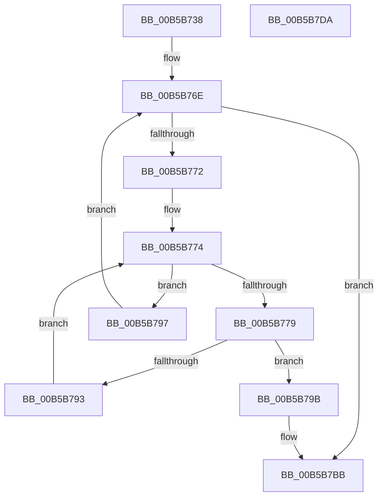

# HalpInitSystemHelper

- RVA: `0x00B5B738`–`0x00B5B7DB` (길이 `163` bytes)
- VA: `0x0000000140B5B738`
- 실행 섹션: `PAGELK`
- PDB 이름 있음: `예`; PDB Function 태그: `아니요`
- unwind 정보 RVA: `0x000847EC`
- 디코드: `51`개 명령, `163/163` bytes 표시
- 미해석 바이트: `0` (있으면 어셈블리에 `.byte`로 보존)

> 이 문서는 커널 이미지의 기계어와 PDB 기호를 분석해 생성했습니다. 4번과 5번은 함수 원형과 자료형을 바이너리 사용 방식에서 추정한 C 해석이며 원본 소스 복구 결과는 아닙니다.

## 1. Dependencies

- 직접 호출 지점: **2**; 고유 호출 대상: **2**
- 직접 호출자로 확인된 함수: **7**
- RIP 상대 이미지 참조: **1**

### Outgoing calls
- `0x00B5B78A` → [guard_dispatch_icall](../../text/6B/guard_dispatch_icall_function_006BAAD0.md) (function, `0x006BAAD0`)
- `0x00B5B7B5` → [KeBugCheckEx](../../text/4F/KeBugCheckEx_function_004FD660.md) (function, `0x004FD660`)

### Direct callers
- [HalInitializeProcessor](../../text/53/HalInitializeProcessor_function_0053D950.md) at `0x0053D96A`
- [HalpInitializeLateSystemActions](../../text/53/HalpInitializeLateSystemActions_function_0053D97C.md) at `0x0053D98A`
- [sub_00B46B8A](../../page/B4/Unknown_function_00B46B8A.md) at `0x00B46C0C`
- [HalpInitSystemPhase1](HalpInitSystemPhase1_function_00B5B7E4.md) at `0x00B5B807`
- [HalAllProcessorsStarted](../../init/C1/HalAllProcessorsStarted_function_00C1DD90.md) at `0x00C1DD9E`
- [HalReportResourceUsage](../../init/C1/HalReportResourceUsage_function_00C1DDC0.md) at `0x00C1DDE8`
- [HalReportResourceUsage](../../init/C1/HalReportResourceUsage_function_00C1DDC0.md) at `0x00C1DE18`
- [HalpInitSystemPhase0](../../init/C1/HalpInitSystemPhase0_function_00C1DE2C.md) at `0x00C1DE3B`

### Static image references
- `0x00B5B75E` → RVA `0x00007080` (`.rdata`; read)

## 2. Other-region calls and transfers

- 다른 실행 섹션으로 향하는 call: **2**
  - `0x00B5B78A` → [guard_dispatch_icall](../../text/6B/guard_dispatch_icall_function_006BAAD0.md) (`PAGELK` → `.text`)
  - `0x00B5B7B5` → [KeBugCheckEx](../../text/4F/KeBugCheckEx_function_004FD660.md) (`PAGELK` → `.text`)
- 별도 외부 분기/꼬리 이동을 확인하지 못했습니다.

## 3. Assembly (complete function range)

```asm
00B5B738  48 8B C4                        mov rax, rsp
00B5B73B  48 89 58 08                     mov qword ptr [rax + 8], rbx
00B5B73F  48 89 68 10                     mov qword ptr [rax + 0x10], rbp
00B5B743  48 89 70 18                     mov qword ptr [rax + 0x18], rsi
00B5B747  48 89 78 20                     mov qword ptr [rax + 0x20], rdi
00B5B74B  41 54                           push r12
00B5B74D  41 56                           push r14
00B5B74F  41 57                           push r15
00B5B751  48 83 EC 30                     sub rsp, 0x30
00B5B755  65 44 8B 3C 25 A4 01 00 00      mov r15d, dword ptr gs:[0x1a4]
00B5B75E  4C 8D 25 1B B9 4A FF            lea r12, [rip - 0xb546e5]
00B5B765  4D 8B F0                        mov r14, r8
00B5B768  8B EA                           mov ebp, edx
00B5B76A  8B D9                           mov ebx, ecx
00B5B76C  33 C0                           xor eax, eax
00B5B76E  3B DD                           cmp ebx, ebp
00B5B770  7F 49                           jg 0x140b5b7bb
00B5B772  33 FF                           xor edi, edi
00B5B774  83 FF 16                        cmp edi, 0x16
00B5B777  73 1E                           jae 0x140b5b797
00B5B779  8B F7                           mov esi, edi
00B5B77B  4D 8B C6                        mov r8, r14
00B5B77E  48 03 F6                        add rsi, rsi
00B5B781  41 8B D7                        mov edx, r15d
00B5B784  8B CB                           mov ecx, ebx
00B5B786  49 8B 04 F4                     mov rax, qword ptr [r12 + rsi*8]
00B5B78A  E8 41 F3 B5 FF                  call 0x1406baad0
00B5B78F  85 C0                           test eax, eax
00B5B791  78 08                           js 0x140b5b79b
00B5B793  FF C7                           inc edi
00B5B795  EB DD                           jmp 0x140b5b774
00B5B797  FF C3                           inc ebx
00B5B799  EB D3                           jmp 0x140b5b76e
00B5B79B  4C 63 C0                        movsxd r8, eax
00B5B79E  BA 00 82 00 00                  mov edx, 0x8200
00B5B7A3  49 8B 44 F4 08                  mov rax, qword ptr [r12 + rsi*8 + 8]
00B5B7A8  B9 5C 00 00 00                  mov ecx, 0x5c
00B5B7AD  4C 63 CB                        movsxd r9, ebx
00B5B7B0  48 89 44 24 20                  mov qword ptr [rsp + 0x20], rax
00B5B7B5  E8 A6 1E 9A FF                  call 0x1404fd660
00B5B7BA  CC                              int3
00B5B7BB  48 8B 5C 24 50                  mov rbx, qword ptr [rsp + 0x50]
00B5B7C0  48 8B 6C 24 58                  mov rbp, qword ptr [rsp + 0x58]
00B5B7C5  48 8B 74 24 60                  mov rsi, qword ptr [rsp + 0x60]
00B5B7CA  48 8B 7C 24 68                  mov rdi, qword ptr [rsp + 0x68]
00B5B7CF  48 83 C4 30                     add rsp, 0x30
00B5B7D3  41 5F                           pop r15
00B5B7D5  41 5E                           pop r14
00B5B7D7  41 5C                           pop r12
00B5B7D9  C3                              ret
00B5B7DA  CC                              int3
```

## 4. C-style interpretation (structured pseudocode)

```c
__int64 __fastcall HalpInitSystemHelper(int a1, int a2, __int64 a3)
{
    __int64 result;
    __int64 v_rbx;
    __int64 v_rdi;
    __int64 v_rsi;
    __int64 v_rsp;
    unsigned __int64 v_stack_m28;
    unsigned __int64 v_stack_p10;
    unsigned __int64 v_stack_p18;
    unsigned __int64 v_stack_p20;
    unsigned __int64 v_stack_p8;

    *(unsigned __int64 *)(v_rsp + 8) = v_rbx;
    *(unsigned __int64 *)(v_rsp + 16) = v_rbp;
    *(unsigned __int64 *)(v_rsp + 24) = v_rsi;
    *(unsigned __int64 *)(v_rsp + 32) = v_rdi;
    v_rsp = (v_rsp) - (48);
    result = 0;
loc_00B5B76E:
    if (((unsigned int)((unsigned int)(a1))) > ((unsigned int)((unsigned int)(a2)))) goto loc_00B5B7BB;
    v_rdi = 0;
loc_00B5B774:
    if (0 >= 22) goto loc_00B5B797;
    v_rsi = (0) + (0);
    result = guard_dispatch_icall((unsigned int)((unsigned int)((unsigned int)(a1))), (unsigned int)((unsigned int)((unsigned int)(*(unsigned int *)(gs_base + (0 + 420))))), a3, a4);
    if (sign_flag) goto loc_00B5B79B;
    v_rdi = (unsigned int)((v_rdi) + 1);
    goto loc_00B5B774;
loc_00B5B797:
    v_rbx = (unsigned int)(((unsigned int)(a1)) + 1);
    goto loc_00B5B76E;
loc_00B5B79B:
    v_stack_m28 = *(unsigned __int64 *)(v_rip - 11880165 + v_rsi * 8 + 8);
    result = KeBugCheckEx(92, (unsigned int)(0x8200ULL), (int)((unsigned int)(result)), (int)((unsigned int)(v_rbx)));
loc_00B5B7BB:
    v_rsp = (v_rsp) + (48);
    return result;
}
```

## 5. (Beta) C Style

```c
int64_t HalpInitSystemHelper(int32_t Arg1, int32_t Arg2, int64_t Arg3)
{
    int64_t result;
    int64_t local_rbx;
    int64_t local_rdi;
    int64_t local_rsi;
    int64_t local_rsp;
    uint64_t v_stack_m28;
    uint64_t v_stack_p10;
    uint64_t v_stack_p18;
    uint64_t v_stack_p20;
    uint64_t v_stack_p8;

    *(uint64_t *)(local_rsp + 0x8) = local_rbx;
    *(uint64_t *)(local_rsp + 0x10) = local_rbp;
    *(uint64_t *)(local_rsp + 0x18) = local_rsi;
    *(uint64_t *)(local_rsp + 0x20) = local_rdi;
    local_rsp = (local_rsp) - (48);
    result = 0;
loc_00B5B76E:
    if (((uint32_t)((uint32_t)(Arg1))) > ((uint32_t)((uint32_t)(Arg2)))) goto loc_00B5B7BB;
    local_rdi = 0;
loc_00B5B774:
    if (0 >= 22) goto loc_00B5B797;
    local_rsi = (0) + (0);
    result = guard_dispatch_icall((uint32_t)((uint32_t)((uint32_t)(Arg1))), (uint32_t)((uint32_t)((uint32_t)(*(uint32_t *)(gs_base + (0 + 0x1A4))))), Arg3, a4);
    if (sign_flag) goto loc_00B5B79B;
    local_rdi = (uint32_t)((local_rdi) + 1);
    goto loc_00B5B774;
loc_00B5B797:
    local_rbx = (uint32_t)(((uint32_t)(Arg1)) + 1);
    goto loc_00B5B76E;
loc_00B5B79B:
    v_stack_m28 = *(uint64_t *)(v_rip - 0xB546E5 + local_rsi * 8 + 0x8);
    result = KeBugCheckEx(92, (uint32_t)(0x8200ULL), (int32_t)((uint32_t)(result)), (int32_t)((uint32_t)(local_rbx)));
loc_00B5B7BB:
    local_rsp = (local_rsp) + (48);
    return result;
}
```

## 6. Execution-region graph

[열기: 2D/3D 그래프와 함수 탐색 컨트롤 패널](../../../control-panel.html?section=pagelk&rva=0x00B5B738&view=graph)

- 2D 그래프는 위에서 아래로 흐르고, 3D 그래프는 빈 공간을 드래그해 회전합니다. Shift+드래그는 이동, 휠은 확대·축소, 함수 노드 선택은 대상 보고서 이동입니다.

### Static fallback


