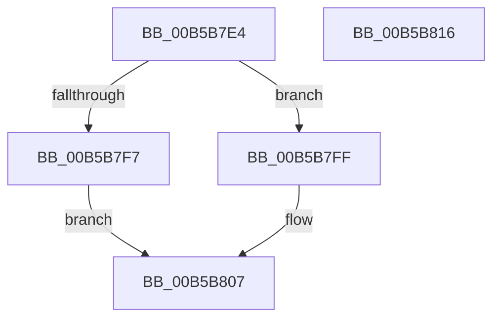

# HalpInitSystemPhase1

- RVA: `0x00B5B7E4`–`0x00B5B817` (길이 `51` bytes)
- VA: `0x0000000140B5B7E4`
- 실행 섹션: `PAGELK`
- PDB 이름 있음: `예`; PDB Function 태그: `아니요`
- unwind 정보 RVA: `0x0005C788`
- 디코드: `16`개 명령, `51/51` bytes 표시
- 미해석 바이트: `0` (있으면 어셈블리에 `.byte`로 보존)

> 이 문서는 커널 이미지의 기계어와 PDB 기호를 분석해 생성했습니다. 4번과 5번은 함수 원형과 자료형을 바이너리 사용 방식에서 추정한 C 해석이며 원본 소스 복구 결과는 아닙니다.

## 1. Dependencies

- 직접 호출 지점: **1**; 고유 호출 대상: **1**
- 직접 호출자로 확인된 함수: **1**
- RIP 상대 이미지 참조: **0**

### Outgoing calls
- `0x00B5B807` → [HalpInitSystemHelper](HalpInitSystemHelper_function_00B5B738.md) (function, `0x00B5B738`)

### Direct callers
- [HalInitSystem](HalInitSystem_function_00B5B6E0.md) at `0x00B5B709`

### Static image references
- 디코드된 RIP-relative 메모리 참조가 없습니다.

## 2. Other-region calls and transfers

- 다른 실행 섹션으로 향하는 call: **0**
- 별도 외부 분기/꼬리 이동을 확인하지 못했습니다.

## 3. Assembly (complete function range)

```asm
00B5B7E4  48 83 EC 28                     sub rsp, 0x28
00B5B7E8  65 8B 04 25 A4 01 00 00         mov eax, dword ptr gs:[0x1a4]
00B5B7F0  4C 8B C1                        mov r8, rcx
00B5B7F3  85 C0                           test eax, eax
00B5B7F5  75 08                           jne 0x140b5b7ff
00B5B7F7  8D 48 11                        lea ecx, [rax + 0x11]
00B5B7FA  8D 50 12                        lea edx, [rax + 0x12]
00B5B7FD  EB 08                           jmp 0x140b5b807
00B5B7FF  B9 13 00 00 00                  mov ecx, 0x13
00B5B804  8D 51 01                        lea edx, [rcx + 1]
00B5B807  E8 2C FF FF FF                  call 0x140b5b738
00B5B80C  85 C0                           test eax, eax
00B5B80E  0F 99 C0                        setns al
00B5B811  48 83 C4 28                     add rsp, 0x28
00B5B815  C3                              ret
00B5B816  CC                              int3
```

## 4. C-style interpretation (structured pseudocode)

```c
__int64 __fastcall HalpInitSystemPhase1(__int64 a1)
{
    __int64 result;
    __int64 v_rsp;

    v_rsp = (v_rsp) - (40);
    if ((unsigned int)((unsigned int)(*(unsigned int *)(gs_base + (0 + 420)))) != 0) goto loc_00B5B7FF;
    goto loc_00B5B807;
loc_00B5B7FF:
loc_00B5B807:
    result = HalpInitSystemHelper(19, 19 + 1, a1, a4);
    result = (!sign_flag) ? 1 : 0;
    v_rsp = (v_rsp) + (40);
    return result;
}
```

## 5. (Beta) C Style

```c
int64_t HalpInitSystemPhase1(int64_t Arg1)
{
    int64_t result;
    int64_t local_rsp;

    local_rsp = (local_rsp) - (40);
    if ((uint32_t)((uint32_t)(*(uint32_t *)(gs_base + (0 + 0x1A4)))) != 0) goto loc_00B5B7FF;
    goto loc_00B5B807;
loc_00B5B7FF:
loc_00B5B807:
    result = HalpInitSystemHelper(19, 19 + 1, Arg1, a4);
    result = (!sign_flag) ? 1 : 0;
    local_rsp = (local_rsp) + (40);
    return result;
}
```

## 6. Execution-region graph

[열기: 2D/3D 그래프와 함수 탐색 컨트롤 패널](../../../control-panel.html?section=pagelk&rva=0x00B5B7E4&view=graph)

- 2D 그래프는 위에서 아래로 흐르고, 3D 그래프는 빈 공간을 드래그해 회전합니다. Shift+드래그는 이동, 휠은 확대·축소, 함수 노드 선택은 대상 보고서 이동입니다.

### Static fallback


