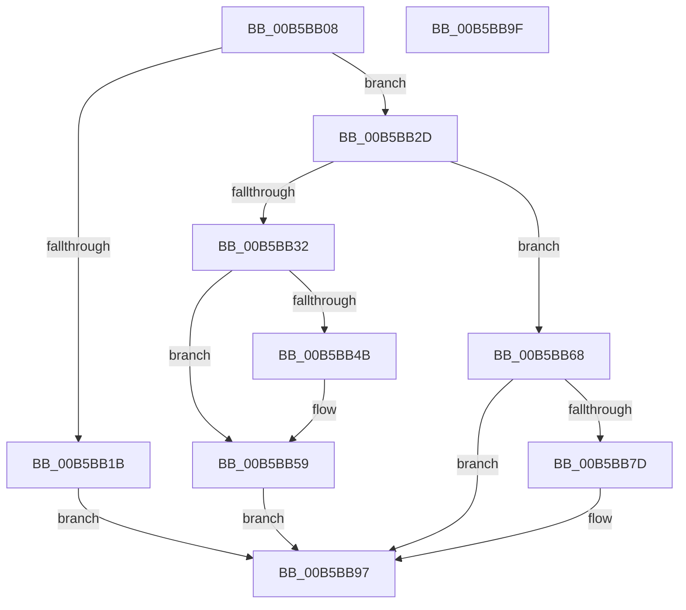

# HalpInitializeCmc

- RVA: `0x00B5BB08`–`0x00B5BBA0` (길이 `152` bytes)
- VA: `0x0000000140B5BB08`
- 실행 섹션: `PAGELK`
- PDB 이름 있음: `예`; PDB Function 태그: `아니요`
- unwind 정보 RVA: `0x0005CF00`
- 디코드: `40`개 명령, `152/152` bytes 표시
- 미해석 바이트: `0` (있으면 어셈블리에 `.byte`로 보존)

> 이 문서는 커널 이미지의 기계어와 PDB 기호를 분석해 생성했습니다. 4번과 5번은 함수 원형과 자료형을 바이너리 사용 방식에서 추정한 C 해석이며 원본 소스 복구 결과는 아닙니다.

## 1. Dependencies

- 직접 호출 지점: **6**; 고유 호출 대상: **5**
- 직접 호출자로 확인된 함수: **1**
- RIP 상대 이미지 참조: **4**

### Outgoing calls
- `0x00B5BB42` → [HalpIsCmciImplemented](HalpIsCmciImplemented_function_00B5C314.md) (function, `0x00B5C314`)
- `0x00B5BB5C` → [HalpCmcInitializePolling](../../text/54/HalpCmcInitializePolling_function_005408E4.md) (function, `0x005408E4`)
- `0x00B5BB61` → [HalpCmcStartPolling](../../text/4F/HalpCmcStartPolling_function_004F8D40.md) (function, `0x004F8D40`)
- `0x00B5BB74` → [HalpIsCmciImplemented](HalpIsCmciImplemented_function_00B5C314.md) (function, `0x00B5C314`)
- `0x00B5BB85` → [HalpCmciInitializeErrorPacket](../../text/48/HalpCmciInitializeErrorPacket_function_00487010.md) (function, `0x00487010`)
- `0x00B5BB92` → [HalpCmciInitProcessor](../../text/48/HalpCmciInitProcessor_function_004875E4.md) (function, `0x004875E4`)

### Direct callers
- [HalpInitializeErrSrc](HalpInitializeErrSrc_function_00B5BBB0.md) at `0x00B5BBEA`

### Static image references
- `0x00B5BB1E` → RVA `0x00E0FC04` (`.data`; write)
- `0x00B5BB24` → RVA `0x00E0F6C8` (`.data`; write)
- `0x00B5BB4B` → RVA `0x00E0F6B8` (`.data`; write)
- `0x00B5BB52` → RVA `0x00E0F6A0` (`.data`; read/write)

## 2. Other-region calls and transfers

- 다른 실행 섹션으로 향하는 call: **4**
  - `0x00B5BB5C` → [HalpCmcInitializePolling](../../text/54/HalpCmcInitializePolling_function_005408E4.md) (`PAGELK` → `.text`)
  - `0x00B5BB61` → [HalpCmcStartPolling](../../text/4F/HalpCmcStartPolling_function_004F8D40.md) (`PAGELK` → `.text`)
  - `0x00B5BB85` → [HalpCmciInitializeErrorPacket](../../text/48/HalpCmciInitializeErrorPacket_function_00487010.md) (`PAGELK` → `.text`)
  - `0x00B5BB92` → [HalpCmciInitProcessor](../../text/48/HalpCmciInitProcessor_function_004875E4.md) (`PAGELK` → `.text`)
- 별도 외부 분기/꼬리 이동을 확인하지 못했습니다.

## 3. Assembly (complete function range)

```asm
00B5BB08  40 53                           push rbx
00B5BB0A  48 83 EC 20                     sub rsp, 0x20
00B5BB0E  48 83 64 24 40 00               and qword ptr [rsp + 0x40], 0
00B5BB14  48 8B DA                        mov rbx, rdx
00B5BB17  85 C9                           test ecx, ecx
00B5BB19  75 12                           jne 0x140b5bb2d
00B5BB1B  8B 42 1C                        mov eax, dword ptr [rdx + 0x1c]
00B5BB1E  89 05 E0 40 2B 00               mov dword ptr [rip + 0x2b40e0], eax
00B5BB24  48 89 15 9D 3B 2B 00            mov qword ptr [rip + 0x2b3b9d], rdx
00B5BB2B  EB 6A                           jmp 0x140b5bb97
00B5BB2D  83 F9 01                        cmp ecx, 1
00B5BB30  75 36                           jne 0x140b5bb68
00B5BB32  8B 42 1C                        mov eax, dword ptr [rdx + 0x1c]
00B5BB35  89 05 C9 40 2B 00               mov dword ptr [rip + 0x2b40c9], eax
00B5BB3B  48 89 1D 86 3B 2B 00            mov qword ptr [rip + 0x2b3b86], rbx
00B5BB42  E8 CD 07 00 00                  call 0x140b5c314
00B5BB47  84 C0                           test al, al
00B5BB49  74 0E                           je 0x140b5bb59
00B5BB4B  C6 05 66 3B 2B 00 01            mov byte ptr [rip + 0x2b3b66], 1
00B5BB52  F0 FF 05 47 3B 2B 00            lock inc dword ptr [rip + 0x2b3b47]
00B5BB59  48 8B CB                        mov rcx, rbx
00B5BB5C  E8 83 4D 9E FF                  call 0x1405408e4
00B5BB61  E8 DA D1 99 FF                  call 0x1404f8d40
00B5BB66  EB 2F                           jmp 0x140b5bb97
00B5BB68  65 8B 04 25 A4 01 00 00         mov eax, dword ptr gs:[0x1a4]
00B5BB70  89 44 24 40                     mov dword ptr [rsp + 0x40], eax
00B5BB74  E8 9B 07 00 00                  call 0x140b5c314
00B5BB79  84 C0                           test al, al
00B5BB7B  74 1A                           je 0x140b5bb97
00B5BB7D  48 8B 54 24 40                  mov rdx, qword ptr [rsp + 0x40]
00B5BB82  48 8B CB                        mov rcx, rbx
00B5BB85  E8 86 B4 92 FF                  call 0x140487010
00B5BB8A  48 8B 54 24 40                  mov rdx, qword ptr [rsp + 0x40]
00B5BB8F  48 8B CB                        mov rcx, rbx
00B5BB92  E8 4D BA 92 FF                  call 0x1404875e4
00B5BB97  33 C0                           xor eax, eax
00B5BB99  48 83 C4 20                     add rsp, 0x20
00B5BB9D  5B                              pop rbx
00B5BB9E  C3                              ret
00B5BB9F  CC                              int3
```

## 4. C-style interpretation (structured pseudocode)

```c
__int64 __fastcall HalpInitializeCmc(int a1, __int64 a2)
{
    __int64 result;
    __int64 v_rsp;
    unsigned __int64 v_stack_p18;

    v_rsp = (v_rsp) - (32);
    if (a1 != 0) goto loc_00B5BB2D;
    *(unsigned int *)(v_rip + 2834656) = (unsigned int)((unsigned int)(*(unsigned int *)(a2 + 28)));
    *(unsigned __int64 *)(v_rip + 2833309) = a2;
    goto loc_00B5BB97;
loc_00B5BB2D:
    if (a1 != 1) goto loc_00B5BB68;
    *(unsigned int *)(v_rip + 2834633) = (unsigned int)((unsigned int)(*(unsigned int *)(a2 + 28)));
    *(unsigned __int64 *)(v_rip + 2833286) = a2;
    result = HalpIsCmciImplemented(a1, a2, a3, a4);
    if ((unsigned __int8)(result) != 0) {
        *(unsigned __int8 *)(v_rip + 2833254) = 1;
    }
    result = HalpCmcInitializePolling(a2, a2, a3, a4);
    result = HalpCmcStartPolling(a2, a2, a3, a4);
    goto loc_00B5BB97;
loc_00B5BB68:
    v_stack_p18 = (unsigned int)((unsigned int)(*(unsigned int *)(gs_base + (0 + 420))));
    result = HalpIsCmciImplemented(a2, a2, a3, a4);
    if ((unsigned __int8)(result) != 0) {
        a2 = v_stack_p18;
        a1 = a2;
        result = HalpCmciInitializeErrorPacket(a1, a2, a3, a4);
        a2 = v_stack_p18;
        a1 = a2;
        result = HalpCmciInitProcessor(a1, a2, a3, a4);
    }
    result = 0;
    v_rsp = (v_rsp) + (32);
    return result;
}
```

## 5. (Beta) C Style

```c
int64_t HalpInitializeCmc(int32_t Arg1, void *Arg2)
{
    uint8_t *arg2 = (uint8_t *)Arg2;

    int64_t result;
    int64_t local_rsp;
    uint64_t v_stack_p18;

    local_rsp = (local_rsp) - (32);
    if (Arg1 != 0) goto loc_00B5BB2D;
    *(uint32_t *)(v_rip + 0x2B40E0) = (uint32_t)((uint32_t)(*(uint32_t *)(arg2 + 0x1C)));
    *(void **)(v_rip + 0x2B3B9D) = Arg2;
    goto loc_00B5BB97;
loc_00B5BB2D:
    if (Arg1 != 1) goto loc_00B5BB68;
    *(uint32_t *)(v_rip + 0x2B40C9) = (uint32_t)((uint32_t)(*(uint32_t *)(arg2 + 0x1C)));
    *(void **)(v_rip + 0x2B3B86) = Arg2;
    result = HalpIsCmciImplemented(Arg1, Arg2, a3, a4);
    if ((uint8_t)(result) != 0) {
        *(uint8_t *)(v_rip + 0x2B3B66) = 1;
    }
    result = HalpCmcInitializePolling(Arg2, Arg2, a3, a4);
    result = HalpCmcStartPolling(Arg2, Arg2, a3, a4);
    goto loc_00B5BB97;
loc_00B5BB68:
    v_stack_p18 = (uint32_t)((uint32_t)(*(uint32_t *)(gs_base + (0 + 0x1A4))));
    result = HalpIsCmciImplemented(Arg2, Arg2, a3, a4);
    if ((uint8_t)(result) != 0) {
        Arg2 = v_stack_p18;
        Arg1 = Arg2;
        result = HalpCmciInitializeErrorPacket(Arg1, Arg2, a3, a4);
        Arg2 = v_stack_p18;
        Arg1 = Arg2;
        result = HalpCmciInitProcessor(Arg1, Arg2, a3, a4);
    }
    result = 0;
    local_rsp = (local_rsp) + (32);
    return result;
}
```

### 관측된 메모리 오프셋

구조체 형식이 확인되지 않은 접근은 인자 기준의 오프셋으로만 기록했습니다.

| 기준 인자 | 오프셋 표현 | 폭 (bit) | 접근 |
|---|---:|---:|---|
| `Arg2` | `+ 0x1C` | `32` | `R` |

## 6. Execution-region graph

[열기: 2D/3D 그래프와 함수 탐색 컨트롤 패널](../../../control-panel.html?section=pagelk&rva=0x00B5BB08&view=graph)

- 2D 그래프는 위에서 아래로 흐르고, 3D 그래프는 빈 공간을 드래그해 회전합니다. Shift+드래그는 이동, 휠은 확대·축소, 함수 노드 선택은 대상 보고서 이동입니다.

### Static fallback


