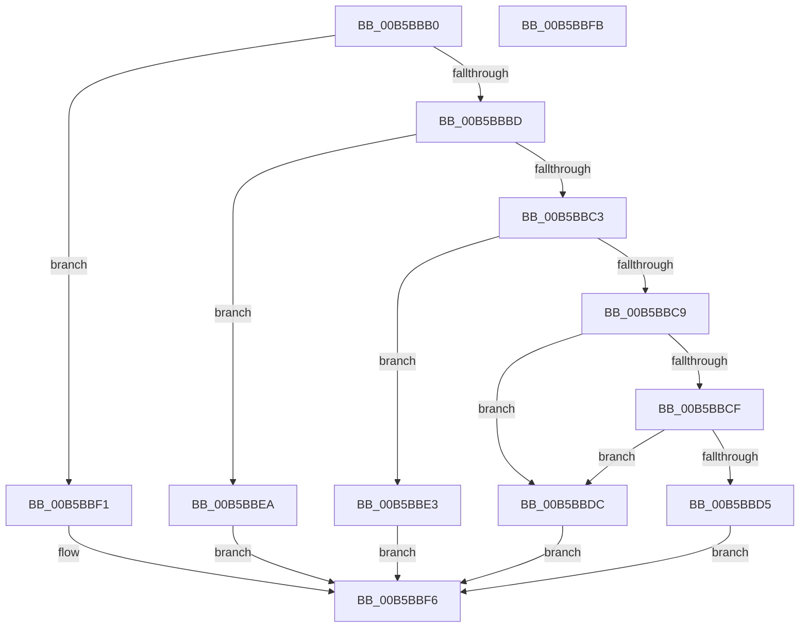

# HalpInitializeErrSrc

- RVA: `0x00B5BBB0`–`0x00B5BBFC` (길이 `76` bytes)
- VA: `0x0000000140B5BBB0`
- 실행 섹션: `PAGELK`
- PDB 이름 있음: `예`; PDB Function 태그: `아니요`
- unwind 정보 RVA: `0x0005C788`
- 디코드: `24`개 명령, `76/76` bytes 표시
- 미해석 바이트: `0` (있으면 어셈블리에 `.byte`로 보존)

> 이 문서는 커널 이미지의 기계어와 PDB 기호를 분석해 생성했습니다. 4번과 5번은 함수 원형과 자료형을 바이너리 사용 방식에서 추정한 C 해석이며 원본 소스 복구 결과는 아닙니다.

## 1. Dependencies

- 직접 호출 지점: **4**; 고유 호출 대상: **4**
- 직접 호출자로 확인된 함수: **0**
- RIP 상대 이미지 참조: **0**

### Outgoing calls
- `0x00B5BBDC` → [HalpInitializeGenericErrorSource](HalpInitializeGenericErrorSource_function_00B5E564.md) (function, `0x00B5E564`)
- `0x00B5BBE3` → [HalpInitializeNMI](../../text/54/HalpInitializeNMI_function_00545B14.md) (function, `0x00545B14`)
- `0x00B5BBEA` → [HalpInitializeCmc](HalpInitializeCmc_function_00B5BB08.md) (function, `0x00B5BB08`)
- `0x00B5BBF1` → [HalpInitializeMce](HalpInitializeMce_function_00B5BC04.md) (function, `0x00B5BC04`)

### Direct callers
- 이 함수 시작 RVA로 연결되는 직접 call은 확인되지 않았습니다. 간접 호출은 완전히 역산할 수 없습니다.

### Static image references
- 디코드된 RIP-relative 메모리 참조가 없습니다.

## 2. Other-region calls and transfers

- 다른 실행 섹션으로 향하는 call: **1**
  - `0x00B5BBE3` → [HalpInitializeNMI](../../text/54/HalpInitializeNMI_function_00545B14.md) (`PAGELK` → `.text`)
- 별도 외부 분기/꼬리 이동을 확인하지 못했습니다.

## 3. Assembly (complete function range)

```asm
00B5BBB0  48 83 EC 28                     sub rsp, 0x28
00B5BBB4  44 8B 42 08                     mov r8d, dword ptr [rdx + 8]
00B5BBB8  45 85 C0                        test r8d, r8d
00B5BBBB  74 34                           je 0x140b5bbf1
00B5BBBD  41 83 E8 01                     sub r8d, 1
00B5BBC1  74 27                           je 0x140b5bbea
00B5BBC3  41 83 E8 02                     sub r8d, 2
00B5BBC7  74 1A                           je 0x140b5bbe3
00B5BBC9  41 83 E8 02                     sub r8d, 2
00B5BBCD  74 0D                           je 0x140b5bbdc
00B5BBCF  41 83 F8 07                     cmp r8d, 7
00B5BBD3  74 07                           je 0x140b5bbdc
00B5BBD5  B8 BB 00 00 C0                  mov eax, 0xc00000bb
00B5BBDA  EB 1A                           jmp 0x140b5bbf6
00B5BBDC  E8 83 29 00 00                  call 0x140b5e564
00B5BBE1  EB 13                           jmp 0x140b5bbf6
00B5BBE3  E8 2C 9F 9E FF                  call 0x140545b14
00B5BBE8  EB 0C                           jmp 0x140b5bbf6
00B5BBEA  E8 19 FF FF FF                  call 0x140b5bb08
00B5BBEF  EB 05                           jmp 0x140b5bbf6
00B5BBF1  E8 0E 00 00 00                  call 0x140b5bc04
00B5BBF6  48 83 C4 28                     add rsp, 0x28
00B5BBFA  C3                              ret
00B5BBFB  CC                              int3
```

## 4. C-style interpretation (structured pseudocode)

```c
__int64 __fastcall HalpInitializeErrSrc(__int64 a1, __int64 a2)
{
    __int64 result;
    __int64 v_rsp;

    v_rsp = (v_rsp) - (40);
    if ((unsigned int)((unsigned int)(*(unsigned int *)(a2 + 8))) == 0) goto loc_00B5BBF1;
    a3 = (unsigned int)(((unsigned int)(*(unsigned int *)(a2 + 8))) - (1));
    if (condition_is_equal) goto loc_00B5BBEA;
    a3 = (unsigned int)((a3) - (2));
    if (condition_is_equal) goto loc_00B5BBE3;
    a3 = (unsigned int)((a3) - (2));
    if (condition_is_equal) goto loc_00B5BBDC;
    if (((unsigned int)(a3)) == 7) goto loc_00B5BBDC;
    goto loc_00B5BBF6;
loc_00B5BBDC:
    result = HalpInitializeGenericErrorSource(a1, a2, a3, a4);
    goto loc_00B5BBF6;
loc_00B5BBE3:
    result = HalpInitializeNMI(a1, a2, a3, a4);
    goto loc_00B5BBF6;
loc_00B5BBEA:
    result = HalpInitializeCmc(a1, a2, a3, a4);
    goto loc_00B5BBF6;
loc_00B5BBF1:
    result = HalpInitializeMce(a1, a2, a3, a4);
loc_00B5BBF6:
    v_rsp = (v_rsp) + (40);
    return result;
}
```

## 5. (Beta) C Style

```c
int64_t HalpInitializeErrSrc(int64_t Arg1, void *Arg2)
{
    uint8_t *arg2 = (uint8_t *)Arg2;

    int64_t result;
    int64_t local_rsp;

    local_rsp = (local_rsp) - (40);
    if ((uint32_t)((uint32_t)(*(uint32_t *)(arg2 + 0x8))) == 0) goto loc_00B5BBF1;
    a3 = (uint32_t)(((uint32_t)(*(uint32_t *)(arg2 + 0x8))) - (1));
    if (condition_is_equal) goto loc_00B5BBEA;
    a3 = (uint32_t)((a3) - (2));
    if (condition_is_equal) goto loc_00B5BBE3;
    a3 = (uint32_t)((a3) - (2));
    if (condition_is_equal) goto loc_00B5BBDC;
    if (((uint32_t)(a3)) == 7) goto loc_00B5BBDC;
    goto loc_00B5BBF6;
loc_00B5BBDC:
    result = HalpInitializeGenericErrorSource(Arg1, Arg2, a3, a4);
    goto loc_00B5BBF6;
loc_00B5BBE3:
    result = HalpInitializeNMI(Arg1, Arg2, a3, a4);
    goto loc_00B5BBF6;
loc_00B5BBEA:
    result = HalpInitializeCmc(Arg1, Arg2, a3, a4);
    goto loc_00B5BBF6;
loc_00B5BBF1:
    result = HalpInitializeMce(Arg1, Arg2, a3, a4);
loc_00B5BBF6:
    local_rsp = (local_rsp) + (40);
    return result;
}
```

### 관측된 메모리 오프셋

구조체 형식이 확인되지 않은 접근은 인자 기준의 오프셋으로만 기록했습니다.

| 기준 인자 | 오프셋 표현 | 폭 (bit) | 접근 |
|---|---:|---:|---|
| `Arg2` | `+ 0x8` | `32` | `R` |

## 6. Execution-region graph

[열기: 2D/3D 그래프와 함수 탐색 컨트롤 패널](../../../control-panel.html?section=pagelk&rva=0x00B5BBB0&view=graph)

- 2D 그래프는 위에서 아래로 흐르고, 3D 그래프는 빈 공간을 드래그해 회전합니다. Shift+드래그는 이동, 휠은 확대·축소, 함수 노드 선택은 대상 보고서 이동입니다.

### Static fallback


