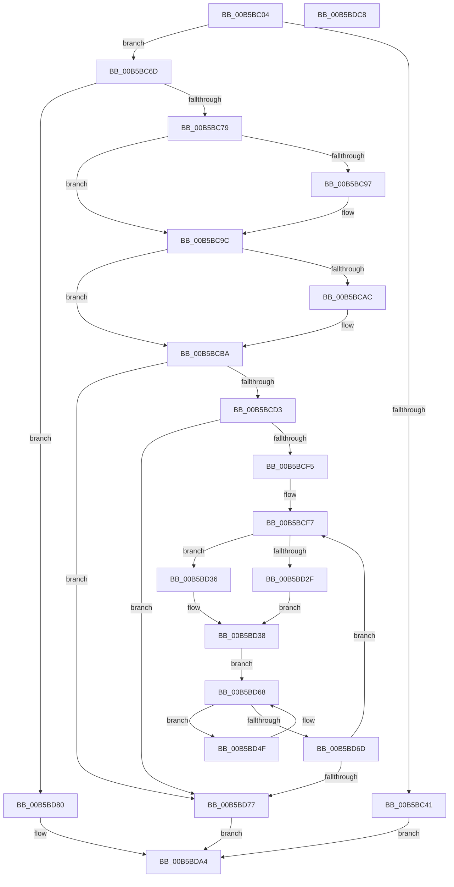

# HalpInitializeMce

- RVA: `0x00B5BC04`–`0x00B5BDC9` (길이 `453` bytes)
- VA: `0x0000000140B5BC04`
- 실행 섹션: `PAGELK`
- PDB 이름 있음: `예`; PDB Function 태그: `아니요`
- unwind 정보 RVA: `0x000C3B3C`
- 디코드: `108`개 명령, `453/453` bytes 표시
- 미해석 바이트: `0` (있으면 어셈블리에 `.byte`로 보존)

> 이 문서는 커널 이미지의 기계어와 PDB 기호를 분석해 생성했습니다. 4번과 5번은 함수 원형과 자료형을 바이너리 사용 방식에서 추정한 C 해석이며 원본 소스 복구 결과는 아닙니다.

## 1. Dependencies

- 직접 호출 지점: **16**; 고유 호출 대상: **15**
- 직접 호출자로 확인된 함수: **1**
- RIP 상대 이미지 참조: **11**

### Outgoing calls
- `0x00B5BC51` → [HalpMcaSetFeatureFlags](HalpMcaSetFeatureFlags_function_00B5C434.md) (function, `0x00B5C434`)
- `0x00B5BC56` → [HalpInitializeGhesRecovery](../../text/55/HalpInitializeGhesRecovery_function_0055680C.md) (function, `0x0055680C`)
- `0x00B5BC5B` → [HalpMceInitializeRecovery](../../text/55/HalpMceInitializeRecovery_function_00555D14.md) (function, `0x00555D14`)
- `0x00B5BC63` → [HalpMceInit](../B7/HalpMceInit_function_00B7B144.md) (function, `0x00B7B144`)
- `0x00B5BC89` → [HalpMceInit](../B7/HalpMceInit_function_00B7B144.md) (function, `0x00B7B144`)
- `0x00B5BC97` → [HalpMcaExtendedLogInitialize](../../text/54/HalpMcaExtendedLogInitialize_function_0054162C.md) (function, `0x0054162C`)
- `0x00B5BC9C` → `PSHED.dll!PshedIsSystemWheaEnabled` (import, 간접 대상; import `PSHED.dll!PshedIsSystemWheaEnabled`)
- `0x00B5BCB5` → [HalpHandlePreviousMcaErrors](HalpHandlePreviousMcaErrors_function_00B5B8E4.md) (function, `0x00B5B8E4`)
- `0x00B5BCBF` → `PSHED.dll!PshedInitAvailable` (import, 간접 대상; import `PSHED.dll!PshedInitAvailable`)
- `0x00B5BCD3` → `PSHED.dll!PshedInitGlobal` (import, 간접 대상; import `PSHED.dll!PshedInitGlobal`)
- `0x00B5BCE4` → [KeQueryActiveProcessorCountEx](../../text/24/KeQueryActiveProcessorCountEx_function_00249EF0.md) (function, `0x00249EF0`)
- `0x00B5BD38` → [KeSetSystemGroupAffinityThread](../../text/39/KeSetSystemGroupAffinityThread_function_00399140.md) (function, `0x00399140`)
- `0x00B5BD55` → `PSHED.dll!PshedInitProc` (import, 간접 대상; import `PSHED.dll!PshedInitProc`)
- `0x00B5BD91` → [HalpMceInitProcessor](../B7/HalpMceInitProcessor_function_00B7B298.md) (function, `0x00B7B298`)
- `0x00B5BD9F` → [HalpHandlePreviousMcaErrorsOnProcessor](HalpHandlePreviousMcaErrorsOnProcessor_function_00B5BA2C.md) (function, `0x00B5BA2C`)
- `0x00B5BDAE` → [_security_check_cookie](../../text/6A/_security_check_cookie_function_006AC640.md) (function, `0x006AC640`)

### Direct callers
- [HalpInitializeErrSrc](HalpInitializeErrSrc_function_00B5BBB0.md) at `0x00B5BBF1`

### Static image references
- `0x00B5BC18` → RVA `0x00E0A740` (`.data`; read)
- `0x00B5BC44` → RVA `0x00E100E4` (`.data`; write)
- `0x00B5BC4A` → RVA `0x00E0F6F0` (`.data`; write)
- `0x00B5BC8E` → RVA `0x00E100C0` (`.data`; read)
- `0x00B5BC9C` → RVA `0x00151130` (`PSHED.dll!PshedIsSystemWheaEnabled (IAT)`; read)
- `0x00B5BCAC` → RVA `0x00E0F6B0` (`.data`; read)
- `0x00B5BCBF` → RVA `0x00151140` (`PSHED.dll!PshedInitAvailable (IAT)`; read)
- `0x00B5BCD3` → RVA `0x00151138` (`PSHED.dll!PshedInitGlobal (IAT)`; read)
- `0x00B5BCF7` → RVA `0x00F231B0` (`.data`; read)
- `0x00B5BD55` → RVA `0x00151128` (`PSHED.dll!PshedInitProc (IAT)`; read)
- `0x00B5BD77` → RVA `0x00E0FC02` (`.data`; write)

## 2. Other-region calls and transfers

- 다른 실행 섹션으로 향하는 call: **6**
  - `0x00B5BC56` → [HalpInitializeGhesRecovery](../../text/55/HalpInitializeGhesRecovery_function_0055680C.md) (`PAGELK` → `.text`)
  - `0x00B5BC5B` → [HalpMceInitializeRecovery](../../text/55/HalpMceInitializeRecovery_function_00555D14.md) (`PAGELK` → `.text`)
  - `0x00B5BC97` → [HalpMcaExtendedLogInitialize](../../text/54/HalpMcaExtendedLogInitialize_function_0054162C.md) (`PAGELK` → `.text`)
  - `0x00B5BCE4` → [KeQueryActiveProcessorCountEx](../../text/24/KeQueryActiveProcessorCountEx_function_00249EF0.md) (`PAGELK` → `.text`)
  - `0x00B5BD38` → [KeSetSystemGroupAffinityThread](../../text/39/KeSetSystemGroupAffinityThread_function_00399140.md) (`PAGELK` → `.text`)
  - `0x00B5BDAE` → [_security_check_cookie](../../text/6A/_security_check_cookie_function_006AC640.md) (`PAGELK` → `.text`)
- 별도 외부 분기/꼬리 이동을 확인하지 못했습니다.

## 3. Assembly (complete function range)

```asm
00B5BC04  48 89 5C 24 08                  mov qword ptr [rsp + 8], rbx
00B5BC09  48 89 6C 24 10                  mov qword ptr [rsp + 0x10], rbp
00B5BC0E  48 89 74 24 18                  mov qword ptr [rsp + 0x18], rsi
00B5BC13  57                              push rdi
00B5BC14  48 83 EC 50                     sub rsp, 0x50
00B5BC18  48 8B 05 21 EB 2A 00            mov rax, qword ptr [rip + 0x2aeb21]
00B5BC1F  48 33 C4                        xor rax, rsp
00B5BC22  48 89 44 24 48                  mov qword ptr [rsp + 0x48], rax
00B5BC27  48 83 64 24 20 00               and qword ptr [rsp + 0x20], 0
00B5BC2D  0F 57 C0                        xorps xmm0, xmm0
00B5BC30  48 8B DA                        mov rbx, rdx
00B5BC33  0F 11 44 24 28                  movups xmmword ptr [rsp + 0x28], xmm0
00B5BC38  0F 11 44 24 38                  movups xmmword ptr [rsp + 0x38], xmm0
00B5BC3D  85 C9                           test ecx, ecx
00B5BC3F  75 2C                           jne 0x140b5bc6d
00B5BC41  8B 42 1C                        mov eax, dword ptr [rdx + 0x1c]
00B5BC44  89 05 9A 44 2B 00               mov dword ptr [rip + 0x2b449a], eax
00B5BC4A  48 89 15 9F 3A 2B 00            mov qword ptr [rip + 0x2b3a9f], rdx
00B5BC51  E8 DE 07 00 00                  call 0x140b5c434
00B5BC56  E8 B1 AB 9F FF                  call 0x14055680c
00B5BC5B  E8 B4 A0 9F FF                  call 0x140555d14
00B5BC60  48 8B CB                        mov rcx, rbx
00B5BC63  E8 DC F4 01 00                  call 0x140b7b144
00B5BC68  E9 37 01 00 00                  jmp 0x140b5bda4
00B5BC6D  83 F9 01                        cmp ecx, 1
00B5BC70  48 8B CB                        mov rcx, rbx
00B5BC73  0F 85 07 01 00 00               jne 0x140b5bd80
00B5BC79  8B 42 1C                        mov eax, dword ptr [rdx + 0x1c]
00B5BC7C  89 05 62 44 2B 00               mov dword ptr [rip + 0x2b4462], eax
00B5BC82  48 89 1D 67 3A 2B 00            mov qword ptr [rip + 0x2b3a67], rbx
00B5BC89  E8 B6 F4 01 00                  call 0x140b7b144
00B5BC8E  80 3D 2B 44 2B 00 00            cmp byte ptr [rip + 0x2b442b], 0
00B5BC95  74 05                           je 0x140b5bc9c
00B5BC97  E8 90 59 9E FF                  call 0x14054162c
00B5BC9C  48 FF 15 8D 54 5F FF            call qword ptr [rip - 0xa0ab73]
00B5BCA3  0F 1F 44 00 00                  nop dword ptr [rax + rax]
00B5BCA8  84 C0                           test al, al
00B5BCAA  75 0E                           jne 0x140b5bcba
00B5BCAC  38 05 FE 39 2B 00               cmp byte ptr [rip + 0x2b39fe], al
00B5BCB2  0F 95 C1                        setne cl
00B5BCB5  E8 2A FC FF FF                  call 0x140b5b8e4
00B5BCBA  F0 83 0C 24 00                  lock or dword ptr [rsp], 0
00B5BCBF  48 FF 15 7A 54 5F FF            call qword ptr [rip - 0xa0ab86]
00B5BCC6  0F 1F 44 00 00                  nop dword ptr [rax + rax]
00B5BCCB  84 C0                           test al, al
00B5BCCD  0F 84 A4 00 00 00               je 0x140b5bd77
00B5BCD3  48 FF 15 5E 54 5F FF            call qword ptr [rip - 0xa0aba2]
00B5BCDA  0F 1F 44 00 00                  nop dword ptr [rax + rax]
00B5BCDF  B9 FF FF 00 00                  mov ecx, 0xffff
00B5BCE4  E8 07 E2 6E FF                  call 0x140249ef0
00B5BCE9  33 FF                           xor edi, edi
00B5BCEB  8B E8                           mov ebp, eax
00B5BCED  85 C0                           test eax, eax
00B5BCEF  0F 84 82 00 00 00               je 0x140b5bd77
00B5BCF5  33 F6                           xor esi, esi
00B5BCF7  48 8B 0D B2 74 3C 00            mov rcx, qword ptr [rip + 0x3c74b2]
00B5BCFE  33 C0                           xor eax, eax
00B5BD00  89 44 24 32                     mov dword ptr [rsp + 0x32], eax
00B5BD04  66 89 44 24 36                  mov word ptr [rsp + 0x36], ax
00B5BD09  B8 01 00 00 00                  mov eax, 1
00B5BD0E  8B 0C 0E                        mov ecx, dword ptr [rsi + rcx]
00B5BD11  8B D1                           mov edx, ecx
00B5BD13  83 E1 3F                        and ecx, 0x3f
00B5BD16  C1 EA 06                        shr edx, 6
00B5BD19  48 D3 E0                        shl rax, cl
00B5BD1C  48 8D 4C 24 28                  lea rcx, [rsp + 0x28]
00B5BD21  66 89 54 24 30                  mov word ptr [rsp + 0x30], dx
00B5BD26  48 89 44 24 28                  mov qword ptr [rsp + 0x28], rax
00B5BD2B  85 FF                           test edi, edi
00B5BD2D  75 07                           jne 0x140b5bd36
00B5BD2F  48 8D 54 24 38                  lea rdx, [rsp + 0x38]
00B5BD34  EB 02                           jmp 0x140b5bd38
00B5BD36  33 D2                           xor edx, edx
00B5BD38  E8 03 D4 83 FF                  call 0x140399140
00B5BD3D  65 48 8B 04 25 18 00 00 00      mov rax, qword ptr gs:[0x18]
00B5BD46  48 8B 98 D8 00 00 00            mov rbx, qword ptr [rax + 0xd8]
00B5BD4D  EB 19                           jmp 0x140b5bd68
00B5BD4F  8B 8B AC 00 00 00               mov ecx, dword ptr [rbx + 0xac]
00B5BD55  48 FF 15 CC 53 5F FF            call qword ptr [rip - 0xa0ac34]
00B5BD5C  0F 1F 44 00 00                  nop dword ptr [rax + rax]
00B5BD61  48 8B 9B B8 00 00 00            mov rbx, qword ptr [rbx + 0xb8]
00B5BD68  48 85 DB                        test rbx, rbx
00B5BD6B  75 E2                           jne 0x140b5bd4f
00B5BD6D  FF C7                           inc edi
00B5BD6F  48 83 C6 04                     add rsi, 4
00B5BD73  3B FD                           cmp edi, ebp
00B5BD75  72 80                           jb 0x140b5bcf7
00B5BD77  C6 05 84 3E 2B 00 01            mov byte ptr [rip + 0x2b3e84], 1
00B5BD7E  EB 24                           jmp 0x140b5bda4
00B5BD80  65 8B 04 25 A4 01 00 00         mov eax, dword ptr gs:[0x1a4]
00B5BD88  89 44 24 20                     mov dword ptr [rsp + 0x20], eax
00B5BD8C  48 8B 54 24 20                  mov rdx, qword ptr [rsp + 0x20]
00B5BD91  E8 02 F5 01 00                  call 0x140b7b298
00B5BD96  4C 8B 44 24 20                  mov r8, qword ptr [rsp + 0x20]
00B5BD9B  33 D2                           xor edx, edx
00B5BD9D  33 C9                           xor ecx, ecx
00B5BD9F  E8 88 FC FF FF                  call 0x140b5ba2c
00B5BDA4  33 C0                           xor eax, eax
00B5BDA6  48 8B 4C 24 48                  mov rcx, qword ptr [rsp + 0x48]
00B5BDAB  48 33 CC                        xor rcx, rsp
00B5BDAE  E8 8D 08 B5 FF                  call 0x1406ac640
00B5BDB3  48 8B 5C 24 60                  mov rbx, qword ptr [rsp + 0x60]
00B5BDB8  48 8B 6C 24 68                  mov rbp, qword ptr [rsp + 0x68]
00B5BDBD  48 8B 74 24 70                  mov rsi, qword ptr [rsp + 0x70]
00B5BDC2  48 83 C4 50                     add rsp, 0x50
00B5BDC6  5F                              pop rdi
00B5BDC7  C3                              ret
00B5BDC8  CC                              int3
```

## 4. C-style interpretation (structured pseudocode)

```c
__int64 __fastcall HalpInitializeMce(int a1, __int64 a2)
{
    __int64 result;
    __int64 v_rdi;
    __int64 v_rsi;
    __int64 v_rsp;
    unsigned __int64 v_stack_m10;
    unsigned __int64 v_stack_m20;
    unsigned __int16 v_stack_m22;
    unsigned int v_stack_m26;
    unsigned __int16 v_stack_m28;
    unsigned __int64 v_stack_m30;
    unsigned __int64 v_stack_m38;
    unsigned int v_stack_m58;
    unsigned __int64 v_stack_p10;
    unsigned __int64 v_stack_p18;
    unsigned __int64 v_stack_p8;

    v_stack_p8 = v_rbx;
    v_stack_p10 = v_rbp;
    v_stack_p18 = v_rsi;
    v_rsp = (v_rsp) - (80);
    result = (*(unsigned __int64 *)(v_rip + 2812705)) ^ (v_rsp);
    v_stack_m10 = result;
    v_stack_m30 = v_xmm0;
    v_stack_m20 = v_xmm0;
    if (a1 != 0) goto loc_00B5BC6D;
    *(unsigned int *)(v_rip + 2835610) = (unsigned int)((unsigned int)(*(unsigned int *)(a2 + 28)));
    *(unsigned __int64 *)(v_rip + 2833055) = a2;
    result = HalpMcaSetFeatureFlags(a1, a2, a3, a4);
    result = HalpInitializeGhesRecovery(a1, a2, a3, a4);
    result = HalpMceInitializeRecovery(a1, a2, a3, a4);
    result = HalpMceInit(a2, a2, a3, a4);
    goto loc_00B5BDA4;
loc_00B5BC6D:
    if (((unsigned int)(a2)) != 1) goto loc_00B5BD80;
    *(unsigned int *)(v_rip + 2835554) = (unsigned int)((unsigned int)(*(unsigned int *)(a2 + 28)));
    *(unsigned __int64 *)(v_rip + 2832999) = a2;
    result = HalpMceInit(a2, a2, a3, a4);
    if ((*(unsigned __int8 *)(v_rip + 2835499)) != 0) {
        result = HalpMcaExtendedLogInitialize(a2, a2, a3, a4);
    }
    result = PSHED_dll_PshedIsSystemWheaEnabled(a2, a2, a3, a4);
    if ((unsigned __int8)(result) == 0) {
        a1 = ((*(unsigned __int8 *)(v_rip + 2832894)) != ((unsigned __int8)(result))) ? 1 : 0;
        result = HalpHandlePreviousMcaErrors(a1, a2, a3, a4);
    }
    result = PSHED_dll_PshedInitAvailable(a1, a2, a3, a4);
    if ((unsigned __int8)(result) == 0) goto loc_00B5BD77;
    result = PSHED_dll_PshedInitGlobal(a1, a2, a3, a4);
    result = KeQueryActiveProcessorCountEx((unsigned int)(0xFFFFULL), a2, a3, a4);
    v_rdi = 0;
    if ((unsigned int)(result) == 0) goto loc_00B5BD77;
    v_rsi = 0;
loc_00B5BCF7:
    result = 0;
    v_stack_m26 = 0;
    v_stack_m22 = 0;
    a1 = (unsigned int)(((unsigned int)(*(unsigned int *)(v_rsi + *(unsigned __int64 *)(v_rip + 3962034) * 1))) & (63));
    a2 = (unsigned int)(((unsigned int)((unsigned int)((unsigned int)(*(unsigned int *)(v_rsi + *(unsigned __int64 *)(v_rip + 3962034) * 1))))) >> (6));
    result = (1) << ((unsigned __int8)(a1));
    v_stack_m28 = (unsigned __int16)(a2);
    v_stack_m30 = result;
    if (0 != 0) goto loc_00B5BD36;
    goto loc_00B5BD38;
loc_00B5BD36:
    a2 = 0;
loc_00B5BD38:
    result = KeSetSystemGroupAffinityThread(v_stack_m30, a2, a3, a4);
    goto loc_00B5BD68;
loc_00B5BD4F:
    result = PSHED_dll_PshedInitProc((unsigned int)(*(unsigned int *)(*(unsigned __int64 *)(*(unsigned __int64 *)(gs_base + (0 + 24)) + 216) + 172)), a2, a3, a4);
loc_00B5BD68:
    if (*(unsigned __int64 *)(*(unsigned __int64 *)(*(unsigned __int64 *)(gs_base + (0 + 24)) + 216) + 184) != 0) goto loc_00B5BD4F;
    v_rdi = (unsigned int)((v_rdi) + 1);
    v_rsi = (v_rsi) + (4);
    if (((unsigned int)(v_rdi)) < ((unsigned int)((unsigned int)((unsigned int)(result))))) goto loc_00B5BCF7;
loc_00B5BD77:
    *(unsigned __int8 *)(v_rip + 2834052) = 1;
    goto loc_00B5BDA4;
loc_00B5BD80:
    v_stack_m38 = (unsigned int)((unsigned int)(*(unsigned int *)(gs_base + (0 + 420))));
    result = HalpMceInitProcessor((unsigned int)(*(unsigned int *)(*(unsigned __int64 *)(*(unsigned __int64 *)(gs_base + (0 + 24)) + 216) + 172)), v_stack_m38, a3, a4);
    a2 = 0;
    a1 = 0;
    result = HalpHandlePreviousMcaErrorsOnProcessor(a1, a2, v_stack_m38, a4);
loc_00B5BDA4:
    result = 0;
    a1 = (v_stack_m10) ^ (v_rsp);
    result = _security_check_cookie(a1, a2, v_stack_m38, a4);
    v_rsp = (v_rsp) + (80);
    return result;
}
```

## 5. (Beta) C Style

```c
int64_t HalpInitializeMce(int32_t Arg1, void *Arg2)
{
    uint8_t *arg2 = (uint8_t *)Arg2;

    int64_t result;
    int64_t local_rdi;
    int64_t local_rsi;
    int64_t local_rsp;
    uint64_t v_stack_m10;
    uint64_t v_stack_m20;
    uint16_t v_stack_m22;
    uint32_t v_stack_m26;
    uint16_t v_stack_m28;
    uint64_t v_stack_m30;
    uint64_t v_stack_m38;
    uint32_t v_stack_m58;
    uint64_t v_stack_p10;
    uint64_t v_stack_p18;
    uint64_t v_stack_p8;

    v_stack_p8 = local_rbx;
    v_stack_p10 = local_rbp;
    v_stack_p18 = local_rsi;
    local_rsp = (local_rsp) - (80);
    result = (*(uint64_t *)(v_rip + 0x2AEB21)) ^ (local_rsp);
    v_stack_m10 = result;
    v_stack_m30 = v_xmm0;
    v_stack_m20 = v_xmm0;
    if (Arg1 != 0) goto loc_00B5BC6D;
    *(uint32_t *)(v_rip + 0x2B449A) = (uint32_t)((uint32_t)(*(uint32_t *)(arg2 + 0x1C)));
    *(void **)(v_rip + 0x2B3A9F) = Arg2;
    result = HalpMcaSetFeatureFlags(Arg1, Arg2, a3, a4);
    result = HalpInitializeGhesRecovery(Arg1, Arg2, a3, a4);
    result = HalpMceInitializeRecovery(Arg1, Arg2, a3, a4);
    result = HalpMceInit(Arg2, Arg2, a3, a4);
    goto loc_00B5BDA4;
loc_00B5BC6D:
    if (((uint32_t)(Arg2)) != 1) goto loc_00B5BD80;
    *(uint32_t *)(v_rip + 0x2B4462) = (uint32_t)((uint32_t)(*(uint32_t *)(arg2 + 0x1C)));
    *(void **)(v_rip + 0x2B3A67) = Arg2;
    result = HalpMceInit(Arg2, Arg2, a3, a4);
    if ((*(uint8_t *)(v_rip + 0x2B442B)) != 0) {
        result = HalpMcaExtendedLogInitialize(Arg2, Arg2, a3, a4);
    }
    result = kernel_indirect_call(Arg2, Arg2, a3, a4);
    if ((uint8_t)(result) == 0) {
        Arg1 = ((*(uint8_t *)(v_rip + 0x2B39FE)) != ((uint8_t)(result))) ? 1 : 0;
        result = HalpHandlePreviousMcaErrors(Arg1, Arg2, a3, a4);
    }
    result = kernel_indirect_call(Arg1, Arg2, a3, a4);
    if ((uint8_t)(result) == 0) goto loc_00B5BD77;
    result = kernel_indirect_call(Arg1, Arg2, a3, a4);
    result = KeQueryActiveProcessorCountEx((uint32_t)(0xFFFFULL), Arg2, a3, a4);
    local_rdi = 0;
    if ((uint32_t)(result) == 0) goto loc_00B5BD77;
    local_rsi = 0;
loc_00B5BCF7:
    result = 0;
    v_stack_m26 = 0;
    v_stack_m22 = 0;
    Arg1 = (uint32_t)(((uint32_t)(*(uint32_t *)(local_rsi + *(uint64_t *)(v_rip + 0x3C74B2) * 1))) & (63));
    Arg2 = (uint32_t)(((uint32_t)((uint32_t)((uint32_t)(*(uint32_t *)(local_rsi + *(uint64_t *)(v_rip + 0x3C74B2) * 1))))) >> (6));
    result = (1) << ((uint8_t)(Arg1));
    v_stack_m28 = (uint16_t)(Arg2);
    v_stack_m30 = result;
    if (0 != 0) goto loc_00B5BD36;
    goto loc_00B5BD38;
loc_00B5BD36:
    Arg2 = 0;
loc_00B5BD38:
    result = KeSetSystemGroupAffinityThread(v_stack_m30, Arg2, a3, a4);
    goto loc_00B5BD68;
loc_00B5BD4F:
    result = kernel_indirect_call((uint32_t)(*(uint32_t *)(*(uint64_t *)(*(uint64_t *)(gs_base + (0 + 0x18)) + 0xD8) + 0xAC)), Arg2, a3, a4);
loc_00B5BD68:
    if (*(uint64_t *)(*(uint64_t *)(*(uint64_t *)(gs_base + (0 + 0x18)) + 0xD8) + 0xB8) != 0) goto loc_00B5BD4F;
    local_rdi = (uint32_t)((local_rdi) + 1);
    local_rsi = (local_rsi) + (4);
    if (((uint32_t)(local_rdi)) < ((uint32_t)((uint32_t)((uint32_t)(result))))) goto loc_00B5BCF7;
loc_00B5BD77:
    *(uint8_t *)(v_rip + 0x2B3E84) = 1;
    goto loc_00B5BDA4;
loc_00B5BD80:
    v_stack_m38 = (uint32_t)((uint32_t)(*(uint32_t *)(gs_base + (0 + 0x1A4))));
    result = HalpMceInitProcessor((uint32_t)(*(uint32_t *)(*(uint64_t *)(*(uint64_t *)(gs_base + (0 + 0x18)) + 0xD8) + 0xAC)), v_stack_m38, a3, a4);
    Arg2 = 0;
    Arg1 = 0;
    result = HalpHandlePreviousMcaErrorsOnProcessor(Arg1, Arg2, v_stack_m38, a4);
loc_00B5BDA4:
    result = 0;
    Arg1 = (v_stack_m10) ^ (local_rsp);
    result = _security_check_cookie(Arg1, Arg2, v_stack_m38, a4);
    local_rsp = (local_rsp) + (80);
    return result;
}
```

### 관측된 메모리 오프셋

구조체 형식이 확인되지 않은 접근은 인자 기준의 오프셋으로만 기록했습니다.

| 기준 인자 | 오프셋 표현 | 폭 (bit) | 접근 |
|---|---:|---:|---|
| `Arg2` | `+ 0x1C` | `32` | `R` |

## 6. Execution-region graph

[열기: 2D/3D 그래프와 함수 탐색 컨트롤 패널](../../../control-panel.html?section=pagelk&rva=0x00B5BC04&view=graph)

- 2D 그래프는 위에서 아래로 흐르고, 3D 그래프는 빈 공간을 드래그해 회전합니다. Shift+드래그는 이동, 휠은 확대·축소, 함수 노드 선택은 대상 보고서 이동입니다.

### Static fallback


