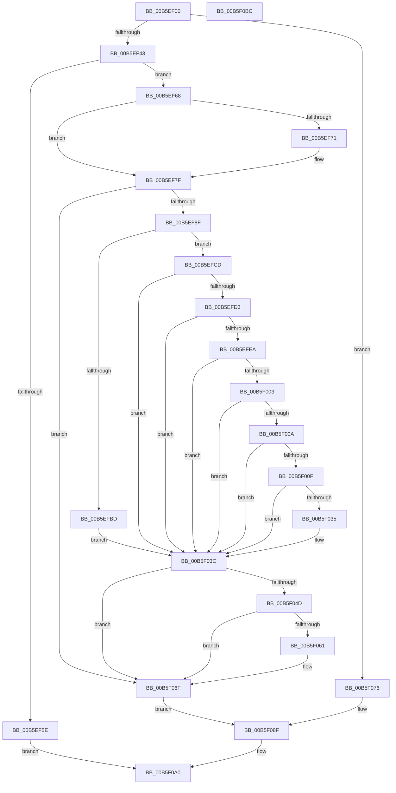

# HalpInitializeProfiling

- RVA: `0x00B5EF00`–`0x00B5F0BD` (길이 `445` bytes)
- VA: `0x0000000140B5EF00`
- 실행 섹션: `PAGELK`
- PDB 이름 있음: `예`; PDB Function 태그: `아니요`
- unwind 정보 RVA: `0x000C48CC`
- 디코드: `114`개 명령, `445/445` bytes 표시
- 미해석 바이트: `0` (있으면 어셈블리에 `.byte`로 보존)

> 이 문서는 커널 이미지의 기계어와 PDB 기호를 분석해 생성했습니다. 4번과 5번은 함수 원형과 자료형을 바이너리 사용 방식에서 추정한 C 해석이며 원본 소스 복구 결과는 아닙니다.

## 1. Dependencies

- 직접 호출 지점: **12**; 고유 호출 대상: **10**
- 직접 호출자로 확인된 함수: **1**
- RIP 상대 이미지 참조: **13**

### Outgoing calls
- `0x00B5EF43` → [HalpQueryMaximumRegisteredProcessorCount](../../text/54/HalpQueryMaximumRegisteredProcessorCount_function_00543BE8.md) (function, `0x00543BE8`)
- `0x00B5EF50` → [HalpMmAllocateMemory](../../text/54/HalpMmAllocateMemory_function_00544974.md) (function, `0x00544974`)
- `0x00B5EF68` → [Feature_Test52061194__private_IsEnabledDeviceUsageNoInline](../../text/4F/Feature_Test52061194__private_IsEnabledDeviceUsageNoInline_function_004F74D4.md) (function, `0x004F74D4`)
- `0x00B5EF7A` → [memset](../../text/6C/memset_function_006C6C40.md) (function, `0x006C6C40`)
- `0x00B5EFB4` → [strncmp](../../text/6C/strncmp_function_006C6720.md) (function, `0x006C6720`)
- `0x00B5EFE1` → [strncmp](../../text/6C/strncmp_function_006C6720.md) (function, `0x006C6720`)
- `0x00B5F00F` → [Feature_Test52061194__private_IsEnabledDeviceUsageNoInline](../../text/4F/Feature_Test52061194__private_IsEnabledDeviceUsageNoInline_function_004F74D4.md) (function, `0x004F74D4`)
- `0x00B5F044` → [HalpIsMicrosoftCompatibleHvLoaded](../../text/4A/HalpIsMicrosoftCompatibleHvLoaded_function_004AFAAC.md) (function, `0x004AFAAC`)
- `0x00B5F056` → [HalpHvCpuid](../../text/54/HalpHvCpuid_function_0054C010.md) (function, `0x0054C010`)
- `0x00B5F06F` → [HalpLbrInitialize](../B6/HalpLbrInitialize_function_00B60F78.md) (function, `0x00B60F78`)
- `0x00B5F099` → [guard_dispatch_icall](../../text/6B/guard_dispatch_icall_function_006BAAD0.md) (function, `0x006BAAD0`)
- `0x00B5F0A7` → [_security_check_cookie](../../text/6A/_security_check_cookie_function_006AC640.md) (function, `0x006AC640`)

### Direct callers
- [HalpHwPerfCntInitSystem](HalpHwPerfCntInitSystem_function_00B5C590.md) at `0x00B5C5D1`
- [HalpHwPerfCntInitSystem](HalpHwPerfCntInitSystem_function_00B5C590.md) at `0x00B5C653`

### Static image references
- `0x00B5EF12` → RVA `0x00E0A740` (`.data`; read)
- `0x00B5EF7F` → RVA `0x00FC1C44` (`.data`; read)
- `0x00B5EFA6` → RVA `0x00025A80` (`.rdata`; read)
- `0x00B5EFBD` → RVA `0x000078F0` (`.rdata`; read)
- `0x00B5EFC4` → RVA `0x00E03B20` (`.data`; write)
- `0x00B5EFD6` → RVA `0x00025A90` (`.rdata`; read)
- `0x00B5F016` → RVA `0x00002A40` (`.rdata`; read)
- `0x00B5F01D` → RVA `0x00007850` (`.rdata`; read)
- `0x00B5F035` → RVA `0x00FC2C38` (`.data`; read/write)
- `0x00B5F03C` → RVA `0x00E10310` (`.data`; read/write)
- `0x00B5F061` → RVA `0x000071E0` (`.rdata`; read)
- `0x00B5F076` → RVA `0x00FC8C40` (`ALMOSTRO`; read)
- `0x00B5F08F` → RVA `0x00E03B20` (`.data`; read)

## 2. Other-region calls and transfers

- 다른 실행 섹션으로 향하는 call: **11**
  - `0x00B5EF43` → [HalpQueryMaximumRegisteredProcessorCount](../../text/54/HalpQueryMaximumRegisteredProcessorCount_function_00543BE8.md) (`PAGELK` → `.text`)
  - `0x00B5EF50` → [HalpMmAllocateMemory](../../text/54/HalpMmAllocateMemory_function_00544974.md) (`PAGELK` → `.text`)
  - `0x00B5EF68` → [Feature_Test52061194__private_IsEnabledDeviceUsageNoInline](../../text/4F/Feature_Test52061194__private_IsEnabledDeviceUsageNoInline_function_004F74D4.md) (`PAGELK` → `.text`)
  - `0x00B5EF7A` → [memset](../../text/6C/memset_function_006C6C40.md) (`PAGELK` → `.text`)
  - `0x00B5EFB4` → [strncmp](../../text/6C/strncmp_function_006C6720.md) (`PAGELK` → `.text`)
  - `0x00B5EFE1` → [strncmp](../../text/6C/strncmp_function_006C6720.md) (`PAGELK` → `.text`)
  - `0x00B5F00F` → [Feature_Test52061194__private_IsEnabledDeviceUsageNoInline](../../text/4F/Feature_Test52061194__private_IsEnabledDeviceUsageNoInline_function_004F74D4.md) (`PAGELK` → `.text`)
  - `0x00B5F044` → [HalpIsMicrosoftCompatibleHvLoaded](../../text/4A/HalpIsMicrosoftCompatibleHvLoaded_function_004AFAAC.md) (`PAGELK` → `.text`)
  - `0x00B5F056` → [HalpHvCpuid](../../text/54/HalpHvCpuid_function_0054C010.md) (`PAGELK` → `.text`)
  - `0x00B5F099` → [guard_dispatch_icall](../../text/6B/guard_dispatch_icall_function_006BAAD0.md) (`PAGELK` → `.text`)
  - `0x00B5F0A7` → [_security_check_cookie](../../text/6A/_security_check_cookie_function_006AC640.md) (`PAGELK` → `.text`)
- 별도 외부 분기/꼬리 이동을 확인하지 못했습니다.

## 3. Assembly (complete function range)

```asm
00B5EF00  48 89 5C 24 08                  mov qword ptr [rsp + 8], rbx
00B5EF05  48 89 7C 24 10                  mov qword ptr [rsp + 0x10], rdi
00B5EF0A  55                              push rbp
00B5EF0B  48 8B EC                        mov rbp, rsp
00B5EF0E  48 83 EC 50                     sub rsp, 0x50
00B5EF12  48 8B 05 27 B8 2A 00            mov rax, qword ptr [rip + 0x2ab827]
00B5EF19  48 33 C4                        xor rax, rsp
00B5EF1C  48 89 45 F8                     mov qword ptr [rbp - 8], rax
00B5EF20  0F 57 C0                        xorps xmm0, xmm0
00B5EF23  0F 57 C9                        xorps xmm1, xmm1
00B5EF26  0F 11 45 E8                     movups xmmword ptr [rbp - 0x18], xmm0
00B5EF2A  65 48 8B 1C 25 20 00 00 00      mov rbx, qword ptr gs:[0x20]
00B5EF33  0F 11 4D D8                     movups xmmword ptr [rbp - 0x28], xmm1
00B5EF37  83 63 60 00                     and dword ptr [rbx + 0x60], 0
00B5EF3B  85 C9                           test ecx, ecx
00B5EF3D  0F 85 33 01 00 00               jne 0x140b5f076
00B5EF43  E8 A0 4C 9E FF                  call 0x140543be8
00B5EF48  8D 3C 40                        lea edi, [rax + rax*2]
00B5EF4B  C1 E7 05                        shl edi, 5
00B5EF4E  8B CF                           mov ecx, edi
00B5EF50  E8 1F 5A 9E FF                  call 0x140544974
00B5EF55  48 89 43 58                     mov qword ptr [rbx + 0x58], rax
00B5EF59  48 85 C0                        test rax, rax
00B5EF5C  75 0A                           jne 0x140b5ef68
00B5EF5E  B8 9A 00 00 C0                  mov eax, 0xc000009a
00B5EF63  E9 38 01 00 00                  jmp 0x140b5f0a0
00B5EF68  E8 67 85 99 FF                  call 0x1404f74d4
00B5EF6D  85 C0                           test eax, eax
00B5EF6F  74 0E                           je 0x140b5ef7f
00B5EF71  48 8B 4B 58                     mov rcx, qword ptr [rbx + 0x58]
00B5EF75  33 D2                           xor edx, edx
00B5EF77  44 8B C7                        mov r8d, edi
00B5EF7A  E8 C1 7C B6 FF                  call 0x1406c6c40
00B5EF7F  F7 05 BB 2C 46 00 01 00 00 00   test dword ptr [rip + 0x462cbb], 1
00B5EF89  0F 84 E0 00 00 00               je 0x140b5f06f
00B5EF8F  33 C9                           xor ecx, ecx
00B5EF91  33 C0                           xor eax, eax
00B5EF93  0F A2                           cpuid
00B5EF95  89 5D EC                        mov dword ptr [rbp - 0x14], ebx
00B5EF98  BB 0C 00 00 00                  mov ebx, 0xc
00B5EF9D  89 55 F0                        mov dword ptr [rbp - 0x10], edx
00B5EFA0  44 8B C3                        mov r8d, ebx
00B5EFA3  89 4D F4                        mov dword ptr [rbp - 0xc], ecx
00B5EFA6  48 8D 15 D3 6A 4C FF            lea rdx, [rip - 0xb3952d]
00B5EFAD  48 8D 4D EC                     lea rcx, [rbp - 0x14]
00B5EFB1  89 45 E8                        mov dword ptr [rbp - 0x18], eax
00B5EFB4  E8 67 77 B6 FF                  call 0x1406c6720
00B5EFB9  85 C0                           test eax, eax
00B5EFBB  75 10                           jne 0x140b5efcd
00B5EFBD  48 8D 05 2C 89 4A FF            lea rax, [rip - 0xb576d4]
00B5EFC4  48 89 05 55 4B 2A 00            mov qword ptr [rip + 0x2a4b55], rax
00B5EFCB  EB 6F                           jmp 0x140b5f03c
00B5EFCD  83 7D E8 0A                     cmp dword ptr [rbp - 0x18], 0xa
00B5EFD1  72 69                           jb 0x140b5f03c
00B5EFD3  4C 8B C3                        mov r8, rbx
00B5EFD6  48 8D 15 B3 6A 4C FF            lea rdx, [rip - 0xb3954d]
00B5EFDD  48 8D 4D EC                     lea rcx, [rbp - 0x14]
00B5EFE1  E8 3A 77 B6 FF                  call 0x1406c6720
00B5EFE6  85 C0                           test eax, eax
00B5EFE8  75 52                           jne 0x140b5f03c
00B5EFEA  33 C9                           xor ecx, ecx
00B5EFEC  B8 0A 00 00 00                  mov eax, 0xa
00B5EFF1  0F A2                           cpuid
00B5EFF3  89 45 E8                        mov dword ptr [rbp - 0x18], eax
00B5EFF6  89 5D EC                        mov dword ptr [rbp - 0x14], ebx
00B5EFF9  89 4D F0                        mov dword ptr [rbp - 0x10], ecx
00B5EFFC  89 55 F4                        mov dword ptr [rbp - 0xc], edx
00B5EFFF  3C 01                           cmp al, 1
00B5F001  72 39                           jb 0x140b5f03c
00B5F003  A9 00 00 00 FF                  test eax, 0xff000000
00B5F008  74 32                           je 0x140b5f03c
00B5F00A  F6 C3 01                        test bl, 1
00B5F00D  75 2D                           jne 0x140b5f03c
00B5F00F  E8 C0 84 99 FF                  call 0x1404f74d4
00B5F014  85 C0                           test eax, eax
00B5F016  48 8D 0D 23 3A 4A FF            lea rcx, [rip - 0xb5c5dd]
00B5F01D  48 8D 15 2C 88 4A FF            lea rdx, [rip - 0xb577d4]
00B5F024  48 0F 44 CA                     cmove rcx, rdx
00B5F028  80 7D E8 04                     cmp byte ptr [rbp - 0x18], 4
00B5F02C  48 89 0D ED 4A 2A 00            mov qword ptr [rip + 0x2a4aed], rcx
00B5F033  72 07                           jb 0x140b5f03c
00B5F035  83 0D FC 3B 46 00 01            or dword ptr [rip + 0x463bfc], 1
00B5F03C  48 83 25 CC 12 2B 00 00         and qword ptr [rip + 0x2b12cc], 0
00B5F044  E8 63 0A 95 FF                  call 0x1404afaac
00B5F049  84 C0                           test al, al
00B5F04B  74 22                           je 0x140b5f06f
00B5F04D  48 8D 55 D8                     lea rdx, [rbp - 0x28]
00B5F051  B9 03 00 00 40                  mov ecx, 0x40000003
00B5F056  E8 B5 CF 9E FF                  call 0x14054c010
00B5F05B  F6 45 E4 04                     test byte ptr [rbp - 0x1c], 4
00B5F05F  75 0E                           jne 0x140b5f06f
00B5F061  48 8D 05 78 81 4A FF            lea rax, [rip - 0xb57e88]
00B5F068  48 89 05 B1 4A 2A 00            mov qword ptr [rip + 0x2a4ab1], rax
00B5F06F  E8 04 1F 00 00                  call 0x140b60f78
00B5F074  EB 19                           jmp 0x140b5f08f
00B5F076  48 8B 15 C3 9B 46 00            mov rdx, qword ptr [rip + 0x469bc3]
00B5F07D  8B C1                           mov eax, ecx
00B5F07F  48 8D 0C 40                     lea rcx, [rax + rax*2]
00B5F083  48 C1 E1 05                     shl rcx, 5
00B5F087  48 03 4A 58                     add rcx, qword ptr [rdx + 0x58]
00B5F08B  48 89 4B 58                     mov qword ptr [rbx + 0x58], rcx
00B5F08F  48 8B 05 8A 4A 2A 00            mov rax, qword ptr [rip + 0x2a4a8a]
00B5F096  48 8B 00                        mov rax, qword ptr [rax]
00B5F099  E8 32 BA B5 FF                  call 0x1406baad0
00B5F09E  33 C0                           xor eax, eax
00B5F0A0  48 8B 4D F8                     mov rcx, qword ptr [rbp - 8]
00B5F0A4  48 33 CC                        xor rcx, rsp
00B5F0A7  E8 94 D5 B4 FF                  call 0x1406ac640
00B5F0AC  48 8B 5C 24 60                  mov rbx, qword ptr [rsp + 0x60]
00B5F0B1  48 8B 7C 24 68                  mov rdi, qword ptr [rsp + 0x68]
00B5F0B6  48 83 C4 50                     add rsp, 0x50
00B5F0BA  5D                              pop rbp
00B5F0BB  C3                              ret
00B5F0BC  CC                              int3
```

## 4. C-style interpretation (structured pseudocode)

```c
__int64 __fastcall HalpInitializeProfiling(int a1, int a2)
{
    __int64 result;
    __int64 v_rdi;
    __int64 v_rsp;
    unsigned __int64 v_stack_m10;
    unsigned int v_stack_m14;
    unsigned int v_stack_m18;
    unsigned int v_stack_m1C;
    unsigned __int64 v_stack_m20;
    unsigned __int8 v_stack_m24;
    unsigned __int64 v_stack_m30;
    unsigned __int64 v_stack_p10;
    unsigned __int64 v_stack_p8;

    v_stack_p8 = v_rbx;
    v_stack_p10 = v_rdi;
    v_rsp = (v_rsp) - (80);
    result = (*(unsigned __int64 *)(v_rip + 2799655)) ^ (v_rsp);
    v_stack_m10 = result;
    v_stack_m20 = v_xmm0;
    v_stack_m30 = v_xmm1;
    if (a1 != 0) goto loc_00B5F076;
    result = HalpQueryMaximumRegisteredProcessorCount(a1, a2, a3, a4);
    v_rdi = (unsigned int)((result + result * 2) << (5));
    result = HalpMmAllocateMemory((unsigned int)((unsigned int)(v_rdi)), a2, a3, a4);
    *(unsigned __int64 *)(*(unsigned __int64 *)(gs_base + (0 + 32)) + 88) = result;
    if (result != 0) goto loc_00B5EF68;
    goto loc_00B5F0A0;
loc_00B5EF68:
    result = Feature_Test52061194__private_IsEnabledDeviceUsageNoInline((unsigned int)((unsigned int)(v_rdi)), a2, a3, a4);
    if ((unsigned int)(result) != 0) {
        a1 = *(unsigned __int64 *)(*(unsigned __int64 *)(gs_base + (0 + 32)) + 88);
        a2 = 0;
        a3 = (unsigned int)(v_rdi);
        result = memset(a1, a2, a3, a4);
    }
    if (((*(unsigned int *)(v_rip + 4598971)) & (1)) == 0) goto loc_00B5F06F;
    a1 = 0;
    result = 0;
    v_stack_m1C = (unsigned int)(*(unsigned __int64 *)(gs_base + (0 + 32)));
    v_stack_m18 = 0;
    v_stack_m14 = 0;
    v_stack_m20 = 0;
    result = strncmp(v_stack_m1C, v_rip - 11769133, 12, a4);
    if ((unsigned int)(result) != 0) goto loc_00B5EFCD;
    *(unsigned __int64 *)(v_rip + 2771797) = v_rip - 11892436;
    goto loc_00B5F03C;
loc_00B5EFCD:
    if (v_stack_m20 < 10) goto loc_00B5F03C;
    result = strncmp(v_stack_m1C, v_rip - 11769165, 12, a4);
    if ((unsigned int)(result) != 0) goto loc_00B5F03C;
    a1 = 0;
    v_stack_m20 = 10;
    v_stack_m1C = 12;
    v_stack_m18 = 0;
    v_stack_m14 = (unsigned int)(v_rip - 11769165);
    if (10 < 1) goto loc_00B5F03C;
    if (((10) & (0xFF000000ULL)) == 0) goto loc_00B5F03C;
    if (((12) & (1)) != 0) goto loc_00B5F03C;
    result = Feature_Test52061194__private_IsEnabledDeviceUsageNoInline(a1, v_rip - 11769165, 12, a4);
    a1 = v_rip - 11912669;
    if ((unsigned int)(result) == 0) { a1 = v_rip - 11892692; }
    *(unsigned __int64 *)(v_rip + 2771693) = a1;
    if (v_stack_m20 >= 4) {
    }
    result = HalpIsMicrosoftCompatibleHvLoaded(a1, v_rip - 11892692, 12, a4);
    if ((unsigned __int8)(result) == 0) goto loc_00B5F06F;
    result = HalpHvCpuid((unsigned int)(0x40000003ULL), v_stack_m30, 12, a4);
    if (((v_stack_m24) & (4)) == 0) {
        result = v_rip - 11894408;
        *(unsigned __int64 *)(v_rip + 2771633) = result;
    }
    result = HalpLbrInitialize((unsigned int)(0x40000003ULL), v_stack_m30, 12, a4);
    goto loc_00B5F08F;
loc_00B5F076:
    a1 = ((unsigned int)((unsigned int)((unsigned int)(0x40000003ULL))) + (unsigned int)((unsigned int)((unsigned int)(0x40000003ULL))) * 2) << (5);
    a1 = (a1) + (*(unsigned __int64 *)(*(unsigned __int64 *)(v_rip + 4627395) + 88));
    *(unsigned __int64 *)(12 + 88) = a1;
loc_00B5F08F:
    result = guard_dispatch_icall(a1, *(unsigned __int64 *)(v_rip + 4627395), 12, a4);
    result = 0;
loc_00B5F0A0:
    a1 = (v_stack_m10) ^ (v_rsp);
    result = _security_check_cookie(a1, *(unsigned __int64 *)(v_rip + 4627395), 12, a4);
    v_rsp = (v_rsp) + (80);
    return result;
}
```

## 5. (Beta) C Style

```c
int64_t HalpInitializeProfiling(int32_t Arg1, int32_t Arg2)
{
    int64_t result;
    int64_t local_rdi;
    int64_t local_rsp;
    uint64_t v_stack_m10;
    uint32_t v_stack_m14;
    uint32_t v_stack_m18;
    uint32_t v_stack_m1C;
    uint64_t v_stack_m20;
    uint8_t v_stack_m24;
    uint64_t v_stack_m30;
    uint64_t v_stack_p10;
    uint64_t v_stack_p8;

    v_stack_p8 = local_rbx;
    v_stack_p10 = local_rdi;
    local_rsp = (local_rsp) - (80);
    result = (*(uint64_t *)(v_rip + 0x2AB827)) ^ (local_rsp);
    v_stack_m10 = result;
    v_stack_m20 = v_xmm0;
    v_stack_m30 = v_xmm1;
    if (Arg1 != 0) goto loc_00B5F076;
    result = HalpQueryMaximumRegisteredProcessorCount(Arg1, Arg2, a3, a4);
    local_rdi = (uint32_t)((result + result * 2) << (5));
    result = HalpMmAllocateMemory((uint32_t)((uint32_t)(local_rdi)), Arg2, a3, a4);
    *(uint64_t *)(*(uint64_t *)(gs_base + (0 + 0x20)) + 0x58) = result;
    if (result != 0) goto loc_00B5EF68;
    goto loc_00B5F0A0;
loc_00B5EF68:
    result = Feature_Test52061194__private_IsEnabledDeviceUsageNoInline((uint32_t)((uint32_t)(local_rdi)), Arg2, a3, a4);
    if ((uint32_t)(result) != 0) {
        Arg1 = *(uint64_t *)(*(uint64_t *)(gs_base + (0 + 0x20)) + 0x58);
        Arg2 = 0;
        a3 = (uint32_t)(local_rdi);
        result = memset(Arg1, Arg2, a3, a4);
    }
    if (((*(uint32_t *)(v_rip + 0x462CBB)) & (1)) == 0) goto loc_00B5F06F;
    Arg1 = 0;
    result = 0;
    v_stack_m1C = (uint32_t)(*(uint64_t *)(gs_base + (0 + 0x20)));
    v_stack_m18 = 0;
    v_stack_m14 = 0;
    v_stack_m20 = 0;
    result = strncmp(v_stack_m1C, v_rip - 11769133, 12, a4);
    if ((uint32_t)(result) != 0) goto loc_00B5EFCD;
    *(uint64_t *)(v_rip + 0x2A4B55) = v_rip - 11892436;
    goto loc_00B5F03C;
loc_00B5EFCD:
    if (v_stack_m20 < 10) goto loc_00B5F03C;
    result = strncmp(v_stack_m1C, v_rip - 11769165, 12, a4);
    if ((uint32_t)(result) != 0) goto loc_00B5F03C;
    Arg1 = 0;
    v_stack_m20 = 10;
    v_stack_m1C = 12;
    v_stack_m18 = 0;
    v_stack_m14 = (uint32_t)(v_rip - 11769165);
    if (10 < 1) goto loc_00B5F03C;
    if (((10) & (0xFF000000ULL)) == 0) goto loc_00B5F03C;
    if (((12) & (1)) != 0) goto loc_00B5F03C;
    result = Feature_Test52061194__private_IsEnabledDeviceUsageNoInline(Arg1, v_rip - 11769165, 12, a4);
    Arg1 = v_rip - 11912669;
    if ((uint32_t)(result) == 0) { Arg1 = v_rip - 11892692; }
    *(uint64_t *)(v_rip + 0x2A4AED) = Arg1;
    if (v_stack_m20 >= 4) {
    }
    result = HalpIsMicrosoftCompatibleHvLoaded(Arg1, v_rip - 11892692, 12, a4);
    if ((uint8_t)(result) == 0) goto loc_00B5F06F;
    result = HalpHvCpuid((uint32_t)(0x40000003ULL), v_stack_m30, 12, a4);
    if (((v_stack_m24) & (4)) == 0) {
        result = v_rip - 11894408;
        *(uint64_t *)(v_rip + 0x2A4AB1) = result;
    }
    result = HalpLbrInitialize((uint32_t)(0x40000003ULL), v_stack_m30, 12, a4);
    goto loc_00B5F08F;
loc_00B5F076:
    Arg1 = ((uint32_t)((uint32_t)((uint32_t)(0x40000003ULL))) + (uint32_t)((uint32_t)((uint32_t)(0x40000003ULL))) * 2) << (5);
    Arg1 = (Arg1) + (*(uint64_t *)(*(uint64_t *)(v_rip + 0x469BC3) + 0x58));
    *(uint64_t *)(12 + 0x58) = Arg1;
loc_00B5F08F:
    result = guard_dispatch_icall(Arg1, *(uint64_t *)(v_rip + 0x469BC3), 12, a4);
    result = 0;
loc_00B5F0A0:
    Arg1 = (v_stack_m10) ^ (local_rsp);
    result = _security_check_cookie(Arg1, *(uint64_t *)(v_rip + 0x469BC3), 12, a4);
    local_rsp = (local_rsp) + (80);
    return result;
}
```

## 6. Execution-region graph

[열기: 2D/3D 그래프와 함수 탐색 컨트롤 패널](../../../control-panel.html?section=pagelk&rva=0x00B5EF00&view=graph)

- 2D 그래프는 위에서 아래로 흐르고, 3D 그래프는 빈 공간을 드래그해 회전합니다. Shift+드래그는 이동, 휠은 확대·축소, 함수 노드 선택은 대상 보고서 이동입니다.

### Static fallback


