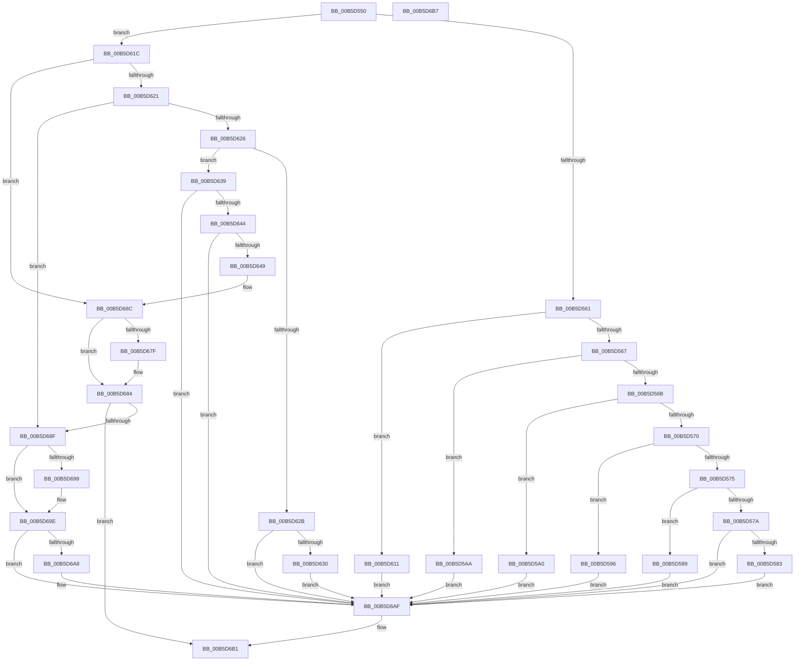

# HalpInterruptInitSystem

- RVA: `0x00B5D550`–`0x00B5D6B8` (길이 `360` bytes)
- VA: `0x0000000140B5D550`
- 실행 섹션: `PAGELK`
- PDB 이름 있음: `예`; PDB Function 태그: `아니요`
- unwind 정보 RVA: `0x00064C80`
- 디코드: `89`개 명령, `360/360` bytes 표시
- 미해석 바이트: `0` (있으면 어셈블리에 `.byte`로 보존)

> 이 문서는 커널 이미지의 기계어와 PDB 기호를 분석해 생성했습니다. 4번과 5번은 함수 원형과 자료형을 바이너리 사용 방식에서 추정한 C 해석이며 원본 소스 복구 결과는 아닙니다.

## 1. Dependencies

- 직접 호출 지점: **13**; 고유 호출 대상: **13**
- 직접 호출자로 확인된 함수: **0**
- RIP 상대 이미지 참조: **18**

### Outgoing calls
- `0x00B5D58C` → [HalpInterruptInitDiscard](../../init/C2/HalpInterruptInitDiscard_function_00C20194.md) (function, `0x00C20194`)
- `0x00B5D596` → [HalpInterruptInitializeGlobals](../../text/54/HalpInterruptInitializeGlobals_function_00544138.md) (function, `0x00544138`)
- `0x00B5D5A0` → [HalpInitializeInterruptsPn](../../text/54/HalpInitializeInterruptsPn_function_00543E38.md) (function, `0x00543E38`)
- `0x00B5D630` → [HalpInterruptInitPowerManagement](../../text/55/HalpInterruptInitPowerManagement_function_005577F8.md) (function, `0x005577F8`)
- `0x00B5D666` → [KeBugCheckEx](../../text/4F/KeBugCheckEx_function_004FD660.md) (function, `0x004FD660`)
- `0x00B5D66C` → [HalpPreAllocateKInterrupts](../../init/C2/HalpPreAllocateKInterrupts_function_00C2378C.md) (function, `0x00C2378C`)
- `0x00B5D671` → [HalpInitializeInterruptsBspLate](../../text/54/HalpInitializeInterruptsBspLate_function_00543D70.md) (function, `0x00543D70`)
- `0x00B5D676` → [Feature_ProcessorStartupCacheFlushOptimization__private_IsEnabledDeviceUsageNoInline](../../text/54/Feature_ProcessorStartupCacheFlushOptimization__private_IsEnabledDeviceUsageNoInline_function_00543D04.md) (function, `0x00543D04`)
- `0x00B5D67F` → [HalpInterruptAllocateCacheDomainTable](../../text/55/HalpInterruptAllocateCacheDomainTable_function_0055A41C.md) (function, `0x0055A41C`)
- `0x00B5D684` → [HalpInterruptBuildGlobalStartupStub](../../text/54/HalpInterruptBuildGlobalStartupStub_function_0054343C.md) (function, `0x0054343C`)
- `0x00B5D68F` → [HalpInterruptModel](../../text/4A/HalpInterruptModel_function_004ACA38.md) (function, `0x004ACA38`)
- `0x00B5D699` → [HalpInterruptEnableNmi](../../text/4A/HalpInterruptEnableNmi_function_004AD9E0.md) (function, `0x004AD9E0`)
- `0x00B5D6AA` → [HalpInterruptEnablePerformanceEvents](../../text/2D/HalpInterruptEnablePerformanceEvents_function_002D3420.md) (function, `0x002D3420`)

### Direct callers
- 이 함수 시작 RVA로 연결되는 직접 call은 확인되지 않았습니다. 간접 호출은 완전히 역산할 수 없습니다.

### Static image references
- `0x00B5D5AA` → RVA `0x00707390` (`HaliAddInterruptRemapping`; read)
- `0x00B5D5B1` → RVA `0x00E009F0` (`.data`; write)
- `0x00B5D5B8` → RVA `0x007073E0` (`HaliRemoveInterruptRemapping`; read)
- `0x00B5D5BF` → RVA `0x00E009F8` (`.data`; write)
- `0x00B5D5C6` → RVA `0x004C5DC0` (`HalpInterruptGetIdentifiers`; read)
- `0x00B5D5CD` → RVA `0x00E00A28` (`.data`; write)
- `0x00B5D5D4` → RVA `0x0055A8F0` (`HalpInterruptQueryProcessorRestartEntryPoint`; read)
- `0x00B5D5DB` → RVA `0x00E00A68` (`.data`; write)
- `0x00B5D5E2` → RVA `0x002D3100` (`HalpInterruptSetDestination`; read)
- `0x00B5D5E9` → RVA `0x00E00AC8` (`.data`; write)
- `0x00B5D5F0` → RVA `0x00557310` (`HalpConnectThermalInterrupt`; read)
- `0x00B5D5F7` → RVA `0x00E00B98` (`.data`; write)
- `0x00B5D5FE` → RVA `0x0055B400` (`HalpPreprocessNmi`; read)
- `0x00B5D605` → RVA `0x00E00BD8` (`.data`; write)
- `0x00B5D611` → RVA `0x00E0A840` (`.data`; write)
- `0x00B5D639` → RVA `0x00F90694` (`.data`; read)
- `0x00B5D649` → RVA `0x00E101F0` (`.data`; read)
- `0x00B5D69E` → RVA `0x00FC1C44` (`.data`; read)

## 2. Other-region calls and transfers

- 다른 실행 섹션으로 향하는 call: **13**
  - `0x00B5D58C` → [HalpInterruptInitDiscard](../../init/C2/HalpInterruptInitDiscard_function_00C20194.md) (`PAGELK` → `INIT`)
  - `0x00B5D596` → [HalpInterruptInitializeGlobals](../../text/54/HalpInterruptInitializeGlobals_function_00544138.md) (`PAGELK` → `.text`)
  - `0x00B5D5A0` → [HalpInitializeInterruptsPn](../../text/54/HalpInitializeInterruptsPn_function_00543E38.md) (`PAGELK` → `.text`)
  - `0x00B5D630` → [HalpInterruptInitPowerManagement](../../text/55/HalpInterruptInitPowerManagement_function_005577F8.md) (`PAGELK` → `.text`)
  - `0x00B5D666` → [KeBugCheckEx](../../text/4F/KeBugCheckEx_function_004FD660.md) (`PAGELK` → `.text`)
  - `0x00B5D66C` → [HalpPreAllocateKInterrupts](../../init/C2/HalpPreAllocateKInterrupts_function_00C2378C.md) (`PAGELK` → `INIT`)
  - `0x00B5D671` → [HalpInitializeInterruptsBspLate](../../text/54/HalpInitializeInterruptsBspLate_function_00543D70.md) (`PAGELK` → `.text`)
  - `0x00B5D676` → [Feature_ProcessorStartupCacheFlushOptimization__private_IsEnabledDeviceUsageNoInline](../../text/54/Feature_ProcessorStartupCacheFlushOptimization__private_IsEnabledDeviceUsageNoInline_function_00543D04.md) (`PAGELK` → `.text`)
  - `0x00B5D67F` → [HalpInterruptAllocateCacheDomainTable](../../text/55/HalpInterruptAllocateCacheDomainTable_function_0055A41C.md) (`PAGELK` → `.text`)
  - `0x00B5D684` → [HalpInterruptBuildGlobalStartupStub](../../text/54/HalpInterruptBuildGlobalStartupStub_function_0054343C.md) (`PAGELK` → `.text`)
  - `0x00B5D68F` → [HalpInterruptModel](../../text/4A/HalpInterruptModel_function_004ACA38.md) (`PAGELK` → `.text`)
  - `0x00B5D699` → [HalpInterruptEnableNmi](../../text/4A/HalpInterruptEnableNmi_function_004AD9E0.md) (`PAGELK` → `.text`)
  - `0x00B5D6AA` → [HalpInterruptEnablePerformanceEvents](../../text/2D/HalpInterruptEnablePerformanceEvents_function_002D3420.md) (`PAGELK` → `.text`)
- 별도 외부 분기/꼬리 이동을 확인하지 못했습니다.

## 3. Assembly (complete function range)

```asm
00B5D550  40 53                           push rbx
00B5D552  48 83 EC 30                     sub rsp, 0x30
00B5D556  33 DB                           xor ebx, ebx
00B5D558  83 F9 10                        cmp ecx, 0x10
00B5D55B  0F 8F BB 00 00 00               jg 0x140b5d61c
00B5D561  0F 84 AA 00 00 00               je 0x140b5d611
00B5D567  85 C9                           test ecx, ecx
00B5D569  74 3F                           je 0x140b5d5aa
00B5D56B  83 F9 04                        cmp ecx, 4
00B5D56E  74 30                           je 0x140b5d5a0
00B5D570  83 F9 07                        cmp ecx, 7
00B5D573  74 21                           je 0x140b5d596
00B5D575  83 F9 09                        cmp ecx, 9
00B5D578  74 0F                           je 0x140b5d589
00B5D57A  83 F9 0B                        cmp ecx, 0xb
00B5D57D  0F 85 2C 01 00 00               jne 0x140b5d6af
00B5D583  FB                              sti
00B5D584  E9 26 01 00 00                  jmp 0x140b5d6af
00B5D589  49 8B C8                        mov rcx, r8
00B5D58C  E8 03 2C 0C 00                  call 0x140c20194
00B5D591  E9 19 01 00 00                  jmp 0x140b5d6af
00B5D596  E8 9D 6B 9E FF                  call 0x140544138
00B5D59B  E9 0F 01 00 00                  jmp 0x140b5d6af
00B5D5A0  E8 93 68 9E FF                  call 0x140543e38
00B5D5A5  E9 05 01 00 00                  jmp 0x140b5d6af
00B5D5AA  48 8D 05 DF 9D BA FF            lea rax, [rip - 0x456221]
00B5D5B1  48 89 05 38 34 2A 00            mov qword ptr [rip + 0x2a3438], rax
00B5D5B8  48 8D 05 21 9E BA FF            lea rax, [rip - 0x4561df]
00B5D5BF  48 89 05 32 34 2A 00            mov qword ptr [rip + 0x2a3432], rax
00B5D5C6  48 8D 05 F3 87 96 FF            lea rax, [rip - 0x69780d]
00B5D5CD  48 89 05 54 34 2A 00            mov qword ptr [rip + 0x2a3454], rax
00B5D5D4  48 8D 05 15 D3 9F FF            lea rax, [rip - 0x602ceb]
00B5D5DB  48 89 05 86 34 2A 00            mov qword ptr [rip + 0x2a3486], rax
00B5D5E2  48 8D 05 17 5B 77 FF            lea rax, [rip - 0x88a4e9]
00B5D5E9  48 89 05 D8 34 2A 00            mov qword ptr [rip + 0x2a34d8], rax
00B5D5F0  48 8D 05 19 9D 9F FF            lea rax, [rip - 0x6062e7]
00B5D5F7  48 89 05 9A 35 2A 00            mov qword ptr [rip + 0x2a359a], rax
00B5D5FE  48 8D 05 FB DD 9F FF            lea rax, [rip - 0x602205]
00B5D605  48 89 05 CC 35 2A 00            mov qword ptr [rip + 0x2a35cc], rax
00B5D60C  E9 9E 00 00 00                  jmp 0x140b5d6af
00B5D611  88 1D 29 D2 2A 00               mov byte ptr [rip + 0x2ad229], bl
00B5D617  E9 93 00 00 00                  jmp 0x140b5d6af
00B5D61C  83 F9 11                        cmp ecx, 0x11
00B5D61F  74 4B                           je 0x140b5d66c
00B5D621  83 F9 13                        cmp ecx, 0x13
00B5D624  74 69                           je 0x140b5d68f
00B5D626  83 F9 15                        cmp ecx, 0x15
00B5D629  74 0E                           je 0x140b5d639
00B5D62B  83 F9 1D                        cmp ecx, 0x1d
00B5D62E  75 7F                           jne 0x140b5d6af
00B5D630  E8 C3 A1 9F FF                  call 0x1405577f8
00B5D635  8B D8                           mov ebx, eax
00B5D637  EB 76                           jmp 0x140b5d6af
00B5D639  48 63 05 54 30 43 00            movsxd rax, dword ptr [rip + 0x433054]
00B5D640  85 C0                           test eax, eax
00B5D642  74 6B                           je 0x140b5d6af
00B5D644  83 F8 0E                        cmp eax, 0xe
00B5D647  74 66                           je 0x140b5d6af
00B5D649  4C 8B 0D A0 2B 2B 00            mov r9, qword ptr [rip + 0x2b2ba0]
00B5D650  BA 03 02 00 00                  mov edx, 0x203
00B5D655  B9 5C 00 00 00                  mov ecx, 0x5c
00B5D65A  48 89 44 24 20                  mov qword ptr [rsp + 0x20], rax
00B5D65F  4D 63 81 F0 00 00 00            movsxd r8, dword ptr [r9 + 0xf0]
00B5D666  E8 F5 FF 99 FF                  call 0x1404fd660
00B5D66B  CC                              int3
00B5D66C  E8 1B 61 0C 00                  call 0x140c2378c
00B5D671  E8 FA 66 9E FF                  call 0x140543d70
00B5D676  E8 89 66 9E FF                  call 0x140543d04
00B5D67B  85 C0                           test eax, eax
00B5D67D  74 05                           je 0x140b5d684
00B5D67F  E8 98 CD 9F FF                  call 0x14055a41c
00B5D684  E8 B3 5D 9E FF                  call 0x14054343c
00B5D689  8B D8                           mov ebx, eax
00B5D68B  85 C0                           test eax, eax
00B5D68D  78 22                           js 0x140b5d6b1
00B5D68F  E8 A4 F3 94 FF                  call 0x1404aca38
00B5D694  83 F8 01                        cmp eax, 1
00B5D697  75 05                           jne 0x140b5d69e
00B5D699  E8 42 03 95 FF                  call 0x1404ad9e0
00B5D69E  8B 05 A0 45 46 00               mov eax, dword ptr [rip + 0x4645a0]
00B5D6A4  A8 01                           test al, 1
00B5D6A6  74 07                           je 0x140b5d6af
00B5D6A8  33 C9                           xor ecx, ecx
00B5D6AA  E8 71 5D 77 FF                  call 0x1402d3420
00B5D6AF  8B C3                           mov eax, ebx
00B5D6B1  48 83 C4 30                     add rsp, 0x30
00B5D6B5  5B                              pop rbx
00B5D6B6  C3                              ret
00B5D6B7  CC                              int3
```

## 4. C-style interpretation (structured pseudocode)

```c
__int64 __fastcall HalpInterruptInitSystem(int a1, __int64 a2, __int64 a3)
{
    __int64 result;
    __int64 v_rbx;
    __int64 v_rsp;
    unsigned __int64 v_stack_m18;

    v_rsp = (v_rsp) - (48);
    v_rbx = 0;
    if (a1 > 16) goto loc_00B5D61C;
    if (a1 == 16) goto loc_00B5D611;
    if (a1 == 0) goto loc_00B5D5AA;
    if (a1 == 4) goto loc_00B5D5A0;
    if (a1 == 7) goto loc_00B5D596;
    if (a1 == 9) goto loc_00B5D589;
    if (a1 != 11) goto loc_00B5D6AF;
    goto loc_00B5D6AF;
loc_00B5D589:
    result = HalpInterruptInitDiscard(a3, a2, a3, a4);
    goto loc_00B5D6AF;
loc_00B5D596:
    result = HalpInterruptInitializeGlobals(a3, a2, a3, a4);
    goto loc_00B5D6AF;
loc_00B5D5A0:
    result = HalpInitializeInterruptsPn(a3, a2, a3, a4);
    goto loc_00B5D6AF;
loc_00B5D5AA:
    *(unsigned __int64 *)(v_rip + 2765880) = v_rip - 4547105;
    *(unsigned __int64 *)(v_rip + 2765874) = v_rip - 4547039;
    *(unsigned __int64 *)(v_rip + 2765908) = v_rip - 6912013;
    *(unsigned __int64 *)(v_rip + 2765958) = v_rip - 6302955;
    *(unsigned __int64 *)(v_rip + 2766040) = v_rip - 8955113;
    *(unsigned __int64 *)(v_rip + 2766234) = v_rip - 6316775;
    *(unsigned __int64 *)(v_rip + 2766284) = v_rip - 6300165;
    goto loc_00B5D6AF;
loc_00B5D611:
    *(unsigned __int8 *)(v_rip + 2806313) = 0;
    goto loc_00B5D6AF;
loc_00B5D61C:
    if (((unsigned int)(a3)) == 17) goto loc_00B5D66C;
    if (((unsigned int)(a3)) == 19) goto loc_00B5D68F;
    if (((unsigned int)(a3)) == 21) goto loc_00B5D639;
    if (((unsigned int)(a3)) != 29) goto loc_00B5D6AF;
    result = HalpInterruptInitPowerManagement(a3, a2, a3, a4);
    goto loc_00B5D6AF;
loc_00B5D639:
    if ((unsigned int)((int)(*(unsigned int *)(v_rip + 4403284))) == 0) goto loc_00B5D6AF;
    if (((unsigned int)((int)(*(unsigned int *)(v_rip + 4403284)))) == 14) goto loc_00B5D6AF;
    v_stack_m18 = (int)(*(unsigned int *)(v_rip + 4403284));
    result = KeBugCheckEx(92, 515, (int)(*(unsigned int *)(*(unsigned __int64 *)(v_rip + 2829216) + 240)), *(unsigned __int64 *)(v_rip + 2829216));
loc_00B5D66C:
    result = HalpPreAllocateKInterrupts(92, 515, (int)(*(unsigned int *)(*(unsigned __int64 *)(v_rip + 2829216) + 240)), *(unsigned __int64 *)(v_rip + 2829216));
    result = HalpInitializeInterruptsBspLate(92, 515, (int)(*(unsigned int *)(*(unsigned __int64 *)(v_rip + 2829216) + 240)), *(unsigned __int64 *)(v_rip + 2829216));
    result = Feature_ProcessorStartupCacheFlushOptimization__private_IsEnabledDeviceUsageNoInline(92, 515, (int)(*(unsigned int *)(*(unsigned __int64 *)(v_rip + 2829216) + 240)), *(unsigned __int64 *)(v_rip + 2829216));
    if ((unsigned int)(result) != 0) {
        result = HalpInterruptAllocateCacheDomainTable(92, 515, (int)(*(unsigned int *)(*(unsigned __int64 *)(v_rip + 2829216) + 240)), *(unsigned __int64 *)(v_rip + 2829216));
    }
    result = HalpInterruptBuildGlobalStartupStub(92, 515, (int)(*(unsigned int *)(*(unsigned __int64 *)(v_rip + 2829216) + 240)), *(unsigned __int64 *)(v_rip + 2829216));
    if (sign_flag) goto loc_00B5D6B1;
loc_00B5D68F:
    result = HalpInterruptModel(92, 515, (int)(*(unsigned int *)(*(unsigned __int64 *)(v_rip + 2829216) + 240)), *(unsigned __int64 *)(v_rip + 2829216));
    if (((unsigned int)(result)) == 1) {
        result = HalpInterruptEnableNmi(92, 515, (int)(*(unsigned int *)(*(unsigned __int64 *)(v_rip + 2829216) + 240)), *(unsigned __int64 *)(v_rip + 2829216));
    }
    result = (unsigned int)(*(unsigned int *)(v_rip + 4605344));
    if ((((unsigned __int8)((unsigned int)(*(unsigned int *)(v_rip + 4605344)))) & (1)) != 0) {
        a1 = 0;
        result = HalpInterruptEnablePerformanceEvents(a1, 515, (int)(*(unsigned int *)(*(unsigned __int64 *)(v_rip + 2829216) + 240)), *(unsigned __int64 *)(v_rip + 2829216));
    }
loc_00B5D6B1:
    v_rsp = (v_rsp) + (48);
    return (unsigned int)((unsigned int)((unsigned int)((unsigned int)(result))));
}
```

## 5. (Beta) C Style

```c
int64_t HalpInterruptInitSystem(int32_t Arg1, int64_t Arg2, int64_t Arg3)
{
    int64_t result;
    int64_t local_rbx;
    int64_t local_rsp;
    uint64_t v_stack_m18;

    local_rsp = (local_rsp) - (48);
    local_rbx = 0;
    if (Arg1 > 16) goto loc_00B5D61C;
    if (Arg1 == 16) goto loc_00B5D611;
    if (Arg1 == 0) goto loc_00B5D5AA;
    if (Arg1 == 4) goto loc_00B5D5A0;
    if (Arg1 == 7) goto loc_00B5D596;
    if (Arg1 == 9) goto loc_00B5D589;
    if (Arg1 != 11) goto loc_00B5D6AF;
    goto loc_00B5D6AF;
loc_00B5D589:
    result = HalpInterruptInitDiscard(Arg3, Arg2, Arg3, a4);
    goto loc_00B5D6AF;
loc_00B5D596:
    result = HalpInterruptInitializeGlobals(Arg3, Arg2, Arg3, a4);
    goto loc_00B5D6AF;
loc_00B5D5A0:
    result = HalpInitializeInterruptsPn(Arg3, Arg2, Arg3, a4);
    goto loc_00B5D6AF;
loc_00B5D5AA:
    *(uint64_t *)(v_rip + 0x2A3438) = v_rip - 4547105;
    *(uint64_t *)(v_rip + 0x2A3432) = v_rip - 4547039;
    *(uint64_t *)(v_rip + 0x2A3454) = v_rip - 6912013;
    *(uint64_t *)(v_rip + 0x2A3486) = v_rip - 6302955;
    *(uint64_t *)(v_rip + 0x2A34D8) = v_rip - 8955113;
    *(uint64_t *)(v_rip + 0x2A359A) = v_rip - 6316775;
    *(uint64_t *)(v_rip + 0x2A35CC) = v_rip - 6300165;
    goto loc_00B5D6AF;
loc_00B5D611:
    *(uint8_t *)(v_rip + 0x2AD229) = 0;
    goto loc_00B5D6AF;
loc_00B5D61C:
    if (((uint32_t)(Arg3)) == 17) goto loc_00B5D66C;
    if (((uint32_t)(Arg3)) == 19) goto loc_00B5D68F;
    if (((uint32_t)(Arg3)) == 21) goto loc_00B5D639;
    if (((uint32_t)(Arg3)) != 29) goto loc_00B5D6AF;
    result = HalpInterruptInitPowerManagement(Arg3, Arg2, Arg3, a4);
    goto loc_00B5D6AF;
loc_00B5D639:
    if ((uint32_t)((int32_t)(*(uint32_t *)(v_rip + 0x433054))) == 0) goto loc_00B5D6AF;
    if (((uint32_t)((int32_t)(*(uint32_t *)(v_rip + 0x433054)))) == 14) goto loc_00B5D6AF;
    v_stack_m18 = (int32_t)(*(uint32_t *)(v_rip + 0x433054));
    result = KeBugCheckEx(92, 515, (int32_t)(*(uint32_t *)(*(uint64_t *)(v_rip + 0x2B2BA0) + 0xF0)), *(uint64_t *)(v_rip + 0x2B2BA0));
loc_00B5D66C:
    result = HalpPreAllocateKInterrupts(92, 515, (int32_t)(*(uint32_t *)(*(uint64_t *)(v_rip + 0x2B2BA0) + 0xF0)), *(uint64_t *)(v_rip + 0x2B2BA0));
    result = HalpInitializeInterruptsBspLate(92, 515, (int32_t)(*(uint32_t *)(*(uint64_t *)(v_rip + 0x2B2BA0) + 0xF0)), *(uint64_t *)(v_rip + 0x2B2BA0));
    result = Feature_ProcessorStartupCacheFlushOptimization__private_IsEnabledDeviceUsageNoInline(92, 515, (int32_t)(*(uint32_t *)(*(uint64_t *)(v_rip + 0x2B2BA0) + 0xF0)), *(uint64_t *)(v_rip + 0x2B2BA0));
    if ((uint32_t)(result) != 0) {
        result = HalpInterruptAllocateCacheDomainTable(92, 515, (int32_t)(*(uint32_t *)(*(uint64_t *)(v_rip + 0x2B2BA0) + 0xF0)), *(uint64_t *)(v_rip + 0x2B2BA0));
    }
    result = HalpInterruptBuildGlobalStartupStub(92, 515, (int32_t)(*(uint32_t *)(*(uint64_t *)(v_rip + 0x2B2BA0) + 0xF0)), *(uint64_t *)(v_rip + 0x2B2BA0));
    if (sign_flag) goto loc_00B5D6B1;
loc_00B5D68F:
    result = HalpInterruptModel(92, 515, (int32_t)(*(uint32_t *)(*(uint64_t *)(v_rip + 0x2B2BA0) + 0xF0)), *(uint64_t *)(v_rip + 0x2B2BA0));
    if (((uint32_t)(result)) == 1) {
        result = HalpInterruptEnableNmi(92, 515, (int32_t)(*(uint32_t *)(*(uint64_t *)(v_rip + 0x2B2BA0) + 0xF0)), *(uint64_t *)(v_rip + 0x2B2BA0));
    }
    result = (uint32_t)(*(uint32_t *)(v_rip + 0x4645A0));
    if ((((uint8_t)((uint32_t)(*(uint32_t *)(v_rip + 0x4645A0)))) & (1)) != 0) {
        Arg1 = 0;
        result = HalpInterruptEnablePerformanceEvents(Arg1, 515, (int32_t)(*(uint32_t *)(*(uint64_t *)(v_rip + 0x2B2BA0) + 0xF0)), *(uint64_t *)(v_rip + 0x2B2BA0));
    }
loc_00B5D6B1:
    local_rsp = (local_rsp) + (48);
    return (uint32_t)((uint32_t)((uint32_t)((uint32_t)(result))));
}
```

## 6. Execution-region graph

[열기: 2D/3D 그래프와 함수 탐색 컨트롤 패널](../../../control-panel.html?section=pagelk&rva=0x00B5D550&view=graph)

- 2D 그래프는 위에서 아래로 흐르고, 3D 그래프는 빈 공간을 드래그해 회전합니다. Shift+드래그는 이동, 휠은 확대·축소, 함수 노드 선택은 대상 보고서 이동입니다.

### Static fallback


