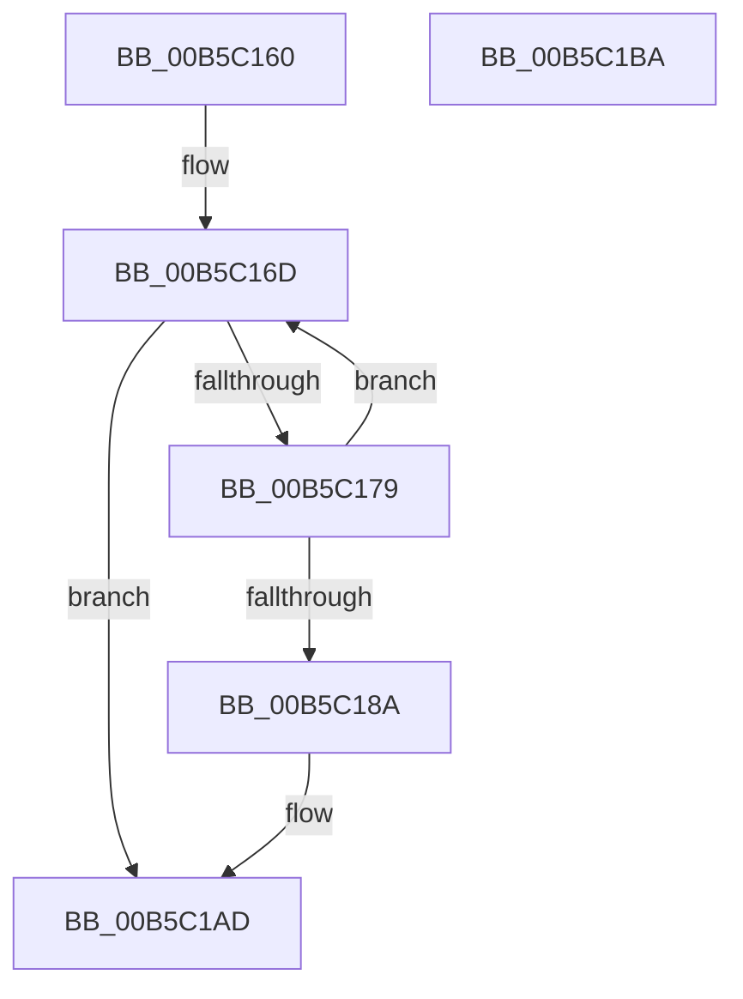

# HalpInterruptRestoreAllControllerState

- RVA: `0x00B5C160`–`0x00B5C1BB` (길이 `91` bytes)
- VA: `0x0000000140B5C160`
- 실행 섹션: `PAGELK`
- PDB 이름 있음: `예`; PDB Function 태그: `아니요`
- unwind 정보 RVA: `0x00064C80`
- 디코드: `25`개 명령, `91/91` bytes 표시
- 미해석 바이트: `0` (있으면 어셈블리에 `.byte`로 보존)

> 이 문서는 커널 이미지의 기계어와 PDB 기호를 분석해 생성했습니다. 4번과 5번은 함수 원형과 자료형을 바이너리 사용 방식에서 추정한 C 해석이며 원본 소스 복구 결과는 아닙니다.

## 1. Dependencies

- 직접 호출 지점: **2**; 고유 호출 대상: **2**
- 직접 호출자로 확인된 함수: **3**
- RIP 상대 이미지 참조: **3**

### Outgoing calls
- `0x00B5C181` → [HalpInterruptRestoreController](../../text/4A/HalpInterruptRestoreController_function_004A75A8.md) (function, `0x004A75A8`)
- `0x00B5C1A7` → [KeBugCheckEx](../../text/4F/KeBugCheckEx_function_004FD660.md) (function, `0x004FD660`)

### Direct callers
- [HalpInterruptMaskLevelTriggeredLines](../../text/56/HalpInterruptMaskLevelTriggeredLines_function_00563590.md) at `0x00563691`
- [HalpInterruptUnmaskLevelTriggeredLines](../../text/56/HalpInterruptUnmaskLevelTriggeredLines_function_00563740.md) at `0x00563744`
- [HalpInterruptSwapProcessorIdentifiers](../B6/HalpInterruptSwapProcessorIdentifiers_function_00B60510.md) at `0x00B60625`

### Static image references
- `0x00B5C166` → RVA `0x00FC38F0` (`.data`; read)
- `0x00B5C18A` → RVA `0x00F90694` (`.data`; read)
- `0x00B5C1AD` → RVA `0x00E101B0` (`.data`; write)

## 2. Other-region calls and transfers

- 다른 실행 섹션으로 향하는 call: **2**
  - `0x00B5C181` → [HalpInterruptRestoreController](../../text/4A/HalpInterruptRestoreController_function_004A75A8.md) (`PAGELK` → `.text`)
  - `0x00B5C1A7` → [KeBugCheckEx](../../text/4F/KeBugCheckEx_function_004FD660.md) (`PAGELK` → `.text`)
- 별도 외부 분기/꼬리 이동을 확인하지 못했습니다.

## 3. Assembly (complete function range)

```asm
00B5C160  40 53                           push rbx
00B5C162  48 83 EC 30                     sub rsp, 0x30
00B5C166  48 8B 1D 83 77 46 00            mov rbx, qword ptr [rip + 0x467783]
00B5C16D  48 8D 05 7C 77 46 00            lea rax, [rip + 0x46777c]
00B5C174  48 3B D8                        cmp rbx, rax
00B5C177  74 34                           je 0x140b5c1ad
00B5C179  48 8B CB                        mov rcx, rbx
00B5C17C  33 D2                           xor edx, edx
00B5C17E  48 8B 1B                        mov rbx, qword ptr [rbx]
00B5C181  E8 22 B4 94 FF                  call 0x1404a75a8
00B5C186  85 C0                           test eax, eax
00B5C188  79 E3                           jns 0x140b5c16d
00B5C18A  4C 63 05 03 45 43 00            movsxd r8, dword ptr [rip + 0x434503]
00B5C191  41 B9 03 00 00 00               mov r9d, 3
00B5C197  48 98                           cdqe
00B5C199  BA 00 02 00 00                  mov edx, 0x200
00B5C19E  48 89 44 24 20                  mov qword ptr [rsp + 0x20], rax
00B5C1A3  41 8D 49 59                     lea ecx, [r9 + 0x59]
00B5C1A7  E8 B4 14 9A FF                  call 0x1404fd660
00B5C1AC  CC                              int3
00B5C1AD  C6 05 FC 3F 2B 00 01            mov byte ptr [rip + 0x2b3ffc], 1
00B5C1B4  48 83 C4 30                     add rsp, 0x30
00B5C1B8  5B                              pop rbx
00B5C1B9  C3                              ret
00B5C1BA  CC                              int3
```

## 4. C-style interpretation (structured pseudocode)

```c
__int64 __fastcall HalpInterruptRestoreAllControllerState(__int64 a1, int a2)
{
    __int64 result;
    __int64 v_rsp;
    unsigned __int64 v_stack_m18;

    v_rsp = (v_rsp) - (48);
loc_00B5C16D:
    if ((*(unsigned __int64 *)(v_rip + 4618115)) == (v_rip + 4618108)) goto loc_00B5C1AD;
    a2 = 0;
    result = HalpInterruptRestoreController(*(unsigned __int64 *)(v_rip + 4618115), a2, a3, a4);
    if (!sign_flag) goto loc_00B5C16D;
    v_stack_m18 = result;
    result = KeBugCheckEx(3 + 89, 512, (int)(*(unsigned int *)(v_rip + 4408579)), 3);
loc_00B5C1AD:
    *(unsigned __int8 *)(v_rip + 2834428) = 1;
    v_rsp = (v_rsp) + (48);
    return result;
}
```

## 5. (Beta) C Style

```c
int64_t HalpInterruptRestoreAllControllerState(int64_t Arg1, int32_t Arg2)
{
    int64_t result;
    int64_t local_rsp;
    uint64_t v_stack_m18;

    local_rsp = (local_rsp) - (48);
loc_00B5C16D:
    if ((*(uint64_t *)(v_rip + 0x467783)) == (v_rip + 4618108)) goto loc_00B5C1AD;
    Arg2 = 0;
    result = HalpInterruptRestoreController(*(uint64_t *)(v_rip + 0x467783), Arg2, a3, a4);
    if (!sign_flag) goto loc_00B5C16D;
    v_stack_m18 = result;
    result = KeBugCheckEx(3 + 89, 512, (int32_t)(*(uint32_t *)(v_rip + 0x434503)), 3);
loc_00B5C1AD:
    *(uint8_t *)(v_rip + 0x2B3FFC) = 1;
    local_rsp = (local_rsp) + (48);
    return result;
}
```

## 6. Execution-region graph

[열기: 2D/3D 그래프와 함수 탐색 컨트롤 패널](../../../control-panel.html?section=pagelk&rva=0x00B5C160&view=graph)

- 2D 그래프는 위에서 아래로 흐르고, 3D 그래프는 빈 공간을 드래그해 회전합니다. Shift+드래그는 이동, 휠은 확대·축소, 함수 노드 선택은 대상 보고서 이동입니다.

### Static fallback


