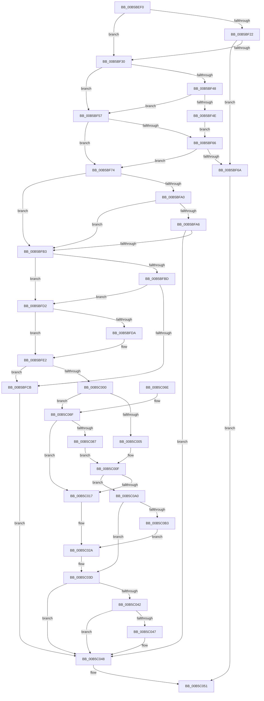

# HalpInterruptStartProcessor

- RVA: `0x00B5BEF0`–`0x00B5C0C7` (길이 `471` bytes)
- VA: `0x0000000140B5BEF0`
- 실행 섹션: `PAGELK`
- PDB 이름 있음: `예`; PDB Function 태그: `아니요`
- unwind 정보 RVA: `0x000C3BF0`
- 디코드: `130`개 명령, `471/471` bytes 표시
- 미해석 바이트: `0` (있으면 어셈블리에 `.byte`로 보존)

> 이 문서는 커널 이미지의 기계어와 PDB 기호를 분석해 생성했습니다. 4번과 5번은 함수 원형과 자료형을 바이너리 사용 방식에서 추정한 C 해석이며 원본 소스 복구 결과는 아닙니다.

## 1. Dependencies

- 직접 호출 지점: **10**; 고유 호출 대상: **10**
- 직접 호출자로 확인된 함수: **4**
- RIP 상대 이미지 참조: **11**

### Outgoing calls
- `0x00B5BF37` → [HalpInterruptGetNextProcessorLocalId](../../text/54/HalpInterruptGetNextProcessorLocalId_function_005434EC.md) (function, `0x005434EC`)
- `0x00B5BF81` → [HalpHvVpStartEnabled](../../text/54/HalpHvVpStartEnabled_function_0054D0F4.md) (function, `0x0054D0F4`)
- `0x00B5BFA6` → [HalpMmUpdateTiledMemoryMapTargetStub](../../text/55/HalpMmUpdateTiledMemoryMapTargetStub_function_0055A974.md) (function, `0x0055A974`)
- `0x00B5BFC2` → [HalpSetProcessorStateByNtIndex](../../text/55/HalpSetProcessorStateByNtIndex_function_00558988.md) (function, `0x00558988`)
- `0x00B5BFDA` → [HalpDisableInterrupts](../../text/25/HalpDisableInterrupts_function_002521A0.md) (function, `0x002521A0`)
- `0x00B5BFF7` → [HalpInterruptSetProcessorStartContext](../../text/54/HalpInterruptSetProcessorStartContext_function_00543A90.md) (function, `0x00543A90`)
- `0x00B5C00A` → [HalpHvStartProcessor](../../text/55/HalpHvStartProcessor_function_0055A23C.md) (function, `0x0055A23C`)
- `0x00B5C038` → [HalpInterruptSetProblemEx](../../text/48/HalpInterruptSetProblemEx_function_0048AC8C.md) (function, `0x0048AC8C`)
- `0x00B5C096` → [guard_dispatch_icall](../../text/6B/guard_dispatch_icall_function_006BAAD0.md) (function, `0x006BAAD0`)
- `0x00B5C0A7` → [HalpInterruptWaitForProcessorStartUp](../../text/54/HalpInterruptWaitForProcessorStartUp_function_00543B6C.md) (function, `0x00543B6C`)

### Direct callers
- [HalStartDynamicProcessor](../../text/54/HalStartDynamicProcessor_function_00543300.md) at `0x005433A0`
- [HalStartNextProcessor](../../text/54/HalStartNextProcessor_function_005479B0.md) at `0x005479E6`
- [HalpDpStartProcessor](../B6/HalpDpStartProcessor_function_00B60384.md) at `0x00B60411`
- [HalpBlkStartBlockedProcessor](../B6/HalpBlkStartBlockedProcessor_function_00B60E10.md) at `0x00B60E71`

### Static image references
- `0x00B5BF14` → RVA `0x00E10208` (`.data`; read)
- `0x00B5BF22` → RVA `0x00E0A774` (`.data`; read)
- `0x00B5BF3E` → RVA `0x00FC1C41` (`.data`; read)
- `0x00B5BF4E` → RVA `0x00FC3E19` (`.data`; write)
- `0x00B5BF7B` → RVA `0x00FC3E18` (`.data`; write)
- `0x00B5BF86` → RVA `0x00FC3E28` (`.data`; read)
- `0x00B5BF90` → RVA `0x00FC3E40` (`.data`; read)
- `0x00B5BF97` → RVA `0x00FC3E08` (`.data`; read)
- `0x00B5BFE2` → RVA `0x00FC3E18` (`.data`; read)
- `0x00B5C02A` → RVA `0x00E101F0` (`.data`; read)
- `0x00B5C031` → RVA `0x00023AE0` (`.rdata`; read)

## 2. Other-region calls and transfers

- 다른 실행 섹션으로 향하는 call: **10**
  - `0x00B5BF37` → [HalpInterruptGetNextProcessorLocalId](../../text/54/HalpInterruptGetNextProcessorLocalId_function_005434EC.md) (`PAGELK` → `.text`)
  - `0x00B5BF81` → [HalpHvVpStartEnabled](../../text/54/HalpHvVpStartEnabled_function_0054D0F4.md) (`PAGELK` → `.text`)
  - `0x00B5BFA6` → [HalpMmUpdateTiledMemoryMapTargetStub](../../text/55/HalpMmUpdateTiledMemoryMapTargetStub_function_0055A974.md) (`PAGELK` → `.text`)
  - `0x00B5BFC2` → [HalpSetProcessorStateByNtIndex](../../text/55/HalpSetProcessorStateByNtIndex_function_00558988.md) (`PAGELK` → `.text`)
  - `0x00B5BFDA` → [HalpDisableInterrupts](../../text/25/HalpDisableInterrupts_function_002521A0.md) (`PAGELK` → `.text`)
  - `0x00B5BFF7` → [HalpInterruptSetProcessorStartContext](../../text/54/HalpInterruptSetProcessorStartContext_function_00543A90.md) (`PAGELK` → `.text`)
  - `0x00B5C00A` → [HalpHvStartProcessor](../../text/55/HalpHvStartProcessor_function_0055A23C.md) (`PAGELK` → `.text`)
  - `0x00B5C038` → [HalpInterruptSetProblemEx](../../text/48/HalpInterruptSetProblemEx_function_0048AC8C.md) (`PAGELK` → `.text`)
  - `0x00B5C096` → [guard_dispatch_icall](../../text/6B/guard_dispatch_icall_function_006BAAD0.md) (`PAGELK` → `.text`)
  - `0x00B5C0A7` → [HalpInterruptWaitForProcessorStartUp](../../text/54/HalpInterruptWaitForProcessorStartUp_function_00543B6C.md) (`PAGELK` → `.text`)
- 별도 외부 분기/꼬리 이동을 확인하지 못했습니다.

## 3. Assembly (complete function range)

```asm
00B5BEF0  48 8B C4                        mov rax, rsp
00B5BEF3  48 89 58 08                     mov qword ptr [rax + 8], rbx
00B5BEF7  48 89 68 18                     mov qword ptr [rax + 0x18], rbp
00B5BEFB  48 89 70 20                     mov qword ptr [rax + 0x20], rsi
00B5BEFF  89 50 10                        mov dword ptr [rax + 0x10], edx
00B5BF02  57                              push rdi
00B5BF03  41 54                           push r12
00B5BF05  41 55                           push r13
00B5BF07  41 56                           push r14
00B5BF09  41 57                           push r15
00B5BF0B  48 83 EC 30                     sub rsp, 0x30
00B5BF0F  33 FF                           xor edi, edi
00B5BF11  4D 8B E9                        mov r13, r9
00B5BF14  39 3D EE 42 2B 00               cmp dword ptr [rip + 0x2b42ee], edi
00B5BF1A  41 8B F0                        mov esi, r8d
00B5BF1D  44 8B F1                        mov r14d, ecx
00B5BF20  74 0E                           je 0x140b5bf30
00B5BF22  8B 05 4C E8 2A 00               mov eax, dword ptr [rip + 0x2ae84c]
00B5BF28  3B 05 DA 42 2B 00               cmp eax, dword ptr [rip + 0x2b42da]
00B5BF2E  73 3A                           jae 0x140b5bf6a
00B5BF30  48 8D 54 24 68                  lea rdx, [rsp + 0x68]
00B5BF35  8B CE                           mov ecx, esi
00B5BF37  E8 B0 75 9E FF                  call 0x1405434ec
00B5BF3C  8B C8                           mov ecx, eax
00B5BF3E  8A 05 FD 5C 46 00               mov al, byte ptr [rip + 0x465cfd]
00B5BF44  84 C0                           test al, al
00B5BF46  75 0F                           jne 0x140b5bf57
00B5BF48  40 F6 C6 02                     test sil, 2
00B5BF4C  75 09                           jne 0x140b5bf57
00B5BF4E  40 88 3D C4 7E 46 00            mov byte ptr [rip + 0x467ec4], dil
00B5BF55  EB 0F                           jmp 0x140b5bf66
00B5BF57  C6 05 BB 7E 46 00 01            mov byte ptr [rip + 0x467ebb], 1
00B5BF5E  81 F9 08 07 00 C0               cmp ecx, 0xc0000708
00B5BF64  74 0E                           je 0x140b5bf74
00B5BF66  85 C9                           test ecx, ecx
00B5BF68  79 0A                           jns 0x140b5bf74
00B5BF6A  B8 02 00 00 00                  mov eax, 2
00B5BF6F  E9 DD 00 00 00                  jmp 0x140b5c051
00B5BF74  8B C6                           mov eax, esi
00B5BF76  C1 E8 02                        shr eax, 2
00B5BF79  24 01                           and al, 1
00B5BF7B  88 05 97 7E 46 00               mov byte ptr [rip + 0x467e97], al
00B5BF81  E8 6E 11 9F FF                  call 0x14054d0f4
00B5BF86  40 38 3D 9B 7E 46 00            cmp byte ptr [rip + 0x467e9b], dil
00B5BF8D  40 8A E8                        mov bpl, al
00B5BF90  4C 8B 3D A9 7E 46 00            mov r15, qword ptr [rip + 0x467ea9]
00B5BF97  48 8B 1D 6A 7E 46 00            mov rbx, qword ptr [rip + 0x467e6a]
00B5BF9E  74 13                           je 0x140b5bfb3
00B5BFA0  40 F6 C6 03                     test sil, 3
00B5BFA4  74 0D                           je 0x140b5bfb3
00B5BFA6  E8 C9 E9 9F FF                  call 0x14055a974
00B5BFAB  85 C0                           test eax, eax
00B5BFAD  0F 88 95 00 00 00               js 0x140b5c048
00B5BFB3  8B 7C 24 68                     mov edi, dword ptr [rsp + 0x68]
00B5BFB7  41 83 FE FF                     cmp r14d, -1
00B5BFBB  74 15                           je 0x140b5bfd2
00B5BFBD  8B D7                           mov edx, edi
00B5BFBF  41 8B CE                        mov ecx, r14d
00B5BFC2  E8 C1 C9 9F FF                  call 0x140558988
00B5BFC7  85 C0                           test eax, eax
00B5BFC9  79 07                           jns 0x140b5bfd2
00B5BFCB  BF 02 00 00 00                  mov edi, 2
00B5BFD0  EB 76                           jmp 0x140b5c048
00B5BFD2  40 32 F6                        xor sil, sil
00B5BFD5  40 84 ED                        test bpl, bpl
00B5BFD8  75 08                           jne 0x140b5bfe2
00B5BFDA  E8 C1 61 6F FF                  call 0x1402521a0
00B5BFDF  40 8A F0                        mov sil, al
00B5BFE2  44 8A 05 2F 7E 46 00            mov r8b, byte ptr [rip + 0x467e2f]
00B5BFE9  44 8B CF                        mov r9d, edi
00B5BFEC  49 8B D5                        mov rdx, r13
00B5BFEF  41 C6 47 04 00                  mov byte ptr [r15 + 4], 0
00B5BFF4  41 8B CE                        mov ecx, r14d
00B5BFF7  E8 94 7A 9E FF                  call 0x140543a90
00B5BFFC  85 C0                           test eax, eax
00B5BFFE  78 CB                           js 0x140b5bfcb
00B5C000  40 84 ED                        test bpl, bpl
00B5C003  74 6A                           je 0x140b5c06f
00B5C005  4D 8B C7                        mov r8, r15
00B5C008  8B CF                           mov ecx, edi
00B5C00A  E8 2D E2 9F FF                  call 0x14055a23c
00B5C00F  85 C0                           test eax, eax
00B5C011  0F 89 89 00 00 00               jns 0x140b5c0a0
00B5C017  BF 02 00 00 00                  mov edi, 2
00B5C01C  C7 44 24 20 6B 05 00 00         mov dword ptr [rsp + 0x20], 0x56b
00B5C024  44 8B C0                        mov r8d, eax
00B5C027  8D 57 0B                        lea edx, [rdi + 0xb]
00B5C02A  48 8B 0D BF 41 2B 00            mov rcx, qword ptr [rip + 0x2b41bf]
00B5C031  4C 8D 0D A8 7A 4C FF            lea r9, [rip - 0xb38558]
00B5C038  E8 4F EC 92 FF                  call 0x14048ac8c
00B5C03D  40 84 ED                        test bpl, bpl
00B5C040  75 06                           jne 0x140b5c048
00B5C042  40 84 F6                        test sil, sil
00B5C045  74 01                           je 0x140b5c048
00B5C047  FB                              sti
00B5C048  C6 05 C9 7D 46 00 00            mov byte ptr [rip + 0x467dc9], 0
00B5C04F  8B C7                           mov eax, edi
00B5C051  48 8B 5C 24 60                  mov rbx, qword ptr [rsp + 0x60]
00B5C056  48 8B 6C 24 70                  mov rbp, qword ptr [rsp + 0x70]
00B5C05B  48 8B 74 24 78                  mov rsi, qword ptr [rsp + 0x78]
00B5C060  48 83 C4 30                     add rsp, 0x30
00B5C064  41 5F                           pop r15
00B5C066  41 5E                           pop r14
00B5C068  41 5D                           pop r13
00B5C06A  41 5C                           pop r12
00B5C06C  5F                              pop rdi
00B5C06D  C3                              ret
00B5C06E  CC                              int3
00B5C06F  48 8B 0D 7A 41 2B 00            mov rcx, qword ptr [rip + 0x2b417a]
00B5C076  B8 01 00 00 C0                  mov eax, 0xc0000001
00B5C07B  4C 8B 91 80 00 00 00            mov r10, qword ptr [rcx + 0x80]
00B5C082  4D 85 D2                        test r10, r10
00B5C085  74 90                           je 0x140b5c017
00B5C087  48 8B 49 10                     mov rcx, qword ptr [rcx + 0x10]
00B5C08B  44 8B CB                        mov r9d, ebx
00B5C08E  4D 8B C7                        mov r8, r15
00B5C091  8B D7                           mov edx, edi
00B5C093  49 8B C2                        mov rax, r10
00B5C096  E8 35 EA B5 FF                  call 0x1406baad0
00B5C09B  E9 6F FF FF FF                  jmp 0x140b5c00f
00B5C0A0  40 8A D5                        mov dl, bpl
00B5C0A3  49 8D 4F 04                     lea rcx, [r15 + 4]
00B5C0A7  E8 C0 7A 9E FF                  call 0x140543b6c
00B5C0AC  8B F8                           mov edi, eax
00B5C0AE  83 F8 04                        cmp eax, 4
00B5C0B1  74 8A                           je 0x140b5c03d
00B5C0B3  45 33 C0                        xor r8d, r8d
00B5C0B6  C7 44 24 20 65 05 00 00         mov dword ptr [rsp + 0x20], 0x565
00B5C0BE  41 8D 50 0E                     lea edx, [r8 + 0xe]
00B5C0C2  E9 63 FF FF FF                  jmp 0x140b5c02a
```

## 4. C-style interpretation (structured pseudocode)

```c
__int64 __fastcall HalpInterruptStartProcessor(int a1, int a2, int a3, __int64 a4)
{
    __int64 result;
    __int64 v_rdi;
    __int64 v_rsi;
    __int64 v_rsp;
    unsigned int v_stack_m38;
    unsigned __int64 v_stack_p10;
    unsigned __int64 v_stack_p18;
    unsigned __int64 v_stack_p20;
    unsigned __int64 v_stack_p8;

    *(unsigned __int64 *)(v_rsp + 8) = v_rbx;
    *(unsigned __int64 *)(v_rsp + 24) = v_rbp;
    *(unsigned __int64 *)(v_rsp + 32) = v_rsi;
    *(unsigned int *)(v_rsp + 16) = a2;
    v_rsp = (v_rsp) - (48);
    v_rdi = 0;
    if ((*(unsigned int *)(v_rip + 2835182)) == 0) goto loc_00B5BF30;
    if (((unsigned int)((unsigned int)(*(unsigned int *)(v_rip + 2811980)))) >= (*(unsigned int *)(v_rip + 2835162))) goto loc_00B5BF6A;
loc_00B5BF30:
    result = HalpInterruptGetNextProcessorLocalId((unsigned int)((unsigned int)((unsigned int)(a3))), v_stack_p10, a3, a4);
    if ((unsigned __int8)(*(unsigned __int8 *)(v_rip + 4611325)) != 0) goto loc_00B5BF57;
    if ((((unsigned __int8)((unsigned int)(a3))) & (2)) != 0) goto loc_00B5BF57;
    *(unsigned __int8 *)(v_rip + 4619972) = 0;
    goto loc_00B5BF66;
loc_00B5BF57:
    *(unsigned __int8 *)(v_rip + 4619963) = 1;
    if (((unsigned int)((unsigned int)((unsigned int)(result)))) == 0xC0000708ULL) goto loc_00B5BF74;
loc_00B5BF66:
    if (!sign_flag) goto loc_00B5BF74;
loc_00B5BF6A:
    goto loc_00B5C051;
loc_00B5BF74:
    result = (unsigned int)(((unsigned int)((unsigned int)((unsigned int)(a3)))) >> (2));
    result = (unsigned __int8)((result) & (1));
    *(unsigned __int8 *)(v_rip + 4619927) = (unsigned __int8)(result);
    result = HalpHvVpStartEnabled((unsigned int)((unsigned int)(result)), v_stack_p10, a3, a4);
    if ((*(unsigned __int8 *)(v_rip + 4619931)) == 0) goto loc_00B5BFB3;
    if ((((unsigned __int8)((unsigned int)(a3))) & (3)) == 0) goto loc_00B5BFB3;
    result = HalpMmUpdateTiledMemoryMapTargetStub((unsigned int)((unsigned int)(result)), v_stack_p10, a3, a4);
    if (sign_flag) goto loc_00B5C048;
loc_00B5BFB3:
    if (((unsigned int)((unsigned int)(a1))) == -1) goto loc_00B5BFD2;
    result = HalpSetProcessorStateByNtIndex((unsigned int)((unsigned int)((unsigned int)(a1))), (unsigned int)((unsigned int)((unsigned int)(v_stack_p10))), a3, a4);
    if (!sign_flag) goto loc_00B5BFD2;
loc_00B5BFCB:
    goto loc_00B5C048;
loc_00B5BFD2:
    v_rsi = 0;
    if ((unsigned __int8)((unsigned __int8)(result)) == 0) {
        result = HalpDisableInterrupts((unsigned int)((unsigned int)((unsigned int)(a1))), (unsigned int)((unsigned int)((unsigned int)(v_stack_p10))), a3, a4);
        v_rsi = (unsigned __int8)(result);
    }
    *(unsigned __int8 *)(*(unsigned __int64 *)(v_rip + 4619945) + 4) = 0;
    result = HalpInterruptSetProcessorStartContext((unsigned int)((unsigned int)((unsigned int)(a1))), a4, *(unsigned __int8 *)(v_rip + 4619823), 2);
    if (sign_flag) goto loc_00B5BFCB;
    if ((unsigned __int8)((unsigned __int8)(result)) == 0) goto loc_00B5C06F;
    result = HalpHvStartProcessor(2, a4, *(unsigned __int64 *)(v_rip + 4619945), 2);
loc_00B5C00F:
    if (!sign_flag) goto loc_00B5C0A0;
loc_00B5C017:
    v_stack_m38 = 0x56BULL;
loc_00B5C02A:
    result = HalpInterruptSetProblemEx(*(unsigned __int64 *)(v_rip + 2834879), 2 + 11, (unsigned int)((unsigned int)(result)), v_rip - 11765080);
loc_00B5C03D:
    if ((unsigned __int8)((unsigned __int8)(result)) != 0) goto loc_00B5C048;
    if ((unsigned __int8)(v_rsi) != 0) {
    }
    *(unsigned __int8 *)(v_rip + 4619721) = 0;
loc_00B5C051:
    v_rsp = (v_rsp) + (48);
    return 2;
loc_00B5C06F:
    if (*(unsigned __int64 *)(*(unsigned __int64 *)(v_rip + 2834810) + 128) == 0) goto loc_00B5C017;
    result = guard_dispatch_icall(*(unsigned __int64 *)(*(unsigned __int64 *)(v_rip + 2834810) + 16), 2, *(unsigned __int64 *)(v_rip + 4619945), (unsigned int)((unsigned int)(v_stack_p8)));
    goto loc_00B5C00F;
loc_00B5C0A0:
    result = HalpInterruptWaitForProcessorStartUp(*(unsigned __int64 *)(v_rip + 4619945) + 4, (unsigned __int8)(v_stack_p18), *(unsigned __int64 *)(v_rip + 4619945), (unsigned int)((unsigned int)(v_stack_p8)));
    if (((unsigned int)(result)) == 4) goto loc_00B5C03D;
    a3 = 0;
    v_stack_p20 = 0x565ULL;
    goto loc_00B5C02A;
}
```

## 5. (Beta) C Style

```c
int64_t HalpInterruptStartProcessor(int32_t Arg1, int32_t Arg2, int32_t Arg3, int64_t Arg4)
{
    int64_t result;
    int64_t local_rdi;
    int64_t local_rsi;
    int64_t local_rsp;
    uint32_t v_stack_m38;
    uint64_t v_stack_p10;
    uint64_t v_stack_p18;
    uint64_t v_stack_p20;
    uint64_t v_stack_p8;

    *(uint64_t *)(local_rsp + 0x8) = local_rbx;
    *(uint64_t *)(local_rsp + 0x18) = local_rbp;
    *(uint64_t *)(local_rsp + 0x20) = local_rsi;
    *(uint32_t *)(local_rsp + 0x10) = Arg2;
    local_rsp = (local_rsp) - (48);
    local_rdi = 0;
    if ((*(uint32_t *)(v_rip + 0x2B42EE)) == 0) goto loc_00B5BF30;
    if (((uint32_t)((uint32_t)(*(uint32_t *)(v_rip + 0x2AE84C)))) >= (*(uint32_t *)(v_rip + 0x2B42DA))) goto loc_00B5BF6A;
loc_00B5BF30:
    result = HalpInterruptGetNextProcessorLocalId((uint32_t)((uint32_t)((uint32_t)(Arg3))), v_stack_p10, Arg3, Arg4);
    if ((uint8_t)(*(uint8_t *)(v_rip + 0x465CFD)) != 0) goto loc_00B5BF57;
    if ((((uint8_t)((uint32_t)(Arg3))) & (2)) != 0) goto loc_00B5BF57;
    *(uint8_t *)(v_rip + 0x467EC4) = 0;
    goto loc_00B5BF66;
loc_00B5BF57:
    *(uint8_t *)(v_rip + 0x467EBB) = 1;
    if (((uint32_t)((uint32_t)((uint32_t)(result)))) == 0xC0000708ULL) goto loc_00B5BF74;
loc_00B5BF66:
    if (!sign_flag) goto loc_00B5BF74;
loc_00B5BF6A:
    goto loc_00B5C051;
loc_00B5BF74:
    result = (uint32_t)(((uint32_t)((uint32_t)((uint32_t)(Arg3)))) >> (2));
    result = (uint8_t)((result) & (1));
    *(uint8_t *)(v_rip + 0x467E97) = (uint8_t)(result);
    result = HalpHvVpStartEnabled((uint32_t)((uint32_t)(result)), v_stack_p10, Arg3, Arg4);
    if ((*(uint8_t *)(v_rip + 0x467E9B)) == 0) goto loc_00B5BFB3;
    if ((((uint8_t)((uint32_t)(Arg3))) & (3)) == 0) goto loc_00B5BFB3;
    result = HalpMmUpdateTiledMemoryMapTargetStub((uint32_t)((uint32_t)(result)), v_stack_p10, Arg3, Arg4);
    if (sign_flag) goto loc_00B5C048;
loc_00B5BFB3:
    if (((uint32_t)((uint32_t)(Arg1))) == -1) goto loc_00B5BFD2;
    result = HalpSetProcessorStateByNtIndex((uint32_t)((uint32_t)((uint32_t)(Arg1))), (uint32_t)((uint32_t)((uint32_t)(v_stack_p10))), Arg3, Arg4);
    if (!sign_flag) goto loc_00B5BFD2;
loc_00B5BFCB:
    goto loc_00B5C048;
loc_00B5BFD2:
    local_rsi = 0;
    if ((uint8_t)((uint8_t)(result)) == 0) {
        result = HalpDisableInterrupts((uint32_t)((uint32_t)((uint32_t)(Arg1))), (uint32_t)((uint32_t)((uint32_t)(v_stack_p10))), Arg3, Arg4);
        local_rsi = (uint8_t)(result);
    }
    *(uint8_t *)(*(uint64_t *)(v_rip + 0x467EA9) + 0x4) = 0;
    result = HalpInterruptSetProcessorStartContext((uint32_t)((uint32_t)((uint32_t)(Arg1))), Arg4, *(uint8_t *)(v_rip + 0x467E2F), 2);
    if (sign_flag) goto loc_00B5BFCB;
    if ((uint8_t)((uint8_t)(result)) == 0) goto loc_00B5C06F;
    result = HalpHvStartProcessor(2, Arg4, *(uint64_t *)(v_rip + 0x467EA9), 2);
loc_00B5C00F:
    if (!sign_flag) goto loc_00B5C0A0;
loc_00B5C017:
    v_stack_m38 = 0x56BULL;
loc_00B5C02A:
    result = HalpInterruptSetProblemEx(*(uint64_t *)(v_rip + 0x2B41BF), 2 + 11, (uint32_t)((uint32_t)(result)), v_rip - 11765080);
loc_00B5C03D:
    if ((uint8_t)((uint8_t)(result)) != 0) goto loc_00B5C048;
    if ((uint8_t)(local_rsi) != 0) {
    }
    *(uint8_t *)(v_rip + 0x467DC9) = 0;
loc_00B5C051:
    local_rsp = (local_rsp) + (48);
    return 2;
loc_00B5C06F:
    if (*(uint64_t *)(*(uint64_t *)(v_rip + 0x2B417A) + 0x80) == 0) goto loc_00B5C017;
    result = guard_dispatch_icall(*(uint64_t *)(*(uint64_t *)(v_rip + 0x2B417A) + 0x10), 2, *(uint64_t *)(v_rip + 0x467EA9), (uint32_t)((uint32_t)(v_stack_p8)));
    goto loc_00B5C00F;
loc_00B5C0A0:
    result = HalpInterruptWaitForProcessorStartUp(*(uint64_t *)(v_rip + 0x467EA9) + 4, (uint8_t)(v_stack_p18), *(uint64_t *)(v_rip + 0x467EA9), (uint32_t)((uint32_t)(v_stack_p8)));
    if (((uint32_t)(result)) == 4) goto loc_00B5C03D;
    Arg3 = 0;
    v_stack_p20 = 0x565ULL;
    goto loc_00B5C02A;
}
```

## 6. Execution-region graph

[열기: 2D/3D 그래프와 함수 탐색 컨트롤 패널](../../../control-panel.html?section=pagelk&rva=0x00B5BEF0&view=graph)

- 2D 그래프는 위에서 아래로 흐르고, 3D 그래프는 빈 공간을 드래그해 회전합니다. Shift+드래그는 이동, 휠은 확대·축소, 함수 노드 선택은 대상 보고서 이동입니다.

### Static fallback


