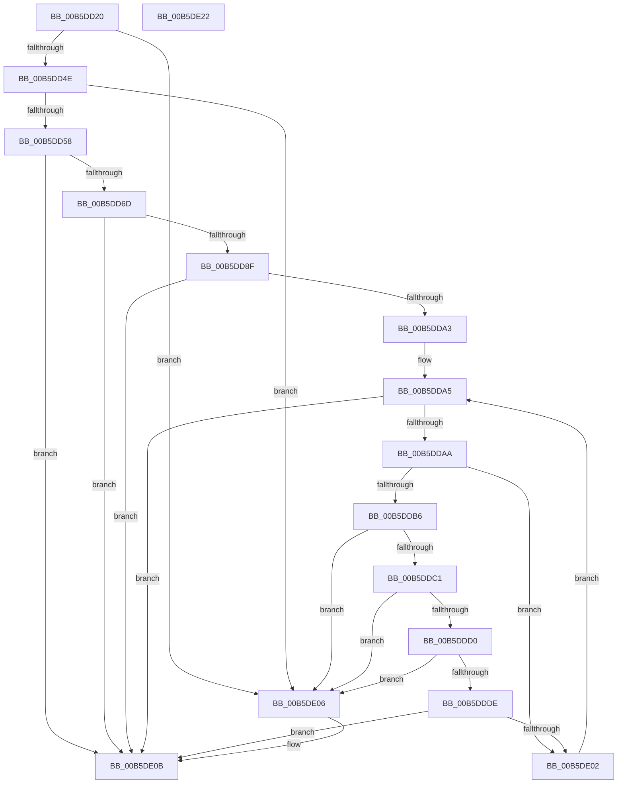

# HalpIommuConstructReservedPageTable

- RVA: `0x00B5DD20`–`0x00B5DE23` (길이 `259` bytes)
- VA: `0x0000000140B5DD20`
- 실행 섹션: `PAGELK`
- PDB 이름 있음: `예`; PDB Function 태그: `아니요`
- unwind 정보 RVA: `0x0007D3C0`
- 디코드: `74`개 명령, `259/259` bytes 표시
- 미해석 바이트: `0` (있으면 어셈블리에 `.byte`로 보존)

> 이 문서는 커널 이미지의 기계어와 PDB 기호를 분석해 생성했습니다. 4번과 5번은 함수 원형과 자료형을 바이너리 사용 방식에서 추정한 C 해석이며 원본 소스 복구 결과는 아닙니다.

## 1. Dependencies

- 직접 호출 지점: **4**; 고유 호출 대상: **4**
- 직접 호출자로 확인된 함수: **1**
- RIP 상대 이미지 참조: **1**

### Outgoing calls
- `0x00B5DD5E` → [HalpIommuGetPageTableType](../../text/55/HalpIommuGetPageTableType_function_00555220.md) (function, `0x00555220`)
- `0x00B5DD84` → [HalpIommuCreateDmarPageTable](../../text/56/HalpIommuCreateDmarPageTable_function_00568C4C.md) (function, `0x00568C4C`)
- `0x00B5DD98` → [HalpIommuGetDmarptRootAddress](../../text/56/HalpIommuGetDmarptRootAddress_function_00568EC0.md) (function, `0x00568EC0`)
- `0x00B5DDF7` → [HalpIommuMapLogicalRange](../../text/56/HalpIommuMapLogicalRange_function_005690DC.md) (function, `0x005690DC`)

### Direct callers
- [HalpIommuProcessReservedDomains](HalpIommuProcessReservedDomains_function_00B5DE2C.md) at `0x00B5DE7D`

### Static image references
- `0x00B5DD3B` → RVA `0x00FC1710` (`.data`; read)

## 2. Other-region calls and transfers

- 다른 실행 섹션으로 향하는 call: **4**
  - `0x00B5DD5E` → [HalpIommuGetPageTableType](../../text/55/HalpIommuGetPageTableType_function_00555220.md) (`PAGELK` → `.text`)
  - `0x00B5DD84` → [HalpIommuCreateDmarPageTable](../../text/56/HalpIommuCreateDmarPageTable_function_00568C4C.md) (`PAGELK` → `.text`)
  - `0x00B5DD98` → [HalpIommuGetDmarptRootAddress](../../text/56/HalpIommuGetDmarptRootAddress_function_00568EC0.md) (`PAGELK` → `.text`)
  - `0x00B5DDF7` → [HalpIommuMapLogicalRange](../../text/56/HalpIommuMapLogicalRange_function_005690DC.md) (`PAGELK` → `.text`)
- 별도 외부 분기/꼬리 이동을 확인하지 못했습니다.

## 3. Assembly (complete function range)

```asm
00B5DD20  48 8B C4                        mov rax, rsp
00B5DD23  48 89 58 08                     mov qword ptr [rax + 8], rbx
00B5DD27  48 89 68 10                     mov qword ptr [rax + 0x10], rbp
00B5DD2B  48 89 70 18                     mov qword ptr [rax + 0x18], rsi
00B5DD2F  57                              push rdi
00B5DD30  48 83 EC 40                     sub rsp, 0x40
00B5DD34  83 60 20 00                     and dword ptr [rax + 0x20], 0
00B5DD38  41 8B F8                        mov edi, r8d
00B5DD3B  80 3D CE 39 46 00 00            cmp byte ptr [rip + 0x4639ce], 0
00B5DD42  48 8B DA                        mov rbx, rdx
00B5DD45  48 8B E9                        mov rbp, rcx
00B5DD48  0F 85 B8 00 00 00               jne 0x140b5de06
00B5DD4E  83 7A 20 00                     cmp dword ptr [rdx + 0x20], 0
00B5DD52  0F 84 AE 00 00 00               je 0x140b5de06
00B5DD58  48 8D 50 20                     lea rdx, [rax + 0x20]
00B5DD5C  33 C9                           xor ecx, ecx
00B5DD5E  E8 BD 74 9F FF                  call 0x140555220
00B5DD63  8B C8                           mov ecx, eax
00B5DD65  85 C0                           test eax, eax
00B5DD67  0F 88 9E 00 00 00               js 0x140b5de0b
00B5DD6D  8B 4C 24 68                     mov ecx, dword ptr [rsp + 0x68]
00B5DD71  48 8D 73 08                     lea rsi, [rbx + 8]
00B5DD75  48 89 74 24 30                  mov qword ptr [rsp + 0x30], rsi
00B5DD7A  44 8B C7                        mov r8d, edi
00B5DD7D  8B D7                           mov edx, edi
00B5DD7F  48 89 6C 24 28                  mov qword ptr [rsp + 0x28], rbp
00B5DD84  E8 C3 AE A0 FF                  call 0x140568c4c
00B5DD89  8B C8                           mov ecx, eax
00B5DD8B  85 C0                           test eax, eax
00B5DD8D  78 7C                           js 0x140b5de0b
00B5DD8F  48 8B 0E                        mov rcx, qword ptr [rsi]
00B5DD92  4C 8D 43 10                     lea r8, [rbx + 0x10]
00B5DD96  8B D7                           mov edx, edi
00B5DD98  E8 23 B1 A0 FF                  call 0x140568ec0
00B5DD9D  8B C8                           mov ecx, eax
00B5DD9F  85 C0                           test eax, eax
00B5DDA1  78 68                           js 0x140b5de0b
00B5DDA3  33 FF                           xor edi, edi
00B5DDA5  3B 7B 20                        cmp edi, dword ptr [rbx + 0x20]
00B5DDA8  73 61                           jae 0x140b5de0b
00B5DDAA  4C 8D 0C 7F                     lea r9, [rdi + rdi*2]
00B5DDAE  42 80 7C CB 38 00               cmp byte ptr [rbx + r9*8 + 0x38], 0
00B5DDB4  75 4C                           jne 0x140b5de02
00B5DDB6  42 F7 44 CB 28 FF 0F 00 00      test dword ptr [rbx + r9*8 + 0x28], 0xfff
00B5DDBF  75 45                           jne 0x140b5de06
00B5DDC1  4A 8B 44 CB 30                  mov rax, qword ptr [rbx + r9*8 + 0x30]
00B5DDC6  4A 8B 4C CB 28                  mov rcx, qword ptr [rbx + r9*8 + 0x28]
00B5DDCB  48 3B C1                        cmp rax, rcx
00B5DDCE  7E 36                           jle 0x140b5de06
00B5DDD0  48 2B C1                        sub rax, rcx
00B5DDD3  48 FF C0                        inc rax
00B5DDD6  48 A9 FF 0F 00 00               test rax, 0xfff
00B5DDDC  75 28                           jne 0x140b5de06
00B5DDDE  48 8B 16                        mov rdx, qword ptr [rsi]
00B5DDE1  4C 8B C9                        mov r9, rcx
00B5DDE4  48 89 4C 24 28                  mov qword ptr [rsp + 0x28], rcx
00B5DDE9  41 B8 03 00 00 00               mov r8d, 3
00B5DDEF  48 8B CD                        mov rcx, rbp
00B5DDF2  48 89 44 24 20                  mov qword ptr [rsp + 0x20], rax
00B5DDF7  E8 E0 B2 A0 FF                  call 0x1405690dc
00B5DDFC  8B C8                           mov ecx, eax
00B5DDFE  85 C0                           test eax, eax
00B5DE00  78 09                           js 0x140b5de0b
00B5DE02  FF C7                           inc edi
00B5DE04  EB 9F                           jmp 0x140b5dda5
00B5DE06  B9 0D 00 00 C0                  mov ecx, 0xc000000d
00B5DE0B  48 8B 5C 24 50                  mov rbx, qword ptr [rsp + 0x50]
00B5DE10  8B C1                           mov eax, ecx
00B5DE12  48 8B 6C 24 58                  mov rbp, qword ptr [rsp + 0x58]
00B5DE17  48 8B 74 24 60                  mov rsi, qword ptr [rsp + 0x60]
00B5DE1C  48 83 C4 40                     add rsp, 0x40
00B5DE20  5F                              pop rdi
00B5DE21  C3                              ret
00B5DE22  CC                              int3
```

## 4. C-style interpretation (structured pseudocode)

```c
__int64 __fastcall HalpIommuConstructReservedPageTable(__int64 a1, __int64 a2, int a3)
{
    __int64 result;
    __int64 v_rdi;
    __int64 v_rsp;
    unsigned __int64 v_stack_m18;
    unsigned __int64 v_stack_m20;
    unsigned __int64 v_stack_m28;
    unsigned __int64 v_stack_p10;
    unsigned __int64 v_stack_p18;
    unsigned int v_stack_p20;
    unsigned __int64 v_stack_p8;

    *(unsigned __int64 *)(v_rsp + 8) = v_rbx;
    *(unsigned __int64 *)(v_rsp + 16) = v_rbp;
    *(unsigned __int64 *)(v_rsp + 24) = v_rsi;
    v_rsp = (v_rsp) - (64);
    if ((*(unsigned __int8 *)(v_rip + 4602318)) != 0) goto loc_00B5DE06;
    if ((*(unsigned int *)(a2 + 32)) == 0) goto loc_00B5DE06;
    a1 = 0;
    result = HalpIommuGetPageTableType(a1, v_rsp + 32, a3, a4);
    if (sign_flag) goto loc_00B5DE0B;
    v_stack_m18 = a2 + 8;
    v_stack_m20 = 0;
    result = HalpIommuCreateDmarPageTable((unsigned int)(v_stack_p20), (unsigned int)((unsigned int)((unsigned int)(a3))), (unsigned int)((unsigned int)((unsigned int)(a3))), a4);
    if (sign_flag) goto loc_00B5DE0B;
    result = HalpIommuGetDmarptRootAddress(*(unsigned __int64 *)(a2 + 8), (unsigned int)((unsigned int)((unsigned int)(a3))), a2 + 16, a4);
    if (sign_flag) goto loc_00B5DE0B;
    v_rdi = 0;
loc_00B5DDA5:
    if (0 >= (*(unsigned int *)(a2 + 32))) goto loc_00B5DE0B;
    if ((*(unsigned __int8 *)(a2 + v_rdi + v_rdi * 2 * 8 + 56)) != 0) goto loc_00B5DE02;
    if (((*(unsigned int *)(a2 + v_rdi + v_rdi * 2 * 8 + 40)) & (0xFFFULL)) != 0) goto loc_00B5DE06;
    if ((*(unsigned __int64 *)(a2 + v_rdi + v_rdi * 2 * 8 + 48)) <= (*(unsigned __int64 *)(a2 + v_rdi + v_rdi * 2 * 8 + 40))) goto loc_00B5DE06;
    result = (*(unsigned __int64 *)(a2 + v_rdi + v_rdi * 2 * 8 + 48)) - (*(unsigned __int64 *)(a2 + v_rdi + v_rdi * 2 * 8 + 40));
    result = (result) + 1;
    if (((result) & (0xFFFULL)) != 0) goto loc_00B5DE06;
    v_stack_m20 = *(unsigned __int64 *)(a2 + v_rdi + v_rdi * 2 * 8 + 40);
    v_stack_m28 = result;
    result = HalpIommuMapLogicalRange(0, *(unsigned __int64 *)(a2 + 8), 3, *(unsigned __int64 *)(a2 + v_rdi + v_rdi * 2 * 8 + 40));
    if (sign_flag) goto loc_00B5DE0B;
loc_00B5DE02:
    v_rdi = (unsigned int)((v_rdi) + 1);
    goto loc_00B5DDA5;
loc_00B5DE06:
loc_00B5DE0B:
    v_rsp = (v_rsp) + (64);
    return (unsigned int)((unsigned int)((unsigned int)(0xC000000DULL)));
}
```

## 5. (Beta) C Style

```c
int64_t HalpIommuConstructReservedPageTable(int64_t Arg1, void *Arg2, int32_t Arg3)
{
    uint8_t *arg2 = (uint8_t *)Arg2;

    int64_t result;
    int64_t local_rdi;
    int64_t local_rsp;
    uint64_t v_stack_m18;
    uint64_t v_stack_m20;
    uint64_t v_stack_m28;
    uint64_t v_stack_p10;
    uint64_t v_stack_p18;
    uint32_t v_stack_p20;
    uint64_t v_stack_p8;

    *(uint64_t *)(local_rsp + 0x8) = local_rbx;
    *(uint64_t *)(local_rsp + 0x10) = local_rbp;
    *(uint64_t *)(local_rsp + 0x18) = local_rsi;
    local_rsp = (local_rsp) - (64);
    if ((*(uint8_t *)(v_rip + 0x4639CE)) != 0) goto loc_00B5DE06;
    if ((*(uint32_t *)(arg2 + 0x20)) == 0) goto loc_00B5DE06;
    Arg1 = 0;
    result = HalpIommuGetPageTableType(Arg1, local_rsp + 32, Arg3, a4);
    if (sign_flag) goto loc_00B5DE0B;
    v_stack_m18 = Arg2 + 8;
    v_stack_m20 = 0;
    result = HalpIommuCreateDmarPageTable((uint32_t)(v_stack_p20), (uint32_t)((uint32_t)((uint32_t)(Arg3))), (uint32_t)((uint32_t)((uint32_t)(Arg3))), a4);
    if (sign_flag) goto loc_00B5DE0B;
    result = HalpIommuGetDmarptRootAddress(*(uint64_t *)(arg2 + 0x8), (uint32_t)((uint32_t)((uint32_t)(Arg3))), Arg2 + 16, a4);
    if (sign_flag) goto loc_00B5DE0B;
    local_rdi = 0;
loc_00B5DDA5:
    if (0 >= (*(uint32_t *)(arg2 + 0x20))) goto loc_00B5DE0B;
    if ((*(uint8_t *)(arg2 + local_rdi + local_rdi * 2 * 8 + 0x38)) != 0) goto loc_00B5DE02;
    if (((*(uint32_t *)(arg2 + local_rdi + local_rdi * 2 * 8 + 0x28)) & (0xFFFULL)) != 0) goto loc_00B5DE06;
    if ((*(uint64_t *)(arg2 + local_rdi + local_rdi * 2 * 8 + 0x30)) <= (*(uint64_t *)(arg2 + local_rdi + local_rdi * 2 * 8 + 0x28))) goto loc_00B5DE06;
    result = (*(uint64_t *)(arg2 + local_rdi + local_rdi * 2 * 8 + 0x30)) - (*(uint64_t *)(arg2 + local_rdi + local_rdi * 2 * 8 + 0x28));
    result = (result) + 1;
    if (((result) & (0xFFFULL)) != 0) goto loc_00B5DE06;
    v_stack_m20 = *(uint64_t *)(arg2 + local_rdi + local_rdi * 2 * 8 + 0x28);
    v_stack_m28 = result;
    result = HalpIommuMapLogicalRange(0, *(uint64_t *)(arg2 + 0x8), 3, *(uint64_t *)(arg2 + local_rdi + local_rdi * 2 * 8 + 0x28));
    if (sign_flag) goto loc_00B5DE0B;
loc_00B5DE02:
    local_rdi = (uint32_t)((local_rdi) + 1);
    goto loc_00B5DDA5;
loc_00B5DE06:
loc_00B5DE0B:
    local_rsp = (local_rsp) + (64);
    return (uint32_t)((uint32_t)((uint32_t)(0xC000000DULL)));
}
```

### 관측된 메모리 오프셋

구조체 형식이 확인되지 않은 접근은 인자 기준의 오프셋으로만 기록했습니다.

| 기준 인자 | 오프셋 표현 | 폭 (bit) | 접근 |
|---|---:|---:|---|
| `Arg2` | `+ 0x0` | `64` | `R` |
| `Arg2` | `+ 0x8` | `64` | `R` |
| `Arg2` | `+ 0x10` | `64` | `R` |
| `Arg2` | `+ 0x20` | `32` | `R` |
| `Arg2` | `+ 0x28 + r9*8` | `32` | `R` |
| `Arg2` | `+ 0x28 + r9*8` | `64` | `R` |
| `Arg2` | `+ 0x30 + r9*8` | `64` | `R` |
| `Arg2` | `+ 0x38 + r9*8` | `8` | `R` |

## 6. Execution-region graph

[열기: 2D/3D 그래프와 함수 탐색 컨트롤 패널](../../../control-panel.html?section=pagelk&rva=0x00B5DD20&view=graph)

- 2D 그래프는 위에서 아래로 흐르고, 3D 그래프는 빈 공간을 드래그해 회전합니다. Shift+드래그는 이동, 휠은 확대·축소, 함수 노드 선택은 대상 보고서 이동입니다.

### Static fallback


