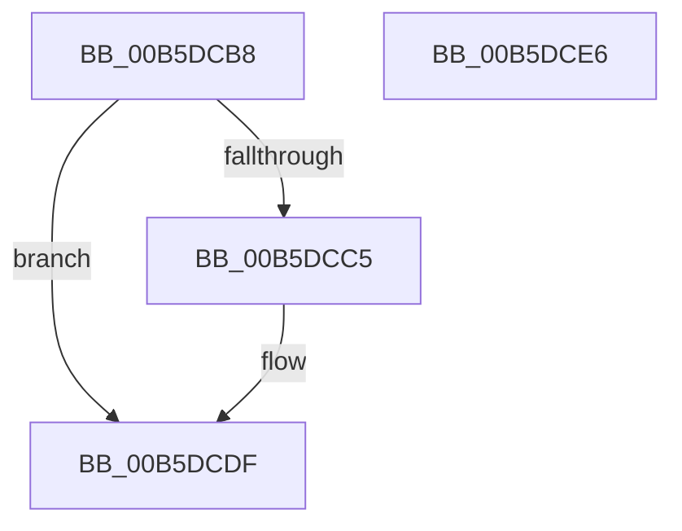

# HalpIommuInitInterrupts

- RVA: `0x00B5DCB8`–`0x00B5DCE7` (길이 `47` bytes)
- VA: `0x0000000140B5DCB8`
- 실행 섹션: `PAGELK`
- PDB 이름 있음: `예`; PDB Function 태그: `아니요`
- unwind 정보 RVA: `0x0005D2F4`
- 디코드: `12`개 명령, `47/47` bytes 표시
- 미해석 바이트: `0` (있으면 어셈블리에 `.byte`로 보존)

> 이 문서는 커널 이미지의 기계어와 PDB 기호를 분석해 생성했습니다. 4번과 5번은 함수 원형과 자료형을 바이너리 사용 방식에서 추정한 C 해석이며 원본 소스 복구 결과는 아닙니다.

## 1. Dependencies

- 직접 호출 지점: **1**; 고유 호출 대상: **1**
- 직접 호출자로 확인된 함수: **1**
- RIP 상대 이미지 참조: **2**

### Outgoing calls
- `0x00B5DCDA` → [HalpInterruptSetIdtEntry](../../text/55/HalpInterruptSetIdtEntry_function_0055BAE0.md) (function, `0x0055BAE0`)

### Direct callers
- [HalpIommuInitSystem](HalpIommuInitSystem_function_00B5D7E0.md) at `0x00B5D876`
- [HalpIommuInitSystem](HalpIommuInitSystem_function_00B5D7E0.md) at `0x00B5D92C`

### Static image references
- `0x00B5DCBC` → RVA `0x00FC1710` (`.data`; read)
- `0x00B5DCCB` → RVA `0x00553890` (`HalpIommuInterruptRoutine`; read)

## 2. Other-region calls and transfers

- 다른 실행 섹션으로 향하는 call: **1**
  - `0x00B5DCDA` → [HalpInterruptSetIdtEntry](../../text/55/HalpInterruptSetIdtEntry_function_0055BAE0.md) (`PAGELK` → `.text`)
- 별도 외부 분기/꼬리 이동을 확인하지 못했습니다.

## 3. Assembly (complete function range)

```asm
00B5DCB8  48 83 EC 38                     sub rsp, 0x38
00B5DCBC  80 3D 4D 3A 46 00 00            cmp byte ptr [rip + 0x463a4d], 0
00B5DCC3  75 1A                           jne 0x140b5dcdf
00B5DCC5  48 83 4C 24 20 FF               or qword ptr [rsp + 0x20], 0xffffffffffffffff
00B5DCCB  48 8D 15 BE 5B 9F FF            lea rdx, [rip - 0x60a442]
00B5DCD2  41 B0 0C                        mov r8b, 0xc
00B5DCD5  B9 CE 00 00 00                  mov ecx, 0xce
00B5DCDA  E8 01 DE 9F FF                  call 0x14055bae0
00B5DCDF  33 C0                           xor eax, eax
00B5DCE1  48 83 C4 38                     add rsp, 0x38
00B5DCE5  C3                              ret
00B5DCE6  CC                              int3
```

## 4. C-style interpretation (structured pseudocode)

```c
__int64 __fastcall HalpIommuInitInterrupts(void)
{
    __int64 result;
    __int64 v_rsp;
    unsigned __int64 v_stack_m18;

    v_rsp = (v_rsp) - (56);
    if ((*(unsigned __int8 *)(v_rip + 4602445)) == 0) {
        a2 = v_rip - 6333506;
        a3 = 12;
        a1 = 206;
        result = HalpInterruptSetIdtEntry(a1, a2, a3, a4);
    }
    result = 0;
    v_rsp = (v_rsp) + (56);
    return result;
}
```

## 5. (Beta) C Style

```c
void HalpIommuInitInterrupts(void)
{
    int64_t result;
    int64_t local_rsp;
    uint64_t v_stack_m18;

    local_rsp = (local_rsp) - (56);
    if ((*(uint8_t *)(v_rip + 0x463A4D)) == 0) {
        a2 = v_rip - 6333506;
        a3 = 12;
        a1 = 206;
        result = HalpInterruptSetIdtEntry(a1, a2, a3, a4);
    }
    result = 0;
    local_rsp = (local_rsp) + (56);
    return result;
}
```

## 6. Execution-region graph

[열기: 2D/3D 그래프와 함수 탐색 컨트롤 패널](../../../control-panel.html?section=pagelk&rva=0x00B5DCB8&view=graph)

- 2D 그래프는 위에서 아래로 흐르고, 3D 그래프는 빈 공간을 드래그해 회전합니다. Shift+드래그는 이동, 휠은 확대·축소, 함수 노드 선택은 대상 보고서 이동입니다.

### Static fallback


