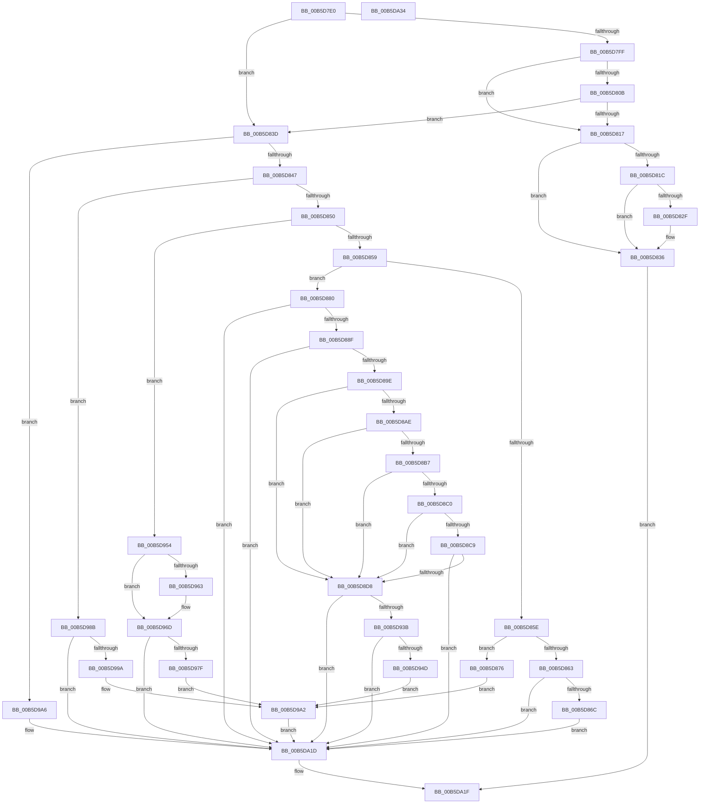

# HalpIommuInitSystem

- RVA: `0x00B5D7E0`–`0x00B5DA35` (길이 `597` bytes)
- VA: `0x0000000140B5D7E0`
- 실행 섹션: `PAGELK`
- PDB 이름 있음: `예`; PDB Function 태그: `아니요`
- unwind 정보 RVA: `0x0005C954`
- 디코드: `136`개 명령, `597/597` bytes 표시
- 미해석 바이트: `0` (있으면 어셈블리에 `.byte`로 보존)

> 이 문서는 커널 이미지의 기계어와 PDB 기호를 분석해 생성했습니다. 4번과 5번은 함수 원형과 자료형을 바이너리 사용 방식에서 추정한 C 해석이며 원본 소스 복구 결과는 아닙니다.

## 1. Dependencies

- 직접 호출 지점: **17**; 고유 호출 대상: **15**
- 직접 호출자로 확인된 함수: **0**
- RIP 상대 이미지 참조: **32**

### Outgoing calls
- `0x00B5D80E` → [guard_dispatch_icall](../../text/6B/guard_dispatch_icall_function_006BAAD0.md) (function, `0x006BAAD0`)
- `0x00B5D826` → [guard_dispatch_icall](../../text/6B/guard_dispatch_icall_function_006BAAD0.md) (function, `0x006BAAD0`)
- `0x00B5D86C` → [HalpIommuLogEarlyFault](../../text/55/HalpIommuLogEarlyFault_function_00555640.md) (function, `0x00555640`)
- `0x00B5D876` → [HalpIommuInitInterrupts](HalpIommuInitInterrupts_function_00B5DCB8.md) (function, `0x00B5DCB8`)
- `0x00B5D880` → [IommuInitializeLibrary](../../text/56/IommuInitializeLibrary_function_00565A64.md) (function, `0x00565A64`)
- `0x00B5D88F` → [HalpIommuInitializeDmar](../../text/55/HalpIommuInitializeDmar_function_0055541C.md) (function, `0x0055541C`)
- `0x00B5D8C9` → [IommupHvUnblockDefaultDma](../../text/56/IommupHvUnblockDefaultDma_function_005677F0.md) (function, `0x005677F0`)
- `0x00B5D92C` → [HalpIommuInitInterrupts](HalpIommuInitInterrupts_function_00B5DCB8.md) (function, `0x00B5DCB8`)
- `0x00B5D93B` → [HalpIommuEnableInterrupts](../../text/54/HalpIommuEnableInterrupts_function_0054E9FC.md) (function, `0x0054E9FC`)
- `0x00B5D94D` → [IommupHvSetRootFaultReportingReady](../../text/56/IommupHvSetRootFaultReportingReady_function_005677D4.md) (function, `0x005677D4`)
- `0x00B5D95A` → [HalpInterruptIsRemappingRequired](../../text/4B/HalpInterruptIsRemappingRequired_function_004B7AB0.md) (function, `0x004B7AB0`)
- `0x00B5D970` → [HalpIommuProcessReservations](../../text/55/HalpIommuProcessReservations_function_005558A4.md) (function, `0x005558A4`)
- `0x00B5D984` → [HalpIommuInitializeAll](../B7/HalpIommuInitializeAll_function_00B7A684.md) (function, `0x00B7A684`)
- `0x00B5D98B` → [HalpIommuInitDiscard](../../init/C2/HalpIommuInitDiscard_function_00C203F8.md) (function, `0x00C203F8`)
- `0x00B5D99D` → [HalpIommuInitializeDmaGuardPolicy](../../text/55/HalpIommuInitializeDmaGuardPolicy_function_00555348.md) (function, `0x00555348`)
- `0x00B5D9F6` → [KeInitializeDpc](../../text/45/KeInitializeDpc_function_0045BBD0.md) (function, `0x0045BBD0`)
- `0x00B5D9FE` → [HalpIommuGetRootIommuFaultPolicy](../../text/54/HalpIommuGetRootIommuFaultPolicy_function_0054EA58.md) (function, `0x0054EA58`)

### Direct callers
- 이 함수 시작 RVA로 연결되는 직접 call은 확인되지 않았습니다. 간접 호출은 완전히 역산할 수 없습니다.

### Static image references
- `0x00B5D7FF` → RVA `0x00E06D28` (`.data`; read)
- `0x00B5D82F` → RVA `0x00E0A80C` (`.data`; write)
- `0x00B5D8AE` → RVA `0x00FC1710` (`.data`; read)
- `0x00B5D8B7` → RVA `0x00FC1712` (`.data`; read)
- `0x00B5D8C0` → RVA `0x00E103E8` (`.data`; read)
- `0x00B5D8D8` → RVA `0x004CA150` (`HalpIommuBlockDevice`; read)
- `0x00B5D8DF` → RVA `0x00E00C20` (`.data`; write)
- `0x00B5D8E6` → RVA `0x004C6250` (`HalpIommuUnblockDevice`; read)
- `0x00B5D8ED` → RVA `0x00E00C28` (`.data`; write)
- `0x00B5D8F4` → RVA `0x0070CC00` (`HalpGetIommuInterface`; read)
- `0x00B5D8FB` → RVA `0x00E00C30` (`.data`; write)
- `0x00B5D902` → RVA `0x00555000` (`HalpIommuDmaRemappingCapable`; read)
- `0x00B5D909` → RVA `0x00E00C98` (`.data`; write)
- `0x00B5D910` → RVA `0x0070CCC0` (`HalpGetIommuInterfaceEx`; read)
- `0x00B5D917` → RVA `0x00E00CB0` (`.data`; write)
- `0x00B5D91E` → RVA `0x0054F810` (`HalpNotifyIommuDomainPolicyChange`; read)
- `0x00B5D925` → RVA `0x00E00CB8` (`.data`; write)
- `0x00B5D954` → RVA `0x00FC18E4` (`.data`; write)
- `0x00B5D9A6` → RVA `0x00FC1740` (`.data`; read)
- `0x00B5D9AD` → RVA `0x00FC16E0` (`.data`; write)
- `0x00B5D9B4` → RVA `0x00FC1748` (`.data`; write)
- `0x00B5D9BB` → RVA `0x005550E0` (`HalpIommuEarlyFaultDpcRoutine`; read)
- `0x00B5D9C2` → RVA `0x00FC1740` (`.data`; write)
- `0x00B5D9C9` → RVA `0x00FC1920` (`.data`; read)
- `0x00B5D9D0` → RVA `0x00FC1720` (`.data`; read)
- `0x00B5D9DA` → RVA `0x00FC1728` (`.data`; write)
- `0x00B5D9E1` → RVA `0x00FC1720` (`.data`; write)
- `0x00B5D9E8` → RVA `0x00C20660` (`HalpIommuRegisterDispatchTable`; read)
- `0x00B5D9EF` → RVA `0x00E00B10` (`.data`; write)
- `0x00B5DA09` → RVA `0x00FC18E8` (`.data`; write)
- `0x00B5DA0F` → RVA `0x004C02D0` (`HalpIommuReportIommuFault`; read)
- `0x00B5DA16` → RVA `0x00E00C90` (`.data`; write)

## 2. Other-region calls and transfers

- 다른 실행 섹션으로 향하는 call: **14**
  - `0x00B5D80E` → [guard_dispatch_icall](../../text/6B/guard_dispatch_icall_function_006BAAD0.md) (`PAGELK` → `.text`)
  - `0x00B5D826` → [guard_dispatch_icall](../../text/6B/guard_dispatch_icall_function_006BAAD0.md) (`PAGELK` → `.text`)
  - `0x00B5D86C` → [HalpIommuLogEarlyFault](../../text/55/HalpIommuLogEarlyFault_function_00555640.md) (`PAGELK` → `.text`)
  - `0x00B5D880` → [IommuInitializeLibrary](../../text/56/IommuInitializeLibrary_function_00565A64.md) (`PAGELK` → `.text`)
  - `0x00B5D88F` → [HalpIommuInitializeDmar](../../text/55/HalpIommuInitializeDmar_function_0055541C.md) (`PAGELK` → `.text`)
  - `0x00B5D8C9` → [IommupHvUnblockDefaultDma](../../text/56/IommupHvUnblockDefaultDma_function_005677F0.md) (`PAGELK` → `.text`)
  - `0x00B5D93B` → [HalpIommuEnableInterrupts](../../text/54/HalpIommuEnableInterrupts_function_0054E9FC.md) (`PAGELK` → `.text`)
  - `0x00B5D94D` → [IommupHvSetRootFaultReportingReady](../../text/56/IommupHvSetRootFaultReportingReady_function_005677D4.md) (`PAGELK` → `.text`)
  - `0x00B5D95A` → [HalpInterruptIsRemappingRequired](../../text/4B/HalpInterruptIsRemappingRequired_function_004B7AB0.md) (`PAGELK` → `.text`)
  - `0x00B5D970` → [HalpIommuProcessReservations](../../text/55/HalpIommuProcessReservations_function_005558A4.md) (`PAGELK` → `.text`)
  - `0x00B5D98B` → [HalpIommuInitDiscard](../../init/C2/HalpIommuInitDiscard_function_00C203F8.md) (`PAGELK` → `INIT`)
  - `0x00B5D99D` → [HalpIommuInitializeDmaGuardPolicy](../../text/55/HalpIommuInitializeDmaGuardPolicy_function_00555348.md) (`PAGELK` → `.text`)
  - `0x00B5D9F6` → [KeInitializeDpc](../../text/45/KeInitializeDpc_function_0045BBD0.md) (`PAGELK` → `.text`)
  - `0x00B5D9FE` → [HalpIommuGetRootIommuFaultPolicy](../../text/54/HalpIommuGetRootIommuFaultPolicy_function_0054EA58.md) (`PAGELK` → `.text`)
- 별도 외부 분기/꼬리 이동을 확인하지 못했습니다.

## 3. Assembly (complete function range)

```asm
00B5D7E0  48 89 5C 24 08                  mov qword ptr [rsp + 8], rbx
00B5D7E5  48 89 6C 24 10                  mov qword ptr [rsp + 0x10], rbp
00B5D7EA  48 89 74 24 18                  mov qword ptr [rsp + 0x18], rsi
00B5D7EF  57                              push rdi
00B5D7F0  48 83 EC 20                     sub rsp, 0x20
00B5D7F4  33 ED                           xor ebp, ebp
00B5D7F6  49 8B F0                        mov rsi, r8
00B5D7F9  8B F9                           mov edi, ecx
00B5D7FB  85 C9                           test ecx, ecx
00B5D7FD  74 3E                           je 0x140b5d83d
00B5D7FF  48 8B 05 22 95 2A 00            mov rax, qword ptr [rip + 0x2a9522]
00B5D806  48 85 C0                        test rax, rax
00B5D809  74 0C                           je 0x140b5d817
00B5D80B  48 8B 00                        mov rax, qword ptr [rax]
00B5D80E  E8 BD D2 B5 FF                  call 0x1406baad0
00B5D813  84 C0                           test al, al
00B5D815  75 26                           jne 0x140b5d83d
00B5D817  83 FF 08                        cmp edi, 8
00B5D81A  75 1A                           jne 0x140b5d836
00B5D81C  48 8B 05 05 95 2A 00            mov rax, qword ptr [rip + 0x2a9505]
00B5D823  48 8B 00                        mov rax, qword ptr [rax]
00B5D826  E8 A5 D2 B5 FF                  call 0x1406baad0
00B5D82B  84 C0                           test al, al
00B5D82D  75 07                           jne 0x140b5d836
00B5D82F  40 88 2D D6 CF 2A 00            mov byte ptr [rip + 0x2acfd6], bpl
00B5D836  33 C0                           xor eax, eax
00B5D838  E9 E2 01 00 00                  jmp 0x140b5da1f
00B5D83D  8B DD                           mov ebx, ebp
00B5D83F  85 FF                           test edi, edi
00B5D841  0F 84 5F 01 00 00               je 0x140b5d9a6
00B5D847  83 FF 08                        cmp edi, 8
00B5D84A  0F 84 3B 01 00 00               je 0x140b5d98b
00B5D850  83 FF 0A                        cmp edi, 0xa
00B5D853  0F 84 FB 00 00 00               je 0x140b5d954
00B5D859  83 FF 11                        cmp edi, 0x11
00B5D85C  74 22                           je 0x140b5d880
00B5D85E  83 FF 13                        cmp edi, 0x13
00B5D861  74 13                           je 0x140b5d876
00B5D863  83 FF 20                        cmp edi, 0x20
00B5D866  0F 85 B1 01 00 00               jne 0x140b5da1d
00B5D86C  E8 CF 7D 9F FF                  call 0x140555640
00B5D871  E9 A7 01 00 00                  jmp 0x140b5da1d
00B5D876  E8 3D 04 00 00                  call 0x140b5dcb8
00B5D87B  E9 22 01 00 00                  jmp 0x140b5d9a2
00B5D880  E8 DF 81 A0 FF                  call 0x140565a64
00B5D885  8B D8                           mov ebx, eax
00B5D887  85 C0                           test eax, eax
00B5D889  0F 88 8E 01 00 00               js 0x140b5da1d
00B5D88F  E8 88 7B 9F FF                  call 0x14055541c
00B5D894  8B D8                           mov ebx, eax
00B5D896  85 C0                           test eax, eax
00B5D898  0F 88 7F 01 00 00               js 0x140b5da1d
00B5D89E  48 8B 86 F0 00 00 00            mov rax, qword ptr [rsi + 0xf0]
00B5D8A5  F6 80 58 0A 00 00 04            test byte ptr [rax + 0xa58], 4
00B5D8AC  74 2A                           je 0x140b5d8d8
00B5D8AE  40 38 2D 5B 3E 46 00            cmp byte ptr [rip + 0x463e5b], bpl
00B5D8B5  74 21                           je 0x140b5d8d8
00B5D8B7  40 38 2D 54 3E 46 00            cmp byte ptr [rip + 0x463e54], bpl
00B5D8BE  74 18                           je 0x140b5d8d8
00B5D8C0  40 38 2D 21 2B 2B 00            cmp byte ptr [rip + 0x2b2b21], bpl
00B5D8C7  75 0F                           jne 0x140b5d8d8
00B5D8C9  E8 22 9F A0 FF                  call 0x1405677f0
00B5D8CE  8B D8                           mov ebx, eax
00B5D8D0  85 C0                           test eax, eax
00B5D8D2  0F 88 45 01 00 00               js 0x140b5da1d
00B5D8D8  48 8D 05 71 C8 96 FF            lea rax, [rip - 0x69378f]
00B5D8DF  48 89 05 3A 33 2A 00            mov qword ptr [rip + 0x2a333a], rax
00B5D8E6  48 8D 05 63 89 96 FF            lea rax, [rip - 0x69769d]
00B5D8ED  48 89 05 34 33 2A 00            mov qword ptr [rip + 0x2a3334], rax
00B5D8F4  48 8D 05 05 F3 BA FF            lea rax, [rip - 0x450cfb]
00B5D8FB  48 89 05 2E 33 2A 00            mov qword ptr [rip + 0x2a332e], rax
00B5D902  48 8D 05 F7 76 9F FF            lea rax, [rip - 0x608909]
00B5D909  48 89 05 88 33 2A 00            mov qword ptr [rip + 0x2a3388], rax
00B5D910  48 8D 05 A9 F3 BA FF            lea rax, [rip - 0x450c57]
00B5D917  48 89 05 92 33 2A 00            mov qword ptr [rip + 0x2a3392], rax
00B5D91E  48 8D 05 EB 1E 9F FF            lea rax, [rip - 0x60e115]
00B5D925  48 89 05 8C 33 2A 00            mov qword ptr [rip + 0x2a338c], rax
00B5D92C  E8 87 03 00 00                  call 0x140b5dcb8
00B5D931  8B D8                           mov ebx, eax
00B5D933  85 C0                           test eax, eax
00B5D935  0F 88 E2 00 00 00               js 0x140b5da1d
00B5D93B  E8 BC 10 9F FF                  call 0x14054e9fc
00B5D940  40 38 2D C9 3D 46 00            cmp byte ptr [rip + 0x463dc9], bpl
00B5D947  0F 84 D0 00 00 00               je 0x140b5da1d
00B5D94D  E8 82 9E A0 FF                  call 0x1405677d4
00B5D952  EB 4E                           jmp 0x140b5d9a2
00B5D954  89 2D 8A 3F 46 00               mov dword ptr [rip + 0x463f8a], ebp
00B5D95A  E8 51 A1 95 FF                  call 0x1404b7ab0
00B5D95F  84 C0                           test al, al
00B5D961  74 0A                           je 0x140b5d96d
00B5D963  C7 05 77 3F 46 00 01 00 00 00   mov dword ptr [rip + 0x463f77], 1
00B5D96D  48 8B CE                        mov rcx, rsi
00B5D970  E8 2F 7F 9F FF                  call 0x1405558a4
00B5D975  8B D8                           mov ebx, eax
00B5D977  85 C0                           test eax, eax
00B5D979  0F 88 9E 00 00 00               js 0x140b5da1d
00B5D97F  48 8B D6                        mov rdx, rsi
00B5D982  33 C9                           xor ecx, ecx
00B5D984  E8 FB CC 01 00                  call 0x140b7a684
00B5D989  EB 17                           jmp 0x140b5d9a2
00B5D98B  E8 68 2A 0C 00                  call 0x140c203f8
00B5D990  8B D8                           mov ebx, eax
00B5D992  85 C0                           test eax, eax
00B5D994  0F 88 83 00 00 00               js 0x140b5da1d
00B5D99A  48 8B CE                        mov rcx, rsi
00B5D99D  E8 A6 79 9F FF                  call 0x140555348
00B5D9A2  8B D8                           mov ebx, eax
00B5D9A4  EB 77                           jmp 0x140b5da1d
00B5D9A6  48 8D 05 93 3D 46 00            lea rax, [rip + 0x463d93]
00B5D9AD  48 89 2D 2C 3D 46 00            mov qword ptr [rip + 0x463d2c], rbp
00B5D9B4  48 89 05 8D 3D 46 00            mov qword ptr [rip + 0x463d8d], rax
00B5D9BB  48 8D 15 1E 77 9F FF            lea rdx, [rip - 0x6088e2]
00B5D9C2  48 89 05 77 3D 46 00            mov qword ptr [rip + 0x463d77], rax
00B5D9C9  48 8D 0D 50 3F 46 00            lea rcx, [rip + 0x463f50]
00B5D9D0  48 8D 05 49 3D 46 00            lea rax, [rip + 0x463d49]
00B5D9D7  45 33 C0                        xor r8d, r8d
00B5D9DA  48 89 05 47 3D 46 00            mov qword ptr [rip + 0x463d47], rax
00B5D9E1  48 89 05 38 3D 46 00            mov qword ptr [rip + 0x463d38], rax
00B5D9E8  48 8D 05 71 2C 0C 00            lea rax, [rip + 0xc2c71]
00B5D9EF  48 89 05 1A 31 2A 00            mov qword ptr [rip + 0x2a311a], rax
00B5D9F6  E8 D5 E1 8F FF                  call 0x14045bbd0
00B5D9FB  48 8B CE                        mov rcx, rsi
00B5D9FE  E8 55 10 9F FF                  call 0x14054ea58
00B5DA03  83 F8 01                        cmp eax, 1
00B5DA06  0F 47 C5                        cmova eax, ebp
00B5DA09  89 05 D9 3E 46 00               mov dword ptr [rip + 0x463ed9], eax
00B5DA0F  48 8D 05 BA 28 96 FF            lea rax, [rip - 0x69d746]
00B5DA16  48 89 05 73 32 2A 00            mov qword ptr [rip + 0x2a3273], rax
00B5DA1D  8B C3                           mov eax, ebx
00B5DA1F  48 8B 5C 24 30                  mov rbx, qword ptr [rsp + 0x30]
00B5DA24  48 8B 6C 24 38                  mov rbp, qword ptr [rsp + 0x38]
00B5DA29  48 8B 74 24 40                  mov rsi, qword ptr [rsp + 0x40]
00B5DA2E  48 83 C4 20                     add rsp, 0x20
00B5DA32  5F                              pop rdi
00B5DA33  C3                              ret
00B5DA34  CC                              int3
```

## 4. C-style interpretation (structured pseudocode)

```c
__int64 __fastcall HalpIommuInitSystem(int a1, __int64 a2, __int64 a3)
{
    __int64 result;
    __int64 v_rbp;
    __int64 v_rsp;
    unsigned __int64 v_stack_p10;
    unsigned __int64 v_stack_p18;
    unsigned __int64 v_stack_p8;

    v_stack_p8 = v_rbx;
    v_stack_p10 = v_rbp;
    v_stack_p18 = v_rsi;
    v_rsp = (v_rsp) - (32);
    v_rbp = 0;
    if (a1 == 0) goto loc_00B5D83D;
    if (*(unsigned __int64 *)(v_rip + 2790690) == 0) goto loc_00B5D817;
    result = guard_dispatch_icall(a1, a2, a3, a4);
    if ((unsigned __int8)(result) != 0) goto loc_00B5D83D;
loc_00B5D817:
    if (((unsigned int)((unsigned int)(a1))) != 8) goto loc_00B5D836;
    result = guard_dispatch_icall(a1, a2, a3, a4);
    if ((unsigned __int8)(result) == 0) {
        *(unsigned __int8 *)(v_rip + 2805718) = 0;
    }
    result = 0;
    goto loc_00B5DA1F;
loc_00B5D83D:
    if ((unsigned int)((unsigned int)(a1)) == 0) goto loc_00B5D9A6;
    if (((unsigned int)((unsigned int)(a1))) == 8) goto loc_00B5D98B;
    if (((unsigned int)((unsigned int)(a1))) == 10) goto loc_00B5D954;
    if (((unsigned int)((unsigned int)(a1))) == 17) goto loc_00B5D880;
    if (((unsigned int)((unsigned int)(a1))) == 19) goto loc_00B5D876;
    if (((unsigned int)((unsigned int)(a1))) != 32) goto loc_00B5DA1D;
    result = HalpIommuLogEarlyFault(a1, a2, a3, a4);
    goto loc_00B5DA1D;
loc_00B5D876:
    result = HalpIommuInitInterrupts(a1, a2, a3, a4);
    goto loc_00B5D9A2;
loc_00B5D880:
    result = IommuInitializeLibrary(a1, a2, a3, a4);
    if (sign_flag) goto loc_00B5DA1D;
    result = HalpIommuInitializeDmar(a1, a2, a3, a4);
    if (sign_flag) goto loc_00B5DA1D;
    if (((*(unsigned __int8 *)(*(unsigned __int64 *)(a3 + 240) + 2648)) & (4)) == 0) goto loc_00B5D8D8;
    if ((*(unsigned __int8 *)(v_rip + 4603483)) == 0) goto loc_00B5D8D8;
    if ((*(unsigned __int8 *)(v_rip + 4603476)) == 0) goto loc_00B5D8D8;
    if ((*(unsigned __int8 *)(v_rip + 2829089)) != 0) goto loc_00B5D8D8;
    result = IommupHvUnblockDefaultDma(a1, a2, a3, a4);
    if (sign_flag) goto loc_00B5DA1D;
loc_00B5D8D8:
    *(unsigned __int64 *)(v_rip + 2765626) = v_rip - 6895503;
    *(unsigned __int64 *)(v_rip + 2765620) = v_rip - 6911645;
    *(unsigned __int64 *)(v_rip + 2765614) = v_rip - 4525307;
    *(unsigned __int64 *)(v_rip + 2765704) = v_rip - 6326537;
    *(unsigned __int64 *)(v_rip + 2765714) = v_rip - 4525143;
    *(unsigned __int64 *)(v_rip + 2765708) = v_rip - 6349077;
    result = HalpIommuInitInterrupts(a1, a2, a3, a4);
    if (sign_flag) goto loc_00B5DA1D;
    result = HalpIommuEnableInterrupts(a1, a2, a3, a4);
    if ((*(unsigned __int8 *)(v_rip + 4603337)) == 0) goto loc_00B5DA1D;
    result = IommupHvSetRootFaultReportingReady(a1, a2, a3, a4);
    goto loc_00B5D9A2;
loc_00B5D954:
    *(unsigned int *)(v_rip + 4603786) = 0;
    result = HalpInterruptIsRemappingRequired(a1, a2, a3, a4);
    if ((unsigned __int8)(result) != 0) {
        *(unsigned int *)(v_rip + 4603767) = 1;
    }
    result = HalpIommuProcessReservations(a3, a2, a3, a4);
    if (sign_flag) goto loc_00B5DA1D;
    a1 = 0;
    result = HalpIommuInitializeAll(a1, a3, a3, a4);
    goto loc_00B5D9A2;
loc_00B5D98B:
    result = HalpIommuInitDiscard(a1, a3, a3, a4);
    if (sign_flag) goto loc_00B5DA1D;
    result = HalpIommuInitializeDmaGuardPolicy(a3, a3, a3, a4);
loc_00B5D9A2:
    goto loc_00B5DA1D;
loc_00B5D9A6:
    *(unsigned __int64 *)(v_rip + 4603180) = 0;
    *(unsigned __int64 *)(v_rip + 4603277) = v_rip + 4603283;
    *(unsigned __int64 *)(v_rip + 4603255) = v_rip + 4603283;
    a3 = 0;
    *(unsigned __int64 *)(v_rip + 4603207) = v_rip + 4603209;
    *(unsigned __int64 *)(v_rip + 4603192) = v_rip + 4603209;
    *(unsigned __int64 *)(v_rip + 2765082) = v_rip + 797809;
    result = KeInitializeDpc(v_rip + 4603728, v_rip - 6326498, a3, a4);
    result = HalpIommuGetRootIommuFaultPolicy(0, v_rip - 6326498, a3, a4);
    if (((unsigned int)(result)) > 1) { result = 0; }
    *(unsigned int *)(v_rip + 4603609) = (unsigned int)(result);
    *(unsigned __int64 *)(v_rip + 2765427) = v_rip - 6936390;
loc_00B5DA1D:
loc_00B5DA1F:
    v_rsp = (v_rsp) + (32);
    return (unsigned int)((unsigned int)((unsigned int)((unsigned int)(result))));
}
```

## 5. (Beta) C Style

```c
int64_t HalpIommuInitSystem(int32_t Arg1, int64_t Arg2, void *Arg3)
{
    uint8_t *arg3 = (uint8_t *)Arg3;

    int64_t result;
    int64_t local_rbp;
    int64_t local_rsp;
    uint64_t v_stack_p10;
    uint64_t v_stack_p18;
    uint64_t v_stack_p8;

    v_stack_p8 = local_rbx;
    v_stack_p10 = local_rbp;
    v_stack_p18 = local_rsi;
    local_rsp = (local_rsp) - (32);
    local_rbp = 0;
    if (Arg1 == 0) goto loc_00B5D83D;
    if (*(uint64_t *)(v_rip + 0x2A9522) == 0) goto loc_00B5D817;
    result = guard_dispatch_icall(Arg1, Arg2, Arg3, a4);
    if ((uint8_t)(result) != 0) goto loc_00B5D83D;
loc_00B5D817:
    if (((uint32_t)((uint32_t)(Arg1))) != 8) goto loc_00B5D836;
    result = guard_dispatch_icall(Arg1, Arg2, Arg3, a4);
    if ((uint8_t)(result) == 0) {
        *(uint8_t *)(v_rip + 0x2ACFD6) = 0;
    }
    result = 0;
    goto loc_00B5DA1F;
loc_00B5D83D:
    if ((uint32_t)((uint32_t)(Arg1)) == 0) goto loc_00B5D9A6;
    if (((uint32_t)((uint32_t)(Arg1))) == 8) goto loc_00B5D98B;
    if (((uint32_t)((uint32_t)(Arg1))) == 10) goto loc_00B5D954;
    if (((uint32_t)((uint32_t)(Arg1))) == 17) goto loc_00B5D880;
    if (((uint32_t)((uint32_t)(Arg1))) == 19) goto loc_00B5D876;
    if (((uint32_t)((uint32_t)(Arg1))) != 32) goto loc_00B5DA1D;
    result = HalpIommuLogEarlyFault(Arg1, Arg2, Arg3, a4);
    goto loc_00B5DA1D;
loc_00B5D876:
    result = HalpIommuInitInterrupts(Arg1, Arg2, Arg3, a4);
    goto loc_00B5D9A2;
loc_00B5D880:
    result = IommuInitializeLibrary(Arg1, Arg2, Arg3, a4);
    if (sign_flag) goto loc_00B5DA1D;
    result = HalpIommuInitializeDmar(Arg1, Arg2, Arg3, a4);
    if (sign_flag) goto loc_00B5DA1D;
    if (((*(uint8_t *)(*(uint64_t *)(arg3 + 0xF0) + 0xA58)) & (4)) == 0) goto loc_00B5D8D8;
    if ((*(uint8_t *)(v_rip + 0x463E5B)) == 0) goto loc_00B5D8D8;
    if ((*(uint8_t *)(v_rip + 0x463E54)) == 0) goto loc_00B5D8D8;
    if ((*(uint8_t *)(v_rip + 0x2B2B21)) != 0) goto loc_00B5D8D8;
    result = IommupHvUnblockDefaultDma(Arg1, Arg2, Arg3, a4);
    if (sign_flag) goto loc_00B5DA1D;
loc_00B5D8D8:
    *(uint64_t *)(v_rip + 0x2A333A) = v_rip - 6895503;
    *(uint64_t *)(v_rip + 0x2A3334) = v_rip - 6911645;
    *(uint64_t *)(v_rip + 0x2A332E) = v_rip - 4525307;
    *(uint64_t *)(v_rip + 0x2A3388) = v_rip - 6326537;
    *(uint64_t *)(v_rip + 0x2A3392) = v_rip - 4525143;
    *(uint64_t *)(v_rip + 0x2A338C) = v_rip - 6349077;
    result = HalpIommuInitInterrupts(Arg1, Arg2, Arg3, a4);
    if (sign_flag) goto loc_00B5DA1D;
    result = HalpIommuEnableInterrupts(Arg1, Arg2, Arg3, a4);
    if ((*(uint8_t *)(v_rip + 0x463DC9)) == 0) goto loc_00B5DA1D;
    result = IommupHvSetRootFaultReportingReady(Arg1, Arg2, Arg3, a4);
    goto loc_00B5D9A2;
loc_00B5D954:
    *(uint32_t *)(v_rip + 0x463F8A) = 0;
    result = HalpInterruptIsRemappingRequired(Arg1, Arg2, Arg3, a4);
    if ((uint8_t)(result) != 0) {
        *(uint32_t *)(v_rip + 0x463F77) = 1;
    }
    result = HalpIommuProcessReservations(Arg3, Arg2, Arg3, a4);
    if (sign_flag) goto loc_00B5DA1D;
    Arg1 = 0;
    result = HalpIommuInitializeAll(Arg1, Arg3, Arg3, a4);
    goto loc_00B5D9A2;
loc_00B5D98B:
    result = HalpIommuInitDiscard(Arg1, Arg3, Arg3, a4);
    if (sign_flag) goto loc_00B5DA1D;
    result = HalpIommuInitializeDmaGuardPolicy(Arg3, Arg3, Arg3, a4);
loc_00B5D9A2:
    goto loc_00B5DA1D;
loc_00B5D9A6:
    *(uint64_t *)(v_rip + 0x463D2C) = 0;
    *(uint64_t *)(v_rip + 0x463D8D) = v_rip + 4603283;
    *(uint64_t *)(v_rip + 0x463D77) = v_rip + 4603283;
    Arg3 = 0;
    *(uint64_t *)(v_rip + 0x463D47) = v_rip + 4603209;
    *(uint64_t *)(v_rip + 0x463D38) = v_rip + 4603209;
    *(uint64_t *)(v_rip + 0x2A311A) = v_rip + 797809;
    result = KeInitializeDpc(v_rip + 4603728, v_rip - 6326498, Arg3, a4);
    result = HalpIommuGetRootIommuFaultPolicy(0, v_rip - 6326498, Arg3, a4);
    if (((uint32_t)(result)) > 1) { result = 0; }
    *(uint32_t *)(v_rip + 0x463ED9) = (uint32_t)(result);
    *(uint64_t *)(v_rip + 0x2A3273) = v_rip - 6936390;
loc_00B5DA1D:
loc_00B5DA1F:
    local_rsp = (local_rsp) + (32);
    return (uint32_t)((uint32_t)((uint32_t)((uint32_t)(result))));
}
```

### 관측된 메모리 오프셋

구조체 형식이 확인되지 않은 접근은 인자 기준의 오프셋으로만 기록했습니다.

| 기준 인자 | 오프셋 표현 | 폭 (bit) | 접근 |
|---|---:|---:|---|
| `Arg3` | `+ 0xF0` | `64` | `R` |

## 6. Execution-region graph

[열기: 2D/3D 그래프와 함수 탐색 컨트롤 패널](../../../control-panel.html?section=pagelk&rva=0x00B5D7E0&view=graph)

- 2D 그래프는 위에서 아래로 흐르고, 3D 그래프는 빈 공간을 드래그해 회전합니다. Shift+드래그는 이동, 휠은 확대·축소, 함수 노드 선택은 대상 보고서 이동입니다.

### Static fallback


