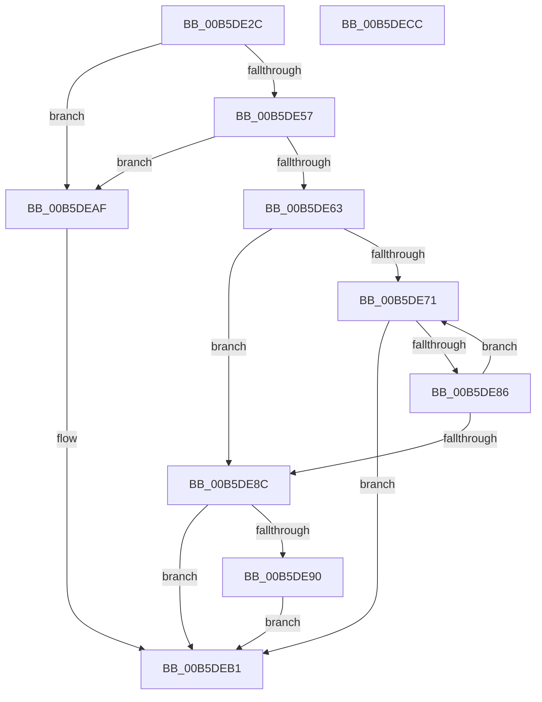

# HalpIommuProcessReservedDomains

- RVA: `0x00B5DE2C`–`0x00B5DECD` (길이 `161` bytes)
- VA: `0x0000000140B5DE2C`
- 실행 섹션: `PAGELK`
- PDB 이름 있음: `예`; PDB Function 태그: `아니요`
- unwind 정보 RVA: `0x0005E6B4`
- 디코드: `48`개 명령, `161/161` bytes 표시
- 미해석 바이트: `0` (있으면 어셈블리에 `.byte`로 보존)

> 이 문서는 커널 이미지의 기계어와 PDB 기호를 분석해 생성했습니다. 4번과 5번은 함수 원형과 자료형을 바이너리 사용 방식에서 추정한 C 해석이며 원본 소스 복구 결과는 아닙니다.

## 1. Dependencies

- 직접 호출 지점: **2**; 고유 호출 대상: **2**
- 직접 호출자로 확인된 함수: **1**
- RIP 상대 이미지 참조: **0**

### Outgoing calls
- `0x00B5DE7D` → [HalpIommuConstructReservedPageTable](HalpIommuConstructReservedPageTable_function_00B5DD20.md) (function, `0x00B5DD20`)
- `0x00B5DEA8` → [guard_dispatch_icall](../../text/6B/guard_dispatch_icall_function_006BAAD0.md) (function, `0x006BAAD0`)

### Direct callers
- [HalpIommuInitializeAll](../B7/HalpIommuInitializeAll_function_00B7A684.md) at `0x00B7A7F1`

### Static image references
- 디코드된 RIP-relative 메모리 참조가 없습니다.

## 2. Other-region calls and transfers

- 다른 실행 섹션으로 향하는 call: **1**
  - `0x00B5DEA8` → [guard_dispatch_icall](../../text/6B/guard_dispatch_icall_function_006BAAD0.md) (`PAGELK` → `.text`)
- 별도 외부 분기/꼬리 이동을 확인하지 못했습니다.

## 3. Assembly (complete function range)

```asm
00B5DE2C  48 8B C4                        mov rax, rsp
00B5DE2F  48 89 58 08                     mov qword ptr [rax + 8], rbx
00B5DE33  48 89 68 10                     mov qword ptr [rax + 0x10], rbp
00B5DE37  48 89 70 18                     mov qword ptr [rax + 0x18], rsi
00B5DE3B  48 89 78 20                     mov qword ptr [rax + 0x20], rdi
00B5DE3F  41 56                           push r14
00B5DE41  48 83 EC 20                     sub rsp, 0x20
00B5DE45  48 8B B2 18 02 00 00            mov rsi, qword ptr [rdx + 0x218]
00B5DE4C  48 8B FA                        mov rdi, rdx
00B5DE4F  4C 8B F1                        mov r14, rcx
00B5DE52  48 85 F6                        test rsi, rsi
00B5DE55  74 58                           je 0x140b5deaf
00B5DE57  8B 9A D8 01 00 00               mov ebx, dword ptr [rdx + 0x1d8]
00B5DE5D  0F BA E3 08                     bt ebx, 8
00B5DE61  73 4C                           jae 0x140b5deaf
00B5DE63  C1 EB 0D                        shr ebx, 0xd
00B5DE66  33 C0                           xor eax, eax
00B5DE68  83 E3 07                        and ebx, 7
00B5DE6B  33 ED                           xor ebp, ebp
00B5DE6D  39 06                           cmp dword ptr [rsi], eax
00B5DE6F  76 1B                           jbe 0x140b5de8c
00B5DE71  48 8B 54 EE 08                  mov rdx, qword ptr [rsi + rbp*8 + 8]
00B5DE76  44 8D 43 01                     lea r8d, [rbx + 1]
00B5DE7A  49 8B CE                        mov rcx, r14
00B5DE7D  E8 9E FE FF FF                  call 0x140b5dd20
00B5DE82  85 C0                           test eax, eax
00B5DE84  78 2B                           js 0x140b5deb1
00B5DE86  FF C5                           inc ebp
00B5DE88  3B 2E                           cmp ebp, dword ptr [rsi]
00B5DE8A  72 E5                           jb 0x140b5de71
00B5DE8C  85 C0                           test eax, eax
00B5DE8E  78 21                           js 0x140b5deb1
00B5DE90  48 8B 97 18 02 00 00            mov rdx, qword ptr [rdi + 0x218]
00B5DE97  48 8B 87 60 01 00 00            mov rax, qword ptr [rdi + 0x160]
00B5DE9E  48 8B 4F 10                     mov rcx, qword ptr [rdi + 0x10]
00B5DEA2  4C 8D 42 08                     lea r8, [rdx + 8]
00B5DEA6  8B 12                           mov edx, dword ptr [rdx]
00B5DEA8  E8 23 CC B5 FF                  call 0x1406baad0
00B5DEAD  EB 02                           jmp 0x140b5deb1
00B5DEAF  33 C0                           xor eax, eax
00B5DEB1  48 8B 5C 24 30                  mov rbx, qword ptr [rsp + 0x30]
00B5DEB6  48 8B 6C 24 38                  mov rbp, qword ptr [rsp + 0x38]
00B5DEBB  48 8B 74 24 40                  mov rsi, qword ptr [rsp + 0x40]
00B5DEC0  48 8B 7C 24 48                  mov rdi, qword ptr [rsp + 0x48]
00B5DEC5  48 83 C4 20                     add rsp, 0x20
00B5DEC9  41 5E                           pop r14
00B5DECB  C3                              ret
00B5DECC  CC                              int3
```

## 4. C-style interpretation (structured pseudocode)

```c
__int64 __fastcall HalpIommuProcessReservedDomains(__int64 a1, __int64 a2)
{
    __int64 result;
    __int64 v_rbp;
    __int64 v_rbx;
    __int64 v_rsp;
    unsigned __int64 v_stack_p10;
    unsigned __int64 v_stack_p18;
    unsigned __int64 v_stack_p20;
    unsigned __int64 v_stack_p8;

    *(unsigned __int64 *)(v_rsp + 8) = v_rbx;
    *(unsigned __int64 *)(v_rsp + 16) = v_rbp;
    *(unsigned __int64 *)(v_rsp + 24) = v_rsi;
    *(unsigned __int64 *)(v_rsp + 32) = v_rdi;
    v_rsp = (v_rsp) - (32);
    if (*(unsigned __int64 *)(a2 + 536) == 0) goto loc_00B5DEAF;
    if (condition_is_above_or_equal) goto loc_00B5DEAF;
    v_rbx = (unsigned int)(((unsigned int)(*(unsigned int *)(a2 + 472))) >> (13));
    result = 0;
    v_rbx = (unsigned int)((v_rbx) & (7));
    v_rbp = 0;
    if ((*(unsigned int *)(*(unsigned __int64 *)(a2 + 536))) <= 0) goto loc_00B5DE8C;
loc_00B5DE71:
    result = HalpIommuConstructReservedPageTable(a1, *(unsigned __int64 *)(*(unsigned __int64 *)(a2 + 536) + v_rbp * 8 + 8), v_rbx + 1, a4);
    if (sign_flag) goto loc_00B5DEB1;
    v_rbp = (unsigned int)((v_rbp) + 1);
    if (((unsigned int)(v_rbp)) < (*(unsigned int *)(*(unsigned __int64 *)(a2 + 536)))) goto loc_00B5DE71;
loc_00B5DE8C:
    if (sign_flag) goto loc_00B5DEB1;
    result = guard_dispatch_icall(*(unsigned __int64 *)(a2 + 16), (unsigned int)(*(unsigned int *)(*(unsigned __int64 *)(a2 + 536))), *(unsigned __int64 *)(a2 + 536) + 8, a4);
    goto loc_00B5DEB1;
loc_00B5DEAF:
    result = 0;
loc_00B5DEB1:
    v_rsp = (v_rsp) + (32);
    return result;
}
```

## 5. (Beta) C Style

```c
int64_t HalpIommuProcessReservedDomains(int64_t Arg1, void *Arg2)
{
    uint8_t *arg2 = (uint8_t *)Arg2;

    int64_t result;
    int64_t local_rbp;
    int64_t local_rbx;
    int64_t local_rsp;
    uint64_t v_stack_p10;
    uint64_t v_stack_p18;
    uint64_t v_stack_p20;
    uint64_t v_stack_p8;

    *(uint64_t *)(local_rsp + 0x8) = local_rbx;
    *(uint64_t *)(local_rsp + 0x10) = local_rbp;
    *(uint64_t *)(local_rsp + 0x18) = local_rsi;
    *(uint64_t *)(local_rsp + 0x20) = local_rdi;
    local_rsp = (local_rsp) - (32);
    if (*(uint64_t *)(arg2 + 0x218) == 0) goto loc_00B5DEAF;
    if (condition_is_above_or_equal) goto loc_00B5DEAF;
    local_rbx = (uint32_t)(((uint32_t)(*(uint32_t *)(arg2 + 0x1D8))) >> (13));
    result = 0;
    local_rbx = (uint32_t)((local_rbx) & (7));
    local_rbp = 0;
    if ((*(uint32_t *)(*(uint64_t *)(arg2 + 0x218))) <= 0) goto loc_00B5DE8C;
loc_00B5DE71:
    result = HalpIommuConstructReservedPageTable(Arg1, *(uint64_t *)(*(uint64_t *)(arg2 + 0x218) + local_rbp * 8 + 0x8), local_rbx + 1, a4);
    if (sign_flag) goto loc_00B5DEB1;
    local_rbp = (uint32_t)((local_rbp) + 1);
    if (((uint32_t)(local_rbp)) < (*(uint32_t *)(*(uint64_t *)(arg2 + 0x218)))) goto loc_00B5DE71;
loc_00B5DE8C:
    if (sign_flag) goto loc_00B5DEB1;
    result = guard_dispatch_icall(*(uint64_t *)(arg2 + 0x10), (uint32_t)(*(uint32_t *)(*(uint64_t *)(arg2 + 0x218))), *(uint64_t *)(arg2 + 0x218) + 8, a4);
    goto loc_00B5DEB1;
loc_00B5DEAF:
    result = 0;
loc_00B5DEB1:
    local_rsp = (local_rsp) + (32);
    return result;
}
```

### 관측된 메모리 오프셋

구조체 형식이 확인되지 않은 접근은 인자 기준의 오프셋으로만 기록했습니다.

| 기준 인자 | 오프셋 표현 | 폭 (bit) | 접근 |
|---|---:|---:|---|
| `Arg2` | `+ 0x10` | `64` | `R` |
| `Arg2` | `+ 0x160` | `64` | `R` |
| `Arg2` | `+ 0x1D8` | `32` | `R` |
| `Arg2` | `+ 0x218` | `64` | `R` |

## 6. Execution-region graph

[열기: 2D/3D 그래프와 함수 탐색 컨트롤 패널](../../../control-panel.html?section=pagelk&rva=0x00B5DE2C&view=graph)

- 2D 그래프는 위에서 아래로 흐르고, 3D 그래프는 빈 공간을 드래그해 회전합니다. Shift+드래그는 이동, 휠은 확대·축소, 함수 노드 선택은 대상 보고서 이동입니다.

### Static fallback


