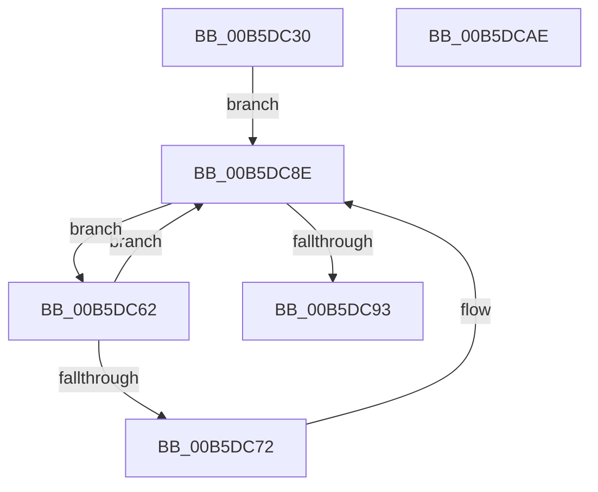

# HalpIommuUpdateRemappingDestination

- RVA: `0x00B5DC30`–`0x00B5DCAF` (길이 `127` bytes)
- VA: `0x0000000140B5DC30`
- 실행 섹션: `PAGELK`
- PDB 이름 있음: `예`; PDB Function 태그: `아니요`
- unwind 정보 RVA: `0x0005D7BC`
- 디코드: `35`개 명령, `127/127` bytes 표시
- 미해석 바이트: `0` (있으면 어셈블리에 `.byte`로 보존)

> 이 문서는 커널 이미지의 기계어와 PDB 기호를 분석해 생성했습니다. 4번과 5번은 함수 원형과 자료형을 바이너리 사용 방식에서 추정한 C 해석이며 원본 소스 복구 결과는 아닙니다.

## 1. Dependencies

- 직접 호출 지점: **1**; 고유 호출 대상: **1**
- 직접 호출자로 확인된 함수: **1**
- RIP 상대 이미지 참조: **1**

### Outgoing calls
- `0x00B5DC89` → [guard_dispatch_icall](../../text/6B/guard_dispatch_icall_function_006BAAD0.md) (function, `0x006BAAD0`)

### Direct callers
- [HalpUpdateIrtDestinationId](../../text/55/HalpUpdateIrtDestinationId_function_005572EC.md) at `0x005572F0`

### Static image references
- `0x00B5DC49` → RVA `0x00FC1740` (`.data`; read)

## 2. Other-region calls and transfers

- 다른 실행 섹션으로 향하는 call: **1**
  - `0x00B5DC89` → [guard_dispatch_icall](../../text/6B/guard_dispatch_icall_function_006BAAD0.md) (`PAGELK` → `.text`)
- 별도 외부 분기/꼬리 이동을 확인하지 못했습니다.

## 3. Assembly (complete function range)

```asm
00B5DC30  48 8B C4                        mov rax, rsp
00B5DC33  48 89 58 08                     mov qword ptr [rax + 8], rbx
00B5DC37  48 89 68 10                     mov qword ptr [rax + 0x10], rbp
00B5DC3B  48 89 70 18                     mov qword ptr [rax + 0x18], rsi
00B5DC3F  48 89 78 20                     mov qword ptr [rax + 0x20], rdi
00B5DC43  41 56                           push r14
00B5DC45  48 83 EC 30                     sub rsp, 0x30
00B5DC49  48 8B 1D F0 3A 46 00            mov rbx, qword ptr [rip + 0x463af0]
00B5DC50  4C 8D 35 E9 3A 46 00            lea r14, [rip + 0x463ae9]
00B5DC57  41 8B F9                        mov edi, r9d
00B5DC5A  49 8B F0                        mov rsi, r8
00B5DC5D  48 8B EA                        mov rbp, rdx
00B5DC60  EB 2C                           jmp 0x140b5dc8e
00B5DC62  48 8D 0B                        lea rcx, [rbx]
00B5DC65  48 8B 1B                        mov rbx, qword ptr [rbx]
00B5DC68  8B 81 D8 01 00 00               mov eax, dword ptr [rcx + 0x1d8]
00B5DC6E  A8 40                           test al, 0x40
00B5DC70  74 1C                           je 0x140b5dc8e
00B5DC72  48 8B 81 C0 00 00 00            mov rax, qword ptr [rcx + 0xc0]
00B5DC79  4C 8B CE                        mov r9, rsi
00B5DC7C  48 8B 49 10                     mov rcx, qword ptr [rcx + 0x10]
00B5DC80  4C 8B C5                        mov r8, rbp
00B5DC83  B2 01                           mov dl, 1
00B5DC85  89 7C 24 20                     mov dword ptr [rsp + 0x20], edi
00B5DC89  E8 42 CE B5 FF                  call 0x1406baad0
00B5DC8E  49 3B DE                        cmp rbx, r14
00B5DC91  75 CF                           jne 0x140b5dc62
00B5DC93  48 8B 5C 24 40                  mov rbx, qword ptr [rsp + 0x40]
00B5DC98  48 8B 6C 24 48                  mov rbp, qword ptr [rsp + 0x48]
00B5DC9D  48 8B 74 24 50                  mov rsi, qword ptr [rsp + 0x50]
00B5DCA2  48 8B 7C 24 58                  mov rdi, qword ptr [rsp + 0x58]
00B5DCA7  48 83 C4 30                     add rsp, 0x30
00B5DCAB  41 5E                           pop r14
00B5DCAD  C3                              ret
00B5DCAE  CC                              int3
```

## 4. C-style interpretation (structured pseudocode)

```c
__int64 __fastcall HalpIommuUpdateRemappingDestination(__int64 a1, __int64 a2, __int64 a3, int a4)
{
    __int64 result;
    __int64 v_rsp;
    unsigned int v_stack_m18;
    unsigned __int64 v_stack_p10;
    unsigned __int64 v_stack_p18;
    unsigned __int64 v_stack_p20;
    unsigned __int64 v_stack_p8;

    *(unsigned __int64 *)(v_rsp + 8) = v_rbx;
    *(unsigned __int64 *)(v_rsp + 16) = v_rbp;
    *(unsigned __int64 *)(v_rsp + 24) = v_rsi;
    *(unsigned __int64 *)(v_rsp + 32) = v_rdi;
    v_rsp = (v_rsp) - (48);
    goto loc_00B5DC8E;
loc_00B5DC62:
    result = (unsigned int)(*(unsigned int *)(*(unsigned __int64 *)(v_rip + 4602608) + 472));
    if ((((unsigned __int8)((unsigned int)(*(unsigned int *)(*(unsigned __int64 *)(v_rip + 4602608) + 472)))) & (64)) != 0) {
        result = *(unsigned __int64 *)(*(unsigned __int64 *)(v_rip + 4602608) + 192);
        a4 = a3;
        a1 = *(unsigned __int64 *)(*(unsigned __int64 *)(v_rip + 4602608) + 16);
        a3 = a2;
        a2 = 1;
        v_stack_m18 = (unsigned int)((unsigned int)(a4));
        result = guard_dispatch_icall(a1, a2, a3, a4);
    }
    if ((*(unsigned __int64 *)(*(unsigned __int64 *)(v_rip + 4602608))) != (v_rip + 4602601)) goto loc_00B5DC62;
    v_rsp = (v_rsp) + (48);
    return result;
}
```

## 5. (Beta) C Style

```c
int64_t HalpIommuUpdateRemappingDestination(int64_t Arg1, int64_t Arg2, int64_t Arg3, int32_t Arg4)
{
    int64_t result;
    int64_t local_rsp;
    uint32_t v_stack_m18;
    uint64_t v_stack_p10;
    uint64_t v_stack_p18;
    uint64_t v_stack_p20;
    uint64_t v_stack_p8;

    *(uint64_t *)(local_rsp + 0x8) = local_rbx;
    *(uint64_t *)(local_rsp + 0x10) = local_rbp;
    *(uint64_t *)(local_rsp + 0x18) = local_rsi;
    *(uint64_t *)(local_rsp + 0x20) = local_rdi;
    local_rsp = (local_rsp) - (48);
    goto loc_00B5DC8E;
loc_00B5DC62:
    result = (uint32_t)(*(uint32_t *)(*(uint64_t *)(v_rip + 0x463AF0) + 0x1D8));
    if ((((uint8_t)((uint32_t)(*(uint32_t *)(*(uint64_t *)(v_rip + 0x463AF0) + 0x1D8)))) & (64)) != 0) {
        result = *(uint64_t *)(*(uint64_t *)(v_rip + 0x463AF0) + 0xC0);
        Arg4 = Arg3;
        Arg1 = *(uint64_t *)(*(uint64_t *)(v_rip + 0x463AF0) + 0x10);
        Arg3 = Arg2;
        Arg2 = 1;
        v_stack_m18 = (uint32_t)((uint32_t)(Arg4));
        result = guard_dispatch_icall(Arg1, Arg2, Arg3, Arg4);
    }
    if ((*(uint64_t *)(*(uint64_t *)(v_rip + 0x463AF0))) != (v_rip + 4602601)) goto loc_00B5DC62;
    local_rsp = (local_rsp) + (48);
    return result;
}
```

## 6. Execution-region graph

[열기: 2D/3D 그래프와 함수 탐색 컨트롤 패널](../../../control-panel.html?section=pagelk&rva=0x00B5DC30&view=graph)

- 2D 그래프는 위에서 아래로 흐르고, 3D 그래프는 빈 공간을 드래그해 회전합니다. Shift+드래그는 이동, 휠은 확대·축소, 함수 노드 선택은 대상 보고서 이동입니다.

### Static fallback


