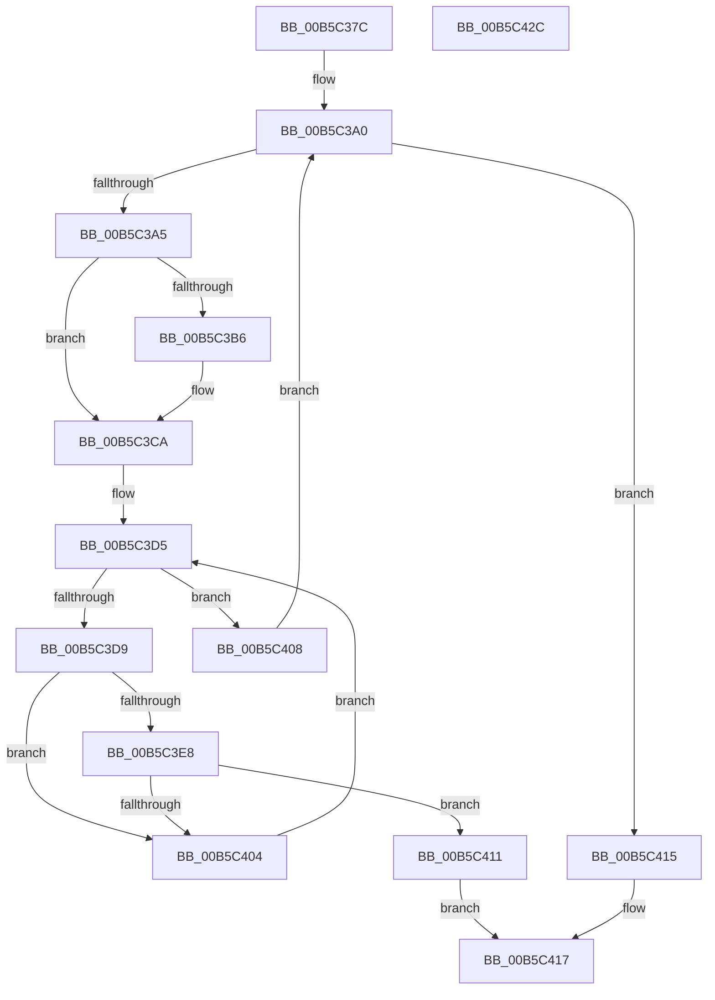

# HalpIsCmciImplementedAMD

- RVA: `0x00B5C37C`–`0x00B5C42D` (길이 `177` bytes)
- VA: `0x0000000140B5C37C`
- 실행 섹션: `PAGELK`
- PDB 이름 있음: `예`; PDB Function 태그: `아니요`
- unwind 정보 RVA: `0x0005C954`
- 디코드: `47`개 명령, `177/177` bytes 표시
- 미해석 바이트: `0` (있으면 어셈블리에 `.byte`로 보존)

> 이 문서는 커널 이미지의 기계어와 PDB 기호를 분석해 생성했습니다. 4번과 5번은 함수 원형과 자료형을 바이너리 사용 방식에서 추정한 C 해석이며 원본 소스 복구 결과는 아닙니다.

## 1. Dependencies

- 직접 호출 지점: **1**; 고유 호출 대상: **1**
- 직접 호출자로 확인된 함수: **1**
- RIP 상대 이미지 참조: **2**

### Outgoing calls
- `0x00B5C3DE` → [HalpWheaReadMsrMisc](../../text/48/HalpWheaReadMsrMisc_function_004872EC.md) (function, `0x004872EC`)

### Direct callers
- [HalpCmciInitProcessor](../../text/48/HalpCmciInitProcessor_function_004875E4.md) at `0x004876C9`

### Static image references
- `0x00B5C3A5` → RVA `0x00E100E0` (`.data`; read)
- `0x00B5C3C4` → RVA `0x00E100E0` (`.data`; write)

## 2. Other-region calls and transfers

- 다른 실행 섹션으로 향하는 call: **1**
  - `0x00B5C3DE` → [HalpWheaReadMsrMisc](../../text/48/HalpWheaReadMsrMisc_function_004872EC.md) (`PAGELK` → `.text`)
- 별도 외부 분기/꼬리 이동을 확인하지 못했습니다.

## 3. Assembly (complete function range)

```asm
00B5C37C  48 89 5C 24 08                  mov qword ptr [rsp + 8], rbx
00B5C381  48 89 6C 24 10                  mov qword ptr [rsp + 0x10], rbp
00B5C386  48 89 74 24 18                  mov qword ptr [rsp + 0x18], rsi
00B5C38B  57                              push rdi
00B5C38C  48 83 EC 20                     sub rsp, 0x20
00B5C390  65 48 8B 04 25 18 00 00 00      mov rax, qword ptr gs:[0x18]
00B5C399  48 8B B8 D8 00 00 00            mov rdi, qword ptr [rax + 0xd8]
00B5C3A0  48 85 FF                        test rdi, rdi
00B5C3A3  74 70                           je 0x140b5c415
00B5C3A5  8A 05 35 3D 2B 00               mov al, byte ptr [rip + 0x2b3d35]
00B5C3AB  48 8B 9F AC 00 00 00            mov rbx, qword ptr [rdi + 0xac]
00B5C3B2  84 C0                           test al, al
00B5C3B4  75 14                           jne 0x140b5c3ca
00B5C3B6  B9 79 01 00 00                  mov ecx, 0x179
00B5C3BB  0F 32                           rdmsr
00B5C3BD  48 C1 E2 20                     shl rdx, 0x20
00B5C3C1  48 0B C2                        or rax, rdx
00B5C3C4  88 05 16 3D 2B 00               mov byte ptr [rip + 0x2b3d16], al
00B5C3CA  8A 05 10 3D 2B 00               mov al, byte ptr [rip + 0x2b3d10]
00B5C3D0  33 F6                           xor esi, esi
00B5C3D2  0F B6 E8                        movzx ebp, al
00B5C3D5  3B F5                           cmp esi, ebp
00B5C3D7  73 2F                           jae 0x140b5c408
00B5C3D9  8B D6                           mov edx, esi
00B5C3DB  48 8B CB                        mov rcx, rbx
00B5C3DE  E8 09 AF 92 FF                  call 0x1404872ec
00B5C3E3  48 85 C0                        test rax, rax
00B5C3E6  79 1C                           jns 0x140b5c404
00B5C3E8  48 B9 00 00 00 00 00 00 00 60   movabs rcx, 0x6000000000000000
00B5C3F2  48 23 C1                        and rax, rcx
00B5C3F5  48 B9 00 00 00 00 00 00 00 40   movabs rcx, 0x4000000000000000
00B5C3FF  48 3B C1                        cmp rax, rcx
00B5C402  74 0D                           je 0x140b5c411
00B5C404  FF C6                           inc esi
00B5C406  EB CD                           jmp 0x140b5c3d5
00B5C408  48 8B BF B8 00 00 00            mov rdi, qword ptr [rdi + 0xb8]
00B5C40F  EB 8F                           jmp 0x140b5c3a0
00B5C411  B0 01                           mov al, 1
00B5C413  EB 02                           jmp 0x140b5c417
00B5C415  32 C0                           xor al, al
00B5C417  48 8B 5C 24 30                  mov rbx, qword ptr [rsp + 0x30]
00B5C41C  48 8B 6C 24 38                  mov rbp, qword ptr [rsp + 0x38]
00B5C421  48 8B 74 24 40                  mov rsi, qword ptr [rsp + 0x40]
00B5C426  48 83 C4 20                     add rsp, 0x20
00B5C42A  5F                              pop rdi
00B5C42B  C3                              ret
00B5C42C  CC                              int3
```

## 4. C-style interpretation (structured pseudocode)

```c
__int64 __fastcall HalpIsCmciImplementedAMD(__int64 a1, __int64 a2)
{
    __int64 result;
    __int64 v_rsi;
    __int64 v_rsp;
    unsigned __int64 v_stack_p10;
    unsigned __int64 v_stack_p18;
    unsigned __int64 v_stack_p8;

    v_stack_p8 = v_rbx;
    v_stack_p10 = v_rbp;
    v_stack_p18 = v_rsi;
    v_rsp = (v_rsp) - (32);
loc_00B5C3A0:
    if (*(unsigned __int64 *)(*(unsigned __int64 *)(gs_base + (0 + 24)) + 216) == 0) goto loc_00B5C415;
    result = *(unsigned __int8 *)(v_rip + 2833717);
    if ((unsigned __int8)(*(unsigned __int8 *)(v_rip + 2833717)) == 0) {
        a1 = 377;
        a2 = (a2) << (32);
        result = (*(unsigned __int8 *)(v_rip + 2833717)) | (a2);
        *(unsigned __int8 *)(v_rip + 2833686) = (unsigned __int8)(result);
    }
    v_rsi = 0;
loc_00B5C3D5:
    if (0 >= ((unsigned int)((unsigned __int8)(*(unsigned __int8 *)(v_rip + 2833680))))) goto loc_00B5C408;
    result = HalpWheaReadMsrMisc(*(unsigned __int64 *)(*(unsigned __int64 *)(*(unsigned __int64 *)(gs_base + (0 + 24)) + 216) + 172), 0, a3, a4);
    if (!sign_flag) goto loc_00B5C404;
    result = (result) & (*(unsigned __int64 *)(*(unsigned __int64 *)(*(unsigned __int64 *)(gs_base + (0 + 24)) + 216) + 172));
    if (result == (*(unsigned __int64 *)(*(unsigned __int64 *)(*(unsigned __int64 *)(gs_base + (0 + 24)) + 216) + 172))) goto loc_00B5C411;
loc_00B5C404:
    v_rsi = (unsigned int)((v_rsi) + 1);
    goto loc_00B5C3D5;
loc_00B5C408:
    goto loc_00B5C3A0;
loc_00B5C411:
    goto loc_00B5C417;
loc_00B5C415:
    result = 0;
loc_00B5C417:
    v_rsp = (v_rsp) + (32);
    return result;
}
```

## 5. (Beta) C Style

```c
int64_t HalpIsCmciImplementedAMD(int64_t Arg1, int64_t Arg2)
{
    int64_t result;
    int64_t local_rsi;
    int64_t local_rsp;
    uint64_t v_stack_p10;
    uint64_t v_stack_p18;
    uint64_t v_stack_p8;

    v_stack_p8 = local_rbx;
    v_stack_p10 = local_rbp;
    v_stack_p18 = local_rsi;
    local_rsp = (local_rsp) - (32);
loc_00B5C3A0:
    if (*(uint64_t *)(*(uint64_t *)(gs_base + (0 + 0x18)) + 0xD8) == 0) goto loc_00B5C415;
    result = *(uint8_t *)(v_rip + 0x2B3D35);
    if ((uint8_t)(*(uint8_t *)(v_rip + 0x2B3D35)) == 0) {
        Arg1 = 377;
        Arg2 = (Arg2) << (32);
        result = (*(uint8_t *)(v_rip + 0x2B3D35)) | (Arg2);
        *(uint8_t *)(v_rip + 0x2B3D16) = (uint8_t)(result);
    }
    local_rsi = 0;
loc_00B5C3D5:
    if (0 >= ((uint32_t)((uint8_t)(*(uint8_t *)(v_rip + 0x2B3D10))))) goto loc_00B5C408;
    result = HalpWheaReadMsrMisc(*(uint64_t *)(*(uint64_t *)(*(uint64_t *)(gs_base + (0 + 0x18)) + 0xD8) + 0xAC), 0, a3, a4);
    if (!sign_flag) goto loc_00B5C404;
    result = (result) & (*(uint64_t *)(*(uint64_t *)(*(uint64_t *)(gs_base + (0 + 0x18)) + 0xD8) + 0xAC));
    if (result == (*(uint64_t *)(*(uint64_t *)(*(uint64_t *)(gs_base + (0 + 0x18)) + 0xD8) + 0xAC))) goto loc_00B5C411;
loc_00B5C404:
    local_rsi = (uint32_t)((local_rsi) + 1);
    goto loc_00B5C3D5;
loc_00B5C408:
    goto loc_00B5C3A0;
loc_00B5C411:
    goto loc_00B5C417;
loc_00B5C415:
    result = 0;
loc_00B5C417:
    local_rsp = (local_rsp) + (32);
    return result;
}
```

## 6. Execution-region graph

[열기: 2D/3D 그래프와 함수 탐색 컨트롤 패널](../../../control-panel.html?section=pagelk&rva=0x00B5C37C&view=graph)

- 2D 그래프는 위에서 아래로 흐르고, 3D 그래프는 빈 공간을 드래그해 회전합니다. Shift+드래그는 이동, 휠은 확대·축소, 함수 노드 선택은 대상 보고서 이동입니다.

### Static fallback


