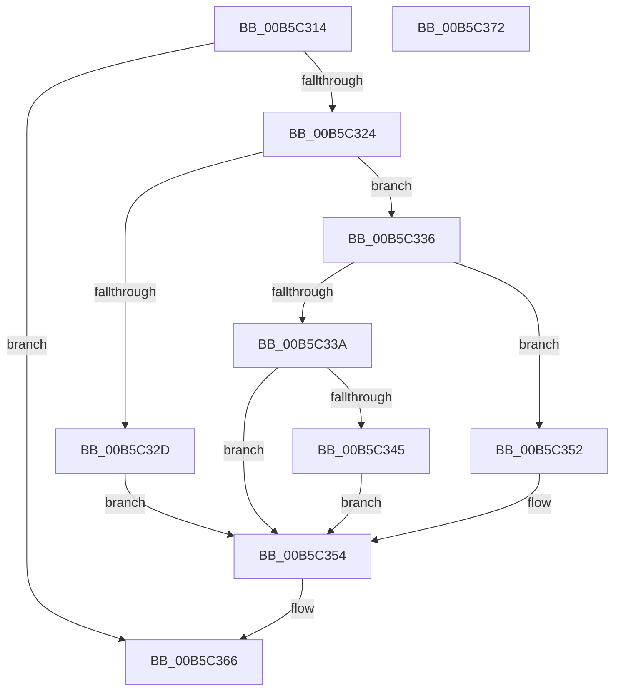

# HalpIsCmciImplemented

- RVA: `0x00B5C314`–`0x00B5C373` (길이 `95` bytes)
- VA: `0x0000000140B5C314`
- 실행 섹션: `PAGELK`
- PDB 이름 있음: `예`; PDB Function 태그: `아니요`
- unwind 정보 RVA: `0x0005CF00`
- 디코드: `29`개 명령, `95/95` bytes 표시
- 미해석 바이트: `0` (있으면 어셈블리에 `.byte`로 보존)

> 이 문서는 커널 이미지의 기계어와 PDB 기호를 분석해 생성했습니다. 4번과 5번은 함수 원형과 자료형을 바이너리 사용 방식에서 추정한 C 해석이며 원본 소스 복구 결과는 아닙니다.

## 1. Dependencies

- 직접 호출 지점: **4**; 고유 호출 대상: **3**
- 직접 호출자로 확인된 함수: **4**
- RIP 상대 이미지 참조: **5**

### Outgoing calls
- `0x00B5C324` → [HalpGetCpuVendor](../../text/48/HalpGetCpuVendor_function_004879E4.md) (function, `0x004879E4`)
- `0x00B5C32D` → [HalpInterruptIsCmciSupported](../../text/54/HalpInterruptIsCmciSupported_function_0054415C.md) (function, `0x0054415C`)
- `0x00B5C33A` → [HalpInterruptIsCmciSupported](../../text/54/HalpInterruptIsCmciSupported_function_0054415C.md) (function, `0x0054415C`)
- `0x00B5C345` → [HalpInterruptIsDeferredErrorSupported](../../text/54/HalpInterruptIsDeferredErrorSupported_function_005441A4.md) (function, `0x005441A4`)

### Direct callers
- [HalpCorrectErrSrc](HalpCorrectErrSrc_function_00B5B820.md) at `0x00B5B87A`
- [HalpInitializeCmc](HalpInitializeCmc_function_00B5BB08.md) at `0x00B5BB42`
- [HalpInitializeCmc](HalpInitializeCmc_function_00B5BB08.md) at `0x00B5BB74`
- [HalpMcaSetFeatureFlags](HalpMcaSetFeatureFlags_function_00B5C434.md) at `0x00B5C459`
- [HalpMcaSetFeatureFlags](HalpMcaSetFeatureFlags_function_00B5C434.md) at `0x00B5C502`
- [HalpMcaResumeProcessorConfig](../B7/HalpMcaResumeProcessorConfig_function_00B7B31C.md) at `0x00B7B3C7`

### Static image references
- `0x00B5C31A` → RVA `0x00E10244` (`.data`; read)
- `0x00B5C34A` → RVA `0x00E1024C` (`.data`; write)
- `0x00B5C354` → RVA `0x00E1024D` (`.data`; write)
- `0x00B5C35F` → RVA `0x00E10244` (`.data`; write)
- `0x00B5C366` → RVA `0x00E1024D` (`.data`; read)

## 2. Other-region calls and transfers

- 다른 실행 섹션으로 향하는 call: **4**
  - `0x00B5C324` → [HalpGetCpuVendor](../../text/48/HalpGetCpuVendor_function_004879E4.md) (`PAGELK` → `.text`)
  - `0x00B5C32D` → [HalpInterruptIsCmciSupported](../../text/54/HalpInterruptIsCmciSupported_function_0054415C.md) (`PAGELK` → `.text`)
  - `0x00B5C33A` → [HalpInterruptIsCmciSupported](../../text/54/HalpInterruptIsCmciSupported_function_0054415C.md) (`PAGELK` → `.text`)
  - `0x00B5C345` → [HalpInterruptIsDeferredErrorSupported](../../text/54/HalpInterruptIsDeferredErrorSupported_function_005441A4.md) (`PAGELK` → `.text`)
- 별도 외부 분기/꼬리 이동을 확인하지 못했습니다.

## 3. Assembly (complete function range)

```asm
00B5C314  40 53                           push rbx
00B5C316  48 83 EC 20                     sub rsp, 0x20
00B5C31A  8A 05 24 3F 2B 00               mov al, byte ptr [rip + 0x2b3f24]
00B5C320  84 C0                           test al, al
00B5C322  75 42                           jne 0x140b5c366
00B5C324  E8 BB B6 92 FF                  call 0x1404879e4
00B5C329  3C 02                           cmp al, 2
00B5C32B  75 09                           jne 0x140b5c336
00B5C32D  E8 2A 7E 9E FF                  call 0x14054415c
00B5C332  8A D8                           mov bl, al
00B5C334  EB 1E                           jmp 0x140b5c354
00B5C336  3C 01                           cmp al, 1
00B5C338  75 18                           jne 0x140b5c352
00B5C33A  E8 1D 7E 9E FF                  call 0x14054415c
00B5C33F  8A D8                           mov bl, al
00B5C341  84 C0                           test al, al
00B5C343  74 0F                           je 0x140b5c354
00B5C345  E8 5A 7E 9E FF                  call 0x1405441a4
00B5C34A  88 05 FC 3E 2B 00               mov byte ptr [rip + 0x2b3efc], al
00B5C350  EB 02                           jmp 0x140b5c354
00B5C352  32 DB                           xor bl, bl
00B5C354  88 1D F3 3E 2B 00               mov byte ptr [rip + 0x2b3ef3], bl
00B5C35A  F0 83 0C 24 00                  lock or dword ptr [rsp], 0
00B5C35F  C6 05 DE 3E 2B 00 01            mov byte ptr [rip + 0x2b3ede], 1
00B5C366  8A 05 E1 3E 2B 00               mov al, byte ptr [rip + 0x2b3ee1]
00B5C36C  48 83 C4 20                     add rsp, 0x20
00B5C370  5B                              pop rbx
00B5C371  C3                              ret
00B5C372  CC                              int3
```

## 4. C-style interpretation (structured pseudocode)

```c
__int64 __fastcall HalpIsCmciImplemented(void)
{
    __int64 result;
    __int64 v_rbx;
    __int64 v_rsp;
    unsigned int v_stack_m28;

    v_rsp = (v_rsp) - (32);
    if ((unsigned __int8)(*(unsigned __int8 *)(v_rip + 2834212)) != 0) goto loc_00B5C366;
    result = HalpGetCpuVendor(a1, a2, a3, a4);
    if (((unsigned __int8)(result)) != 2) goto loc_00B5C336;
    result = HalpInterruptIsCmciSupported(a1, a2, a3, a4);
    goto loc_00B5C354;
loc_00B5C336:
    if (((unsigned __int8)(result)) != 1) goto loc_00B5C352;
    result = HalpInterruptIsCmciSupported(a1, a2, a3, a4);
    if ((unsigned __int8)(result) == 0) goto loc_00B5C354;
    result = HalpInterruptIsDeferredErrorSupported(a1, a2, a3, a4);
    *(unsigned __int8 *)(v_rip + 2834172) = (unsigned __int8)(result);
    goto loc_00B5C354;
loc_00B5C352:
    v_rbx = 0;
loc_00B5C354:
    *(unsigned __int8 *)(v_rip + 2834163) = 0;
    *(unsigned __int8 *)(v_rip + 2834142) = 1;
loc_00B5C366:
    v_rsp = (v_rsp) + (32);
    return *(unsigned __int8 *)(v_rip + 2834145);
}
```

## 5. (Beta) C Style

```c
void HalpIsCmciImplemented(void)
{
    int64_t result;
    int64_t local_rbx;
    int64_t local_rsp;
    uint32_t v_stack_m28;

    local_rsp = (local_rsp) - (32);
    if ((uint8_t)(*(uint8_t *)(v_rip + 0x2B3F24)) != 0) goto loc_00B5C366;
    result = HalpGetCpuVendor(a1, a2, a3, a4);
    if (((uint8_t)(result)) != 2) goto loc_00B5C336;
    result = HalpInterruptIsCmciSupported(a1, a2, a3, a4);
    goto loc_00B5C354;
loc_00B5C336:
    if (((uint8_t)(result)) != 1) goto loc_00B5C352;
    result = HalpInterruptIsCmciSupported(a1, a2, a3, a4);
    if ((uint8_t)(result) == 0) goto loc_00B5C354;
    result = HalpInterruptIsDeferredErrorSupported(a1, a2, a3, a4);
    *(uint8_t *)(v_rip + 0x2B3EFC) = (uint8_t)(result);
    goto loc_00B5C354;
loc_00B5C352:
    local_rbx = 0;
loc_00B5C354:
    *(uint8_t *)(v_rip + 0x2B3EF3) = 0;
    *(uint8_t *)(v_rip + 0x2B3EDE) = 1;
loc_00B5C366:
    local_rsp = (local_rsp) + (32);
    return *(uint8_t *)(v_rip + 0x2B3EE1);
}
```

## 6. Execution-region graph

[열기: 2D/3D 그래프와 함수 탐색 컨트롤 패널](../../../control-panel.html?section=pagelk&rva=0x00B5C314&view=graph)

- 2D 그래프는 위에서 아래로 흐르고, 3D 그래프는 빈 공간을 드래그해 회전합니다. Shift+드래그는 이동, 휠은 확대·축소, 함수 노드 선택은 대상 보고서 이동입니다.

### Static fallback


