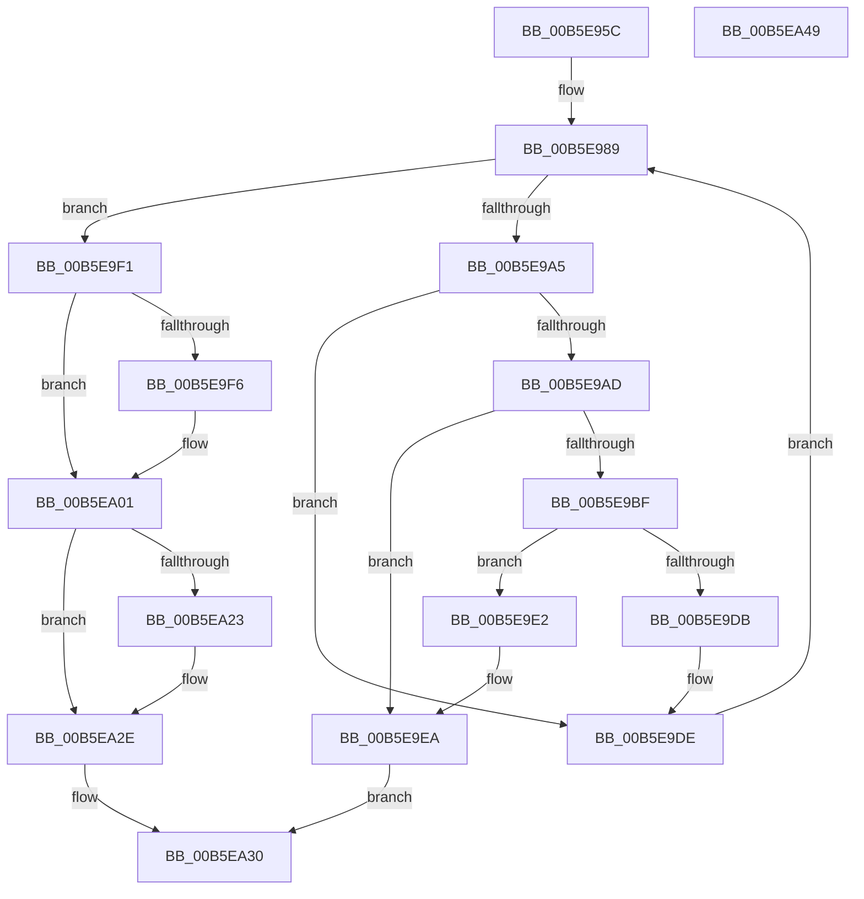

# HalpMapCR3Ex

- RVA: `0x00B5E95C`–`0x00B5EA4A` (길이 `238` bytes)
- VA: `0x0000000140B5E95C`
- 실행 섹션: `PAGELK`
- PDB 이름 있음: `예`; PDB Function 태그: `아니요`
- unwind 정보 RVA: `0x00060300`
- 디코드: `70`개 명령, `238/238` bytes 표시
- 미해석 바이트: `0` (있으면 어셈블리에 `.byte`로 보존)

> 이 문서는 커널 이미지의 기계어와 PDB 기호를 분석해 생성했습니다. 4번과 5번은 함수 원형과 자료형을 바이너리 사용 방식에서 추정한 C 해석이며 원본 소스 복구 결과는 아닙니다.

## 1. Dependencies

- 직접 호출 지점: **6**; 고유 호출 대상: **5**
- 직접 호출자로 확인된 함수: **1**
- RIP 상대 이미지 참조: **1**

### Outgoing calls
- `0x00B5E9B2` → [HalpMmAllocCtxAlloc](../../text/3E/HalpMmAllocCtxAlloc_function_003E10B8.md) (function, `0x003E10B8`)
- `0x00B5E9CA` → [memset](../../text/6C/memset_function_006C6C40.md) (function, `0x006C6C40`)
- `0x00B5E9D2` → [HalpStoreFreeCr3](../../text/55/HalpStoreFreeCr3_function_0055AA08.md) (function, `0x0055AA08`)
- `0x00B5E9E5` → [HalpMmAllocCtxFree](../../text/3E/HalpMmAllocCtxFree_function_003E1904.md) (function, `0x003E1904`)
- `0x00B5E9F9` → [MmGetPhysicalAddress](../../text/23/MmGetPhysicalAddress_function_0023A500.md) (function, `0x0023A500`)
- `0x00B5EA26` → [MmGetPhysicalAddress](../../text/23/MmGetPhysicalAddress_function_0023A500.md) (function, `0x0023A500`)

### Direct callers
- [HalpMmBuildTiledMemoryMap](HalpMmBuildTiledMemoryMap_function_00B5EA50.md) at `0x00B5EA8F`
- [HalpMmBuildTiledMemoryMap](HalpMmBuildTiledMemoryMap_function_00B5EA50.md) at `0x00B5EAAA`

### Static image references
- `0x00B5E974` → RVA `0x00F905E8` (`.data`; read)

## 2. Other-region calls and transfers

- 다른 실행 섹션으로 향하는 call: **6**
  - `0x00B5E9B2` → [HalpMmAllocCtxAlloc](../../text/3E/HalpMmAllocCtxAlloc_function_003E10B8.md) (`PAGELK` → `.text`)
  - `0x00B5E9CA` → [memset](../../text/6C/memset_function_006C6C40.md) (`PAGELK` → `.text`)
  - `0x00B5E9D2` → [HalpStoreFreeCr3](../../text/55/HalpStoreFreeCr3_function_0055AA08.md) (`PAGELK` → `.text`)
  - `0x00B5E9E5` → [HalpMmAllocCtxFree](../../text/3E/HalpMmAllocCtxFree_function_003E1904.md) (`PAGELK` → `.text`)
  - `0x00B5E9F9` → [MmGetPhysicalAddress](../../text/23/MmGetPhysicalAddress_function_0023A500.md) (`PAGELK` → `.text`)
  - `0x00B5EA26` → [MmGetPhysicalAddress](../../text/23/MmGetPhysicalAddress_function_0023A500.md) (`PAGELK` → `.text`)
- 별도 외부 분기/꼬리 이동을 확인하지 못했습니다.

## 3. Assembly (complete function range)

```asm
00B5E95C  48 89 5C 24 08                  mov qword ptr [rsp + 8], rbx
00B5E961  48 89 6C 24 10                  mov qword ptr [rsp + 0x10], rbp
00B5E966  48 89 74 24 18                  mov qword ptr [rsp + 0x18], rsi
00B5E96B  57                              push rdi
00B5E96C  41 56                           push r14
00B5E96E  41 57                           push r15
00B5E970  48 83 EC 20                     sub rsp, 0x20
00B5E974  48 8B 3D 6D 1C 43 00            mov rdi, qword ptr [rip + 0x431c6d]
00B5E97B  4D 8B F0                        mov r14, r8
00B5E97E  48 8B DA                        mov rbx, rdx
00B5E981  4C 8B F9                        mov r15, rcx
00B5E984  BD 03 00 00 00                  mov ebp, 3
00B5E989  8D 0C ED 0C 00 00 00            lea ecx, [rbp*8 + 0xc]
00B5E990  49 8B C7                        mov rax, r15
00B5E993  03 CD                           add ecx, ebp
00B5E995  48 D3 E8                        shr rax, cl
00B5E998  25 FF 01 00 00                  and eax, 0x1ff
00B5E99D  48 8D 34 C7                     lea rsi, [rdi + rax*8]
00B5E9A1  85 ED                           test ebp, ebp
00B5E9A3  74 4C                           je 0x140b5e9f1
00B5E9A5  48 8B 3E                        mov rdi, qword ptr [rsi]
00B5E9A8  48 85 FF                        test rdi, rdi
00B5E9AB  75 31                           jne 0x140b5e9de
00B5E9AD  BA 00 10 00 00                  mov edx, 0x1000
00B5E9B2  E8 01 27 88 FF                  call 0x1403e10b8
00B5E9B7  48 8B F8                        mov rdi, rax
00B5E9BA  48 85 C0                        test rax, rax
00B5E9BD  74 2B                           je 0x140b5e9ea
00B5E9BF  33 D2                           xor edx, edx
00B5E9C1  41 B8 00 10 00 00               mov r8d, 0x1000
00B5E9C7  48 8B C8                        mov rcx, rax
00B5E9CA  E8 71 82 B6 FF                  call 0x1406c6c40
00B5E9CF  48 8B CF                        mov rcx, rdi
00B5E9D2  E8 31 C0 9F FF                  call 0x14055aa08
00B5E9D7  85 C0                           test eax, eax
00B5E9D9  78 07                           js 0x140b5e9e2
00B5E9DB  48 89 3E                        mov qword ptr [rsi], rdi
00B5E9DE  FF CD                           dec ebp
00B5E9E0  EB A7                           jmp 0x140b5e989
00B5E9E2  48 8B D7                        mov rdx, rdi
00B5E9E5  E8 1A 2F 88 FF                  call 0x1403e1904
00B5E9EA  B8 9A 00 00 C0                  mov eax, 0xc000009a
00B5E9EF  EB 3F                           jmp 0x140b5ea30
00B5E9F1  48 85 DB                        test rbx, rbx
00B5E9F4  75 0B                           jne 0x140b5ea01
00B5E9F6  49 8B CF                        mov rcx, r15
00B5E9F9  E8 02 BB 6D FF                  call 0x14023a500
00B5E9FE  48 8B D8                        mov rbx, rax
00B5EA01  48 8B C3                        mov rax, rbx
00B5EA04  48 B9 FF 0F 00 00 00 00 F0 FF   movabs rcx, 0xfff0000000000fff
00B5EA0E  48 33 06                        xor rax, qword ptr [rsi]
00B5EA11  48 23 C1                        and rax, rcx
00B5EA14  48 33 C3                        xor rax, rbx
00B5EA17  48 83 C8 03                     or rax, 3
00B5EA1B  48 89 06                        mov qword ptr [rsi], rax
00B5EA1E  4D 85 F6                        test r14, r14
00B5EA21  74 0B                           je 0x140b5ea2e
00B5EA23  48 8B CE                        mov rcx, rsi
00B5EA26  E8 D5 BA 6D FF                  call 0x14023a500
00B5EA2B  49 89 06                        mov qword ptr [r14], rax
00B5EA2E  33 C0                           xor eax, eax
00B5EA30  48 8B 5C 24 40                  mov rbx, qword ptr [rsp + 0x40]
00B5EA35  48 8B 6C 24 48                  mov rbp, qword ptr [rsp + 0x48]
00B5EA3A  48 8B 74 24 50                  mov rsi, qword ptr [rsp + 0x50]
00B5EA3F  48 83 C4 20                     add rsp, 0x20
00B5EA43  41 5F                           pop r15
00B5EA45  41 5E                           pop r14
00B5EA47  5F                              pop rdi
00B5EA48  C3                              ret
00B5EA49  CC                              int3
```

## 4. C-style interpretation (structured pseudocode)

```c
__int64 __fastcall HalpMapCR3Ex(__int64 a1, __int64 a2, __int64 a3)
{
    __int64 result;
    __int64 v_rbp;
    __int64 v_rbx;
    __int64 v_rsp;
    unsigned __int64 v_stack_p10;
    unsigned __int64 v_stack_p18;
    unsigned __int64 v_stack_p8;

    v_stack_p8 = v_rbx;
    v_stack_p10 = v_rbp;
    v_stack_p18 = v_rsi;
    v_rsp = (v_rsp) - (32);
loc_00B5E989:
    a1 = (unsigned int)((3 * 8 + 12) + (3));
    result = (a1) >> ((unsigned __int8)(a1));
    result = (unsigned int)((result) & (511));
    if (3 == 0) goto loc_00B5E9F1;
    if (*(unsigned __int64 *)(*(unsigned __int64 *)(v_rip + 4398189) + result * 8) != 0) goto loc_00B5E9DE;
    result = HalpMmAllocCtxAlloc(a1, (unsigned int)(0x1000ULL), a3, a4);
    if (result == 0) goto loc_00B5E9EA;
    a2 = 0;
    result = memset(result, a2, (unsigned int)(0x1000ULL), a4);
    result = HalpStoreFreeCr3(result, a2, (unsigned int)(0x1000ULL), a4);
    if (sign_flag) goto loc_00B5E9E2;
    *(unsigned __int64 *)(*(unsigned __int64 *)(v_rip + 4398189) + result * 8) = result;
loc_00B5E9DE:
    v_rbp = (unsigned int)((3) - 1);
    goto loc_00B5E989;
loc_00B5E9E2:
    result = HalpMmAllocCtxFree(result, result, (unsigned int)(0x1000ULL), a4);
loc_00B5E9EA:
    goto loc_00B5EA30;
loc_00B5E9F1:
    result = (unsigned int)(0xC000009AULL);
    v_rbx = a2;
    if (0 == 0) {
        a1 = a1;
        result = MmGetPhysicalAddress(a1, result, (unsigned int)(0x1000ULL), a4);
        v_rbx = result;
    }
    result = (v_rbx) ^ (*(unsigned __int64 *)(*(unsigned __int64 *)(v_rip + 4398189) + result * 8));
    result = (result) & (a1);
    result = (result) ^ (v_rbx);
    result = (result) | (3);
    *(unsigned __int64 *)(*(unsigned __int64 *)(v_rip + 4398189) + result * 8) = result;
    if (a3 != 0) {
        a1 = *(unsigned __int64 *)(v_rip + 4398189) + result * 8;
        result = MmGetPhysicalAddress(a1, result, (unsigned int)(0x1000ULL), a4);
        *(unsigned __int64 *)(a3) = result;
    }
    result = 0;
loc_00B5EA30:
    v_rsp = (v_rsp) + (32);
    return result;
}
```

## 5. (Beta) C Style

```c
int64_t HalpMapCR3Ex(int64_t Arg1, int64_t Arg2, int64_t Arg3)
{
    int64_t result;
    int64_t local_rbp;
    int64_t local_rbx;
    int64_t local_rsp;
    uint64_t v_stack_p10;
    uint64_t v_stack_p18;
    uint64_t v_stack_p8;

    v_stack_p8 = local_rbx;
    v_stack_p10 = local_rbp;
    v_stack_p18 = local_rsi;
    local_rsp = (local_rsp) - (32);
loc_00B5E989:
    Arg1 = (uint32_t)((3 * 8 + 12) + (3));
    result = (Arg1) >> ((uint8_t)(Arg1));
    result = (uint32_t)((result) & (511));
    if (3 == 0) goto loc_00B5E9F1;
    if (*(uint64_t *)(*(uint64_t *)(v_rip + 0x431C6D) + result * 8) != 0) goto loc_00B5E9DE;
    result = HalpMmAllocCtxAlloc(Arg1, (uint32_t)(0x1000ULL), Arg3, a4);
    if (result == 0) goto loc_00B5E9EA;
    Arg2 = 0;
    result = memset(result, Arg2, (uint32_t)(0x1000ULL), a4);
    result = HalpStoreFreeCr3(result, Arg2, (uint32_t)(0x1000ULL), a4);
    if (sign_flag) goto loc_00B5E9E2;
    *(uint64_t *)(*(uint64_t *)(v_rip + 0x431C6D) + result * 8) = result;
loc_00B5E9DE:
    local_rbp = (uint32_t)((3) - 1);
    goto loc_00B5E989;
loc_00B5E9E2:
    result = HalpMmAllocCtxFree(result, result, (uint32_t)(0x1000ULL), a4);
loc_00B5E9EA:
    goto loc_00B5EA30;
loc_00B5E9F1:
    result = (uint32_t)(0xC000009AULL);
    local_rbx = Arg2;
    if (0 == 0) {
        Arg1 = Arg1;
        result = MmGetPhysicalAddress(Arg1, result, (uint32_t)(0x1000ULL), a4);
        local_rbx = result;
    }
    result = (local_rbx) ^ (*(uint64_t *)(*(uint64_t *)(v_rip + 0x431C6D) + result * 8));
    result = (result) & (Arg1);
    result = (result) ^ (local_rbx);
    result = (result) | (3);
    *(uint64_t *)(*(uint64_t *)(v_rip + 0x431C6D) + result * 8) = result;
    if (Arg3 != 0) {
        Arg1 = *(uint64_t *)(v_rip + 0x431C6D) + result * 8;
        result = MmGetPhysicalAddress(Arg1, result, (uint32_t)(0x1000ULL), a4);
        *(uint64_t *)(Arg3) = result;
    }
    result = 0;
loc_00B5EA30:
    local_rsp = (local_rsp) + (32);
    return result;
}
```

## 6. Execution-region graph

[열기: 2D/3D 그래프와 함수 탐색 컨트롤 패널](../../../control-panel.html?section=pagelk&rva=0x00B5E95C&view=graph)

- 2D 그래프는 위에서 아래로 흐르고, 3D 그래프는 빈 공간을 드래그해 회전합니다. Shift+드래그는 이동, 휠은 확대·축소, 함수 노드 선택은 대상 보고서 이동입니다.

### Static fallback


