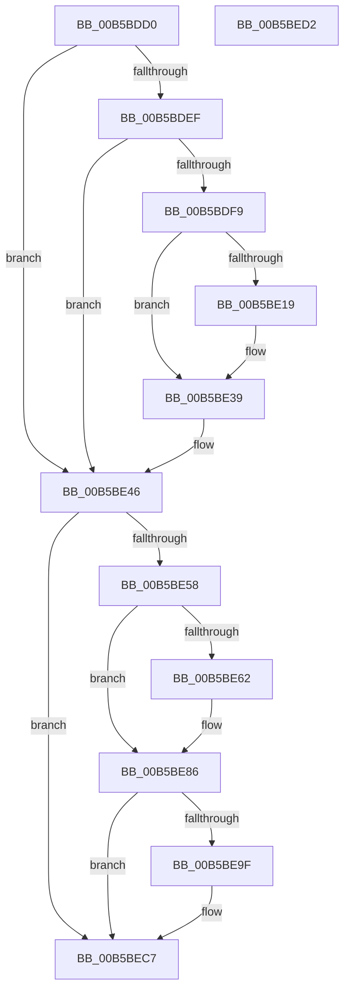

# HalpMcaInitializePcrContext

- RVA: `0x00B5BDD0`–`0x00B5BED3` (길이 `259` bytes)
- VA: `0x0000000140B5BDD0`
- 실행 섹션: `PAGELK`
- PDB 이름 있음: `예`; PDB Function 태그: `아니요`
- unwind 정보 RVA: `0x0008A658`
- 디코드: `59`개 명령, `259/259` bytes 표시
- 미해석 바이트: `0` (있으면 어셈블리에 `.byte`로 보존)

> 이 문서는 커널 이미지의 기계어와 PDB 기호를 분석해 생성했습니다. 4번과 5번은 함수 원형과 자료형을 바이너리 사용 방식에서 추정한 C 해석이며 원본 소스 복구 결과는 아닙니다.

## 1. Dependencies

- 직접 호출 지점: **7**; 고유 호출 대상: **7**
- 직접 호출자로 확인된 함수: **1**
- RIP 상대 이미지 참조: **5**

### Outgoing calls
- `0x00B5BDE4` → [KeGetCurrentProcessorNumberEx](../../text/40/KeGetCurrentProcessorNumberEx_function_00401690.md) (function, `0x00401690`)
- `0x00B5BDF9` → [HalpQueryMaximumRegisteredProcessorCount](../../text/54/HalpQueryMaximumRegisteredProcessorCount_function_00543BE8.md) (function, `0x00543BE8`)
- `0x00B5BE08` → [HalpMmAllocCtxAlloc](../../text/3E/HalpMmAllocCtxAlloc_function_003E10B8.md) (function, `0x003E10B8`)
- `0x00B5BE33` → [KeBugCheckEx](../../text/4F/KeBugCheckEx_function_004FD660.md) (function, `0x004FD660`)
- `0x00B5BE41` → [memset](../../text/6C/memset_function_006C6C40.md) (function, `0x006C6C40`)
- `0x00B5BEAD` → [KeInitializeDpc](../../text/45/KeInitializeDpc_function_0045BBD0.md) (function, `0x0045BBD0`)
- `0x00B5BEBB` → [KeSetTargetProcessorDpcEx](../../text/2D/KeSetTargetProcessorDpcEx_function_002DD280.md) (function, `0x002DD280`)

### Direct callers
- [HalpWheaInitSystem](HalpWheaInitSystem_function_00B5D770.md) at `0x00B5D7AD`

### Static image references
- `0x00B5BDEF` → RVA `0x00E100D8` (`.data`; read)
- `0x00B5BE0D` → RVA `0x00E100D8` (`.data`; write)
- `0x00B5BE19` → RVA `0x000239C0` (`.rdata`; read)
- `0x00B5BE4F` → RVA `0x00FC1C48` (`.data`; read)
- `0x00B5BEA2` → RVA `0x00487290` (`HalpCmciDeferredRoutine`; read)

## 2. Other-region calls and transfers

- 다른 실행 섹션으로 향하는 call: **7**
  - `0x00B5BDE4` → [KeGetCurrentProcessorNumberEx](../../text/40/KeGetCurrentProcessorNumberEx_function_00401690.md) (`PAGELK` → `.text`)
  - `0x00B5BDF9` → [HalpQueryMaximumRegisteredProcessorCount](../../text/54/HalpQueryMaximumRegisteredProcessorCount_function_00543BE8.md) (`PAGELK` → `.text`)
  - `0x00B5BE08` → [HalpMmAllocCtxAlloc](../../text/3E/HalpMmAllocCtxAlloc_function_003E10B8.md) (`PAGELK` → `.text`)
  - `0x00B5BE33` → [KeBugCheckEx](../../text/4F/KeBugCheckEx_function_004FD660.md) (`PAGELK` → `.text`)
  - `0x00B5BE41` → [memset](../../text/6C/memset_function_006C6C40.md) (`PAGELK` → `.text`)
  - `0x00B5BEAD` → [KeInitializeDpc](../../text/45/KeInitializeDpc_function_0045BBD0.md) (`PAGELK` → `.text`)
  - `0x00B5BEBB` → [KeSetTargetProcessorDpcEx](../../text/2D/KeSetTargetProcessorDpcEx_function_002DD280.md) (`PAGELK` → `.text`)
- 별도 외부 분기/꼬리 이동을 확인하지 못했습니다.

## 3. Assembly (complete function range)

```asm
00B5BDD0  48 89 5C 24 10                  mov qword ptr [rsp + 0x10], rbx
00B5BDD5  57                              push rdi
00B5BDD6  48 83 EC 30                     sub rsp, 0x30
00B5BDDA  83 64 24 40 00                  and dword ptr [rsp + 0x40], 0
00B5BDDF  48 8D 4C 24 40                  lea rcx, [rsp + 0x40]
00B5BDE4  E8 A7 58 8A FF                  call 0x140401690
00B5BDE9  8B D8                           mov ebx, eax
00B5BDEB  85 C0                           test eax, eax
00B5BDED  75 57                           jne 0x140b5be46
00B5BDEF  48 83 3D E1 42 2B 00 00         cmp qword ptr [rip + 0x2b42e1], 0
00B5BDF7  75 4D                           jne 0x140b5be46
00B5BDF9  E8 EA 7D 9E FF                  call 0x140543be8
00B5BDFE  8D 0C 40                        lea ecx, [rax + rax*2]
00B5BE01  C1 E1 06                        shl ecx, 6
00B5BE04  8B D1                           mov edx, ecx
00B5BE06  8B F9                           mov edi, ecx
00B5BE08  E8 AB 52 88 FF                  call 0x1403e10b8
00B5BE0D  48 89 05 C4 42 2B 00            mov qword ptr [rip + 0x2b42c4], rax
00B5BE14  48 85 C0                        test rax, rax
00B5BE17  75 20                           jne 0x140b5be39
00B5BE19  4C 8D 0D A0 7B 4C FF            lea r9, [rip - 0xb38460]
00B5BE20  48 C7 44 24 20 28 02 00 00      mov qword ptr [rsp + 0x20], 0x228
00B5BE29  45 33 C0                        xor r8d, r8d
00B5BE2C  8B D7                           mov edx, edi
00B5BE2E  B9 AC 00 00 00                  mov ecx, 0xac
00B5BE33  E8 28 18 9A FF                  call 0x1404fd660
00B5BE38  CC                              int3
00B5BE39  4C 8B C7                        mov r8, rdi
00B5BE3C  33 D2                           xor edx, edx
00B5BE3E  48 8B C8                        mov rcx, rax
00B5BE41  E8 FA AD B6 FF                  call 0x1406c6c40
00B5BE46  65 48 8B 14 25 18 00 00 00      mov rdx, qword ptr gs:[0x18]
00B5BE4F  80 3D F2 5D 46 00 00            cmp byte ptr [rip + 0x465df2], 0
00B5BE56  75 6F                           jne 0x140b5bec7
00B5BE58  48 83 BA D8 00 00 00 00         cmp qword ptr [rdx + 0xd8], 0
00B5BE60  75 24                           jne 0x140b5be86
00B5BE62  48 8D 0C 5B                     lea rcx, [rbx + rbx*2]
00B5BE66  48 C1 E1 06                     shl rcx, 6
00B5BE6A  48 03 0D 67 42 2B 00            add rcx, qword ptr [rip + 0x2b4267]
00B5BE71  48 89 8A D8 00 00 00            mov qword ptr [rdx + 0xd8], rcx
00B5BE78  48 83 A1 B8 00 00 00 00         and qword ptr [rcx + 0xb8], 0
00B5BE80  89 99 AC 00 00 00               mov dword ptr [rcx + 0xac], ebx
00B5BE86  65 48 8B 04 25 18 00 00 00      mov rax, qword ptr gs:[0x18]
00B5BE8F  48 8B B8 D8 00 00 00            mov rdi, qword ptr [rax + 0xd8]
00B5BE96  80 BF A0 00 00 00 00            cmp byte ptr [rdi + 0xa0], 0
00B5BE9D  75 28                           jne 0x140b5bec7
00B5BE9F  4C 8B C7                        mov r8, rdi
00B5BEA2  48 8D 15 E7 B3 92 FF            lea rdx, [rip - 0x6d4c19]
00B5BEA9  48 8D 4F 30                     lea rcx, [rdi + 0x30]
00B5BEAD  E8 1E FD 8F FF                  call 0x14045bbd0
00B5BEB2  48 8D 54 24 40                  lea rdx, [rsp + 0x40]
00B5BEB7  48 8D 4F 30                     lea rcx, [rdi + 0x30]
00B5BEBB  E8 C0 13 78 FF                  call 0x1402dd280
00B5BEC0  C6 87 A0 00 00 00 01            mov byte ptr [rdi + 0xa0], 1
00B5BEC7  48 8B 5C 24 48                  mov rbx, qword ptr [rsp + 0x48]
00B5BECC  48 83 C4 30                     add rsp, 0x30
00B5BED0  5F                              pop rdi
00B5BED1  C3                              ret
00B5BED2  CC                              int3
```

## 4. C-style interpretation (structured pseudocode)

```c
__int64 __fastcall HalpMcaInitializePcrContext(__int64 a1, __int64 a2, int a3)
{
    __int64 result;
    __int64 v_rsp;
    unsigned __int64 v_stack_m18;
    unsigned __int64 v_stack_p10;
    unsigned int v_stack_p8;

    v_stack_p10 = v_rbx;
    v_rsp = (v_rsp) - (48);
    result = KeGetCurrentProcessorNumberEx(v_stack_p8, a2, a3, a4);
    if ((unsigned int)(result) != 0) goto loc_00B5BE46;
    if ((*(unsigned __int64 *)(v_rip + 2835169)) != 0) goto loc_00B5BE46;
    result = HalpQueryMaximumRegisteredProcessorCount(v_stack_p8, a2, a3, a4);
    a1 = (unsigned int)((result + result * 2) << (6));
    result = HalpMmAllocCtxAlloc(a1, (unsigned int)((unsigned int)(a1)), a3, a4);
    *(unsigned __int64 *)(v_rip + 2835140) = result;
    if (result == 0) {
        a4 = v_rip - 11764832;
        v_stack_m18 = 552;
        a3 = 0;
        a2 = (unsigned int)((unsigned int)((unsigned int)(a1)));
        a1 = 172;
        result = KeBugCheckEx(a1, a2, a3, a4);
    }
    a2 = 0;
    result = memset(result, a2, (unsigned int)((unsigned int)(a1)), a4);
loc_00B5BE46:
    if ((*(unsigned __int8 *)(v_rip + 4611570)) != 0) goto loc_00B5BEC7;
    if ((*(unsigned __int64 *)(*(unsigned __int64 *)(gs_base + (0 + 24)) + 216)) == 0) {
        a1 = (unsigned int)((unsigned int)(result)) + (unsigned int)((unsigned int)(result)) * 2;
        a1 = (a1) << (6);
        a1 = (a1) + (*(unsigned __int64 *)(v_rip + 2835047));
        *(unsigned __int64 *)(*(unsigned __int64 *)(gs_base + (0 + 24)) + 216) = a1;
        *(unsigned int *)(a1 + 172) = (unsigned int)((unsigned int)((unsigned int)(result)));
    }
    result = *(unsigned __int64 *)(gs_base + (0 + 24));
    if ((*(unsigned __int8 *)(*(unsigned __int64 *)(*(unsigned __int64 *)(gs_base + (0 + 24)) + 216) + 160)) == 0) {
        a3 = *(unsigned __int64 *)(*(unsigned __int64 *)(gs_base + (0 + 24)) + 216);
        a2 = v_rip - 7162905;
        a1 = *(unsigned __int64 *)(*(unsigned __int64 *)(gs_base + (0 + 24)) + 216) + 48;
        result = KeInitializeDpc(a1, a2, a3, a4);
        a2 = v_stack_p8;
        a1 = *(unsigned __int64 *)(*(unsigned __int64 *)(gs_base + (0 + 24)) + 216) + 48;
        result = KeSetTargetProcessorDpcEx(a1, a2, a3, a4);
        *(unsigned __int8 *)(*(unsigned __int64 *)(*(unsigned __int64 *)(gs_base + (0 + 24)) + 216) + 160) = 1;
    }
    v_rsp = (v_rsp) + (48);
    return result;
}
```

## 5. (Beta) C Style

```c
int64_t HalpMcaInitializePcrContext(int64_t Arg1, int64_t Arg2, int32_t Arg3)
{
    int64_t result;
    int64_t local_rsp;
    uint64_t v_stack_m18;
    uint64_t v_stack_p10;
    uint32_t v_stack_p8;

    v_stack_p10 = local_rbx;
    local_rsp = (local_rsp) - (48);
    result = KeGetCurrentProcessorNumberEx(v_stack_p8, Arg2, Arg3, a4);
    if ((uint32_t)(result) != 0) goto loc_00B5BE46;
    if ((*(uint64_t *)(v_rip + 0x2B42E1)) != 0) goto loc_00B5BE46;
    result = HalpQueryMaximumRegisteredProcessorCount(v_stack_p8, Arg2, Arg3, a4);
    Arg1 = (uint32_t)((result + result * 2) << (6));
    result = HalpMmAllocCtxAlloc(Arg1, (uint32_t)((uint32_t)(Arg1)), Arg3, a4);
    *(uint64_t *)(v_rip + 0x2B42C4) = result;
    if (result == 0) {
        a4 = v_rip - 11764832;
        v_stack_m18 = 552;
        Arg3 = 0;
        Arg2 = (uint32_t)((uint32_t)((uint32_t)(Arg1)));
        Arg1 = 172;
        result = KeBugCheckEx(Arg1, Arg2, Arg3, a4);
    }
    Arg2 = 0;
    result = memset(result, Arg2, (uint32_t)((uint32_t)(Arg1)), a4);
loc_00B5BE46:
    if ((*(uint8_t *)(v_rip + 0x465DF2)) != 0) goto loc_00B5BEC7;
    if ((*(uint64_t *)(*(uint64_t *)(gs_base + (0 + 0x18)) + 0xD8)) == 0) {
        Arg1 = (uint32_t)((uint32_t)(result)) + (uint32_t)((uint32_t)(result)) * 2;
        Arg1 = (Arg1) << (6);
        Arg1 = (Arg1) + (*(uint64_t *)(v_rip + 0x2B4267));
        *(uint64_t *)(*(uint64_t *)(gs_base + (0 + 0x18)) + 0xD8) = Arg1;
        *(uint32_t *)(Arg1 + 0xAC) = (uint32_t)((uint32_t)((uint32_t)(result)));
    }
    result = *(uint64_t *)(gs_base + (0 + 0x18));
    if ((*(uint8_t *)(*(uint64_t *)(*(uint64_t *)(gs_base + (0 + 0x18)) + 0xD8) + 0xA0)) == 0) {
        Arg3 = *(uint64_t *)(*(uint64_t *)(gs_base + (0 + 0x18)) + 0xD8);
        Arg2 = v_rip - 7162905;
        Arg1 = *(uint64_t *)(*(uint64_t *)(gs_base + (0 + 0x18)) + 0xD8) + 48;
        result = KeInitializeDpc(Arg1, Arg2, Arg3, a4);
        Arg2 = v_stack_p8;
        Arg1 = *(uint64_t *)(*(uint64_t *)(gs_base + (0 + 0x18)) + 0xD8) + 48;
        result = KeSetTargetProcessorDpcEx(Arg1, Arg2, Arg3, a4);
        *(uint8_t *)(*(uint64_t *)(*(uint64_t *)(gs_base + (0 + 0x18)) + 0xD8) + 0xA0) = 1;
    }
    local_rsp = (local_rsp) + (48);
    return result;
}
```

## 6. Execution-region graph

[열기: 2D/3D 그래프와 함수 탐색 컨트롤 패널](../../../control-panel.html?section=pagelk&rva=0x00B5BDD0&view=graph)

- 2D 그래프는 위에서 아래로 흐르고, 3D 그래프는 빈 공간을 드래그해 회전합니다. Shift+드래그는 이동, 휠은 확대·축소, 함수 노드 선택은 대상 보고서 이동입니다.

### Static fallback


