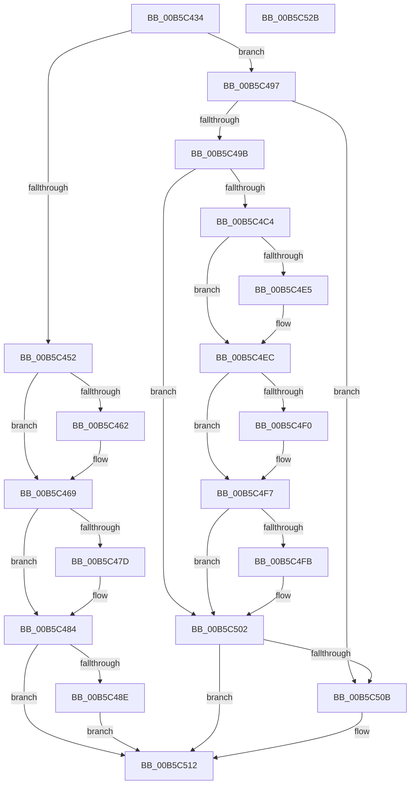

# HalpMcaSetFeatureFlags

- RVA: `0x00B5C434`–`0x00B5C52C` (길이 `248` bytes)
- VA: `0x0000000140B5C434`
- 실행 섹션: `PAGELK`
- PDB 이름 있음: `예`; PDB Function 태그: `아니요`
- unwind 정보 RVA: `0x000BE840`
- 디코드: `64`개 명령, `248/248` bytes 표시
- 미해석 바이트: `0` (있으면 어셈블리에 `.byte`로 보존)

> 이 문서는 커널 이미지의 기계어와 PDB 기호를 분석해 생성했습니다. 4번과 5번은 함수 원형과 자료형을 바이너리 사용 방식에서 추정한 C 해석이며 원본 소스 복구 결과는 아닙니다.

## 1. Dependencies

- 직접 호출 지점: **5**; 고유 호출 대상: **3**
- 직접 호출자로 확인된 함수: **1**
- RIP 상대 이미지 참조: **8**

### Outgoing calls
- `0x00B5C449` → [HalpGetCpuVendor](../../text/48/HalpGetCpuVendor_function_004879E4.md) (function, `0x004879E4`)
- `0x00B5C459` → [HalpIsCmciImplemented](HalpIsCmciImplemented_function_00B5C314.md) (function, `0x00B5C314`)
- `0x00B5C4B5` → [HalpCpuID](../../text/4A/HalpCpuID_function_004A3C80.md) (function, `0x004A3C80`)
- `0x00B5C4D9` → [HalpCpuID](../../text/4A/HalpCpuID_function_004A3C80.md) (function, `0x004A3C80`)
- `0x00B5C502` → [HalpIsCmciImplemented](HalpIsCmciImplemented_function_00B5C314.md) (function, `0x00B5C314`)

### Direct callers
- [HalpInitializeMce](HalpInitializeMce_function_00B5BC04.md) at `0x00B5BC51`

### Static image references
- `0x00B5C452` → RVA `0x00E100B9` (`.data`; write)
- `0x00B5C462` → RVA `0x00E0FC00` (`.data`; write)
- `0x00B5C47D` → RVA `0x00E100B8` (`.data`; write)
- `0x00B5C48E` → RVA `0x00E100C0` (`.data`; write)
- `0x00B5C4F0` → RVA `0x00E0FC01` (`.data`; write)
- `0x00B5C4FB` → RVA `0x00E10258` (`.data`; write)
- `0x00B5C512` → RVA `0x00E0F6B0` (`.data`; write)
- `0x00B5C519` → RVA `0x00E0F6B9` (`.data`; write)

## 2. Other-region calls and transfers

- 다른 실행 섹션으로 향하는 call: **3**
  - `0x00B5C449` → [HalpGetCpuVendor](../../text/48/HalpGetCpuVendor_function_004879E4.md) (`PAGELK` → `.text`)
  - `0x00B5C4B5` → [HalpCpuID](../../text/4A/HalpCpuID_function_004A3C80.md) (`PAGELK` → `.text`)
  - `0x00B5C4D9` → [HalpCpuID](../../text/4A/HalpCpuID_function_004A3C80.md) (`PAGELK` → `.text`)
- 별도 외부 분기/꼬리 이동을 확인하지 못했습니다.

## 3. Assembly (complete function range)

```asm
00B5C434  40 55                           push rbp
00B5C436  48 8B EC                        mov rbp, rsp
00B5C439  48 83 EC 30                     sub rsp, 0x30
00B5C43D  83 65 10 00                     and dword ptr [rbp + 0x10], 0
00B5C441  83 65 18 00                     and dword ptr [rbp + 0x18], 0
00B5C445  83 65 20 00                     and dword ptr [rbp + 0x20], 0
00B5C449  E8 96 B5 92 FF                  call 0x1404879e4
00B5C44E  3C 02                           cmp al, 2
00B5C450  75 45                           jne 0x140b5c497
00B5C452  C6 05 60 3C 2B 00 01            mov byte ptr [rip + 0x2b3c60], 1
00B5C459  E8 B6 FE FF FF                  call 0x140b5c314
00B5C45E  84 C0                           test al, al
00B5C460  75 07                           jne 0x140b5c469
00B5C462  C6 05 97 37 2B 00 01            mov byte ptr [rip + 0x2b3797], 1
00B5C469  B9 79 01 00 00                  mov ecx, 0x179
00B5C46E  0F 32                           rdmsr
00B5C470  48 C1 E2 20                     shl rdx, 0x20
00B5C474  48 0B C2                        or rax, rdx
00B5C477  0F BA E0 18                     bt eax, 0x18
00B5C47B  73 07                           jae 0x140b5c484
00B5C47D  C6 05 34 3C 2B 00 01            mov byte ptr [rip + 0x2b3c34], 1
00B5C484  0F BA E0 1A                     bt eax, 0x1a
00B5C488  0F 83 84 00 00 00               jae 0x140b5c512
00B5C48E  C6 05 2B 3C 2B 00 01            mov byte ptr [rip + 0x2b3c2b], 1
00B5C495  EB 7B                           jmp 0x140b5c512
00B5C497  3C 01                           cmp al, 1
00B5C499  75 70                           jne 0x140b5c50b
00B5C49B  48 8D 45 10                     lea rax, [rbp + 0x10]
00B5C49F  B9 00 00 00 80                  mov ecx, 0x80000000
00B5C4A4  4C 8D 4D 10                     lea r9, [rbp + 0x10]
00B5C4A8  48 89 44 24 20                  mov qword ptr [rsp + 0x20], rax
00B5C4AD  4C 8D 45 10                     lea r8, [rbp + 0x10]
00B5C4B1  48 8D 55 18                     lea rdx, [rbp + 0x18]
00B5C4B5  E8 C6 77 94 FF                  call 0x1404a3c80
00B5C4BA  B9 07 00 00 80                  mov ecx, 0x80000007
00B5C4BF  39 4D 18                        cmp dword ptr [rbp + 0x18], ecx
00B5C4C2  72 3E                           jb 0x140b5c502
00B5C4C4  48 8D 45 10                     lea rax, [rbp + 0x10]
00B5C4C8  4C 8D 4D 10                     lea r9, [rbp + 0x10]
00B5C4CC  48 89 44 24 20                  mov qword ptr [rsp + 0x20], rax
00B5C4D1  4C 8D 45 20                     lea r8, [rbp + 0x20]
00B5C4D5  48 8D 55 10                     lea rdx, [rbp + 0x10]
00B5C4D9  E8 A2 77 94 FF                  call 0x1404a3c80
00B5C4DE  8B 45 20                        mov eax, dword ptr [rbp + 0x20]
00B5C4E1  A8 02                           test al, 2
00B5C4E3  74 07                           je 0x140b5c4ec
00B5C4E5  C6 05 CC 3B 2B 00 01            mov byte ptr [rip + 0x2b3bcc], 1
00B5C4EC  A8 01                           test al, 1
00B5C4EE  74 07                           je 0x140b5c4f7
00B5C4F0  C6 05 0A 37 2B 00 01            mov byte ptr [rip + 0x2b370a], 1
00B5C4F7  A8 08                           test al, 8
00B5C4F9  74 07                           je 0x140b5c502
00B5C4FB  C6 05 56 3D 2B 00 01            mov byte ptr [rip + 0x2b3d56], 1
00B5C502  E8 0D FE FF FF                  call 0x140b5c314
00B5C507  84 C0                           test al, al
00B5C509  75 07                           jne 0x140b5c512
00B5C50B  C6 05 EE 36 2B 00 01            mov byte ptr [rip + 0x2b36ee], 1
00B5C512  C6 05 97 31 2B 00 01            mov byte ptr [rip + 0x2b3197], 1
00B5C519  C6 05 99 31 2B 00 01            mov byte ptr [rip + 0x2b3199], 1
00B5C520  F0 83 0C 24 00                  lock or dword ptr [rsp], 0
00B5C525  48 83 C4 30                     add rsp, 0x30
00B5C529  5D                              pop rbp
00B5C52A  C3                              ret
00B5C52B  CC                              int3
```

## 4. C-style interpretation (structured pseudocode)

```c
__int64 __fastcall HalpMcaSetFeatureFlags(__int64 a1, __int64 a2)
{
    __int64 result;
    __int64 v_rsp;
    unsigned __int64 v_stack_m18;
    unsigned int v_stack_m38;
    unsigned int v_stack_p10;
    unsigned int v_stack_p18;
    unsigned int v_stack_p8;

    v_rsp = (v_rsp) - (48);
    result = HalpGetCpuVendor(a1, a2, a3, a4);
    if (((unsigned __int8)(result)) != 2) goto loc_00B5C497;
    *(unsigned __int8 *)(v_rip + 2833504) = 1;
    result = HalpIsCmciImplemented(a1, a2, a3, a4);
    if ((unsigned __int8)(result) == 0) {
        *(unsigned __int8 *)(v_rip + 2832279) = 1;
    }
    a2 = (a2) << (32);
    result = (result) | (a2);
    if (!(condition_is_above_or_equal)) {
        *(unsigned __int8 *)(v_rip + 2833460) = 1;
    }
    if (condition_is_above_or_equal) goto loc_00B5C512;
    *(unsigned __int8 *)(v_rip + 2833451) = 1;
    goto loc_00B5C512;
loc_00B5C497:
    if (((unsigned __int8)(result)) != 1) goto loc_00B5C50B;
    v_stack_m18 = v_stack_p8;
    result = HalpCpuID((unsigned int)(0x80000000ULL), v_stack_p10, v_stack_p8, v_stack_p8);
    if (v_stack_p10 < ((unsigned int)((unsigned int)(0x80000007ULL)))) goto loc_00B5C502;
    v_stack_m18 = v_stack_p8;
    result = HalpCpuID((unsigned int)(0x80000007ULL), v_stack_p8, v_stack_p18, v_stack_p8);
    if ((((unsigned __int8)((unsigned int)(v_stack_p18))) & (2)) != 0) {
        *(unsigned __int8 *)(v_rip + 2833356) = 1;
    }
    if ((((unsigned __int8)((unsigned int)(v_stack_p18))) & (1)) != 0) {
        *(unsigned __int8 *)(v_rip + 2832138) = 1;
    }
    if ((((unsigned __int8)((unsigned int)(v_stack_p18))) & (8)) != 0) {
        *(unsigned __int8 *)(v_rip + 2833750) = 1;
    }
    result = HalpIsCmciImplemented((unsigned int)(0x80000007ULL), v_stack_p8, v_stack_p18, v_stack_p8);
    if ((unsigned __int8)(result) == 0) {
        *(unsigned __int8 *)(v_rip + 2832110) = 1;
    }
    *(unsigned __int8 *)(v_rip + 2830743) = 1;
    *(unsigned __int8 *)(v_rip + 2830745) = 1;
    v_rsp = (v_rsp) + (48);
    return result;
}
```

## 5. (Beta) C Style

```c
int64_t HalpMcaSetFeatureFlags(int64_t Arg1, int64_t Arg2)
{
    int64_t result;
    int64_t local_rsp;
    uint64_t v_stack_m18;
    uint32_t v_stack_m38;
    uint32_t v_stack_p10;
    uint32_t v_stack_p18;
    uint32_t v_stack_p8;

    local_rsp = (local_rsp) - (48);
    result = HalpGetCpuVendor(Arg1, Arg2, a3, a4);
    if (((uint8_t)(result)) != 2) goto loc_00B5C497;
    *(uint8_t *)(v_rip + 0x2B3C60) = 1;
    result = HalpIsCmciImplemented(Arg1, Arg2, a3, a4);
    if ((uint8_t)(result) == 0) {
        *(uint8_t *)(v_rip + 0x2B3797) = 1;
    }
    Arg2 = (Arg2) << (32);
    result = (result) | (Arg2);
    if (!(condition_is_above_or_equal)) {
        *(uint8_t *)(v_rip + 0x2B3C34) = 1;
    }
    if (condition_is_above_or_equal) goto loc_00B5C512;
    *(uint8_t *)(v_rip + 0x2B3C2B) = 1;
    goto loc_00B5C512;
loc_00B5C497:
    if (((uint8_t)(result)) != 1) goto loc_00B5C50B;
    v_stack_m18 = v_stack_p8;
    result = HalpCpuID((uint32_t)(0x80000000ULL), v_stack_p10, v_stack_p8, v_stack_p8);
    if (v_stack_p10 < ((uint32_t)((uint32_t)(0x80000007ULL)))) goto loc_00B5C502;
    v_stack_m18 = v_stack_p8;
    result = HalpCpuID((uint32_t)(0x80000007ULL), v_stack_p8, v_stack_p18, v_stack_p8);
    if ((((uint8_t)((uint32_t)(v_stack_p18))) & (2)) != 0) {
        *(uint8_t *)(v_rip + 0x2B3BCC) = 1;
    }
    if ((((uint8_t)((uint32_t)(v_stack_p18))) & (1)) != 0) {
        *(uint8_t *)(v_rip + 0x2B370A) = 1;
    }
    if ((((uint8_t)((uint32_t)(v_stack_p18))) & (8)) != 0) {
        *(uint8_t *)(v_rip + 0x2B3D56) = 1;
    }
    result = HalpIsCmciImplemented((uint32_t)(0x80000007ULL), v_stack_p8, v_stack_p18, v_stack_p8);
    if ((uint8_t)(result) == 0) {
        *(uint8_t *)(v_rip + 0x2B36EE) = 1;
    }
    *(uint8_t *)(v_rip + 0x2B3197) = 1;
    *(uint8_t *)(v_rip + 0x2B3199) = 1;
    local_rsp = (local_rsp) + (48);
    return result;
}
```

## 6. Execution-region graph

[열기: 2D/3D 그래프와 함수 탐색 컨트롤 패널](../../../control-panel.html?section=pagelk&rva=0x00B5C434&view=graph)

- 2D 그래프는 위에서 아래로 흐르고, 3D 그래프는 빈 공간을 드래그해 회전합니다. Shift+드래그는 이동, 휠은 확대·축소, 함수 노드 선택은 대상 보고서 이동입니다.

### Static fallback


