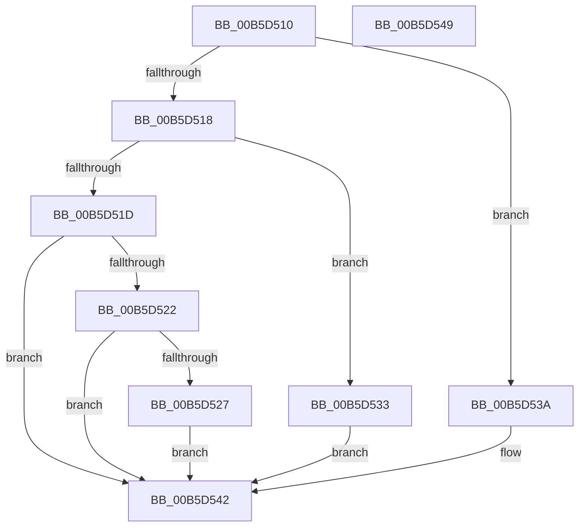

# HalpMiscInitSystem

- RVA: `0x00B5D510`–`0x00B5D54A` (길이 `58` bytes)
- VA: `0x0000000140B5D510`
- 실행 섹션: `PAGELK`
- PDB 이름 있음: `예`; PDB Function 태그: `아니요`
- unwind 정보 RVA: `0x0005C788`
- 디코드: `20`개 명령, `58/58` bytes 표시
- 미해석 바이트: `0` (있으면 어셈블리에 `.byte`로 보존)

> 이 문서는 커널 이미지의 기계어와 PDB 기호를 분석해 생성했습니다. 4번과 5번은 함수 원형과 자료형을 바이너리 사용 방식에서 추정한 C 해석이며 원본 소스 복구 결과는 아닙니다.

## 1. Dependencies

- 직접 호출 지점: **4**; 고유 호출 대상: **4**
- 직접 호출자로 확인된 함수: **0**
- RIP 상대 이미지 참조: **0**

### Outgoing calls
- `0x00B5D527` → [HalpMiscInitializeTelemetry](../../page/70/HalpMiscInitializeTelemetry_function_00707DFC.md) (function, `0x00707DFC`)
- `0x00B5D52C` → [HalpMiscInitializeKsr](../../page/70/HalpMiscInitializeKsr_function_0070C618.md) (function, `0x0070C618`)
- `0x00B5D533` → [HalpMiscInitDiscard](../../init/C2/HalpMiscInitDiscard_function_00C20104.md) (function, `0x00C20104`)
- `0x00B5D53D` → [HalpMiscGetParameters](../../init/C1/HalpMiscGetParameters_function_00C1FD30.md) (function, `0x00C1FD30`)

### Direct callers
- 이 함수 시작 RVA로 연결되는 직접 call은 확인되지 않았습니다. 간접 호출은 완전히 역산할 수 없습니다.

### Static image references
- 디코드된 RIP-relative 메모리 참조가 없습니다.

## 2. Other-region calls and transfers

- 다른 실행 섹션으로 향하는 call: **4**
  - `0x00B5D527` → [HalpMiscInitializeTelemetry](../../page/70/HalpMiscInitializeTelemetry_function_00707DFC.md) (`PAGELK` → `PAGE`)
  - `0x00B5D52C` → [HalpMiscInitializeKsr](../../page/70/HalpMiscInitializeKsr_function_0070C618.md) (`PAGELK` → `PAGE`)
  - `0x00B5D533` → [HalpMiscInitDiscard](../../init/C2/HalpMiscInitDiscard_function_00C20104.md) (`PAGELK` → `INIT`)
  - `0x00B5D53D` → [HalpMiscGetParameters](../../init/C1/HalpMiscGetParameters_function_00C1FD30.md) (`PAGELK` → `INIT`)
- 별도 외부 분기/꼬리 이동을 확인하지 못했습니다.

## 3. Assembly (complete function range)

```asm
00B5D510  48 83 EC 28                     sub rsp, 0x28
00B5D514  85 C9                           test ecx, ecx
00B5D516  74 22                           je 0x140b5d53a
00B5D518  83 F9 07                        cmp ecx, 7
00B5D51B  74 16                           je 0x140b5d533
00B5D51D  83 F9 18                        cmp ecx, 0x18
00B5D520  74 20                           je 0x140b5d542
00B5D522  83 F9 1F                        cmp ecx, 0x1f
00B5D525  75 1B                           jne 0x140b5d542
00B5D527  E8 D0 A8 BA FF                  call 0x140707dfc
00B5D52C  E8 E7 F0 BA FF                  call 0x14070c618
00B5D531  EB 0F                           jmp 0x140b5d542
00B5D533  E8 CC 2B 0C 00                  call 0x140c20104
00B5D538  EB 08                           jmp 0x140b5d542
00B5D53A  49 8B C8                        mov rcx, r8
00B5D53D  E8 EE 27 0C 00                  call 0x140c1fd30
00B5D542  33 C0                           xor eax, eax
00B5D544  48 83 C4 28                     add rsp, 0x28
00B5D548  C3                              ret
00B5D549  CC                              int3
```

## 4. C-style interpretation (structured pseudocode)

```c
__int64 __fastcall HalpMiscInitSystem(int a1, __int64 a2, __int64 a3)
{
    __int64 result;
    __int64 v_rsp;

    v_rsp = (v_rsp) - (40);
    if (a1 == 0) goto loc_00B5D53A;
    if (a1 == 7) goto loc_00B5D533;
    if (a1 == 24) goto loc_00B5D542;
    if (a1 != 31) goto loc_00B5D542;
    result = HalpMiscInitializeTelemetry(a1, a2, a3, a4);
    result = HalpMiscInitializeKsr(a1, a2, a3, a4);
    goto loc_00B5D542;
loc_00B5D533:
    result = HalpMiscInitDiscard(a1, a2, a3, a4);
    goto loc_00B5D542;
loc_00B5D53A:
    result = HalpMiscGetParameters(a3, a2, a3, a4);
loc_00B5D542:
    result = 0;
    v_rsp = (v_rsp) + (40);
    return result;
}
```

## 5. (Beta) C Style

```c
int64_t HalpMiscInitSystem(int32_t Arg1, int64_t Arg2, int64_t Arg3)
{
    int64_t result;
    int64_t local_rsp;

    local_rsp = (local_rsp) - (40);
    if (Arg1 == 0) goto loc_00B5D53A;
    if (Arg1 == 7) goto loc_00B5D533;
    if (Arg1 == 24) goto loc_00B5D542;
    if (Arg1 != 31) goto loc_00B5D542;
    result = HalpMiscInitializeTelemetry(Arg1, Arg2, Arg3, a4);
    result = HalpMiscInitializeKsr(Arg1, Arg2, Arg3, a4);
    goto loc_00B5D542;
loc_00B5D533:
    result = HalpMiscInitDiscard(Arg1, Arg2, Arg3, a4);
    goto loc_00B5D542;
loc_00B5D53A:
    result = HalpMiscGetParameters(Arg3, Arg2, Arg3, a4);
loc_00B5D542:
    result = 0;
    local_rsp = (local_rsp) + (40);
    return result;
}
```

## 6. Execution-region graph

[열기: 2D/3D 그래프와 함수 탐색 컨트롤 패널](../../../control-panel.html?section=pagelk&rva=0x00B5D510&view=graph)

- 2D 그래프는 위에서 아래로 흐르고, 3D 그래프는 빈 공간을 드래그해 회전합니다. Shift+드래그는 이동, 휠은 확대·축소, 함수 노드 선택은 대상 보고서 이동입니다.

### Static fallback


