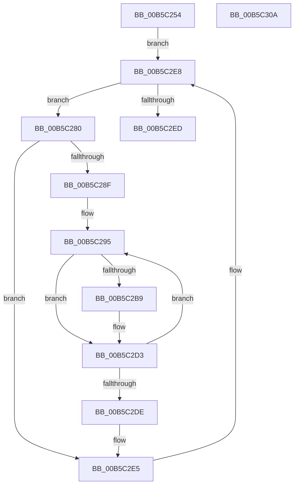

# HalpMmAllocCtxMarkHiberPhase

- RVA: `0x00B5C254`–`0x00B5C30B` (길이 `183` bytes)
- VA: `0x0000000140B5C254`
- 실행 섹션: `PAGELK`
- PDB 이름 있음: `예`; PDB Function 태그: `아니요`
- unwind 정보 RVA: `0x0008C20C`
- 디코드: `54`개 명령, `183/183` bytes 표시
- 미해석 바이트: `0` (있으면 어셈블리에 `.byte`로 보존)

> 이 문서는 커널 이미지의 기계어와 PDB 기호를 분석해 생성했습니다. 4번과 5번은 함수 원형과 자료형을 바이너리 사용 방식에서 추정한 C 해석이며 원본 소스 복구 결과는 아닙니다.

## 1. Dependencies

- 직접 호출 지점: **2**; 고유 호출 대상: **2**
- 직접 호출자로 확인된 함수: **1**
- RIP 상대 이미지 참조: **1**

### Outgoing calls
- `0x00B5C2B0` → [RtlAreBitsClear](../../text/45/RtlAreBitsClear_function_00451800.md) (function, `0x00451800`)
- `0x00B5C2CE` → [PoSetHiberRange](../../text/47/PoSetHiberRange_function_0047C580.md) (function, `0x0047C580`)

### Direct callers
- [HaliLocateHiberRanges](HaliLocateHiberRanges_function_00B5CE50.md) at `0x00B5CF59`

### Static image references
- `0x00B5C270` → RVA `0x00FC2CA0` (`.data`; read)

## 2. Other-region calls and transfers

- 다른 실행 섹션으로 향하는 call: **2**
  - `0x00B5C2B0` → [RtlAreBitsClear](../../text/45/RtlAreBitsClear_function_00451800.md) (`PAGELK` → `.text`)
  - `0x00B5C2CE` → [PoSetHiberRange](../../text/47/PoSetHiberRange_function_0047C580.md) (`PAGELK` → `.text`)
- 별도 외부 분기/꼬리 이동을 확인하지 못했습니다.

## 3. Assembly (complete function range)

```asm
00B5C254  48 89 5C 24 08                  mov qword ptr [rsp + 8], rbx
00B5C259  48 89 6C 24 10                  mov qword ptr [rsp + 0x10], rbp
00B5C25E  48 89 74 24 18                  mov qword ptr [rsp + 0x18], rsi
00B5C263  57                              push rdi
00B5C264  41 54                           push r12
00B5C266  41 55                           push r13
00B5C268  41 56                           push r14
00B5C26A  41 57                           push r15
00B5C26C  48 83 EC 30                     sub rsp, 0x30
00B5C270  48 8B 1D 29 6A 46 00            mov rbx, qword ptr [rip + 0x466a29]
00B5C277  4C 8D 2D 22 6A 46 00            lea r13, [rip + 0x466a22]
00B5C27E  EB 68                           jmp 0x140b5c2e8
00B5C280  8B 7B 20                        mov edi, dword ptr [rbx + 0x20]
00B5C283  45 33 F6                        xor r14d, r14d
00B5C286  48 8B 6B 10                     mov rbp, qword ptr [rbx + 0x10]
00B5C28A  48 85 FF                        test rdi, rdi
00B5C28D  74 56                           je 0x140b5c2e5
00B5C28F  41 BD 00 01 00 00               mov r13d, 0x100
00B5C295  49 3B FD                        cmp rdi, r13
00B5C298  48 8D 4B 20                     lea rcx, [rbx + 0x20]
00B5C29C  48 8B F7                        mov rsi, rdi
00B5C29F  41 8B D6                        mov edx, r14d
00B5C2A2  49 0F 47 F5                     cmova rsi, r13
00B5C2A6  4C 8B FE                        mov r15, rsi
00B5C2A9  44 8B C6                        mov r8d, esi
00B5C2AC  49 C1 E7 04                     shl r15, 4
00B5C2B0  E8 4B 55 8F FF                  call 0x140451800
00B5C2B5  84 C0                           test al, al
00B5C2B7  75 1A                           jne 0x140b5c2d3
00B5C2B9  4D 8B CF                        mov r9, r15
00B5C2BC  C7 44 24 20 68 61 6C 74         mov dword ptr [rsp + 0x20], 0x746c6168
00B5C2C4  4C 8B C5                        mov r8, rbp
00B5C2C7  BA 00 00 01 00                  mov edx, 0x10000
00B5C2CC  33 C9                           xor ecx, ecx
00B5C2CE  E8 AD 02 92 FF                  call 0x14047c580
00B5C2D3  4C 03 F6                        add r14, rsi
00B5C2D6  49 03 EF                        add rbp, r15
00B5C2D9  48 2B FE                        sub rdi, rsi
00B5C2DC  75 B7                           jne 0x140b5c295
00B5C2DE  4C 8D 2D BB 69 46 00            lea r13, [rip + 0x4669bb]
00B5C2E5  48 8B 1B                        mov rbx, qword ptr [rbx]
00B5C2E8  49 3B DD                        cmp rbx, r13
00B5C2EB  75 93                           jne 0x140b5c280
00B5C2ED  48 8B 5C 24 60                  mov rbx, qword ptr [rsp + 0x60]
00B5C2F2  48 8B 6C 24 68                  mov rbp, qword ptr [rsp + 0x68]
00B5C2F7  48 8B 74 24 70                  mov rsi, qword ptr [rsp + 0x70]
00B5C2FC  48 83 C4 30                     add rsp, 0x30
00B5C300  41 5F                           pop r15
00B5C302  41 5E                           pop r14
00B5C304  41 5D                           pop r13
00B5C306  41 5C                           pop r12
00B5C308  5F                              pop rdi
00B5C309  C3                              ret
00B5C30A  CC                              int3
```

## 4. C-style interpretation (structured pseudocode)

```c
__int64 __fastcall HalpMmAllocCtxMarkHiberPhase(void)
{
    __int64 result;
    __int64 v_r14;
    __int64 v_r15;
    __int64 v_rbp;
    __int64 v_rdi;
    __int64 v_rsi;
    __int64 v_rsp;
    unsigned int v_stack_m38;
    unsigned __int64 v_stack_p10;
    unsigned __int64 v_stack_p18;
    unsigned __int64 v_stack_p8;

    v_stack_p8 = v_rbx;
    v_stack_p10 = v_rbp;
    v_stack_p18 = v_rsi;
    v_rsp = (v_rsp) - (48);
    goto loc_00B5C2E8;
loc_00B5C280:
    v_r14 = 0;
    if ((unsigned int)(*(unsigned int *)(*(unsigned __int64 *)(v_rip + 4614697) + 32)) == 0) goto loc_00B5C2E5;
loc_00B5C295:
    v_rsi = (unsigned int)(*(unsigned int *)(*(unsigned __int64 *)(v_rip + 4614697) + 32));
    if (((unsigned int)(*(unsigned int *)(*(unsigned __int64 *)(v_rip + 4614697) + 32))) > 256) { v_rsi = 256; }
    v_r15 = (v_rsi) << (4);
    result = RtlAreBitsClear(*(unsigned __int64 *)(v_rip + 4614697) + 32, 0, (unsigned int)((unsigned int)(v_rsi)), a4);
    if ((unsigned __int8)(result) == 0) {
        a4 = v_r15;
        v_stack_m38 = 0x746C6168ULL;
        a3 = *(unsigned __int64 *)(*(unsigned __int64 *)(v_rip + 4614697) + 16);
        a2 = 0x10000ULL;
        a1 = 0;
        result = PoSetHiberRange(a1, a2, a3, a4);
    }
    v_r14 = (v_r14) + (v_rsi);
    v_rbp = (*(unsigned __int64 *)(*(unsigned __int64 *)(v_rip + 4614697) + 16)) + (v_r15);
    v_rdi = ((unsigned int)(*(unsigned int *)(*(unsigned __int64 *)(v_rip + 4614697) + 32))) - (v_rsi);
    if (condition_is_not_equal) goto loc_00B5C295;
loc_00B5C2E5:
loc_00B5C2E8:
    if ((*(unsigned __int64 *)(*(unsigned __int64 *)(v_rip + 4614697))) != (v_rip + 4614587)) goto loc_00B5C280;
    v_rsp = (v_rsp) + (48);
    return result;
}
```

## 5. (Beta) C Style

```c
void HalpMmAllocCtxMarkHiberPhase(void)
{
    int64_t result;
    int64_t local_r14;
    int64_t local_r15;
    int64_t local_rbp;
    int64_t local_rdi;
    int64_t local_rsi;
    int64_t local_rsp;
    uint32_t v_stack_m38;
    uint64_t v_stack_p10;
    uint64_t v_stack_p18;
    uint64_t v_stack_p8;

    v_stack_p8 = local_rbx;
    v_stack_p10 = local_rbp;
    v_stack_p18 = local_rsi;
    local_rsp = (local_rsp) - (48);
    goto loc_00B5C2E8;
loc_00B5C280:
    local_r14 = 0;
    if ((uint32_t)(*(uint32_t *)(*(uint64_t *)(v_rip + 0x466A29) + 0x20)) == 0) goto loc_00B5C2E5;
loc_00B5C295:
    local_rsi = (uint32_t)(*(uint32_t *)(*(uint64_t *)(v_rip + 0x466A29) + 0x20));
    if (((uint32_t)(*(uint32_t *)(*(uint64_t *)(v_rip + 0x466A29) + 0x20))) > 256) { local_rsi = 256; }
    local_r15 = (local_rsi) << (4);
    result = RtlAreBitsClear(*(uint64_t *)(v_rip + 0x466A29) + 32, 0, (uint32_t)((uint32_t)(local_rsi)), a4);
    if ((uint8_t)(result) == 0) {
        a4 = local_r15;
        v_stack_m38 = 0x746C6168ULL;
        a3 = *(uint64_t *)(*(uint64_t *)(v_rip + 0x466A29) + 0x10);
        a2 = 0x10000ULL;
        a1 = 0;
        result = PoSetHiberRange(a1, a2, a3, a4);
    }
    local_r14 = (local_r14) + (local_rsi);
    local_rbp = (*(uint64_t *)(*(uint64_t *)(v_rip + 0x466A29) + 0x10)) + (local_r15);
    local_rdi = ((uint32_t)(*(uint32_t *)(*(uint64_t *)(v_rip + 0x466A29) + 0x20))) - (local_rsi);
    if (condition_is_not_equal) goto loc_00B5C295;
loc_00B5C2E5:
loc_00B5C2E8:
    if ((*(uint64_t *)(*(uint64_t *)(v_rip + 0x466A29))) != (v_rip + 4614587)) goto loc_00B5C280;
    local_rsp = (local_rsp) + (48);
    return result;
}
```

## 6. Execution-region graph

[열기: 2D/3D 그래프와 함수 탐색 컨트롤 패널](../../../control-panel.html?section=pagelk&rva=0x00B5C254&view=graph)

- 2D 그래프는 위에서 아래로 흐르고, 3D 그래프는 빈 공간을 드래그해 회전합니다. Shift+드래그는 이동, 휠은 확대·축소, 함수 노드 선택은 대상 보고서 이동입니다.

### Static fallback


