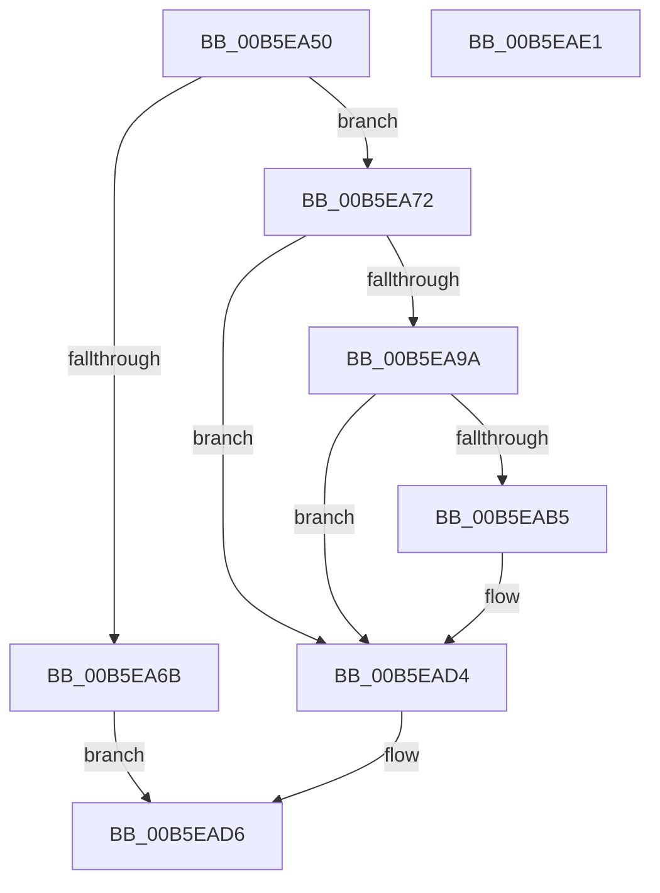

# HalpMmBuildTiledMemoryMap

- RVA: `0x00B5EA50`–`0x00B5EAE2` (길이 `146` bytes)
- VA: `0x0000000140B5EA50`
- 실행 섹션: `PAGELK`
- PDB 이름 있음: `예`; PDB Function 태그: `아니요`
- unwind 정보 RVA: `0x0005CAAC`
- 디코드: `40`개 명령, `146/146` bytes 표시
- 미해석 바이트: `0` (있으면 어셈블리에 `.byte`로 보존)

> 이 문서는 커널 이미지의 기계어와 PDB 기호를 분석해 생성했습니다. 4번과 5번은 함수 원형과 자료형을 바이너리 사용 방식에서 추정한 C 해석이며 원본 소스 복구 결과는 아닙니다.

## 1. Dependencies

- 직접 호출 지점: **6**; 고유 호출 대상: **5**
- 직접 호출자로 확인된 함수: **1**
- RIP 상대 이미지 참조: **5**

### Outgoing calls
- `0x00B5EA5A` → [HalpAllocateCR3Root](../../text/55/HalpAllocateCR3Root_function_0055A914.md) (function, `0x0055A914`)
- `0x00B5EA7D` → [memset](../../text/6C/memset_function_006C6C40.md) (function, `0x006C6C40`)
- `0x00B5EA8F` → [HalpMapCR3Ex](HalpMapCR3Ex_function_00B5E95C.md) (function, `0x00B5E95C`)
- `0x00B5EAAA` → [HalpMapCR3Ex](HalpMapCR3Ex_function_00B5E95C.md) (function, `0x00B5E95C`)
- `0x00B5EAC1` → [HalpCommitCR3Worker](HalpCommitCR3Worker_function_00B5E8D8.md) (function, `0x00B5E8D8`)
- `0x00B5EAC9` → [MmGetPhysicalAddress](../../text/23/MmGetPhysicalAddress_function_0023A500.md) (function, `0x0023A500`)

### Direct callers
- [HalpInterruptBuildGlobalStartupStub](../../text/54/HalpInterruptBuildGlobalStartupStub_function_0054343C.md) at `0x005434B7`

### Static image references
- `0x00B5EA5F` → RVA `0x00F905E8` (`.data`; read)
- `0x00B5EA82` → RVA `0x00FC1AA0` (`.data`; read)
- `0x00B5EA9A` → RVA `0x00F905E0` (`.data`; read)
- `0x00B5EAA3` → RVA `0x006AC820` (`HalpLMStub`; read)
- `0x00B5EACE` → RVA `0x00FC1A8C` (`.data`; write)

## 2. Other-region calls and transfers

- 다른 실행 섹션으로 향하는 call: **3**
  - `0x00B5EA5A` → [HalpAllocateCR3Root](../../text/55/HalpAllocateCR3Root_function_0055A914.md) (`PAGELK` → `.text`)
  - `0x00B5EA7D` → [memset](../../text/6C/memset_function_006C6C40.md) (`PAGELK` → `.text`)
  - `0x00B5EAC9` → [MmGetPhysicalAddress](../../text/23/MmGetPhysicalAddress_function_0023A500.md) (`PAGELK` → `.text`)
- 별도 외부 분기/꼬리 이동을 확인하지 못했습니다.

## 3. Assembly (complete function range)

```asm
00B5EA50  48 89 5C 24 08                  mov qword ptr [rsp + 8], rbx
00B5EA55  57                              push rdi
00B5EA56  48 83 EC 20                     sub rsp, 0x20
00B5EA5A  E8 B5 BE 9F FF                  call 0x14055a914
00B5EA5F  48 8B 3D 82 1B 43 00            mov rdi, qword ptr [rip + 0x431b82]
00B5EA66  48 85 FF                        test rdi, rdi
00B5EA69  75 07                           jne 0x140b5ea72
00B5EA6B  B8 17 00 00 C0                  mov eax, 0xc0000017
00B5EA70  EB 64                           jmp 0x140b5ead6
00B5EA72  33 D2                           xor edx, edx
00B5EA74  41 B8 00 10 00 00               mov r8d, 0x1000
00B5EA7A  48 8B CF                        mov rcx, rdi
00B5EA7D  E8 BE 81 B6 FF                  call 0x1406c6c40
00B5EA82  48 8B 0D 17 30 46 00            mov rcx, qword ptr [rip + 0x463017]
00B5EA89  45 33 C0                        xor r8d, r8d
00B5EA8C  48 8B D1                        mov rdx, rcx
00B5EA8F  E8 C8 FE FF FF                  call 0x140b5e95c
00B5EA94  8B D8                           mov ebx, eax
00B5EA96  85 C0                           test eax, eax
00B5EA98  78 3A                           js 0x140b5ead4
00B5EA9A  4C 8D 05 3F 1B 43 00            lea r8, [rip + 0x431b3f]
00B5EAA1  33 D2                           xor edx, edx
00B5EAA3  48 8D 0D 76 DD B4 FF            lea rcx, [rip - 0x4b228a]
00B5EAAA  E8 AD FE FF FF                  call 0x140b5e95c
00B5EAAF  8B D8                           mov ebx, eax
00B5EAB1  85 C0                           test eax, eax
00B5EAB3  78 1F                           js 0x140b5ead4
00B5EAB5  33 DB                           xor ebx, ebx
00B5EAB7  48 8B 0D 2A 1B 43 00            mov rcx, qword ptr [rip + 0x431b2a]
00B5EABE  8D 53 03                        lea edx, [rbx + 3]
00B5EAC1  E8 12 FE FF FF                  call 0x140b5e8d8
00B5EAC6  48 8B CF                        mov rcx, rdi
00B5EAC9  E8 32 BA 6D FF                  call 0x14023a500
00B5EACE  89 05 B8 2F 46 00               mov dword ptr [rip + 0x462fb8], eax
00B5EAD4  8B C3                           mov eax, ebx
00B5EAD6  48 8B 5C 24 30                  mov rbx, qword ptr [rsp + 0x30]
00B5EADB  48 83 C4 20                     add rsp, 0x20
00B5EADF  5F                              pop rdi
00B5EAE0  C3                              ret
00B5EAE1  CC                              int3
```

## 4. C-style interpretation (structured pseudocode)

```c
__int64 __fastcall HalpMmBuildTiledMemoryMap(__int64 a1, int a2)
{
    __int64 result;
    __int64 v_rbx;
    __int64 v_rsp;
    unsigned __int64 v_stack_p8;

    v_stack_p8 = v_rbx;
    v_rsp = (v_rsp) - (32);
    result = HalpAllocateCR3Root(a1, a2, a3, a4);
    if (*(unsigned __int64 *)(v_rip + 4397954) != 0) goto loc_00B5EA72;
    goto loc_00B5EAD6;
loc_00B5EA72:
    a2 = 0;
    result = memset(*(unsigned __int64 *)(v_rip + 4397954), a2, (unsigned int)(0x1000ULL), a4);
    a3 = 0;
    result = HalpMapCR3Ex(*(unsigned __int64 *)(v_rip + 4599831), *(unsigned __int64 *)(v_rip + 4599831), a3, a4);
    if (sign_flag) goto loc_00B5EAD4;
    a2 = 0;
    result = HalpMapCR3Ex(v_rip - 4924042, a2, v_rip + 4397887, a4);
    v_rbx = (unsigned int)((unsigned int)(result));
    if (!(sign_flag)) {
        v_rbx = 0;
        a1 = *(unsigned __int64 *)(v_rip + 4397866);
        a2 = v_rbx + 3;
        result = HalpCommitCR3Worker(a1, a2, v_rip + 4397887, a4);
        a1 = *(unsigned __int64 *)(v_rip + 4397954);
        result = MmGetPhysicalAddress(a1, a2, v_rip + 4397887, a4);
        *(unsigned int *)(v_rip + 4599736) = (unsigned int)(result);
    }
loc_00B5EAD6:
    v_rsp = (v_rsp) + (32);
    return 0;
}
```

## 5. (Beta) C Style

```c
int64_t HalpMmBuildTiledMemoryMap(int64_t Arg1, int32_t Arg2)
{
    int64_t result;
    int64_t local_rbx;
    int64_t local_rsp;
    uint64_t v_stack_p8;

    v_stack_p8 = local_rbx;
    local_rsp = (local_rsp) - (32);
    result = HalpAllocateCR3Root(Arg1, Arg2, a3, a4);
    if (*(uint64_t *)(v_rip + 0x431B82) != 0) goto loc_00B5EA72;
    goto loc_00B5EAD6;
loc_00B5EA72:
    Arg2 = 0;
    result = memset(*(uint64_t *)(v_rip + 0x431B82), Arg2, (uint32_t)(0x1000ULL), a4);
    a3 = 0;
    result = HalpMapCR3Ex(*(uint64_t *)(v_rip + 0x463017), *(uint64_t *)(v_rip + 0x463017), a3, a4);
    if (sign_flag) goto loc_00B5EAD4;
    Arg2 = 0;
    result = HalpMapCR3Ex(v_rip - 4924042, Arg2, v_rip + 4397887, a4);
    local_rbx = (uint32_t)((uint32_t)(result));
    if (!(sign_flag)) {
        local_rbx = 0;
        Arg1 = *(uint64_t *)(v_rip + 0x431B2A);
        Arg2 = local_rbx + 3;
        result = HalpCommitCR3Worker(Arg1, Arg2, v_rip + 4397887, a4);
        Arg1 = *(uint64_t *)(v_rip + 0x431B82);
        result = MmGetPhysicalAddress(Arg1, Arg2, v_rip + 4397887, a4);
        *(uint32_t *)(v_rip + 0x462FB8) = (uint32_t)(result);
    }
loc_00B5EAD6:
    local_rsp = (local_rsp) + (32);
    return 0;
}
```

## 6. Execution-region graph

[열기: 2D/3D 그래프와 함수 탐색 컨트롤 패널](../../../control-panel.html?section=pagelk&rva=0x00B5EA50&view=graph)

- 2D 그래프는 위에서 아래로 흐르고, 3D 그래프는 빈 공간을 드래그해 회전합니다. Shift+드래그는 이동, 휠은 확대·축소, 함수 노드 선택은 대상 보고서 이동입니다.

### Static fallback


