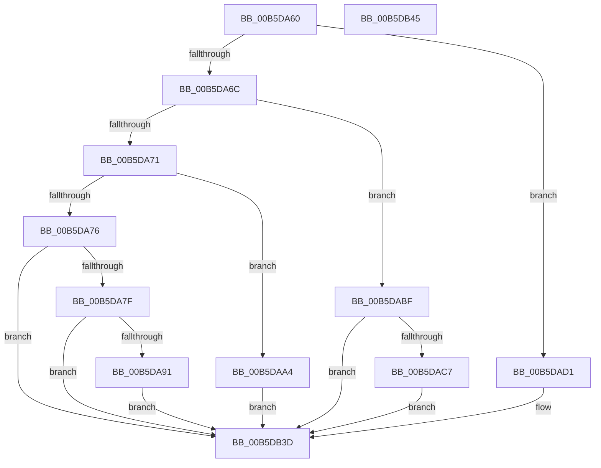

# HalpMmInitSystem

- RVA: `0x00B5DA60`–`0x00B5DB46` (길이 `230` bytes)
- VA: `0x0000000140B5DA60`
- 실행 섹션: `PAGELK`
- PDB 이름 있음: `예`; PDB Function 태그: `아니요`
- unwind 정보 RVA: `0x0005CF00`
- 디코드: `51`개 명령, `230/230` bytes 표시
- 미해석 바이트: `0` (있으면 어셈블리에 `.byte`로 보존)

> 이 문서는 커널 이미지의 기계어와 PDB 기호를 분석해 생성했습니다. 4번과 5번은 함수 원형과 자료형을 바이너리 사용 방식에서 추정한 C 해석이며 원본 소스 복구 결과는 아닙니다.

## 1. Dependencies

- 직접 호출 지점: **4**; 고유 호출 대상: **4**
- 직접 호출자로 확인된 함수: **0**
- RIP 상대 이미지 참조: **15**

### Outgoing calls
- `0x00B5DA82` → [HalpInitMemoryCachingRequirementsTable](HalpInitMemoryCachingRequirementsTable_function_00B5C1C4.md) (function, `0x00B5C1C4`)
- `0x00B5DAA4` → [HalpMmReservePageTablePages](../../text/54/HalpMmReservePageTablePages_function_00544C1C.md) (function, `0x00544C1C`)
- `0x00B5DACA` → [HalpConsumeLowMemory](../../init/C1/HalpConsumeLowMemory_function_00C1EA2C.md) (function, `0x00C1EA2C`)
- `0x00B5DB38` → [HalpMmAllocCtxInit](../../text/54/HalpMmAllocCtxInit_function_005448BC.md) (function, `0x005448BC`)

### Direct callers
- 이 함수 시작 RVA로 연결되는 직접 call은 확인되지 않았습니다. 간접 호출은 완전히 역산할 수 없습니다.

### Static image references
- `0x00B5DA91` → RVA `0x006BA720` (`RtlCopyMemoryNonTemporal`; read)
- `0x00B5DA98` → RVA `0x00E002C8` (`.data`; write)
- `0x00B5DAA9` → RVA `0x00E10230` (`.data`; read/write)
- `0x00B5DAB0` → RVA `0x00E10238` (`.data`; read/write)
- `0x00B5DAB7` → RVA `0x00E10240` (`.data`; read/write)
- `0x00B5DABF` → RVA `0x00FC19BA` (`.data`; read)
- `0x00B5DAE5` → RVA `0x00E10230` (`.data`; write)
- `0x00B5DAFD` → RVA `0x00E10220` (`.data`; write)
- `0x00B5DB04` → RVA `0x00E10218` (`.data`; write)
- `0x00B5DB0E` → RVA `0x00E10228` (`.data`; write)
- `0x00B5DB15` → RVA `0x00544770` (`HalpAllocateEarlyPages`; read)
- `0x00B5DB1C` → RVA `0x00E00978` (`.data`; write)
- `0x00B5DB23` → RVA `0x00544860` (`HalpMapEarlyPages`; read)
- `0x00B5DB2A` → RVA `0x00E00980` (`.data`; write)
- `0x00B5DB31` → RVA `0x00E10210` (`.data`; write)

## 2. Other-region calls and transfers

- 다른 실행 섹션으로 향하는 call: **3**
  - `0x00B5DAA4` → [HalpMmReservePageTablePages](../../text/54/HalpMmReservePageTablePages_function_00544C1C.md) (`PAGELK` → `.text`)
  - `0x00B5DACA` → [HalpConsumeLowMemory](../../init/C1/HalpConsumeLowMemory_function_00C1EA2C.md) (`PAGELK` → `INIT`)
  - `0x00B5DB38` → [HalpMmAllocCtxInit](../../text/54/HalpMmAllocCtxInit_function_005448BC.md) (`PAGELK` → `.text`)
- 별도 외부 분기/꼬리 이동을 확인하지 못했습니다.

## 3. Assembly (complete function range)

```asm
00B5DA60  40 53                           push rbx
00B5DA62  48 83 EC 20                     sub rsp, 0x20
00B5DA66  33 DB                           xor ebx, ebx
00B5DA68  85 C9                           test ecx, ecx
00B5DA6A  74 65                           je 0x140b5dad1
00B5DA6C  83 E9 0C                        sub ecx, 0xc
00B5DA6F  74 4E                           je 0x140b5dabf
00B5DA71  83 E9 04                        sub ecx, 4
00B5DA74  74 2E                           je 0x140b5daa4
00B5DA76  83 F9 01                        cmp ecx, 1
00B5DA79  0F 85 BE 00 00 00               jne 0x140b5db3d
00B5DA7F  49 8B C8                        mov rcx, r8
00B5DA82  E8 3D E7 FF FF                  call 0x140b5c1c4
00B5DA87  8B D8                           mov ebx, eax
00B5DA89  85 C0                           test eax, eax
00B5DA8B  0F 88 AC 00 00 00               js 0x140b5db3d
00B5DA91  48 8D 05 88 CC B5 FF            lea rax, [rip - 0x4a3378]
00B5DA98  48 89 05 29 28 2A 00            mov qword ptr [rip + 0x2a2829], rax
00B5DA9F  E9 99 00 00 00                  jmp 0x140b5db3d
00B5DAA4  E8 73 71 9E FF                  call 0x140544c1c
00B5DAA9  48 21 1D 80 27 2B 00            and qword ptr [rip + 0x2b2780], rbx
00B5DAB0  48 21 1D 81 27 2B 00            and qword ptr [rip + 0x2b2781], rbx
00B5DAB7  21 1D 83 27 2B 00               and dword ptr [rip + 0x2b2783], ebx
00B5DABD  EB 7E                           jmp 0x140b5db3d
00B5DABF  38 1D F5 3E 46 00               cmp byte ptr [rip + 0x463ef5], bl
00B5DAC5  74 76                           je 0x140b5db3d
00B5DAC7  49 8B C8                        mov rcx, r8
00B5DACA  E8 5D 0F 0C 00                  call 0x140c1ea2c
00B5DACF  EB 6C                           jmp 0x140b5db3d
00B5DAD1  49 8B 80 F0 00 00 00            mov rax, qword ptr [r8 + 0xf0]
00B5DAD8  48 21 1D 59 27 2B 00            and qword ptr [rip + 0x2b2759], rbx
00B5DADF  21 1D 5B 27 2B 00               and dword ptr [rip + 0x2b275b], ebx
00B5DAE5  4C 89 05 44 27 2B 00            mov qword ptr [rip + 0x2b2744], r8
00B5DAEC  48 8B 88 90 0B 00 00            mov rcx, qword ptr [rax + 0xb90]
00B5DAF3  48 8B 80 98 0B 00 00            mov rax, qword ptr [rax + 0xb98]
00B5DAFA  48 03 C1                        add rax, rcx
00B5DAFD  48 89 0D 1C 27 2B 00            mov qword ptr [rip + 0x2b271c], rcx
00B5DB04  48 89 05 0D 27 2B 00            mov qword ptr [rip + 0x2b270d], rax
00B5DB0B  48 FF C8                        dec rax
00B5DB0E  48 89 05 13 27 2B 00            mov qword ptr [rip + 0x2b2713], rax
00B5DB15  48 8D 05 54 6C 9E FF            lea rax, [rip - 0x6193ac]
00B5DB1C  48 89 05 55 2E 2A 00            mov qword ptr [rip + 0x2a2e55], rax
00B5DB23  48 8D 05 36 6D 9E FF            lea rax, [rip - 0x6192ca]
00B5DB2A  48 89 05 4F 2E 2A 00            mov qword ptr [rip + 0x2a2e4f], rax
00B5DB31  48 89 0D D8 26 2B 00            mov qword ptr [rip + 0x2b26d8], rcx
00B5DB38  E8 7F 6D 9E FF                  call 0x1405448bc
00B5DB3D  8B C3                           mov eax, ebx
00B5DB3F  48 83 C4 20                     add rsp, 0x20
00B5DB43  5B                              pop rbx
00B5DB44  C3                              ret
00B5DB45  CC                              int3
```

## 4. C-style interpretation (structured pseudocode)

```c
__int64 __fastcall HalpMmInitSystem(int a1, __int64 a2, __int64 a3)
{
    __int64 result;
    __int64 v_rbx;
    __int64 v_rsp;

    v_rsp = (v_rsp) - (32);
    v_rbx = 0;
    if (a1 == 0) goto loc_00B5DAD1;
    a1 = (unsigned int)((a1) - (12));
    if (condition_is_equal) goto loc_00B5DABF;
    a1 = (unsigned int)((a1) - (4));
    if (condition_is_equal) goto loc_00B5DAA4;
    if (a1 != 1) goto loc_00B5DB3D;
    result = HalpInitMemoryCachingRequirementsTable(a3, a2, a3, a4);
    if (sign_flag) goto loc_00B5DB3D;
    *(unsigned __int64 *)(v_rip + 2762793) = v_rip - 4862840;
    goto loc_00B5DB3D;
loc_00B5DAA4:
    result = HalpMmReservePageTablePages(a3, a2, a3, a4);
    goto loc_00B5DB3D;
loc_00B5DABF:
    if ((*(unsigned __int8 *)(v_rip + 4603637)) == ((unsigned __int8)((unsigned int)((unsigned int)(result))))) goto loc_00B5DB3D;
    result = HalpConsumeLowMemory(a3, a2, a3, a4);
    goto loc_00B5DB3D;
loc_00B5DAD1:
    *(unsigned __int64 *)(v_rip + 2828100) = a3;
    result = (*(unsigned __int64 *)(*(unsigned __int64 *)(a3 + 240) + 2968)) + (*(unsigned __int64 *)(*(unsigned __int64 *)(a3 + 240) + 2960));
    *(unsigned __int64 *)(v_rip + 2828060) = *(unsigned __int64 *)(*(unsigned __int64 *)(a3 + 240) + 2960);
    *(unsigned __int64 *)(v_rip + 2828045) = result;
    result = (result) - 1;
    *(unsigned __int64 *)(v_rip + 2828051) = result;
    *(unsigned __int64 *)(v_rip + 2764373) = v_rip - 6394796;
    *(unsigned __int64 *)(v_rip + 2764367) = v_rip - 6394570;
    *(unsigned __int64 *)(v_rip + 2827992) = *(unsigned __int64 *)(*(unsigned __int64 *)(a3 + 240) + 2960);
    result = HalpMmAllocCtxInit(*(unsigned __int64 *)(*(unsigned __int64 *)(a3 + 240) + 2960), a2, a3, a4);
loc_00B5DB3D:
    v_rsp = (v_rsp) + (32);
    return (unsigned int)((unsigned int)((unsigned int)((unsigned int)(result))));
}
```

## 5. (Beta) C Style

```c
int64_t HalpMmInitSystem(int32_t Arg1, int64_t Arg2, void *Arg3)
{
    uint8_t *arg3 = (uint8_t *)Arg3;

    int64_t result;
    int64_t local_rbx;
    int64_t local_rsp;

    local_rsp = (local_rsp) - (32);
    local_rbx = 0;
    if (Arg1 == 0) goto loc_00B5DAD1;
    Arg1 = (uint32_t)((Arg1) - (12));
    if (condition_is_equal) goto loc_00B5DABF;
    Arg1 = (uint32_t)((Arg1) - (4));
    if (condition_is_equal) goto loc_00B5DAA4;
    if (Arg1 != 1) goto loc_00B5DB3D;
    result = HalpInitMemoryCachingRequirementsTable(Arg3, Arg2, Arg3, a4);
    if (sign_flag) goto loc_00B5DB3D;
    *(uint64_t *)(v_rip + 0x2A2829) = v_rip - 4862840;
    goto loc_00B5DB3D;
loc_00B5DAA4:
    result = HalpMmReservePageTablePages(Arg3, Arg2, Arg3, a4);
    goto loc_00B5DB3D;
loc_00B5DABF:
    if ((*(uint8_t *)(v_rip + 0x463EF5)) == ((uint8_t)((uint32_t)((uint32_t)(result))))) goto loc_00B5DB3D;
    result = HalpConsumeLowMemory(Arg3, Arg2, Arg3, a4);
    goto loc_00B5DB3D;
loc_00B5DAD1:
    *(void **)(v_rip + 0x2B2744) = Arg3;
    result = (*(uint64_t *)(*(uint64_t *)(arg3 + 0xF0) + 0xB98)) + (*(uint64_t *)(*(uint64_t *)(arg3 + 0xF0) + 0xB90));
    *(uint64_t *)(v_rip + 0x2B271C) = *(uint64_t *)(*(uint64_t *)(arg3 + 0xF0) + 0xB90);
    *(uint64_t *)(v_rip + 0x2B270D) = result;
    result = (result) - 1;
    *(uint64_t *)(v_rip + 0x2B2713) = result;
    *(uint64_t *)(v_rip + 0x2A2E55) = v_rip - 6394796;
    *(uint64_t *)(v_rip + 0x2A2E4F) = v_rip - 6394570;
    *(uint64_t *)(v_rip + 0x2B26D8) = *(uint64_t *)(*(uint64_t *)(arg3 + 0xF0) + 0xB90);
    result = HalpMmAllocCtxInit(*(uint64_t *)(*(uint64_t *)(arg3 + 0xF0) + 0xB90), Arg2, Arg3, a4);
loc_00B5DB3D:
    local_rsp = (local_rsp) + (32);
    return (uint32_t)((uint32_t)((uint32_t)((uint32_t)(result))));
}
```

### 관측된 메모리 오프셋

구조체 형식이 확인되지 않은 접근은 인자 기준의 오프셋으로만 기록했습니다.

| 기준 인자 | 오프셋 표현 | 폭 (bit) | 접근 |
|---|---:|---:|---|
| `Arg3` | `+ 0xF0` | `64` | `R` |

## 6. Execution-region graph

[열기: 2D/3D 그래프와 함수 탐색 컨트롤 패널](../../../control-panel.html?section=pagelk&rva=0x00B5DA60&view=graph)

- 2D 그래프는 위에서 아래로 흐르고, 3D 그래프는 빈 공간을 드래그해 회전합니다. Shift+드래그는 이동, 휠은 확대·축소, 함수 노드 선택은 대상 보고서 이동입니다.

### Static fallback


