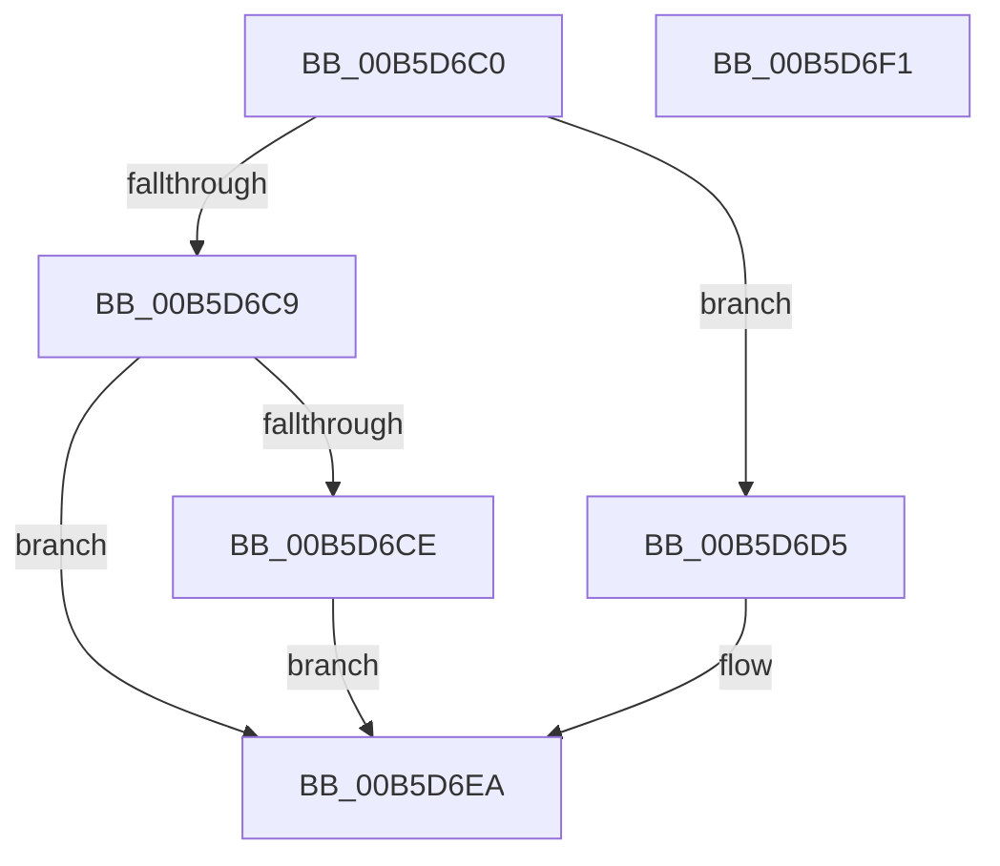

# HalpPciInitSystem

- RVA: `0x00B5D6C0`–`0x00B5D6F2` (길이 `50` bytes)
- VA: `0x0000000140B5D6C0`
- 실행 섹션: `PAGELK`
- PDB 이름 있음: `예`; PDB Function 태그: `아니요`
- unwind 정보 RVA: `0x0005C788`
- 디코드: `15`개 명령, `50/50` bytes 표시
- 미해석 바이트: `0` (있으면 어셈블리에 `.byte`로 보존)

> 이 문서는 커널 이미지의 기계어와 PDB 기호를 분석해 생성했습니다. 4번과 5번은 함수 원형과 자료형을 바이너리 사용 방식에서 추정한 C 해석이며 원본 소스 복구 결과는 아닙니다.

## 1. Dependencies

- 직접 호출 지점: **3**; 고유 호출 대상: **3**
- 직접 호출자로 확인된 함수: **0**
- RIP 상대 이미지 참조: **1**

### Outgoing calls
- `0x00B5D6CE` → [HalpPciReportMmConfigAddressRange](../../init/C2/HalpPciReportMmConfigAddressRange_function_00C2390C.md) (function, `0x00C2390C`)
- `0x00B5D6E0` → [HalpPciInitializeMmConfigAccess](../../init/C2/HalpPciInitializeMmConfigAccess_function_00C23800.md) (function, `0x00C23800`)
- `0x00B5D6E5` → [HalpInitNonBusHandler](../../init/C1/HalpInitNonBusHandler_function_00C1E320.md) (function, `0x00C1E320`)

### Direct callers
- 이 함수 시작 RVA로 연결되는 직접 call은 확인되지 않았습니다. 간접 호출은 완전히 역산할 수 없습니다.

### Static image references
- `0x00B5D6D5` → RVA `0x00FC1708` (`.data`; read/write)

## 2. Other-region calls and transfers

- 다른 실행 섹션으로 향하는 call: **3**
  - `0x00B5D6CE` → [HalpPciReportMmConfigAddressRange](../../init/C2/HalpPciReportMmConfigAddressRange_function_00C2390C.md) (`PAGELK` → `INIT`)
  - `0x00B5D6E0` → [HalpPciInitializeMmConfigAccess](../../init/C2/HalpPciInitializeMmConfigAccess_function_00C23800.md) (`PAGELK` → `INIT`)
  - `0x00B5D6E5` → [HalpInitNonBusHandler](../../init/C1/HalpInitNonBusHandler_function_00C1E320.md) (`PAGELK` → `INIT`)
- 별도 외부 분기/꼬리 이동을 확인하지 못했습니다.

## 3. Assembly (complete function range)

```asm
00B5D6C0  48 83 EC 28                     sub rsp, 0x28
00B5D6C4  83 E9 01                        sub ecx, 1
00B5D6C7  74 0C                           je 0x140b5d6d5
00B5D6C9  83 F9 1A                        cmp ecx, 0x1a
00B5D6CC  75 1C                           jne 0x140b5d6ea
00B5D6CE  E8 39 62 0C 00                  call 0x140c2390c
00B5D6D3  EB 15                           jmp 0x140b5d6ea
00B5D6D5  48 83 25 2B 40 46 00 00         and qword ptr [rip + 0x46402b], 0
00B5D6DD  49 8B C8                        mov rcx, r8
00B5D6E0  E8 1B 61 0C 00                  call 0x140c23800
00B5D6E5  E8 36 0C 0C 00                  call 0x140c1e320
00B5D6EA  33 C0                           xor eax, eax
00B5D6EC  48 83 C4 28                     add rsp, 0x28
00B5D6F0  C3                              ret
00B5D6F1  CC                              int3
```

## 4. C-style interpretation (structured pseudocode)

```c
__int64 __fastcall HalpPciInitSystem(int a1, __int64 a2, __int64 a3)
{
    __int64 result;
    __int64 v_rsp;

    v_rsp = (v_rsp) - (40);
    a1 = (unsigned int)((a1) - (1));
    if (condition_is_equal) goto loc_00B5D6D5;
    if (a1 != 26) goto loc_00B5D6EA;
    result = HalpPciReportMmConfigAddressRange(a1, a2, a3, a4);
    goto loc_00B5D6EA;
loc_00B5D6D5:
    result = HalpPciInitializeMmConfigAccess(a3, a2, a3, a4);
    result = HalpInitNonBusHandler(a3, a2, a3, a4);
loc_00B5D6EA:
    result = 0;
    v_rsp = (v_rsp) + (40);
    return result;
}
```

## 5. (Beta) C Style

```c
int64_t HalpPciInitSystem(int32_t Arg1, int64_t Arg2, int64_t Arg3)
{
    int64_t result;
    int64_t local_rsp;

    local_rsp = (local_rsp) - (40);
    Arg1 = (uint32_t)((Arg1) - (1));
    if (condition_is_equal) goto loc_00B5D6D5;
    if (Arg1 != 26) goto loc_00B5D6EA;
    result = HalpPciReportMmConfigAddressRange(Arg1, Arg2, Arg3, a4);
    goto loc_00B5D6EA;
loc_00B5D6D5:
    result = HalpPciInitializeMmConfigAccess(Arg3, Arg2, Arg3, a4);
    result = HalpInitNonBusHandler(Arg3, Arg2, Arg3, a4);
loc_00B5D6EA:
    result = 0;
    local_rsp = (local_rsp) + (40);
    return result;
}
```

## 6. Execution-region graph

[열기: 2D/3D 그래프와 함수 탐색 컨트롤 패널](../../../control-panel.html?section=pagelk&rva=0x00B5D6C0&view=graph)

- 2D 그래프는 위에서 아래로 흐르고, 3D 그래프는 빈 공간을 드래그해 회전합니다. Shift+드래그는 이동, 휠은 확대·축소, 함수 노드 선택은 대상 보고서 이동입니다.

### Static fallback


