# HalpPostSleepMP

- RVA: `0x00B5ECC4`–`0x00B5EE75` (길이 `433` bytes)
- VA: `0x0000000140B5ECC4`
- 실행 섹션: `PAGELK`
- PDB 이름 있음: `예`; PDB Function 태그: `아니요`
- unwind 정보 RVA: `0x000BDAD8`
- 디코드: `108`개 명령, `433/433` bytes 표시
- 미해석 바이트: `0` (있으면 어셈블리에 `.byte`로 보존)

> 이 문서는 커널 이미지의 기계어와 PDB 기호를 분석해 생성했습니다. 4번과 5번은 함수 원형과 자료형을 바이너리 사용 방식에서 추정한 C 해석이며 원본 소스 복구 결과는 아닙니다.

## 1. Dependencies

- 직접 호출 지점: **19**; 고유 호출 대상: **17**
- 직접 호출자로 확인된 함수: **1**
- RIP 상대 이미지 참조: **19**

### Outgoing calls
- `0x00B5ECEA` → [HalpInterruptReinitializeThisProcessor](../../text/4E/HalpInterruptReinitializeThisProcessor_function_004E29E0.md) (function, `0x004E29E0`)
- `0x00B5ED0A` → [HalpTimerReinitializeThisProcessor](../../text/53/HalpTimerReinitializeThisProcessor_function_0053D2F0.md) (function, `0x0053D2F0`)
- `0x00B5ED1B` → [HalpMcaResumeProcessorConfig](../B7/HalpMcaResumeProcessorConfig_function_00B7B31C.md) (function, `0x00B7B31C`)
- `0x00B5ED2C` → [HalpInterruptEnablePerformanceEvents](../../text/2D/HalpInterruptEnablePerformanceEvents_function_002D3420.md) (function, `0x002D3420`)
- `0x00B5ED31` → [HalpHvIsReferenceTscConfigured](../../text/4F/HalpHvIsReferenceTscConfigured_function_004FBE80.md) (function, `0x004FBE80`)
- `0x00B5ED7B` → [HalpTscInitializeSynchronizationContext](../../text/54/HalpTscInitializeSynchronizationContext_function_0054ADB8.md) (function, `0x0054ADB8`)
- `0x00B5EDAD` → [HalpHvSetMachineCheckHandlerState](../../text/54/HalpHvSetMachineCheckHandlerState_function_0054CEF8.md) (function, `0x0054CEF8`)
- `0x00B5EDBF` → [HalpSetResumeTime](../../text/55/HalpSetResumeTime_function_0055BC08.md) (function, `0x0055BC08`)
- `0x00B5EDC4` → [HalpTimerMarkWake](../../text/4F/HalpTimerMarkWake_function_004FAEA0.md) (function, `0x004FAEA0`)
- `0x00B5EDC9` → [HalpTimerRestoreProcessorCounter](../../text/4F/HalpTimerRestoreProcessorCounter_function_004F6EC8.md) (function, `0x004F6EC8`)
- `0x00B5EDE5` → [HalpSetResumeTime](../../text/55/HalpSetResumeTime_function_0055BC08.md) (function, `0x0055BC08`)
- `0x00B5EDEA` → [HalpInterruptRestoreClock](../../text/54/HalpInterruptRestoreClock_function_00544580.md) (function, `0x00544580`)
- `0x00B5EE21` → [HalpMcUpdateMicrocode](../../text/4D/HalpMcUpdateMicrocode_function_004DB3FC.md) (function, `0x004DB3FC`)
- `0x00B5EE26` → [HalpErrataApplyPerProcessor](../B7/HalpErrataApplyPerProcessor_function_00B7E46C.md) (function, `0x00B7E46C`)
- `0x00B5EE3E` → [HalpRestartProfiling](../../text/4B/HalpRestartProfiling_function_004BD0A4.md) (function, `0x004BD0A4`)
- `0x00B5EE43` → [HalpInterruptEnableNmi](../../text/4A/HalpInterruptEnableNmi_function_004AD9E0.md) (function, `0x004AD9E0`)
- `0x00B5EE4F` → [KeLoadMTRR](../B7/KeLoadMTRR_function_00B7DDA0.md) (function, `0x00B7DDA0`)
- `0x00B5EE5F` → [HalpTscSynchronizationWorker](../../text/54/HalpTscSynchronizationWorker_function_0054B090.md) (function, `0x0054B090`)
- `0x00B5EE69` → [HalpMcaResumeProcessorConfig](../B7/HalpMcaResumeProcessorConfig_function_00B7B31C.md) (function, `0x00B7B31C`)

### Direct callers
- [HaliAcpiSleep](../../text/56/HaliAcpiSleep_function_0056AD60.md) at `0x0056B2C4`

### Static image references
- `0x00B5ECF3` → RVA `0x00F8F9A8` (`.data`; read)
- `0x00B5ED0F` → RVA `0x00FC1C44` (`.data`; read)
- `0x00B5ED40` → RVA `0x00E3ECDC` (`.data`; write)
- `0x00B5ED46` → RVA `0x00E3EC88` (`.data`; read)
- `0x00B5ED4D` → RVA `0x00E3EC88` (`.data`; write)
- `0x00B5ED59` → RVA `0x00E3ECD0` (`.data`; write)
- `0x00B5ED60` → RVA `0x00E3ECC4` (`.data`; write)
- `0x00B5ED74` → RVA `0x00E3EC90` (`.data`; read)
- `0x00B5ED80` → RVA `0x00F8F9A8` (`.data`; read/write)
- `0x00B5ED9B` → RVA `0x00FC1C48` (`.data`; read)
- `0x00B5EDA3` → RVA `0x00E0A768` (`.data`; read)
- `0x00B5EDD9` → RVA `0x00FC1A98` (`.data`; write)
- `0x00B5EDEF` → RVA `0x00FC1C41` (`.data`; write)
- `0x00B5EDF6` → RVA `0x00E3ECD8` (`.data`; write)
- `0x00B5EE00` → RVA `0x00E3ECDC` (`.data`; read/write)
- `0x00B5EE07` → RVA `0x00E3ECDC` (`.data`; read)
- `0x00B5EE13` → RVA `0x00E3ECD8` (`.data`; read)
- `0x00B5EE2B` → RVA `0x00E3ECD8` (`.data`; read/write)
- `0x00B5EE48` → RVA `0x00E3ECC0` (`.data`; read)

## 2. Other-region calls and transfers

- 다른 실행 섹션으로 향하는 call: **15**
  - `0x00B5ECEA` → [HalpInterruptReinitializeThisProcessor](../../text/4E/HalpInterruptReinitializeThisProcessor_function_004E29E0.md) (`PAGELK` → `.text`)
  - `0x00B5ED0A` → [HalpTimerReinitializeThisProcessor](../../text/53/HalpTimerReinitializeThisProcessor_function_0053D2F0.md) (`PAGELK` → `.text`)
  - `0x00B5ED2C` → [HalpInterruptEnablePerformanceEvents](../../text/2D/HalpInterruptEnablePerformanceEvents_function_002D3420.md) (`PAGELK` → `.text`)
  - `0x00B5ED31` → [HalpHvIsReferenceTscConfigured](../../text/4F/HalpHvIsReferenceTscConfigured_function_004FBE80.md) (`PAGELK` → `.text`)
  - `0x00B5ED7B` → [HalpTscInitializeSynchronizationContext](../../text/54/HalpTscInitializeSynchronizationContext_function_0054ADB8.md) (`PAGELK` → `.text`)
  - `0x00B5EDAD` → [HalpHvSetMachineCheckHandlerState](../../text/54/HalpHvSetMachineCheckHandlerState_function_0054CEF8.md) (`PAGELK` → `.text`)
  - `0x00B5EDBF` → [HalpSetResumeTime](../../text/55/HalpSetResumeTime_function_0055BC08.md) (`PAGELK` → `.text`)
  - `0x00B5EDC4` → [HalpTimerMarkWake](../../text/4F/HalpTimerMarkWake_function_004FAEA0.md) (`PAGELK` → `.text`)
  - `0x00B5EDC9` → [HalpTimerRestoreProcessorCounter](../../text/4F/HalpTimerRestoreProcessorCounter_function_004F6EC8.md) (`PAGELK` → `.text`)
  - `0x00B5EDE5` → [HalpSetResumeTime](../../text/55/HalpSetResumeTime_function_0055BC08.md) (`PAGELK` → `.text`)
  - `0x00B5EDEA` → [HalpInterruptRestoreClock](../../text/54/HalpInterruptRestoreClock_function_00544580.md) (`PAGELK` → `.text`)
  - `0x00B5EE21` → [HalpMcUpdateMicrocode](../../text/4D/HalpMcUpdateMicrocode_function_004DB3FC.md) (`PAGELK` → `.text`)
  - `0x00B5EE3E` → [HalpRestartProfiling](../../text/4B/HalpRestartProfiling_function_004BD0A4.md) (`PAGELK` → `.text`)
  - `0x00B5EE43` → [HalpInterruptEnableNmi](../../text/4A/HalpInterruptEnableNmi_function_004AD9E0.md) (`PAGELK` → `.text`)
  - `0x00B5EE5F` → [HalpTscSynchronizationWorker](../../text/54/HalpTscSynchronizationWorker_function_0054B090.md) (`PAGELK` → `.text`)
- 별도 외부 분기/꼬리 이동을 확인하지 못했습니다.

## 3. Assembly (complete function range)

```asm
00B5ECC4  48 89 54 24 10                  mov qword ptr [rsp + 0x10], rdx
00B5ECC9  89 4C 24 08                     mov dword ptr [rsp + 8], ecx
00B5ECCD  53                              push rbx
00B5ECCE  48 83 EC 20                     sub rsp, 0x20
00B5ECD2  65 48 8B 04 25 20 00 00 00      mov rax, qword ptr gs:[0x20]
00B5ECDB  8B 48 24                        mov ecx, dword ptr [rax + 0x24]
00B5ECDE  89 4C 24 38                     mov dword ptr [rsp + 0x38], ecx
00B5ECE2  8B 44 24 38                     mov eax, dword ptr [rsp + 0x38]
00B5ECE6  85 C0                           test eax, eax
00B5ECE8  74 25                           je 0x140b5ed0f
00B5ECEA  E8 F1 3C 98 FF                  call 0x1404e29e0
00B5ECEF  EB 02                           jmp 0x140b5ecf3
00B5ECF1  F3 90                           pause
00B5ECF3  8B 0D AF 0C 43 00               mov ecx, dword ptr [rip + 0x430caf]
00B5ECF9  8B 44 24 38                     mov eax, dword ptr [rsp + 0x38]
00B5ECFD  3B C1                           cmp eax, ecx
00B5ECFF  75 F0                           jne 0x140b5ecf1
00B5ED01  B8 0F 00 00 00                  mov eax, 0xf
00B5ED06  44 0F 22 C0                     mov cr8, rax
00B5ED0A  E8 E1 E5 9D FF                  call 0x14053d2f0
00B5ED0F  8B 05 2F 2F 46 00               mov eax, dword ptr [rip + 0x462f2f]
00B5ED15  A8 0C                           test al, 0xc
00B5ED17  74 07                           je 0x140b5ed20
00B5ED19  33 C9                           xor ecx, ecx
00B5ED1B  E8 FC C5 01 00                  call 0x140b7b31c
00B5ED20  8B 05 1E 2F 46 00               mov eax, dword ptr [rip + 0x462f1e]
00B5ED26  A8 01                           test al, 1
00B5ED28  74 07                           je 0x140b5ed31
00B5ED2A  33 C9                           xor ecx, ecx
00B5ED2C  E8 EF 46 77 FF                  call 0x1402d3420
00B5ED31  E8 4A D1 99 FF                  call 0x1404fbe80
00B5ED36  8B 4C 24 38                     mov ecx, dword ptr [rsp + 0x38]
00B5ED3A  8A D8                           mov bl, al
00B5ED3C  85 C9                           test ecx, ecx
00B5ED3E  75 40                           jne 0x140b5ed80
00B5ED40  89 0D 96 FF 2D 00               mov dword ptr [rip + 0x2dff96], ecx
00B5ED46  48 8D 05 3B FF 2D 00            lea rax, [rip + 0x2dff3b]
00B5ED4D  89 0D 35 FF 2D 00               mov dword ptr [rip + 0x2dff35], ecx
00B5ED53  8B 4C 24 30                     mov ecx, dword ptr [rsp + 0x30]
00B5ED57  FF C9                           dec ecx
00B5ED59  48 89 05 70 FF 2D 00            mov qword ptr [rip + 0x2dff70], rax
00B5ED60  89 0D 5E FF 2D 00               mov dword ptr [rip + 0x2dff5e], ecx
00B5ED66  84 DB                           test bl, bl
00B5ED68  75 16                           jne 0x140b5ed80
00B5ED6A  4C 8D 4C 24 30                  lea r9, [rsp + 0x30]
00B5ED6F  45 33 C0                        xor r8d, r8d
00B5ED72  33 D2                           xor edx, edx
00B5ED74  48 8D 0D 15 FF 2D 00            lea rcx, [rip + 0x2dff15]
00B5ED7B  E8 38 C0 9E FF                  call 0x14054adb8
00B5ED80  F0 FF 05 21 0C 43 00            lock inc dword ptr [rip + 0x430c21]
00B5ED87  8B 05 1B 0C 43 00               mov eax, dword ptr [rip + 0x430c1b]
00B5ED8D  3B 44 24 30                     cmp eax, dword ptr [rsp + 0x30]
00B5ED91  75 F4                           jne 0x140b5ed87
00B5ED93  8B 44 24 38                     mov eax, dword ptr [rsp + 0x38]
00B5ED97  85 C0                           test eax, eax
00B5ED99  75 17                           jne 0x140b5edb2
00B5ED9B  38 05 A7 2E 46 00               cmp byte ptr [rip + 0x462ea7], al
00B5EDA1  74 0F                           je 0x140b5edb2
00B5EDA3  8A 05 BF B9 2A 00               mov al, byte ptr [rip + 0x2ab9bf]
00B5EDA9  84 C0                           test al, al
00B5EDAB  74 05                           je 0x140b5edb2
00B5EDAD  E8 46 E1 9E FF                  call 0x14054cef8
00B5EDB2  8B 44 24 38                     mov eax, dword ptr [rsp + 0x38]
00B5EDB6  85 C0                           test eax, eax
00B5EDB8  75 0A                           jne 0x140b5edc4
00B5EDBA  8D 50 01                        lea edx, [rax + 1]
00B5EDBD  33 C9                           xor ecx, ecx
00B5EDBF  E8 44 CE 9F FF                  call 0x14055bc08
00B5EDC4  E8 D7 C0 99 FF                  call 0x1404faea0
00B5EDC9  E8 FA 80 99 FF                  call 0x1404f6ec8
00B5EDCE  8B 44 24 38                     mov eax, dword ptr [rsp + 0x38]
00B5EDD2  85 C0                           test eax, eax
00B5EDD4  75 2A                           jne 0x140b5ee00
00B5EDD6  8D 50 02                        lea edx, [rax + 2]
00B5EDD9  C7 05 B5 2C 46 00 01 00 00 00   mov dword ptr [rip + 0x462cb5], 1
00B5EDE3  33 C9                           xor ecx, ecx
00B5EDE5  E8 1E CE 9F FF                  call 0x14055bc08
00B5EDEA  E8 91 57 9E FF                  call 0x140544580
00B5EDEF  C6 05 4B 2E 46 00 00            mov byte ptr [rip + 0x462e4b], 0
00B5EDF6  C7 05 D8 FE 2D 00 00 00 00 00   mov dword ptr [rip + 0x2dfed8], 0
00B5EE00  F0 FF 05 D5 FE 2D 00            lock inc dword ptr [rip + 0x2dfed5]
00B5EE07  8B 05 CF FE 2D 00               mov eax, dword ptr [rip + 0x2dfecf]
00B5EE0D  3B 44 24 30                     cmp eax, dword ptr [rsp + 0x30]
00B5EE11  75 F4                           jne 0x140b5ee07
00B5EE13  8B 0D BF FE 2D 00               mov ecx, dword ptr [rip + 0x2dfebf]
00B5EE19  8B 44 24 38                     mov eax, dword ptr [rsp + 0x38]
00B5EE1D  3B C8                           cmp ecx, eax
00B5EE1F  7C F2                           jl 0x140b5ee13
00B5EE21  E8 D6 C5 97 FF                  call 0x1404db3fc
00B5EE26  E8 41 F6 01 00                  call 0x140b7e46c
00B5EE2B  F0 FF 05 A6 FE 2D 00            lock inc dword ptr [rip + 0x2dfea6]
00B5EE32  8B 05 A0 FE 2D 00               mov eax, dword ptr [rip + 0x2dfea0]
00B5EE38  3B 44 24 30                     cmp eax, dword ptr [rsp + 0x30]
00B5EE3C  75 F4                           jne 0x140b5ee32
00B5EE3E  E8 61 E2 95 FF                  call 0x1404bd0a4
00B5EE43  E8 98 EB 94 FF                  call 0x1404ad9e0
00B5EE48  48 8D 0D 71 FE 2D 00            lea rcx, [rip + 0x2dfe71]
00B5EE4F  E8 4C EF 01 00                  call 0x140b7dda0
00B5EE54  84 DB                           test bl, bl
00B5EE56  75 0C                           jne 0x140b5ee64
00B5EE58  48 8D 0D 31 FE 2D 00            lea rcx, [rip + 0x2dfe31]
00B5EE5F  E8 2C C2 9E FF                  call 0x14054b090
00B5EE64  B9 01 00 00 00                  mov ecx, 1
00B5EE69  E8 AE C4 01 00                  call 0x140b7b31c
00B5EE6E  48 83 C4 20                     add rsp, 0x20
00B5EE72  5B                              pop rbx
00B5EE73  C3                              ret
00B5EE74  CC                              int3
```

## 4. C-style interpretation (structured pseudocode)

```c
__int64 __fastcall HalpPostSleepMP(int a1, __int64 a2, int a3)
{
    __int64 result;
    __int64 v_rsp;
    unsigned __int64 v_stack_p10;
    unsigned int v_stack_p8;

    v_stack_p10 = a2;
    v_stack_p8 = a1;
    v_rsp = (v_rsp) - (32);
    v_stack_p10 = (unsigned int)((unsigned int)(*(unsigned int *)(*(unsigned __int64 *)(gs_base + (0 + 32)) + 36)));
    if ((unsigned int)((unsigned int)(v_stack_p10)) == 0) goto loc_00B5ED0F;
    result = HalpInterruptReinitializeThisProcessor((unsigned int)(*(unsigned int *)(*(unsigned __int64 *)(gs_base + (0 + 32)) + 36)), a2, a3, a4);
    goto loc_00B5ECF3;
loc_00B5ECF1:
loc_00B5ECF3:
    if (((unsigned int)((unsigned int)(v_stack_p10))) != ((unsigned int)((unsigned int)(*(unsigned int *)(v_rip + 4394159))))) goto loc_00B5ECF1;
    result = HalpTimerReinitializeThisProcessor((unsigned int)(*(unsigned int *)(v_rip + 4394159)), a2, a3, a4);
loc_00B5ED0F:
    result = (unsigned int)(*(unsigned int *)(v_rip + 4599599));
    if ((((unsigned __int8)((unsigned int)(*(unsigned int *)(v_rip + 4599599)))) & (12)) != 0) {
        a1 = 0;
        result = HalpMcaResumeProcessorConfig(a1, a2, a3, a4);
    }
    result = (unsigned int)(*(unsigned int *)(v_rip + 4599582));
    if ((((unsigned __int8)((unsigned int)(*(unsigned int *)(v_rip + 4599582)))) & (1)) != 0) {
        a1 = 0;
        result = HalpInterruptEnablePerformanceEvents(a1, a2, a3, a4);
    }
    result = HalpHvIsReferenceTscConfigured(a1, a2, a3, a4);
    if ((unsigned int)((unsigned int)(v_stack_p10)) != 0) goto loc_00B5ED80;
    *(unsigned int *)(v_rip + 3014550) = (unsigned int)((unsigned int)(v_stack_p10));
    *(unsigned int *)(v_rip + 3014453) = (unsigned int)((unsigned int)(v_stack_p10));
    a1 = (unsigned int)(((unsigned int)(v_stack_p8)) - 1);
    *(unsigned __int64 *)(v_rip + 3014512) = v_rip + 3014459;
    *(unsigned int *)(v_rip + 3014494) = a1;
    result = v_rip + 3014459;
    if ((unsigned __int8)((unsigned __int8)(result)) == 0) {
        a4 = v_stack_p8;
        a3 = 0;
        a2 = 0;
        a1 = v_rip + 3014421;
        result = HalpTscInitializeSynchronizationContext(a1, a2, a3, a4);
    }
loc_00B5ED87:
    if (((unsigned int)((unsigned int)(*(unsigned int *)(v_rip + 4394011)))) != v_stack_p8) goto loc_00B5ED87;
    if ((unsigned int)((unsigned int)(v_stack_p10)) != 0) goto loc_00B5EDB2;
    if ((*(unsigned __int8 *)(v_rip + 4599463)) == ((unsigned __int8)((unsigned int)(v_stack_p10)))) goto loc_00B5EDB2;
    result = *(unsigned __int8 *)(v_rip + 2800063);
    if ((unsigned __int8)(*(unsigned __int8 *)(v_rip + 2800063)) != 0) {
        result = HalpHvSetMachineCheckHandlerState(a1, a2, a3, a4);
    }
    result = (unsigned int)(v_stack_p10);
    if ((unsigned int)((unsigned int)(v_stack_p10)) == 0) {
        a2 = (unsigned int)(v_stack_p10) + 1;
        a1 = 0;
        result = HalpSetResumeTime(a1, a2, a3, a4);
    }
    result = HalpTimerMarkWake(a1, a2, a3, a4);
    result = HalpTimerRestoreProcessorCounter(a1, a2, a3, a4);
    result = (unsigned int)(v_stack_p10);
    if ((unsigned int)((unsigned int)(v_stack_p10)) == 0) {
        a2 = (unsigned int)(v_stack_p10) + 2;
        *(unsigned int *)(v_rip + 4598965) = 1;
        a1 = 0;
        result = HalpSetResumeTime(a1, a2, a3, a4);
        result = HalpInterruptRestoreClock(a1, a2, a3, a4);
        *(unsigned __int8 *)(v_rip + 4599371) = 0;
        *(unsigned int *)(v_rip + 3014360) = 0;
    }
loc_00B5EE07:
    if (((unsigned int)((unsigned int)(*(unsigned int *)(v_rip + 3014351)))) != v_stack_p8) goto loc_00B5EE07;
loc_00B5EE13:
    if (((unsigned int)((unsigned int)(*(unsigned int *)(v_rip + 3014335)))) < ((unsigned int)((unsigned int)(v_stack_p10)))) goto loc_00B5EE13;
    result = HalpMcUpdateMicrocode((unsigned int)(*(unsigned int *)(v_rip + 3014335)), a2, a3, a4);
    result = HalpErrataApplyPerProcessor((unsigned int)(*(unsigned int *)(v_rip + 3014335)), a2, a3, a4);
loc_00B5EE32:
    if (((unsigned int)((unsigned int)(*(unsigned int *)(v_rip + 3014304)))) != v_stack_p8) goto loc_00B5EE32;
    result = HalpRestartProfiling((unsigned int)(*(unsigned int *)(v_rip + 3014335)), a2, a3, a4);
    result = HalpInterruptEnableNmi((unsigned int)(*(unsigned int *)(v_rip + 3014335)), a2, a3, a4);
    result = KeLoadMTRR(v_rip + 3014257, a2, a3, a4);
    if ((unsigned __int8)((unsigned __int8)(result)) == 0) {
        a1 = v_rip + 3014193;
        result = HalpTscSynchronizationWorker(a1, a2, a3, a4);
    }
    result = HalpMcaResumeProcessorConfig(1, a2, a3, a4);
    v_rsp = (v_rsp) + (32);
    return result;
}
```

## 5. (Beta) C Style

```c
int64_t HalpPostSleepMP(int32_t Arg1, int64_t Arg2, int32_t Arg3)
{
    int64_t result;
    int64_t local_rsp;
    uint64_t v_stack_p10;
    uint32_t v_stack_p8;

    v_stack_p10 = Arg2;
    v_stack_p8 = Arg1;
    local_rsp = (local_rsp) - (32);
    v_stack_p10 = (uint32_t)((uint32_t)(*(uint32_t *)(*(uint64_t *)(gs_base + (0 + 0x20)) + 0x24)));
    if ((uint32_t)((uint32_t)(v_stack_p10)) == 0) goto loc_00B5ED0F;
    result = HalpInterruptReinitializeThisProcessor((uint32_t)(*(uint32_t *)(*(uint64_t *)(gs_base + (0 + 0x20)) + 0x24)), Arg2, Arg3, a4);
    goto loc_00B5ECF3;
loc_00B5ECF1:
loc_00B5ECF3:
    if (((uint32_t)((uint32_t)(v_stack_p10))) != ((uint32_t)((uint32_t)(*(uint32_t *)(v_rip + 0x430CAF))))) goto loc_00B5ECF1;
    result = HalpTimerReinitializeThisProcessor((uint32_t)(*(uint32_t *)(v_rip + 0x430CAF)), Arg2, Arg3, a4);
loc_00B5ED0F:
    result = (uint32_t)(*(uint32_t *)(v_rip + 0x462F2F));
    if ((((uint8_t)((uint32_t)(*(uint32_t *)(v_rip + 0x462F2F)))) & (12)) != 0) {
        Arg1 = 0;
        result = HalpMcaResumeProcessorConfig(Arg1, Arg2, Arg3, a4);
    }
    result = (uint32_t)(*(uint32_t *)(v_rip + 0x462F1E));
    if ((((uint8_t)((uint32_t)(*(uint32_t *)(v_rip + 0x462F1E)))) & (1)) != 0) {
        Arg1 = 0;
        result = HalpInterruptEnablePerformanceEvents(Arg1, Arg2, Arg3, a4);
    }
    result = HalpHvIsReferenceTscConfigured(Arg1, Arg2, Arg3, a4);
    if ((uint32_t)((uint32_t)(v_stack_p10)) != 0) goto loc_00B5ED80;
    *(uint32_t *)(v_rip + 0x2DFF96) = (uint32_t)((uint32_t)(v_stack_p10));
    *(uint32_t *)(v_rip + 0x2DFF35) = (uint32_t)((uint32_t)(v_stack_p10));
    Arg1 = (uint32_t)(((uint32_t)(v_stack_p8)) - 1);
    *(uint64_t *)(v_rip + 0x2DFF70) = v_rip + 3014459;
    *(uint32_t *)(v_rip + 0x2DFF5E) = Arg1;
    result = v_rip + 3014459;
    if ((uint8_t)((uint8_t)(result)) == 0) {
        a4 = v_stack_p8;
        Arg3 = 0;
        Arg2 = 0;
        Arg1 = v_rip + 3014421;
        result = HalpTscInitializeSynchronizationContext(Arg1, Arg2, Arg3, a4);
    }
loc_00B5ED87:
    if (((uint32_t)((uint32_t)(*(uint32_t *)(v_rip + 0x430C1B)))) != v_stack_p8) goto loc_00B5ED87;
    if ((uint32_t)((uint32_t)(v_stack_p10)) != 0) goto loc_00B5EDB2;
    if ((*(uint8_t *)(v_rip + 0x462EA7)) == ((uint8_t)((uint32_t)(v_stack_p10)))) goto loc_00B5EDB2;
    result = *(uint8_t *)(v_rip + 0x2AB9BF);
    if ((uint8_t)(*(uint8_t *)(v_rip + 0x2AB9BF)) != 0) {
        result = HalpHvSetMachineCheckHandlerState(Arg1, Arg2, Arg3, a4);
    }
    result = (uint32_t)(v_stack_p10);
    if ((uint32_t)((uint32_t)(v_stack_p10)) == 0) {
        Arg2 = (uint32_t)(v_stack_p10) + 1;
        Arg1 = 0;
        result = HalpSetResumeTime(Arg1, Arg2, Arg3, a4);
    }
    result = HalpTimerMarkWake(Arg1, Arg2, Arg3, a4);
    result = HalpTimerRestoreProcessorCounter(Arg1, Arg2, Arg3, a4);
    result = (uint32_t)(v_stack_p10);
    if ((uint32_t)((uint32_t)(v_stack_p10)) == 0) {
        Arg2 = (uint32_t)(v_stack_p10) + 2;
        *(uint32_t *)(v_rip + 0x462CB5) = 1;
        Arg1 = 0;
        result = HalpSetResumeTime(Arg1, Arg2, Arg3, a4);
        result = HalpInterruptRestoreClock(Arg1, Arg2, Arg3, a4);
        *(uint8_t *)(v_rip + 0x462E4B) = 0;
        *(uint32_t *)(v_rip + 0x2DFED8) = 0;
    }
loc_00B5EE07:
    if (((uint32_t)((uint32_t)(*(uint32_t *)(v_rip + 0x2DFECF)))) != v_stack_p8) goto loc_00B5EE07;
loc_00B5EE13:
    if (((uint32_t)((uint32_t)(*(uint32_t *)(v_rip + 0x2DFEBF)))) < ((uint32_t)((uint32_t)(v_stack_p10)))) goto loc_00B5EE13;
    result = HalpMcUpdateMicrocode((uint32_t)(*(uint32_t *)(v_rip + 0x2DFEBF)), Arg2, Arg3, a4);
    result = HalpErrataApplyPerProcessor((uint32_t)(*(uint32_t *)(v_rip + 0x2DFEBF)), Arg2, Arg3, a4);
loc_00B5EE32:
    if (((uint32_t)((uint32_t)(*(uint32_t *)(v_rip + 0x2DFEA0)))) != v_stack_p8) goto loc_00B5EE32;
    result = HalpRestartProfiling((uint32_t)(*(uint32_t *)(v_rip + 0x2DFEBF)), Arg2, Arg3, a4);
    result = HalpInterruptEnableNmi((uint32_t)(*(uint32_t *)(v_rip + 0x2DFEBF)), Arg2, Arg3, a4);
    result = KeLoadMTRR(v_rip + 3014257, Arg2, Arg3, a4);
    if ((uint8_t)((uint8_t)(result)) == 0) {
        Arg1 = v_rip + 3014193;
        result = HalpTscSynchronizationWorker(Arg1, Arg2, Arg3, a4);
    }
    result = HalpMcaResumeProcessorConfig(1, Arg2, Arg3, a4);
    local_rsp = (local_rsp) + (32);
    return result;
}
```

## 6. Execution-region graph

[열기: 2D/3D 그래프와 함수 탐색 컨트롤 패널](../../../control-panel.html?section=pagelk&rva=0x00B5ECC4&view=graph)

- 2D 그래프는 위에서 아래로 흐르고, 3D 그래프는 빈 공간을 드래그해 회전합니다. Shift+드래그는 이동, 휠은 확대·축소, 함수 노드 선택은 대상 보고서 이동입니다.

### Static fallback

```mermaid
flowchart TD
  bb_00B5ECC4[BB_00B5ECC4]
  bb_00B5ECEA[BB_00B5ECEA]
  bb_00B5ECF1[BB_00B5ECF1]
  bb_00B5ECF3[BB_00B5ECF3]
  bb_00B5ED01[BB_00B5ED01]
  bb_00B5ED0F[BB_00B5ED0F]
  bb_00B5ED19[BB_00B5ED19]
  bb_00B5ED20[BB_00B5ED20]
  bb_00B5ED2A[BB_00B5ED2A]
  bb_00B5ED31[BB_00B5ED31]
  bb_00B5ED40[BB_00B5ED40]
  bb_00B5ED6A[BB_00B5ED6A]
  bb_00B5ED80[BB_00B5ED80]
  bb_00B5ED87[BB_00B5ED87]
  bb_00B5ED93[BB_00B5ED93]
  bb_00B5ED9B[BB_00B5ED9B]
  bb_00B5EDA3[BB_00B5EDA3]
  bb_00B5EDAD[BB_00B5EDAD]
  bb_00B5EDB2[BB_00B5EDB2]
  bb_00B5EDBA[BB_00B5EDBA]
  bb_00B5EDC4[BB_00B5EDC4]
  bb_00B5EDD6[BB_00B5EDD6]
  bb_00B5EE00[BB_00B5EE00]
  bb_00B5EE07[BB_00B5EE07]
  bb_00B5EE13[BB_00B5EE13]
  bb_00B5EE21[BB_00B5EE21]
  bb_00B5EE32[BB_00B5EE32]
  bb_00B5EE3E[BB_00B5EE3E]
  bb_00B5EE58[BB_00B5EE58]
  bb_00B5EE64[BB_00B5EE64]
  bb_00B5EE74[BB_00B5EE74]
  bb_00B5ECC4 -->|branch| bb_00B5ED0F
  bb_00B5ECC4 -->|fallthrough| bb_00B5ECEA
  bb_00B5ECEA -->|branch| bb_00B5ECF3
  bb_00B5ECF1 -->|flow| bb_00B5ECF3
  bb_00B5ECF3 -->|branch| bb_00B5ECF1
  bb_00B5ECF3 -->|fallthrough| bb_00B5ED01
  bb_00B5ED01 -->|flow| bb_00B5ED0F
  bb_00B5ED0F -->|branch| bb_00B5ED20
  bb_00B5ED0F -->|fallthrough| bb_00B5ED19
  bb_00B5ED19 -->|flow| bb_00B5ED20
  bb_00B5ED20 -->|branch| bb_00B5ED31
  bb_00B5ED20 -->|fallthrough| bb_00B5ED2A
  bb_00B5ED2A -->|flow| bb_00B5ED31
  bb_00B5ED31 -->|branch| bb_00B5ED80
  bb_00B5ED31 -->|fallthrough| bb_00B5ED40
  bb_00B5ED40 -->|branch| bb_00B5ED80
  bb_00B5ED40 -->|fallthrough| bb_00B5ED6A
  bb_00B5ED6A -->|flow| bb_00B5ED80
  bb_00B5ED80 -->|flow| bb_00B5ED87
  bb_00B5ED87 -->|branch| bb_00B5ED87
  bb_00B5ED87 -->|fallthrough| bb_00B5ED93
  bb_00B5ED93 -->|branch| bb_00B5EDB2
  bb_00B5ED93 -->|fallthrough| bb_00B5ED9B
  bb_00B5ED9B -->|branch| bb_00B5EDB2
  bb_00B5ED9B -->|fallthrough| bb_00B5EDA3
  bb_00B5EDA3 -->|branch| bb_00B5EDB2
  bb_00B5EDA3 -->|fallthrough| bb_00B5EDAD
  bb_00B5EDAD -->|flow| bb_00B5EDB2
  bb_00B5EDB2 -->|branch| bb_00B5EDC4
  bb_00B5EDB2 -->|fallthrough| bb_00B5EDBA
  bb_00B5EDBA -->|flow| bb_00B5EDC4
  bb_00B5EDC4 -->|branch| bb_00B5EE00
  bb_00B5EDC4 -->|fallthrough| bb_00B5EDD6
  bb_00B5EDD6 -->|flow| bb_00B5EE00
  bb_00B5EE00 -->|flow| bb_00B5EE07
  bb_00B5EE07 -->|branch| bb_00B5EE07
  bb_00B5EE07 -->|fallthrough| bb_00B5EE13
  bb_00B5EE13 -->|branch| bb_00B5EE13
  bb_00B5EE13 -->|fallthrough| bb_00B5EE21
  bb_00B5EE21 -->|flow| bb_00B5EE32
  bb_00B5EE32 -->|branch| bb_00B5EE32
  bb_00B5EE32 -->|fallthrough| bb_00B5EE3E
  bb_00B5EE3E -->|branch| bb_00B5EE64
  bb_00B5EE3E -->|fallthrough| bb_00B5EE58
  bb_00B5EE58 -->|flow| bb_00B5EE64
```


