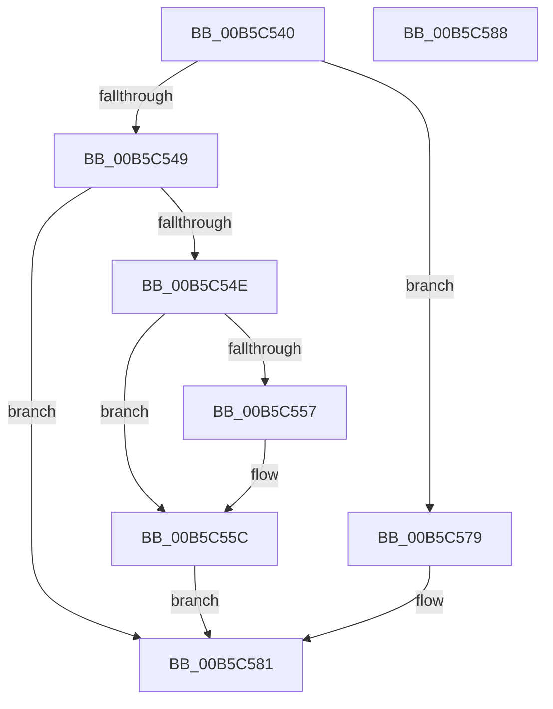

# HalpPowerInitSystem

- RVA: `0x00B5C540`–`0x00B5C589` (길이 `73` bytes)
- VA: `0x0000000140B5C540`
- 실행 섹션: `PAGELK`
- PDB 이름 있음: `예`; PDB Function 태그: `아니요`
- unwind 정보 RVA: `0x0005C788`
- 디코드: `20`개 명령, `73/73` bytes 표시
- 미해석 바이트: `0` (있으면 어셈블리에 `.byte`로 보존)

> 이 문서는 커널 이미지의 기계어와 PDB 기호를 분석해 생성했습니다. 4번과 5번은 함수 원형과 자료형을 바이너리 사용 방식에서 추정한 C 해석이며 원본 소스 복구 결과는 아닙니다.

## 1. Dependencies

- 직접 호출 지점: **4**; 고유 호출 대상: **4**
- 직접 호출자로 확인된 함수: **0**
- RIP 상대 이미지 참조: **3**

### Outgoing calls
- `0x00B5C557` → [HalpPowerInitFwPerformanceTableMappings](../../init/C1/HalpPowerInitFwPerformanceTableMappings_function_00C1EC34.md) (function, `0x00C1EC34`)
- `0x00B5C563` → [MmLockPagableDataSection](../../page/A7/MmLockPagableDataSection_function_00A73E80.md) (function, `0x00A73E80`)
- `0x00B5C572` → [MmUnlockPagableImageSection](../../text/2A/MmUnlockPagableImageSection_function_002A39F0.md) (function, `0x002A39F0`)
- `0x00B5C57C` → [HalpPowerInitDiscard](../../init/C1/HalpPowerInitDiscard_function_00C1EB40.md) (function, `0x00C1EB40`)

### Direct callers
- 이 함수 시작 RVA로 연결되는 직접 call은 확인되지 않았습니다. 간접 호출은 완전히 역산할 수 없습니다.

### Static image references
- `0x00B5C54E` → RVA `0x00FC1AE8` (`.data`; read)
- `0x00B5C55C` → RVA `0x00B5C130` (`HalpSaveDmaControllerState`; read)
- `0x00B5C56B` → RVA `0x00FC2158` (`.data`; write)

## 2. Other-region calls and transfers

- 다른 실행 섹션으로 향하는 call: **4**
  - `0x00B5C557` → [HalpPowerInitFwPerformanceTableMappings](../../init/C1/HalpPowerInitFwPerformanceTableMappings_function_00C1EC34.md) (`PAGELK` → `INIT`)
  - `0x00B5C563` → [MmLockPagableDataSection](../../page/A7/MmLockPagableDataSection_function_00A73E80.md) (`PAGELK` → `PAGE`)
  - `0x00B5C572` → [MmUnlockPagableImageSection](../../text/2A/MmUnlockPagableImageSection_function_002A39F0.md) (`PAGELK` → `.text`)
  - `0x00B5C57C` → [HalpPowerInitDiscard](../../init/C1/HalpPowerInitDiscard_function_00C1EB40.md) (`PAGELK` → `INIT`)
- 별도 외부 분기/꼬리 이동을 확인하지 못했습니다.

## 3. Assembly (complete function range)

```asm
00B5C540  48 83 EC 28                     sub rsp, 0x28
00B5C544  83 F9 08                        cmp ecx, 8
00B5C547  74 30                           je 0x140b5c579
00B5C549  83 F9 11                        cmp ecx, 0x11
00B5C54C  75 33                           jne 0x140b5c581
00B5C54E  80 3D 93 55 46 00 05            cmp byte ptr [rip + 0x465593], 5
00B5C555  72 05                           jb 0x140b5c55c
00B5C557  E8 D8 26 0C 00                  call 0x140c1ec34
00B5C55C  48 8D 0D CD FB FF FF            lea rcx, [rip - 0x433]
00B5C563  E8 18 79 F1 FF                  call 0x140a73e80
00B5C568  48 8B C8                        mov rcx, rax
00B5C56B  48 89 05 E6 5B 46 00            mov qword ptr [rip + 0x465be6], rax
00B5C572  E8 79 74 74 FF                  call 0x1402a39f0
00B5C577  EB 08                           jmp 0x140b5c581
00B5C579  49 8B C8                        mov rcx, r8
00B5C57C  E8 BF 25 0C 00                  call 0x140c1eb40
00B5C581  33 C0                           xor eax, eax
00B5C583  48 83 C4 28                     add rsp, 0x28
00B5C587  C3                              ret
00B5C588  CC                              int3
```

## 4. C-style interpretation (structured pseudocode)

```c
__int64 __fastcall HalpPowerInitSystem(int a1, __int64 a2, __int64 a3)
{
    __int64 result;
    __int64 v_rsp;

    v_rsp = (v_rsp) - (40);
    if (a1 == 8) goto loc_00B5C579;
    if (a1 != 17) goto loc_00B5C581;
    if ((*(unsigned __int8 *)(v_rip + 4609427)) >= 5) {
        result = HalpPowerInitFwPerformanceTableMappings(a1, a2, a3, a4);
    }
    result = MmLockPagableDataSection(v_rip - 1075, a2, a3, a4);
    *(unsigned __int64 *)(v_rip + 4611046) = result;
    result = MmUnlockPagableImageSection(result, a2, a3, a4);
    goto loc_00B5C581;
loc_00B5C579:
    result = HalpPowerInitDiscard(a3, a2, a3, a4);
loc_00B5C581:
    result = 0;
    v_rsp = (v_rsp) + (40);
    return result;
}
```

## 5. (Beta) C Style

```c
int64_t HalpPowerInitSystem(int32_t Arg1, int64_t Arg2, int64_t Arg3)
{
    int64_t result;
    int64_t local_rsp;

    local_rsp = (local_rsp) - (40);
    if (Arg1 == 8) goto loc_00B5C579;
    if (Arg1 != 17) goto loc_00B5C581;
    if ((*(uint8_t *)(v_rip + 0x465593)) >= 5) {
        result = HalpPowerInitFwPerformanceTableMappings(Arg1, Arg2, Arg3, a4);
    }
    result = MmLockPagableDataSection(v_rip - 1075, Arg2, Arg3, a4);
    *(uint64_t *)(v_rip + 0x465BE6) = result;
    result = MmUnlockPagableImageSection(result, Arg2, Arg3, a4);
    goto loc_00B5C581;
loc_00B5C579:
    result = HalpPowerInitDiscard(Arg3, Arg2, Arg3, a4);
loc_00B5C581:
    result = 0;
    local_rsp = (local_rsp) + (40);
    return result;
}
```

## 6. Execution-region graph

[열기: 2D/3D 그래프와 함수 탐색 컨트롤 패널](../../../control-panel.html?section=pagelk&rva=0x00B5C540&view=graph)

- 2D 그래프는 위에서 아래로 흐르고, 3D 그래프는 빈 공간을 드래그해 회전합니다. Shift+드래그는 이동, 휠은 확대·축소, 함수 노드 선택은 대상 보고서 이동입니다.

### Static fallback


