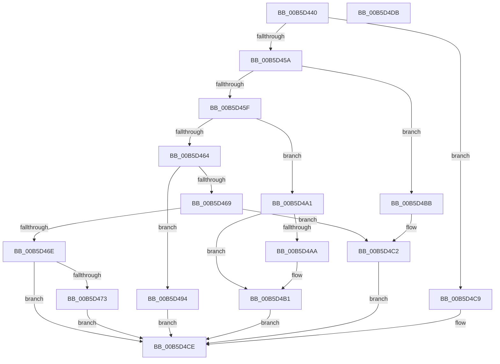

# HalpProcInitSystem

- RVA: `0x00B5D440`–`0x00B5D4DC` (길이 `156` bytes)
- VA: `0x0000000140B5D440`
- 실행 섹션: `PAGELK`
- PDB 이름 있음: `예`; PDB Function 태그: `아니요`
- unwind 정보 RVA: `0x0008A658`
- 디코드: `46`개 명령, `156/156` bytes 표시
- 미해석 바이트: `0` (있으면 어셈블리에 `.byte`로 보존)

> 이 문서는 커널 이미지의 기계어와 PDB 기호를 분석해 생성했습니다. 4번과 5번은 함수 원형과 자료형을 바이너리 사용 방식에서 추정한 C 해석이며 원본 소스 복구 결과는 아닙니다.

## 1. Dependencies

- 직접 호출 지점: **9**; 고유 호출 대상: **9**
- 직접 호출자로 확인된 함수: **0**
- RIP 상대 이미지 참조: **2**

### Outgoing calls
- `0x00B5D483` → [PrExtControlOperations](../../text/66/PrExtControlOperations_function_00666A6C.md) (function, `0x00666A6C`)
- `0x00B5D488` → [HalpMcUpdatePostUpdate](../../text/4D/HalpMcUpdatePostUpdate_function_004D6670.md) (function, `0x004D6670`)
- `0x00B5D48D` → [PrExtLogToTelemetry](../../text/66/PrExtLogToTelemetry_function_00666DC4.md) (function, `0x00666DC4`)
- `0x00B5D494` → [HalpProcGetFeatureBits](../../text/54/HalpProcGetFeatureBits_function_0054E890.md) (function, `0x0054E890`)
- `0x00B5D4AC` → [HalpInterruptStartBlockedProcessors](../../text/55/HalpInterruptStartBlockedProcessors_function_00558914.md) (function, `0x00558914`)
- `0x00B5D4B4` → [HalpMcUpdateInitializeBSP](../../text/55/HalpMcUpdateInitializeBSP_function_0055B22C.md) (function, `0x0055B22C`)
- `0x00B5D4BB` → [HalpProcInitDiscard](../../init/C1/HalpProcInitDiscard_function_00C1FB90.md) (function, `0x00C1FB90`)
- `0x00B5D4C2` → [HalpBlkInitSystem](../../init/C2/HalpBlkInitSystem_function_00C24B98.md) (function, `0x00C24B98`)
- `0x00B5D4C9` → [HalpMcUpdateMicrocode](../../text/4D/HalpMcUpdateMicrocode_function_004DB3FC.md) (function, `0x004DB3FC`)

### Direct callers
- 이 함수 시작 RVA로 연결되는 직접 call은 확인되지 않았습니다. 간접 호출은 완전히 역산할 수 없습니다.

### Static image references
- `0x00B5D499` → RVA `0x00FC1C44` (`.data`; read/write)
- `0x00B5D4A1` → RVA `0x00F90690` (`.data`; read)

## 2. Other-region calls and transfers

- 다른 실행 섹션으로 향하는 call: **9**
  - `0x00B5D483` → [PrExtControlOperations](../../text/66/PrExtControlOperations_function_00666A6C.md) (`PAGELK` → `.text`)
  - `0x00B5D488` → [HalpMcUpdatePostUpdate](../../text/4D/HalpMcUpdatePostUpdate_function_004D6670.md) (`PAGELK` → `.text`)
  - `0x00B5D48D` → [PrExtLogToTelemetry](../../text/66/PrExtLogToTelemetry_function_00666DC4.md) (`PAGELK` → `.text`)
  - `0x00B5D494` → [HalpProcGetFeatureBits](../../text/54/HalpProcGetFeatureBits_function_0054E890.md) (`PAGELK` → `.text`)
  - `0x00B5D4AC` → [HalpInterruptStartBlockedProcessors](../../text/55/HalpInterruptStartBlockedProcessors_function_00558914.md) (`PAGELK` → `.text`)
  - `0x00B5D4B4` → [HalpMcUpdateInitializeBSP](../../text/55/HalpMcUpdateInitializeBSP_function_0055B22C.md) (`PAGELK` → `.text`)
  - `0x00B5D4BB` → [HalpProcInitDiscard](../../init/C1/HalpProcInitDiscard_function_00C1FB90.md) (`PAGELK` → `INIT`)
  - `0x00B5D4C2` → [HalpBlkInitSystem](../../init/C2/HalpBlkInitSystem_function_00C24B98.md) (`PAGELK` → `INIT`)
  - `0x00B5D4C9` → [HalpMcUpdateMicrocode](../../text/4D/HalpMcUpdateMicrocode_function_004DB3FC.md) (`PAGELK` → `.text`)
- 별도 외부 분기/꼬리 이동을 확인하지 못했습니다.

## 3. Assembly (complete function range)

```asm
00B5D440  48 89 5C 24 10                  mov qword ptr [rsp + 0x10], rbx
00B5D445  57                              push rdi
00B5D446  48 83 EC 30                     sub rsp, 0x30
00B5D44A  49 8B F8                        mov rdi, r8
00B5D44D  8B D9                           mov ebx, ecx
00B5D44F  41 B8 04 00 00 00               mov r8d, 4
00B5D455  41 3B C8                        cmp ecx, r8d
00B5D458  74 6F                           je 0x140b5d4c9
00B5D45A  83 F9 0C                        cmp ecx, 0xc
00B5D45D  74 5C                           je 0x140b5d4bb
00B5D45F  83 F9 11                        cmp ecx, 0x11
00B5D462  74 3D                           je 0x140b5d4a1
00B5D464  83 F9 13                        cmp ecx, 0x13
00B5D467  74 2B                           je 0x140b5d494
00B5D469  83 F9 15                        cmp ecx, 0x15
00B5D46C  74 54                           je 0x140b5d4c2
00B5D46E  83 F9 20                        cmp ecx, 0x20
00B5D471  75 5B                           jne 0x140b5d4ce
00B5D473  48 8D 54 24 40                  lea rdx, [rsp + 0x40]
00B5D478  C7 44 24 40 01 00 00 00         mov dword ptr [rsp + 0x40], 1
00B5D480  8D 4B EA                        lea ecx, [rbx - 0x16]
00B5D483  E8 E4 95 B0 FF                  call 0x140666a6c
00B5D488  E8 E3 91 97 FF                  call 0x1404d6670
00B5D48D  E8 32 99 B0 FF                  call 0x140666dc4
00B5D492  EB 3A                           jmp 0x140b5d4ce
00B5D494  E8 F7 13 9F FF                  call 0x14054e890
00B5D499  21 05 A5 47 46 00               and dword ptr [rip + 0x4647a5], eax
00B5D49F  EB 2D                           jmp 0x140b5d4ce
00B5D4A1  83 3D E8 31 43 00 00            cmp dword ptr [rip + 0x4331e8], 0
00B5D4A8  74 07                           je 0x140b5d4b1
00B5D4AA  33 C9                           xor ecx, ecx
00B5D4AC  E8 63 B4 9F FF                  call 0x140558914
00B5D4B1  48 8B CF                        mov rcx, rdi
00B5D4B4  E8 73 DD 9F FF                  call 0x14055b22c
00B5D4B9  EB 13                           jmp 0x140b5d4ce
00B5D4BB  E8 D0 26 0C 00                  call 0x140c1fb90
00B5D4C0  8B CB                           mov ecx, ebx
00B5D4C2  E8 D1 76 0C 00                  call 0x140c24b98
00B5D4C7  EB 05                           jmp 0x140b5d4ce
00B5D4C9  E8 2E DF 97 FF                  call 0x1404db3fc
00B5D4CE  48 8B 5C 24 48                  mov rbx, qword ptr [rsp + 0x48]
00B5D4D3  33 C0                           xor eax, eax
00B5D4D5  48 83 C4 30                     add rsp, 0x30
00B5D4D9  5F                              pop rdi
00B5D4DA  C3                              ret
00B5D4DB  CC                              int3
```

## 4. C-style interpretation (structured pseudocode)

```c
__int64 __fastcall HalpProcInitSystem(int a1, __int64 a2, __int64 a3)
{
    __int64 result;
    __int64 v_rsp;
    unsigned __int64 v_stack_p10;
    unsigned __int64 v_stack_p8;

    v_stack_p10 = v_rbx;
    v_rsp = (v_rsp) - (48);
    if (a1 == 4) goto loc_00B5D4C9;
    if (a1 == 12) goto loc_00B5D4BB;
    if (a1 == 17) goto loc_00B5D4A1;
    if (a1 == 19) goto loc_00B5D494;
    if (a1 == 21) goto loc_00B5D4C2;
    if (a1 != 32) goto loc_00B5D4CE;
    v_stack_p8 = 1;
    result = PrExtControlOperations((unsigned int)(a1) - 22, v_stack_p8, 4, a4);
    result = HalpMcUpdatePostUpdate((unsigned int)(a1) - 22, v_stack_p8, 4, a4);
    result = PrExtLogToTelemetry((unsigned int)(a1) - 22, v_stack_p8, 4, a4);
    goto loc_00B5D4CE;
loc_00B5D494:
    result = HalpProcGetFeatureBits((unsigned int)(a1) - 22, v_stack_p8, 4, a4);
    goto loc_00B5D4CE;
loc_00B5D4A1:
    if ((*(unsigned int *)(v_rip + 4403688)) != 0) {
        a1 = 0;
        result = HalpInterruptStartBlockedProcessors(a1, v_stack_p8, 4, a4);
    }
    result = HalpMcUpdateInitializeBSP(a3, v_stack_p8, 4, a4);
    goto loc_00B5D4CE;
loc_00B5D4BB:
    result = HalpProcInitDiscard(a3, v_stack_p8, 4, a4);
loc_00B5D4C2:
    result = HalpBlkInitSystem((unsigned int)((unsigned int)((unsigned int)(a1))), v_stack_p8, 4, a4);
    goto loc_00B5D4CE;
loc_00B5D4C9:
    result = HalpMcUpdateMicrocode((unsigned int)((unsigned int)((unsigned int)(a1))), v_stack_p8, 4, a4);
loc_00B5D4CE:
    result = 0;
    v_rsp = (v_rsp) + (48);
    return result;
}
```

## 5. (Beta) C Style

```c
int64_t HalpProcInitSystem(void *Arg1, int64_t Arg2, int64_t Arg3)
{
    uint8_t *arg1 = (uint8_t *)Arg1;

    int64_t result;
    int64_t local_rsp;
    uint64_t v_stack_p10;
    uint64_t v_stack_p8;

    v_stack_p10 = local_rbx;
    local_rsp = (local_rsp) - (48);
    if (Arg1 == 4) goto loc_00B5D4C9;
    if (Arg1 == 12) goto loc_00B5D4BB;
    if (Arg1 == 17) goto loc_00B5D4A1;
    if (Arg1 == 19) goto loc_00B5D494;
    if (Arg1 == 21) goto loc_00B5D4C2;
    if (Arg1 != 32) goto loc_00B5D4CE;
    v_stack_p8 = 1;
    result = PrExtControlOperations((uint32_t)(Arg1) - 22, v_stack_p8, 4, a4);
    result = HalpMcUpdatePostUpdate((uint32_t)(Arg1) - 22, v_stack_p8, 4, a4);
    result = PrExtLogToTelemetry((uint32_t)(Arg1) - 22, v_stack_p8, 4, a4);
    goto loc_00B5D4CE;
loc_00B5D494:
    result = HalpProcGetFeatureBits((uint32_t)(Arg1) - 22, v_stack_p8, 4, a4);
    goto loc_00B5D4CE;
loc_00B5D4A1:
    if ((*(uint32_t *)(v_rip + 0x4331E8)) != 0) {
        Arg1 = 0;
        result = HalpInterruptStartBlockedProcessors(Arg1, v_stack_p8, 4, a4);
    }
    result = HalpMcUpdateInitializeBSP(Arg3, v_stack_p8, 4, a4);
    goto loc_00B5D4CE;
loc_00B5D4BB:
    result = HalpProcInitDiscard(Arg3, v_stack_p8, 4, a4);
loc_00B5D4C2:
    result = HalpBlkInitSystem((uint32_t)((uint32_t)((uint32_t)(Arg1))), v_stack_p8, 4, a4);
    goto loc_00B5D4CE;
loc_00B5D4C9:
    result = HalpMcUpdateMicrocode((uint32_t)((uint32_t)((uint32_t)(Arg1))), v_stack_p8, 4, a4);
loc_00B5D4CE:
    result = 0;
    local_rsp = (local_rsp) + (48);
    return result;
}
```

### 관측된 메모리 오프셋

구조체 형식이 확인되지 않은 접근은 인자 기준의 오프셋으로만 기록했습니다.

| 기준 인자 | 오프셋 표현 | 폭 (bit) | 접근 |
|---|---:|---:|---|
| `Arg1` | `- 0x16` | `32` | `R` |

## 6. Execution-region graph

[열기: 2D/3D 그래프와 함수 탐색 컨트롤 패널](../../../control-panel.html?section=pagelk&rva=0x00B5D440&view=graph)

- 2D 그래프는 위에서 아래로 흐르고, 3D 그래프는 빈 공간을 드래그해 회전합니다. Shift+드래그는 이동, 휠은 확대·축소, 함수 노드 선택은 대상 보고서 이동입니다.

### Static fallback


