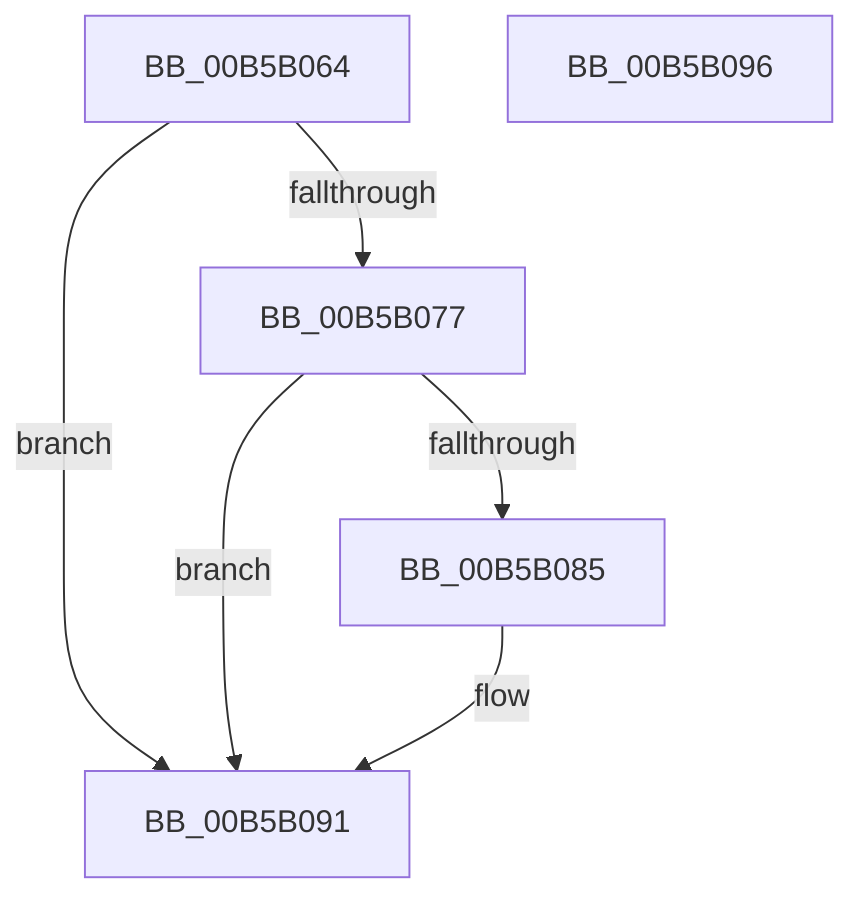

# HalpResetSBF

- RVA: `0x00B5B064`–`0x00B5B097` (길이 `51` bytes)
- VA: `0x0000000140B5B064`
- 실행 섹션: `PAGELK`
- PDB 이름 있음: `예`; PDB Function 태그: `아니요`
- unwind 정보 RVA: `0x0005C788`
- 디코드: `14`개 명령, `51/51` bytes 표시
- 미해석 바이트: `0` (있으면 어셈블리에 `.byte`로 보존)

> 이 문서는 커널 이미지의 기계어와 PDB 기호를 분석해 생성했습니다. 4번과 5번은 함수 원형과 자료형을 바이너리 사용 방식에서 추정한 C 해석이며 원본 소스 복구 결과는 아닙니다.

## 1. Dependencies

- 직접 호출 지점: **2**; 고유 호출 대상: **2**
- 직접 호출자로 확인된 함수: **2**
- RIP 상대 이미지 참조: **1**

### Outgoing calls
- `0x00B5B07C` → [HalReadBootRegister](../B6/HalReadBootRegister_function_00B60EBC.md) (function, `0x00B60EBC`)
- `0x00B5B08C` → [HalWriteBootRegister](../B6/HalWriteBootRegister_function_00B60F00.md) (function, `0x00B60F00`)

### Direct callers
- [HalpEndOfBoot](../../page/70/HalpEndOfBoot_function_0070DA60.md) at `0x0070DA64`
- [HalpAcpiPostSleep](../B7/HalpAcpiPostSleep_function_00B79990.md) at `0x00B79B42`

### Static image references
- `0x00B5B068` → RVA `0x00E117F8` (`.data`; read)

## 2. Other-region calls and transfers

- 다른 실행 섹션으로 향하는 call: **0**
- 별도 외부 분기/꼬리 이동을 확인하지 못했습니다.

## 3. Assembly (complete function range)

```asm
00B5B064  48 83 EC 28                     sub rsp, 0x28
00B5B068  48 83 3D 88 67 2B 00 00         cmp qword ptr [rip + 0x2b6788], 0
00B5B070  C6 44 24 30 00                  mov byte ptr [rsp + 0x30], 0
00B5B075  74 1A                           je 0x140b5b091
00B5B077  48 8D 4C 24 30                  lea rcx, [rsp + 0x30]
00B5B07C  E8 3B 5E 00 00                  call 0x140b60ebc
00B5B081  85 C0                           test eax, eax
00B5B083  75 0C                           jne 0x140b5b091
00B5B085  8A 4C 24 30                     mov cl, byte ptr [rsp + 0x30]
00B5B089  80 E1 F9                        and cl, 0xf9
00B5B08C  E8 6F 5E 00 00                  call 0x140b60f00
00B5B091  48 83 C4 28                     add rsp, 0x28
00B5B095  C3                              ret
00B5B096  CC                              int3
```

## 4. C-style interpretation (structured pseudocode)

```c
__int64 __fastcall HalpResetSBF(void)
{
    __int64 result;
    __int64 v_rsp;
    unsigned __int8 v_stack_p8;

    v_rsp = (v_rsp) - (40);
    v_stack_p8 = 0;
    if ((*(unsigned __int64 *)(v_rip + 2844552)) == 0) goto loc_00B5B091;
    result = HalReadBootRegister(v_stack_p8, a2, a3, a4);
    if ((unsigned int)(result) == 0) {
        a1 = v_stack_p8;
        a1 = (unsigned __int8)((a1) & (249));
        result = HalWriteBootRegister(a1, a2, a3, a4);
    }
    v_rsp = (v_rsp) + (40);
    return result;
}
```

## 5. (Beta) C Style

```c
void HalpResetSBF(void)
{
    int64_t result;
    int64_t local_rsp;
    uint8_t v_stack_p8;

    local_rsp = (local_rsp) - (40);
    v_stack_p8 = 0;
    if ((*(uint64_t *)(v_rip + 0x2B6788)) == 0) goto loc_00B5B091;
    result = HalReadBootRegister(v_stack_p8, a2, a3, a4);
    if ((uint32_t)(result) == 0) {
        a1 = v_stack_p8;
        a1 = (uint8_t)((a1) & (249));
        result = HalWriteBootRegister(a1, a2, a3, a4);
    }
    local_rsp = (local_rsp) + (40);
    return result;
}
```

## 6. Execution-region graph

[열기: 2D/3D 그래프와 함수 탐색 컨트롤 패널](../../../control-panel.html?section=pagelk&rva=0x00B5B064&view=graph)

- 2D 그래프는 위에서 아래로 흐르고, 3D 그래프는 빈 공간을 드래그해 회전합니다. Shift+드래그는 이동, 휠은 확대·축소, 함수 노드 선택은 대상 보고서 이동입니다.

### Static fallback


