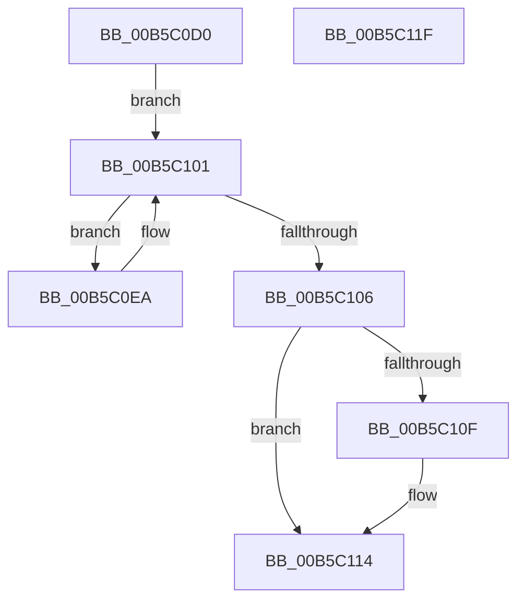

# HalpRestoreDmaControllerState

- RVA: `0x00B5C0D0`–`0x00B5C120` (길이 `80` bytes)
- VA: `0x0000000140B5C0D0`
- 실행 섹션: `PAGELK`
- PDB 이름 있음: `예`; PDB Function 태그: `아니요`
- unwind 정보 RVA: `0x0005CAAC`
- 디코드: `22`개 명령, `80/80` bytes 표시
- 미해석 바이트: `0` (있으면 어셈블리에 `.byte`로 보존)

> 이 문서는 커널 이미지의 기계어와 PDB 기호를 분석해 생성했습니다. 4번과 5번은 함수 원형과 자료형을 바이너리 사용 방식에서 추정한 C 해석이며 원본 소스 복구 결과는 아닙니다.

## 1. Dependencies

- 직접 호출 지점: **3**; 고유 호출 대상: **3**
- 직접 호출자로 확인된 함수: **1**
- RIP 상대 이미지 참조: **1**

### Outgoing calls
- `0x00B5C0F9` → [guard_dispatch_icall](../../text/6B/guard_dispatch_icall_function_006BAAD0.md) (function, `0x006BAAD0`)
- `0x00B5C106` → [HalpMiscIsLegacyPcType](../../text/54/HalpMiscIsLegacyPcType_function_0054BFDC.md) (function, `0x0054BFDC`)
- `0x00B5C10F` → [HalpRestoreLegacyDmaControllerState](HalpRestoreLegacyDmaControllerState_function_00B5EAE8.md) (function, `0x00B5EAE8`)

### Direct callers
- [sub_00B80A42](../B8/Unknown_function_00B80A42.md) at `0x00B80AB6`

### Static image references
- `0x00B5C0DA` → RVA `0x00FC16F0` (`.data`; read)

## 2. Other-region calls and transfers

- 다른 실행 섹션으로 향하는 call: **2**
  - `0x00B5C0F9` → [guard_dispatch_icall](../../text/6B/guard_dispatch_icall_function_006BAAD0.md) (`PAGELK` → `.text`)
  - `0x00B5C106` → [HalpMiscIsLegacyPcType](../../text/54/HalpMiscIsLegacyPcType_function_0054BFDC.md) (`PAGELK` → `.text`)
- 별도 외부 분기/꼬리 이동을 확인하지 못했습니다.

## 3. Assembly (complete function range)

```asm
00B5C0D0  48 89 5C 24 08                  mov qword ptr [rsp + 8], rbx
00B5C0D5  57                              push rdi
00B5C0D6  48 83 EC 20                     sub rsp, 0x20
00B5C0DA  48 8B 1D 0F 56 46 00            mov rbx, qword ptr [rip + 0x46560f]
00B5C0E1  48 8D 3D 08 56 46 00            lea rdi, [rip + 0x465608]
00B5C0E8  EB 17                           jmp 0x140b5c101
00B5C0EA  48 8B 43 50                     mov rax, qword ptr [rbx + 0x50]
00B5C0EE  48 8B 4B 40                     mov rcx, qword ptr [rbx + 0x40]
00B5C0F2  C6 83 D8 00 00 00 01            mov byte ptr [rbx + 0xd8], 1
00B5C0F9  E8 D2 E9 B5 FF                  call 0x1406baad0
00B5C0FE  48 8B 1B                        mov rbx, qword ptr [rbx]
00B5C101  48 3B DF                        cmp rbx, rdi
00B5C104  75 E4                           jne 0x140b5c0ea
00B5C106  E8 D1 FE 9E FF                  call 0x14054bfdc
00B5C10B  84 C0                           test al, al
00B5C10D  74 05                           je 0x140b5c114
00B5C10F  E8 D4 29 00 00                  call 0x140b5eae8
00B5C114  48 8B 5C 24 30                  mov rbx, qword ptr [rsp + 0x30]
00B5C119  48 83 C4 20                     add rsp, 0x20
00B5C11D  5F                              pop rdi
00B5C11E  C3                              ret
00B5C11F  CC                              int3
```

## 4. C-style interpretation (structured pseudocode)

```c
__int64 __fastcall HalpRestoreDmaControllerState(void)
{
    __int64 result;
    __int64 v_rsp;
    unsigned __int64 v_stack_p8;

    v_stack_p8 = v_rbx;
    v_rsp = (v_rsp) - (32);
    goto loc_00B5C101;
loc_00B5C0EA:
    *(unsigned __int8 *)(*(unsigned __int64 *)(v_rip + 4609551) + 216) = 1;
    result = guard_dispatch_icall(*(unsigned __int64 *)(*(unsigned __int64 *)(v_rip + 4609551) + 64), a2, a3, a4);
loc_00B5C101:
    if ((*(unsigned __int64 *)(*(unsigned __int64 *)(v_rip + 4609551))) != (v_rip + 4609544)) goto loc_00B5C0EA;
    result = HalpMiscIsLegacyPcType(*(unsigned __int64 *)(*(unsigned __int64 *)(v_rip + 4609551) + 64), a2, a3, a4);
    if ((unsigned __int8)(result) != 0) {
        result = HalpRestoreLegacyDmaControllerState(*(unsigned __int64 *)(*(unsigned __int64 *)(v_rip + 4609551) + 64), a2, a3, a4);
    }
    v_rsp = (v_rsp) + (32);
    return result;
}
```

## 5. (Beta) C Style

```c
void HalpRestoreDmaControllerState(void)
{
    int64_t result;
    int64_t local_rsp;
    uint64_t v_stack_p8;

    v_stack_p8 = local_rbx;
    local_rsp = (local_rsp) - (32);
    goto loc_00B5C101;
loc_00B5C0EA:
    *(uint8_t *)(*(uint64_t *)(v_rip + 0x46560F) + 0xD8) = 1;
    result = guard_dispatch_icall(*(uint64_t *)(*(uint64_t *)(v_rip + 0x46560F) + 0x40), a2, a3, a4);
loc_00B5C101:
    if ((*(uint64_t *)(*(uint64_t *)(v_rip + 0x46560F))) != (v_rip + 4609544)) goto loc_00B5C0EA;
    result = HalpMiscIsLegacyPcType(*(uint64_t *)(*(uint64_t *)(v_rip + 0x46560F) + 0x40), a2, a3, a4);
    if ((uint8_t)(result) != 0) {
        result = HalpRestoreLegacyDmaControllerState(*(uint64_t *)(*(uint64_t *)(v_rip + 0x46560F) + 0x40), a2, a3, a4);
    }
    local_rsp = (local_rsp) + (32);
    return result;
}
```

## 6. Execution-region graph

[열기: 2D/3D 그래프와 함수 탐색 컨트롤 패널](../../../control-panel.html?section=pagelk&rva=0x00B5C0D0&view=graph)

- 2D 그래프는 위에서 아래로 흐르고, 3D 그래프는 빈 공간을 드래그해 회전합니다. Shift+드래그는 이동, 휠은 확대·축소, 함수 노드 선택은 대상 보고서 이동입니다.

### Static fallback


