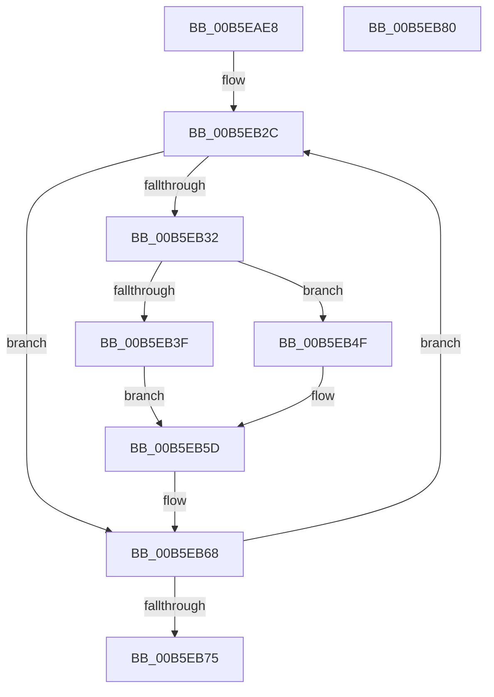

# HalpRestoreLegacyDmaControllerState

- RVA: `0x00B5EAE8`–`0x00B5EB81` (길이 `153` bytes)
- VA: `0x0000000140B5EAE8`
- 실행 섹션: `PAGELK`
- PDB 이름 있음: `예`; PDB Function 태그: `아니요`
- unwind 정보 RVA: `0x0005CAAC`
- 디코드: `58`개 명령, `153/153` bytes 표시
- 미해석 바이트: `0` (있으면 어셈블리에 `.byte`로 보존)

> 이 문서는 커널 이미지의 기계어와 PDB 기호를 분석해 생성했습니다. 4번과 5번은 함수 원형과 자료형을 바이너리 사용 방식에서 추정한 C 해석이며 원본 소스 복구 결과는 아닙니다.

## 1. Dependencies

- 직접 호출 지점: **3**; 고유 호출 대상: **1**
- 직접 호출자로 확인된 함수: **1**
- RIP 상대 이미지 참조: **1**

### Outgoing calls
- `0x00B5EB06` → [HalpIoDelay](../../text/6A/HalpIoDelay_function_006AC7E0.md) (function, `0x006AC7E0`)
- `0x00B5EB1D` → [HalpIoDelay](../../text/6A/HalpIoDelay_function_006AC7E0.md) (function, `0x006AC7E0`)
- `0x00B5EB63` → [HalpIoDelay](../../text/6A/HalpIoDelay_function_006AC7E0.md) (function, `0x006AC7E0`)

### Direct callers
- [HalpRestoreDmaControllerState](HalpRestoreDmaControllerState_function_00B5C0D0.md) at `0x00B5C10F`

### Static image references
- `0x00B5EB25` → RVA `0x00E10481` (`.data`; read)

## 2. Other-region calls and transfers

- 다른 실행 섹션으로 향하는 call: **3**
  - `0x00B5EB06` → [HalpIoDelay](../../text/6A/HalpIoDelay_function_006AC7E0.md) (`PAGELK` → `.text`)
  - `0x00B5EB1D` → [HalpIoDelay](../../text/6A/HalpIoDelay_function_006AC7E0.md) (`PAGELK` → `.text`)
  - `0x00B5EB63` → [HalpIoDelay](../../text/6A/HalpIoDelay_function_006AC7E0.md) (`PAGELK` → `.text`)
- 별도 외부 분기/꼬리 이동을 확인하지 못했습니다.

## 3. Assembly (complete function range)

```asm
00B5EAE8  48 89 5C 24 08                  mov qword ptr [rsp + 8], rbx
00B5EAED  57                              push rdi
00B5EAEE  48 83 EC 20                     sub rsp, 0x20
00B5EAF2  90                              nop
00B5EAF3  BA 0F 00 00 00                  mov edx, 0xf
00B5EAF8  8A C2                           mov al, dl
00B5EAFA  EE                              out dx, al
00B5EAFB  90                              nop
00B5EAFC  BA DE 00 00 00                  mov edx, 0xde
00B5EB01  90                              nop
00B5EB02  B0 0E                           mov al, 0xe
00B5EB04  EE                              out dx, al
00B5EB05  90                              nop
00B5EB06  E8 D5 DC B4 FF                  call 0x1406ac7e0
00B5EB0B  90                              nop
00B5EB0C  BA 08 00 00 00                  mov edx, 8
00B5EB11  33 C0                           xor eax, eax
00B5EB13  EE                              out dx, al
00B5EB14  90                              nop
00B5EB15  BA D0 00 00 00                  mov edx, 0xd0
00B5EB1A  90                              nop
00B5EB1B  EE                              out dx, al
00B5EB1C  90                              nop
00B5EB1D  E8 BE DC B4 FF                  call 0x1406ac7e0
00B5EB22  40 32 FF                        xor dil, dil
00B5EB25  48 8D 1D 55 19 2B 00            lea rbx, [rip + 0x2b1955]
00B5EB2C  80 7B 03 00                     cmp byte ptr [rbx + 3], 0
00B5EB30  74 36                           je 0x140b5eb68
00B5EB32  8A 03                           mov al, byte ptr [rbx]
00B5EB34  48 8B 53 EF                     mov rdx, qword ptr [rbx - 0x11]
00B5EB38  90                              nop
00B5EB39  40 80 FF 04                     cmp dil, 4
00B5EB3D  73 10                           jae 0x140b5eb4f
00B5EB3F  48 83 C2 0B                     add rdx, 0xb
00B5EB43  EE                              out dx, al
00B5EB44  90                              nop
00B5EB45  48 8B 53 EF                     mov rdx, qword ptr [rbx - 0x11]
00B5EB49  48 83 C2 0A                     add rdx, 0xa
00B5EB4D  EB 0E                           jmp 0x140b5eb5d
00B5EB4F  48 83 C2 16                     add rdx, 0x16
00B5EB53  EE                              out dx, al
00B5EB54  90                              nop
00B5EB55  48 8B 53 EF                     mov rdx, qword ptr [rbx - 0x11]
00B5EB59  48 83 C2 14                     add rdx, 0x14
00B5EB5D  8A 43 02                        mov al, byte ptr [rbx + 2]
00B5EB60  90                              nop
00B5EB61  EE                              out dx, al
00B5EB62  90                              nop
00B5EB63  E8 78 DC B4 FF                  call 0x1406ac7e0
00B5EB68  40 FE C7                        inc dil
00B5EB6B  48 83 C3 18                     add rbx, 0x18
00B5EB6F  40 80 FF 08                     cmp dil, 8
00B5EB73  72 B7                           jb 0x140b5eb2c
00B5EB75  48 8B 5C 24 30                  mov rbx, qword ptr [rsp + 0x30]
00B5EB7A  48 83 C4 20                     add rsp, 0x20
00B5EB7E  5F                              pop rdi
00B5EB7F  C3                              ret
00B5EB80  CC                              int3
```

## 4. C-style interpretation (structured pseudocode)

```c
__int64 __fastcall HalpRestoreLegacyDmaControllerState(void)
{
    __int64 result;
    __int64 v_rbx;
    __int64 v_rdi;
    __int64 v_rsp;
    unsigned __int64 v_stack_p8;

    v_stack_p8 = v_rbx;
    v_rsp = (v_rsp) - (32);
    result = HalpIoDelay(a1, 222, a3, a4);
    result = 0;
    result = HalpIoDelay(a1, 208, a3, a4);
    v_rdi = 0;
loc_00B5EB2C:
    if ((*(unsigned __int8 *)(v_rip + 2824533 + 3)) == 0) goto loc_00B5EB68;
    if (0 >= 4) goto loc_00B5EB4F;
    a2 = (*(unsigned __int64 *)(v_rip + 2824533 - 17)) + (11);
    a2 = (*(unsigned __int64 *)(v_rip + 2824533 - 17)) + (10);
    goto loc_00B5EB5D;
loc_00B5EB4F:
    a2 = (a2) + (22);
    a2 = (*(unsigned __int64 *)(v_rip + 2824533 - 17)) + (20);
loc_00B5EB5D:
    result = HalpIoDelay(a1, a2, a3, a4);
loc_00B5EB68:
    v_rdi = (unsigned __int8)((v_rdi) + 1);
    v_rbx = (v_rip + 2824533) + (24);
    if (((unsigned __int8)(v_rdi)) < 8) goto loc_00B5EB2C;
    v_rsp = (v_rsp) + (32);
    return result;
}
```

## 5. (Beta) C Style

```c
void HalpRestoreLegacyDmaControllerState(void)
{
    int64_t result;
    int64_t local_rbx;
    int64_t local_rdi;
    int64_t local_rsp;
    uint64_t v_stack_p8;

    v_stack_p8 = local_rbx;
    local_rsp = (local_rsp) - (32);
    result = HalpIoDelay(a1, 222, a3, a4);
    result = 0;
    result = HalpIoDelay(a1, 208, a3, a4);
    local_rdi = 0;
loc_00B5EB2C:
    if ((*(uint8_t *)(v_rip + 0x2B1955 + 0x3)) == 0) goto loc_00B5EB68;
    if (0 >= 4) goto loc_00B5EB4F;
    a2 = (*(uint64_t *)(v_rip + 0x2B1955 - 0x11)) + (11);
    a2 = (*(uint64_t *)(v_rip + 0x2B1955 - 0x11)) + (10);
    goto loc_00B5EB5D;
loc_00B5EB4F:
    a2 = (a2) + (22);
    a2 = (*(uint64_t *)(v_rip + 0x2B1955 - 0x11)) + (20);
loc_00B5EB5D:
    result = HalpIoDelay(a1, a2, a3, a4);
loc_00B5EB68:
    local_rdi = (uint8_t)((local_rdi) + 1);
    local_rbx = (v_rip + 2824533) + (24);
    if (((uint8_t)(local_rdi)) < 8) goto loc_00B5EB2C;
    local_rsp = (local_rsp) + (32);
    return result;
}
```

## 6. Execution-region graph

[열기: 2D/3D 그래프와 함수 탐색 컨트롤 패널](../../../control-panel.html?section=pagelk&rva=0x00B5EAE8&view=graph)

- 2D 그래프는 위에서 아래로 흐르고, 3D 그래프는 빈 공간을 드래그해 회전합니다. Shift+드래그는 이동, 휠은 확대·축소, 함수 노드 선택은 대상 보고서 이동입니다.

### Static fallback


