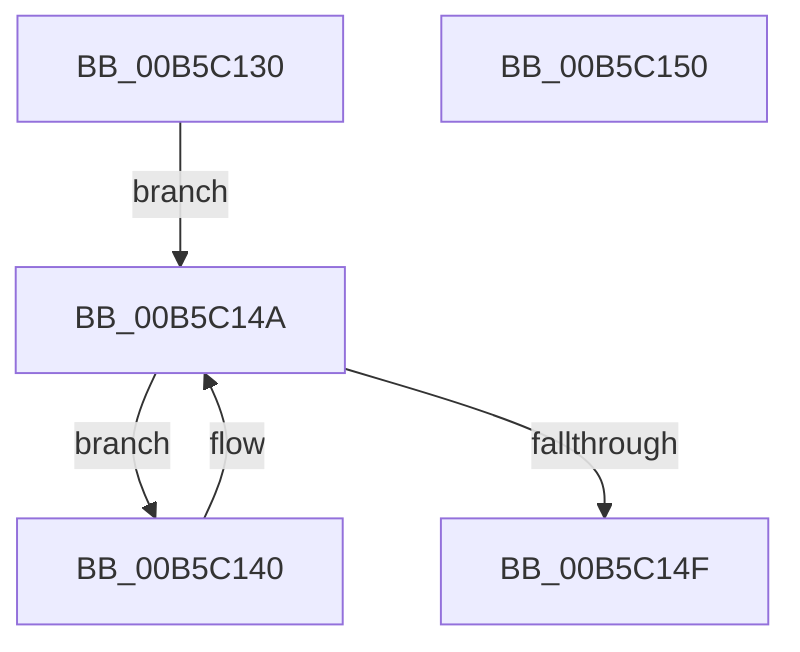

# HalpSaveDmaControllerState

- RVA: `0x00B5C130`–`0x00B5C151` (길이 `33` bytes)
- VA: `0x0000000140B5C130`
- 실행 섹션: `PAGELK`
- PDB 이름 있음: `예`; PDB Function 태그: `아니요`
- unwind 정보 RVA: `0x000DB714`
- 디코드: `9`개 명령, `33/33` bytes 표시
- 미해석 바이트: `0` (있으면 어셈블리에 `.byte`로 보존)

> 이 문서는 커널 이미지의 기계어와 PDB 기호를 분석해 생성했습니다. 4번과 5번은 함수 원형과 자료형을 바이너리 사용 방식에서 추정한 C 해석이며 원본 소스 복구 결과는 아닙니다.

## 1. Dependencies

- 직접 호출 지점: **0**; 고유 호출 대상: **0**
- 직접 호출자로 확인된 함수: **1**
- RIP 상대 이미지 참조: **1**

### Outgoing calls
- 직접 디코드된 call 명령이 없습니다.

### Direct callers
- [HalpAcpiPreSleep](../B7/HalpAcpiPreSleep_function_00B7BFD4.md) at `0x00B7C08B`

### Static image references
- `0x00B5C130` → RVA `0x00FC16F0` (`.data`; read)

## 2. Other-region calls and transfers

- 다른 실행 섹션으로 향하는 call: **0**
- 별도 외부 분기/꼬리 이동을 확인하지 못했습니다.

## 3. Assembly (complete function range)

```asm
00B5C130  48 8B 05 B9 55 46 00            mov rax, qword ptr [rip + 0x4655b9]
00B5C137  48 8D 0D B2 55 46 00            lea rcx, [rip + 0x4655b2]
00B5C13E  EB 0A                           jmp 0x140b5c14a
00B5C140  C6 80 D8 00 00 00 00            mov byte ptr [rax + 0xd8], 0
00B5C147  48 8B 00                        mov rax, qword ptr [rax]
00B5C14A  48 3B C1                        cmp rax, rcx
00B5C14D  75 F1                           jne 0x140b5c140
00B5C14F  C3                              ret
00B5C150  CC                              int3
```

## 4. C-style interpretation (structured pseudocode)

```c
__int64 __fastcall HalpSaveDmaControllerState(void)
{
    goto loc_00B5C14A;
loc_00B5C140:
    *(unsigned __int8 *)(*(unsigned __int64 *)(v_rip + 4609465) + 216) = 0;
loc_00B5C14A:
    if ((*(unsigned __int64 *)(*(unsigned __int64 *)(v_rip + 4609465))) != (v_rip + 4609458)) goto loc_00B5C140;
    return *(unsigned __int64 *)(*(unsigned __int64 *)(v_rip + 4609465));
}
```

## 5. (Beta) C Style

```c
void HalpSaveDmaControllerState(void)
{
    goto loc_00B5C14A;
loc_00B5C140:
    *(uint8_t *)(*(uint64_t *)(v_rip + 0x4655B9) + 0xD8) = 0;
loc_00B5C14A:
    if ((*(uint64_t *)(*(uint64_t *)(v_rip + 0x4655B9))) != (v_rip + 4609458)) goto loc_00B5C140;
    return *(uint64_t *)(*(uint64_t *)(v_rip + 0x4655B9));
}
```

## 6. Execution-region graph

[열기: 2D/3D 그래프와 함수 탐색 컨트롤 패널](../../../control-panel.html?section=pagelk&rva=0x00B5C130&view=graph)

- 2D 그래프는 위에서 아래로 흐르고, 3D 그래프는 빈 공간을 드래그해 회전합니다. Shift+드래그는 이동, 휠은 확대·축소, 함수 노드 선택은 대상 보고서 이동입니다.

### Static fallback


