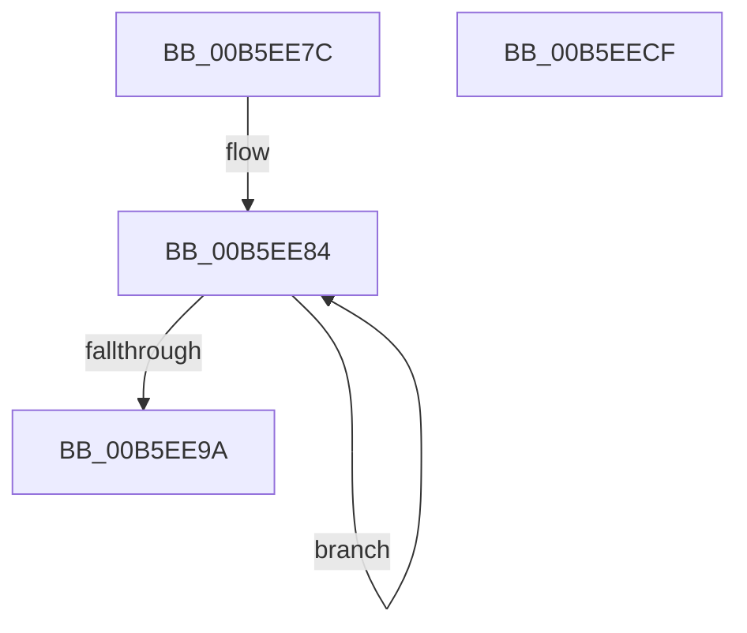

# HalpSimpleCheck

- RVA: `0x00B5EE7C`–`0x00B5EED0` (길이 `84` bytes)
- VA: `0x0000000140B5EE7C`
- 실행 섹션: `PAGELK`
- PDB 이름 있음: `예`; PDB Function 태그: `아니요`
- unwind 정보 RVA: `0x000DB714`
- 디코드: `22`개 명령, `84/84` bytes 표시
- 미해석 바이트: `0` (있으면 어셈블리에 `.byte`로 보존)

> 이 문서는 커널 이미지의 기계어와 PDB 기호를 분석해 생성했습니다. 4번과 5번은 함수 원형과 자료형을 바이너리 사용 방식에서 추정한 C 해석이며 원본 소스 복구 결과는 아닙니다.

## 1. Dependencies

- 직접 호출 지점: **0**; 고유 호출 대상: **0**
- 직접 호출자로 확인된 함수: **2**
- RIP 상대 이미지 참조: **0**

### Outgoing calls
- 직접 디코드된 call 명령이 없습니다.

### Direct callers
- [HalpCheckLowMemoryPreSleep](HalpCheckLowMemoryPreSleep_function_00B5EB88.md) at `0x00B5EC8D`
- [HalpCheckLowMemoryPostSleep](../B7/HalpCheckLowMemoryPostSleep_function_00B7A458.md) at `0x00B7A525`

### Static image references
- 디코드된 RIP-relative 메모리 참조가 없습니다.

## 2. Other-region calls and transfers

- 다른 실행 섹션으로 향하는 call: **0**
- 별도 외부 분기/꼬리 이동을 확인하지 못했습니다.

## 3. Assembly (complete function range)

```asm
00B5EE7C  0F 57 C9                        xorps xmm1, xmm1
00B5EE7F  B8 00 01 00 00                  mov eax, 0x100
00B5EE84  F3 0F 6F 01                     movdqu xmm0, xmmword ptr [rcx]
00B5EE88  48 8D 49 10                     lea rcx, [rcx + 0x10]
00B5EE8C  66 0F FC C1                     paddb xmm0, xmm1
00B5EE90  66 0F 6F C8                     movdqa xmm1, xmm0
00B5EE94  48 83 E8 01                     sub rax, 1
00B5EE98  75 EA                           jne 0x140b5ee84
00B5EE9A  66 0F 73 D8 08                  psrldq xmm0, 8
00B5EE9F  66 0F FC C8                     paddb xmm1, xmm0
00B5EEA3  66 0F 6F C1                     movdqa xmm0, xmm1
00B5EEA7  66 0F 73 D8 04                  psrldq xmm0, 4
00B5EEAC  66 0F FC C8                     paddb xmm1, xmm0
00B5EEB0  66 0F 6F C1                     movdqa xmm0, xmm1
00B5EEB4  66 0F 73 D8 02                  psrldq xmm0, 2
00B5EEB9  66 0F FC C8                     paddb xmm1, xmm0
00B5EEBD  66 0F 6F C1                     movdqa xmm0, xmm1
00B5EEC1  66 0F 73 D8 01                  psrldq xmm0, 1
00B5EEC6  66 0F FC C8                     paddb xmm1, xmm0
00B5EECA  66 0F 7E C8                     movd eax, xmm1
00B5EECE  C3                              ret
00B5EECF  CC                              int3
```

## 4. C-style interpretation (structured pseudocode)

```c
__int64 __fastcall HalpSimpleCheck(__int64 a1)
{
    __int64 result;

loc_00B5EE84:
    result = (256) - (1);
    if (condition_is_not_equal) goto loc_00B5EE84;
    return result;
}
```

## 5. (Beta) C Style

```c
int64_t HalpSimpleCheck(void *Arg1)
{
    uint8_t *arg1 = (uint8_t *)Arg1;

    int64_t result;

loc_00B5EE84:
    result = (256) - (1);
    if (condition_is_not_equal) goto loc_00B5EE84;
    return result;
}
```

### 관측된 메모리 오프셋

구조체 형식이 확인되지 않은 접근은 인자 기준의 오프셋으로만 기록했습니다.

| 기준 인자 | 오프셋 표현 | 폭 (bit) | 접근 |
|---|---:|---:|---|
| `Arg1` | `+ 0x0` | `128` | `R` |
| `Arg1` | `+ 0x10` | `64` | `R` |

## 6. Execution-region graph

[열기: 2D/3D 그래프와 함수 탐색 컨트롤 패널](../../../control-panel.html?section=pagelk&rva=0x00B5EE7C&view=graph)

- 2D 그래프는 위에서 아래로 흐르고, 3D 그래프는 빈 공간을 드래그해 회전합니다. Shift+드래그는 이동, 휠은 확대·축소, 함수 노드 선택은 대상 보고서 이동입니다.

### Static fallback


