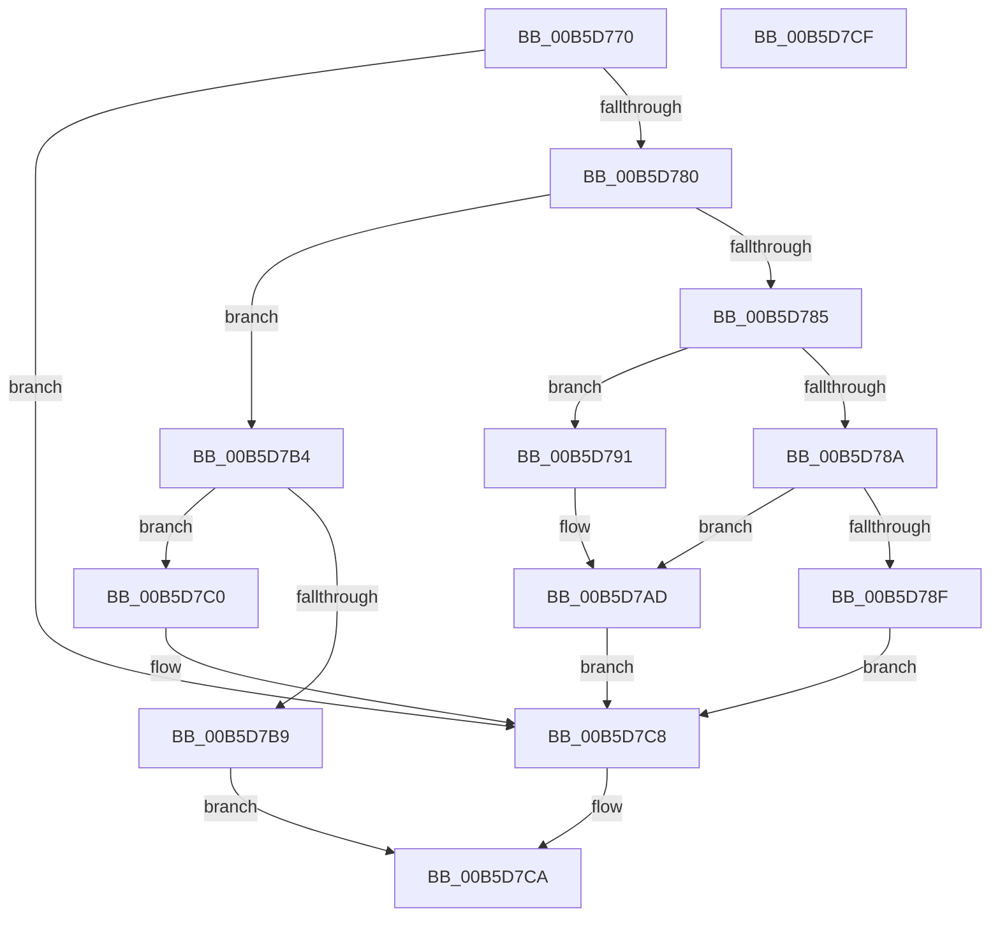

# HalpWheaInitSystem

- RVA: `0x00B5D770`–`0x00B5D7D0` (길이 `96` bytes)
- VA: `0x0000000140B5D770`
- 실행 섹션: `PAGELK`
- PDB 이름 있음: `예`; PDB Function 태그: `아니요`
- unwind 정보 RVA: `0x0005C788`
- 디코드: `28`개 명령, `96/96` bytes 표시
- 미해석 바이트: `0` (있으면 어셈블리에 `.byte`로 보존)

> 이 문서는 커널 이미지의 기계어와 PDB 기호를 분석해 생성했습니다. 4번과 5번은 함수 원형과 자료형을 바이너리 사용 방식에서 추정한 C 해석이며 원본 소스 복구 결과는 아닙니다.

## 1. Dependencies

- 직접 호출 지점: **3**; 고유 호출 대상: **3**
- 직접 호출자로 확인된 함수: **0**
- RIP 상대 이미지 참조: **4**

### Outgoing calls
- `0x00B5D776` → [HalpInterruptModel](../../text/4A/HalpInterruptModel_function_004ACA38.md) (function, `0x004ACA38`)
- `0x00B5D7AD` → [HalpMcaInitializePcrContext](HalpMcaInitializePcrContext_function_00B5BDD0.md) (function, `0x00B5BDD0`)
- `0x00B5D7C3` → [HalpWheaInitDiscard](../../init/C2/HalpWheaInitDiscard_function_00C202B4.md) (function, `0x00C202B4`)

### Direct callers
- 이 함수 시작 RVA로 연결되는 직접 call은 확인되지 않았습니다. 간접 호출은 완전히 역산할 수 없습니다.

### Static image references
- `0x00B5D791` → RVA `0x00564890` (`HalpReadWheaPhysicalMemory`; read)
- `0x00B5D798` → RVA `0x00E00928` (`.data`; write)
- `0x00B5D79F` → RVA `0x00564A40` (`HalpWriteWheaPhysicalMemory`; read)
- `0x00B5D7A6` → RVA `0x00E00930` (`.data`; write)

## 2. Other-region calls and transfers

- 다른 실행 섹션으로 향하는 call: **2**
  - `0x00B5D776` → [HalpInterruptModel](../../text/4A/HalpInterruptModel_function_004ACA38.md) (`PAGELK` → `.text`)
  - `0x00B5D7C3` → [HalpWheaInitDiscard](../../init/C2/HalpWheaInitDiscard_function_00C202B4.md) (`PAGELK` → `INIT`)
- 별도 외부 분기/꼬리 이동을 확인하지 못했습니다.

## 3. Assembly (complete function range)

```asm
00B5D770  48 83 EC 28                     sub rsp, 0x28
00B5D774  8B D1                           mov edx, ecx
00B5D776  E8 BD F2 94 FF                  call 0x1404aca38
00B5D77B  83 F8 01                        cmp eax, 1
00B5D77E  75 48                           jne 0x140b5d7c8
00B5D780  83 FA 0C                        cmp edx, 0xc
00B5D783  74 2F                           je 0x140b5d7b4
00B5D785  83 FA 11                        cmp edx, 0x11
00B5D788  74 07                           je 0x140b5d791
00B5D78A  83 FA 13                        cmp edx, 0x13
00B5D78D  74 1E                           je 0x140b5d7ad
00B5D78F  EB 37                           jmp 0x140b5d7c8
00B5D791  48 8D 05 F8 70 A0 FF            lea rax, [rip - 0x5f8f08]
00B5D798  48 89 05 89 31 2A 00            mov qword ptr [rip + 0x2a3189], rax
00B5D79F  48 8D 05 9A 72 A0 FF            lea rax, [rip - 0x5f8d66]
00B5D7A6  48 89 05 83 31 2A 00            mov qword ptr [rip + 0x2a3183], rax
00B5D7AD  E8 1E E6 FF FF                  call 0x140b5bdd0
00B5D7B2  EB 14                           jmp 0x140b5d7c8
00B5D7B4  4D 85 C0                        test r8, r8
00B5D7B7  75 07                           jne 0x140b5d7c0
00B5D7B9  B8 01 00 00 C0                  mov eax, 0xc0000001
00B5D7BE  EB 0A                           jmp 0x140b5d7ca
00B5D7C0  49 8B C8                        mov rcx, r8
00B5D7C3  E8 EC 2A 0C 00                  call 0x140c202b4
00B5D7C8  33 C0                           xor eax, eax
00B5D7CA  48 83 C4 28                     add rsp, 0x28
00B5D7CE  C3                              ret
00B5D7CF  CC                              int3
```

## 4. C-style interpretation (structured pseudocode)

```c
__int64 __fastcall HalpWheaInitSystem(int a1, __int64 a2, __int64 a3)
{
    __int64 result;
    __int64 v_rsp;

    v_rsp = (v_rsp) - (40);
    result = HalpInterruptModel(a1, (unsigned int)(a1), a3, a4);
    if (((unsigned int)(result)) != 1) goto loc_00B5D7C8;
    if (((unsigned int)((unsigned int)(a1))) == 12) goto loc_00B5D7B4;
    if (((unsigned int)((unsigned int)(a1))) == 17) goto loc_00B5D791;
    if (((unsigned int)((unsigned int)(a1))) == 19) goto loc_00B5D7AD;
    goto loc_00B5D7C8;
loc_00B5D791:
    *(unsigned __int64 *)(v_rip + 2765193) = v_rip - 6262536;
    *(unsigned __int64 *)(v_rip + 2765187) = v_rip - 6262118;
loc_00B5D7AD:
    result = HalpMcaInitializePcrContext(a1, (unsigned int)(a1), a3, a4);
    goto loc_00B5D7C8;
loc_00B5D7B4:
    if (a3 != 0) goto loc_00B5D7C0;
    goto loc_00B5D7CA;
loc_00B5D7C0:
    result = HalpWheaInitDiscard(a3, (unsigned int)(a1), a3, a4);
loc_00B5D7C8:
    result = 0;
loc_00B5D7CA:
    v_rsp = (v_rsp) + (40);
    return result;
}
```

## 5. (Beta) C Style

```c
int64_t HalpWheaInitSystem(int32_t Arg1, int64_t Arg2, int64_t Arg3)
{
    int64_t result;
    int64_t local_rsp;

    local_rsp = (local_rsp) - (40);
    result = HalpInterruptModel(Arg1, (uint32_t)(Arg1), Arg3, a4);
    if (((uint32_t)(result)) != 1) goto loc_00B5D7C8;
    if (((uint32_t)((uint32_t)(Arg1))) == 12) goto loc_00B5D7B4;
    if (((uint32_t)((uint32_t)(Arg1))) == 17) goto loc_00B5D791;
    if (((uint32_t)((uint32_t)(Arg1))) == 19) goto loc_00B5D7AD;
    goto loc_00B5D7C8;
loc_00B5D791:
    *(uint64_t *)(v_rip + 0x2A3189) = v_rip - 6262536;
    *(uint64_t *)(v_rip + 0x2A3183) = v_rip - 6262118;
loc_00B5D7AD:
    result = HalpMcaInitializePcrContext(Arg1, (uint32_t)(Arg1), Arg3, a4);
    goto loc_00B5D7C8;
loc_00B5D7B4:
    if (Arg3 != 0) goto loc_00B5D7C0;
    goto loc_00B5D7CA;
loc_00B5D7C0:
    result = HalpWheaInitDiscard(Arg3, (uint32_t)(Arg1), Arg3, a4);
loc_00B5D7C8:
    result = 0;
loc_00B5D7CA:
    local_rsp = (local_rsp) + (40);
    return result;
}
```

## 6. Execution-region graph

[열기: 2D/3D 그래프와 함수 탐색 컨트롤 패널](../../../control-panel.html?section=pagelk&rva=0x00B5D770&view=graph)

- 2D 그래프는 위에서 아래로 흐르고, 3D 그래프는 빈 공간을 드래그해 회전합니다. Shift+드래그는 이동, 휠은 확대·축소, 함수 노드 선택은 대상 보고서 이동입니다.

### Static fallback


