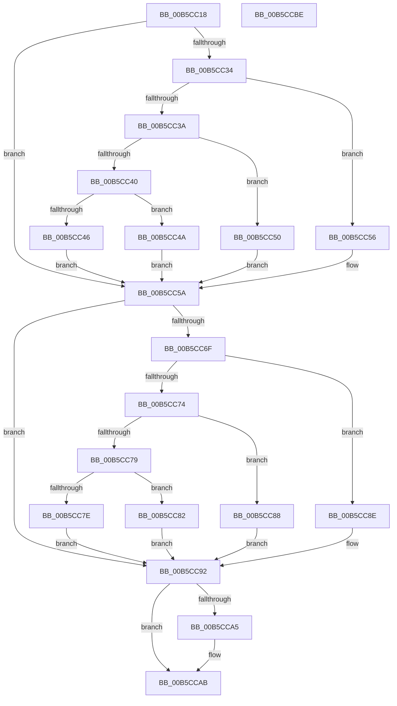

# InitCounterGroupAps

- RVA: `0x00B5CC18`–`0x00B5CCBF` (길이 `167` bytes)
- VA: `0x0000000140B5CC18`
- 실행 섹션: `PAGELK`
- PDB 이름 있음: `예`; PDB Function 태그: `아니요`
- unwind 정보 RVA: `0x0005CAAC`
- 디코드: `56`개 명령, `167/167` bytes 표시
- 미해석 바이트: `0` (있으면 어셈블리에 `.byte`로 보존)

> 이 문서는 커널 이미지의 기계어와 PDB 기호를 분석해 생성했습니다. 4번과 5번은 함수 원형과 자료형을 바이너리 사용 방식에서 추정한 C 해석이며 원본 소스 복구 결과는 아닙니다.

## 1. Dependencies

- 직접 호출 지점: **1**; 고유 호출 대상: **1**
- 직접 호출자로 확인된 함수: **2**
- RIP 상대 이미지 참조: **1**

### Outgoing calls
- `0x00B5CC9C` → [Feature_Test52061194__private_IsEnabledDeviceUsageNoInline](../../text/4F/Feature_Test52061194__private_IsEnabledDeviceUsageNoInline_function_004F74D4.md) (function, `0x004F74D4`)

### Direct callers
- [DefaultInitializeProfilingEnhanced](DefaultInitializeProfilingEnhanced_function_00B5CA68.md) at `0x00B5CAED`
- [DefaultInitializeProfilingEnhanced](DefaultInitializeProfilingEnhanced_function_00B5CA68.md) at `0x00B5CAF6`
- [DefaultInitializeProfilingEnhanced](DefaultInitializeProfilingEnhanced_function_00B5CA68.md) at `0x00B5CB02`
- [DefaultInitializeProfilingEnhanced](DefaultInitializeProfilingEnhanced_function_00B5CA68.md) at `0x00B5CB0E`
- [DefaultInitializeProfilingOriginal](DefaultInitializeProfilingOriginal_function_00B5CB30.md) at `0x00B5CBB5`
- [DefaultInitializeProfilingOriginal](DefaultInitializeProfilingOriginal_function_00B5CB30.md) at `0x00B5CBBE`
- [DefaultInitializeProfilingOriginal](DefaultInitializeProfilingOriginal_function_00B5CB30.md) at `0x00B5CBCA`
- [DefaultInitializeProfilingOriginal](DefaultInitializeProfilingOriginal_function_00B5CB30.md) at `0x00B5CBD6`

### Static image references
- `0x00B5CC22` → RVA `0x00FC8C40` (`ALMOSTRO`; read)

## 2. Other-region calls and transfers

- 다른 실행 섹션으로 향하는 call: **1**
  - `0x00B5CC9C` → [Feature_Test52061194__private_IsEnabledDeviceUsageNoInline](../../text/4F/Feature_Test52061194__private_IsEnabledDeviceUsageNoInline_function_004F74D4.md) (`PAGELK` → `.text`)
- 별도 외부 분기/꼬리 이동을 확인하지 못했습니다.

## 3. Assembly (complete function range)

```asm
00B5CC18  48 89 5C 24 08                  mov qword ptr [rsp + 8], rbx
00B5CC1D  57                              push rdi
00B5CC1E  48 83 EC 20                     sub rsp, 0x20
00B5CC22  48 8B 05 17 C0 46 00            mov rax, qword ptr [rip + 0x46c017]
00B5CC29  44 8B C1                        mov r8d, ecx
00B5CC2C  48 8B 78 58                     mov rdi, qword ptr [rax + 0x58]
00B5CC30  85 C9                           test ecx, ecx
00B5CC32  74 26                           je 0x140b5cc5a
00B5CC34  41 83 E8 01                     sub r8d, 1
00B5CC38  74 1C                           je 0x140b5cc56
00B5CC3A  41 83 E8 63                     sub r8d, 0x63
00B5CC3E  74 10                           je 0x140b5cc50
00B5CC40  41 83 F8 01                     cmp r8d, 1
00B5CC44  74 04                           je 0x140b5cc4a
00B5CC46  33 FF                           xor edi, edi
00B5CC48  EB 10                           jmp 0x140b5cc5a
00B5CC4A  48 83 C7 48                     add rdi, 0x48
00B5CC4E  EB 0A                           jmp 0x140b5cc5a
00B5CC50  48 83 C7 30                     add rdi, 0x30
00B5CC54  EB 04                           jmp 0x140b5cc5a
00B5CC56  48 83 C7 18                     add rdi, 0x18
00B5CC5A  8B C2                           mov eax, edx
00B5CC5C  48 8D 15 DD BF 46 00            lea rdx, [rip + 0x46bfdd]
00B5CC63  48 8B 04 C2                     mov rax, qword ptr [rdx + rax*8]
00B5CC67  48 8B 58 58                     mov rbx, qword ptr [rax + 0x58]
00B5CC6B  85 C9                           test ecx, ecx
00B5CC6D  74 23                           je 0x140b5cc92
00B5CC6F  83 E9 01                        sub ecx, 1
00B5CC72  74 1A                           je 0x140b5cc8e
00B5CC74  83 E9 63                        sub ecx, 0x63
00B5CC77  74 0F                           je 0x140b5cc88
00B5CC79  83 F9 01                        cmp ecx, 1
00B5CC7C  74 04                           je 0x140b5cc82
00B5CC7E  33 DB                           xor ebx, ebx
00B5CC80  EB 10                           jmp 0x140b5cc92
00B5CC82  48 83 C3 48                     add rbx, 0x48
00B5CC86  EB 0A                           jmp 0x140b5cc92
00B5CC88  48 83 C3 30                     add rbx, 0x30
00B5CC8C  EB 04                           jmp 0x140b5cc92
00B5CC8E  48 83 C3 18                     add rbx, 0x18
00B5CC92  8B 07                           mov eax, dword ptr [rdi]
00B5CC94  89 03                           mov dword ptr [rbx], eax
00B5CC96  8B 47 04                        mov eax, dword ptr [rdi + 4]
00B5CC99  89 43 04                        mov dword ptr [rbx + 4], eax
00B5CC9C  E8 33 A8 99 FF                  call 0x1404f74d4
00B5CCA1  85 C0                           test eax, eax
00B5CCA3  74 06                           je 0x140b5ccab
00B5CCA5  8B 47 08                        mov eax, dword ptr [rdi + 8]
00B5CCA8  89 43 08                        mov dword ptr [rbx + 8], eax
00B5CCAB  48 8B 47 10                     mov rax, qword ptr [rdi + 0x10]
00B5CCAF  48 89 43 10                     mov qword ptr [rbx + 0x10], rax
00B5CCB3  48 8B 5C 24 30                  mov rbx, qword ptr [rsp + 0x30]
00B5CCB8  48 83 C4 20                     add rsp, 0x20
00B5CCBC  5F                              pop rdi
00B5CCBD  C3                              ret
00B5CCBE  CC                              int3
```

## 4. C-style interpretation (structured pseudocode)

```c
__int64 __fastcall InitCounterGroupAps(int a1, int a2)
{
    __int64 result;
    __int64 v_rbx;
    __int64 v_rdi;
    __int64 v_rsp;
    unsigned __int64 v_stack_p8;

    v_stack_p8 = v_rbx;
    v_rsp = (v_rsp) - (32);
    if (a1 == 0) goto loc_00B5CC5A;
    a3 = (unsigned int)(((unsigned int)(a1)) - (1));
    if (condition_is_equal) goto loc_00B5CC56;
    a3 = (unsigned int)((a3) - (99));
    if (condition_is_equal) goto loc_00B5CC50;
    if (((unsigned int)(a3)) == 1) goto loc_00B5CC4A;
    v_rdi = 0;
    goto loc_00B5CC5A;
loc_00B5CC4A:
    v_rdi = (v_rdi) + (72);
    goto loc_00B5CC5A;
loc_00B5CC50:
    v_rdi = (v_rdi) + (48);
    goto loc_00B5CC5A;
loc_00B5CC56:
    v_rdi = (v_rdi) + (24);
loc_00B5CC5A:
    if (a1 == 0) goto loc_00B5CC92;
    a1 = (unsigned int)((a1) - (1));
    if (condition_is_equal) goto loc_00B5CC8E;
    a1 = (unsigned int)((a1) - (99));
    if (condition_is_equal) goto loc_00B5CC88;
    if (a1 == 1) goto loc_00B5CC82;
    v_rbx = 0;
    goto loc_00B5CC92;
loc_00B5CC82:
    v_rbx = (v_rbx) + (72);
    goto loc_00B5CC92;
loc_00B5CC88:
    v_rbx = (v_rbx) + (48);
    goto loc_00B5CC92;
loc_00B5CC8E:
    v_rbx = (v_rbx) + (24);
loc_00B5CC92:
    *(unsigned int *)(v_rbx) = (unsigned int)((unsigned int)(*(unsigned int *)(v_rdi)));
    *(unsigned int *)(v_rbx + 4) = (unsigned int)((unsigned int)(*(unsigned int *)(v_rdi + 4)));
    result = Feature_Test52061194__private_IsEnabledDeviceUsageNoInline(a1, v_rip + 4636637, a3, a4);
    if ((unsigned int)(result) != 0) {
        result = *(unsigned int *)(v_rdi + 8);
        *(unsigned int *)(v_rbx + 8) = (unsigned int)(result);
    }
    *(unsigned __int64 *)(v_rbx + 16) = *(unsigned __int64 *)(v_rdi + 16);
    v_rsp = (v_rsp) + (32);
    return *(unsigned __int64 *)(v_rdi + 16);
}
```

## 5. (Beta) C Style

```c
int64_t InitCounterGroupAps(int32_t Arg1, int32_t Arg2)
{
    int64_t result;
    int64_t local_rbx;
    int64_t local_rdi;
    int64_t local_rsp;
    uint64_t v_stack_p8;

    v_stack_p8 = local_rbx;
    local_rsp = (local_rsp) - (32);
    if (Arg1 == 0) goto loc_00B5CC5A;
    a3 = (uint32_t)(((uint32_t)(Arg1)) - (1));
    if (condition_is_equal) goto loc_00B5CC56;
    a3 = (uint32_t)((a3) - (99));
    if (condition_is_equal) goto loc_00B5CC50;
    if (((uint32_t)(a3)) == 1) goto loc_00B5CC4A;
    local_rdi = 0;
    goto loc_00B5CC5A;
loc_00B5CC4A:
    local_rdi = (local_rdi) + (72);
    goto loc_00B5CC5A;
loc_00B5CC50:
    local_rdi = (local_rdi) + (48);
    goto loc_00B5CC5A;
loc_00B5CC56:
    local_rdi = (local_rdi) + (24);
loc_00B5CC5A:
    if (Arg1 == 0) goto loc_00B5CC92;
    Arg1 = (uint32_t)((Arg1) - (1));
    if (condition_is_equal) goto loc_00B5CC8E;
    Arg1 = (uint32_t)((Arg1) - (99));
    if (condition_is_equal) goto loc_00B5CC88;
    if (Arg1 == 1) goto loc_00B5CC82;
    local_rbx = 0;
    goto loc_00B5CC92;
loc_00B5CC82:
    local_rbx = (local_rbx) + (72);
    goto loc_00B5CC92;
loc_00B5CC88:
    local_rbx = (local_rbx) + (48);
    goto loc_00B5CC92;
loc_00B5CC8E:
    local_rbx = (local_rbx) + (24);
loc_00B5CC92:
    *(uint32_t *)(local_rbx) = (uint32_t)((uint32_t)(*(uint32_t *)(local_rdi)));
    *(uint32_t *)(local_rbx + 0x4) = (uint32_t)((uint32_t)(*(uint32_t *)(local_rdi + 0x4)));
    result = Feature_Test52061194__private_IsEnabledDeviceUsageNoInline(Arg1, v_rip + 4636637, a3, a4);
    if ((uint32_t)(result) != 0) {
        result = *(uint32_t *)(local_rdi + 0x8);
        *(uint32_t *)(local_rbx + 0x8) = (uint32_t)(result);
    }
    *(uint64_t *)(local_rbx + 0x10) = *(uint64_t *)(local_rdi + 0x10);
    local_rsp = (local_rsp) + (32);
    return *(uint64_t *)(local_rdi + 0x10);
}
```

## 6. Execution-region graph

[열기: 2D/3D 그래프와 함수 탐색 컨트롤 패널](../../../control-panel.html?section=pagelk&rva=0x00B5CC18&view=graph)

- 2D 그래프는 위에서 아래로 흐르고, 3D 그래프는 빈 공간을 드래그해 회전합니다. Shift+드래그는 이동, 휠은 확대·축소, 함수 노드 선택은 대상 보고서 이동입니다.

### Static fallback


