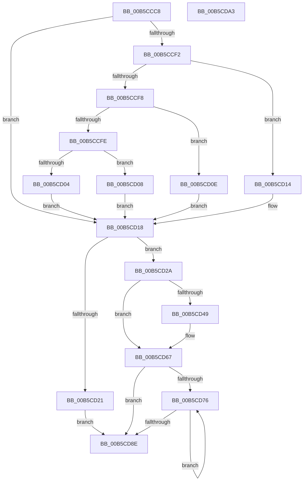

# InitCounterGroupBspEnhanced

- RVA: `0x00B5CCC8`–`0x00B5CDA4` (길이 `220` bytes)
- VA: `0x0000000140B5CCC8`
- 실행 섹션: `PAGELK`
- PDB 이름 있음: `예`; PDB Function 태그: `아니요`
- unwind 정보 RVA: `0x00066400`
- 디코드: `68`개 명령, `220/220` bytes 표시
- 미해석 바이트: `0` (있으면 어셈블리에 `.byte`로 보존)

> 이 문서는 커널 이미지의 기계어와 PDB 기호를 분석해 생성했습니다. 4번과 5번은 함수 원형과 자료형을 바이너리 사용 방식에서 추정한 C 해석이며 원본 소스 복구 결과는 아닙니다.

## 1. Dependencies

- 직접 호출 지점: **3**; 고유 호출 대상: **3**
- 직접 호출자로 확인된 함수: **1**
- RIP 상대 이미지 참조: **2**

### Outgoing calls
- `0x00B5CD38` → [HalpMmAllocateMemory](../../text/54/HalpMmAllocateMemory_function_00544974.md) (function, `0x00544974`)
- `0x00B5CD61` → [KeBugCheckEx](../../text/4F/KeBugCheckEx_function_004FD660.md) (function, `0x004FD660`)
- `0x00B5CD6C` → [memset](../../text/6C/memset_function_006C6C40.md) (function, `0x006C6C40`)

### Direct callers
- [DefaultInitializeProfilingEnhanced](DefaultInitializeProfilingEnhanced_function_00B5CA68.md) at `0x00B5CAC7`
- [DefaultInitializeProfilingEnhanced](DefaultInitializeProfilingEnhanced_function_00B5CA68.md) at `0x00B5CAD0`
- [DefaultInitializeProfilingEnhanced](DefaultInitializeProfilingEnhanced_function_00B5CA68.md) at `0x00B5CADA`
- [DefaultInitializeProfilingEnhanced](DefaultInitializeProfilingEnhanced_function_00B5CA68.md) at `0x00B5CAE4`

### Static image references
- `0x00B5CCDC` → RVA `0x00FC8C40` (`ALMOSTRO`; read)
- `0x00B5CD49` → RVA `0x00023F10` (`.rdata`; read)

## 2. Other-region calls and transfers

- 다른 실행 섹션으로 향하는 call: **3**
  - `0x00B5CD38` → [HalpMmAllocateMemory](../../text/54/HalpMmAllocateMemory_function_00544974.md) (`PAGELK` → `.text`)
  - `0x00B5CD61` → [KeBugCheckEx](../../text/4F/KeBugCheckEx_function_004FD660.md) (`PAGELK` → `.text`)
  - `0x00B5CD6C` → [memset](../../text/6C/memset_function_006C6C40.md) (`PAGELK` → `.text`)
- 별도 외부 분기/꼬리 이동을 확인하지 못했습니다.

## 3. Assembly (complete function range)

```asm
00B5CCC8  48 89 5C 24 08                  mov qword ptr [rsp + 8], rbx
00B5CCCD  48 89 6C 24 10                  mov qword ptr [rsp + 0x10], rbp
00B5CCD2  48 89 74 24 18                  mov qword ptr [rsp + 0x18], rsi
00B5CCD7  57                              push rdi
00B5CCD8  48 83 EC 30                     sub rsp, 0x30
00B5CCDC  48 8B 05 5D BF 46 00            mov rax, qword ptr [rip + 0x46bf5d]
00B5CCE3  33 F6                           xor esi, esi
00B5CCE5  8B E9                           mov ebp, ecx
00B5CCE7  44 8B C1                        mov r8d, ecx
00B5CCEA  48 8B 78 58                     mov rdi, qword ptr [rax + 0x58]
00B5CCEE  85 C9                           test ecx, ecx
00B5CCF0  74 26                           je 0x140b5cd18
00B5CCF2  41 83 E8 01                     sub r8d, 1
00B5CCF6  74 1C                           je 0x140b5cd14
00B5CCF8  41 83 E8 63                     sub r8d, 0x63
00B5CCFC  74 10                           je 0x140b5cd0e
00B5CCFE  41 83 F8 01                     cmp r8d, 1
00B5CD02  74 04                           je 0x140b5cd08
00B5CD04  8B FE                           mov edi, esi
00B5CD06  EB 10                           jmp 0x140b5cd18
00B5CD08  48 83 C7 48                     add rdi, 0x48
00B5CD0C  EB 0A                           jmp 0x140b5cd18
00B5CD0E  48 83 C7 30                     add rdi, 0x30
00B5CD12  EB 04                           jmp 0x140b5cd18
00B5CD14  48 83 C7 18                     add rdi, 0x18
00B5CD18  89 2F                           mov dword ptr [rdi], ebp
00B5CD1A  89 57 04                        mov dword ptr [rdi + 4], edx
00B5CD1D  85 D2                           test edx, edx
00B5CD1F  75 09                           jne 0x140b5cd2a
00B5CD21  89 77 08                        mov dword ptr [rdi + 8], esi
00B5CD24  48 89 77 10                     mov qword ptr [rdi + 0x10], rsi
00B5CD28  EB 64                           jmp 0x140b5cd8e
00B5CD2A  8D 1C 52                        lea ebx, [rdx + rdx*2]
00B5CD2D  8D 42 FF                        lea eax, [rdx - 1]
00B5CD30  C1 E3 04                        shl ebx, 4
00B5CD33  8B CB                           mov ecx, ebx
00B5CD35  89 47 08                        mov dword ptr [rdi + 8], eax
00B5CD38  E8 37 7C 9E FF                  call 0x140544974
00B5CD3D  48 89 47 10                     mov qword ptr [rdi + 0x10], rax
00B5CD41  44 8B C3                        mov r8d, ebx
00B5CD44  48 85 C0                        test rax, rax
00B5CD47  75 1E                           jne 0x140b5cd67
00B5CD49  4C 8D 0D C0 71 4C FF            lea r9, [rip - 0xb38e40]
00B5CD50  48 C7 44 24 20 50 01 00 00      mov qword ptr [rsp + 0x20], 0x150
00B5CD59  BA 02 90 00 00                  mov edx, 0x9002
00B5CD5E  8D 48 5C                        lea ecx, [rax + 0x5c]
00B5CD61  E8 FA 08 9A FF                  call 0x1404fd660
00B5CD66  CC                              int3
00B5CD67  33 D2                           xor edx, edx
00B5CD69  48 8B C8                        mov rcx, rax
00B5CD6C  E8 CF 9E B6 FF                  call 0x1406c6c40
00B5CD71  39 77 04                        cmp dword ptr [rdi + 4], esi
00B5CD74  76 18                           jbe 0x140b5cd8e
00B5CD76  8B C6                           mov eax, esi
00B5CD78  FF C6                           inc esi
00B5CD7A  48 8D 0C 40                     lea rcx, [rax + rax*2]
00B5CD7E  48 8B 47 10                     mov rax, qword ptr [rdi + 0x10]
00B5CD82  48 03 C9                        add rcx, rcx
00B5CD85  89 6C C8 1C                     mov dword ptr [rax + rcx*8 + 0x1c], ebp
00B5CD89  3B 77 04                        cmp esi, dword ptr [rdi + 4]
00B5CD8C  72 E8                           jb 0x140b5cd76
00B5CD8E  48 8B 5C 24 40                  mov rbx, qword ptr [rsp + 0x40]
00B5CD93  48 8B 6C 24 48                  mov rbp, qword ptr [rsp + 0x48]
00B5CD98  48 8B 74 24 50                  mov rsi, qword ptr [rsp + 0x50]
00B5CD9D  48 83 C4 30                     add rsp, 0x30
00B5CDA1  5F                              pop rdi
00B5CDA2  C3                              ret
00B5CDA3  CC                              int3
```

## 4. C-style interpretation (structured pseudocode)

```c
__int64 __fastcall InitCounterGroupBspEnhanced(int a1, __int64 a2)
{
    __int64 result;
    __int64 v_rbx;
    __int64 v_rdi;
    __int64 v_rsi;
    __int64 v_rsp;
    unsigned __int64 v_stack_m18;
    unsigned __int64 v_stack_p10;
    unsigned __int64 v_stack_p18;
    unsigned __int64 v_stack_p8;

    v_stack_p8 = v_rbx;
    v_stack_p10 = v_rbp;
    v_stack_p18 = v_rsi;
    v_rsp = (v_rsp) - (48);
    v_rsi = 0;
    if (a1 == 0) goto loc_00B5CD18;
    a3 = (unsigned int)(((unsigned int)(a1)) - (1));
    if (condition_is_equal) goto loc_00B5CD14;
    a3 = (unsigned int)((a3) - (99));
    if (condition_is_equal) goto loc_00B5CD0E;
    if (((unsigned int)(a3)) == 1) goto loc_00B5CD08;
    goto loc_00B5CD18;
loc_00B5CD08:
    v_rdi = (0) + (72);
    goto loc_00B5CD18;
loc_00B5CD0E:
    v_rdi = (v_rdi) + (48);
    goto loc_00B5CD18;
loc_00B5CD14:
    v_rdi = (v_rdi) + (24);
loc_00B5CD18:
    *(unsigned int *)(v_rdi) = (unsigned int)((unsigned int)(a1));
    *(unsigned int *)(v_rdi + 4) = (unsigned int)(a2);
    if ((unsigned int)(a2) != 0) goto loc_00B5CD2A;
    *(unsigned int *)(v_rdi + 8) = 0;
    *(unsigned __int64 *)(v_rdi + 16) = 0;
    goto loc_00B5CD8E;
loc_00B5CD2A:
    v_rbx = (unsigned int)((a2 + a2 * 2) << (4));
    *(unsigned int *)(v_rdi + 8) = (unsigned int)(a2 - 1);
    result = HalpMmAllocateMemory((unsigned int)((unsigned int)(v_rbx)), a2, a3, a4);
    *(unsigned __int64 *)(v_rdi + 16) = result;
    if (result == 0) {
        a4 = v_rip - 11767360;
        v_stack_m18 = 336;
        a2 = 0x9002ULL;
        a1 = result + 92;
        result = KeBugCheckEx(a1, a2, (unsigned int)((unsigned int)(v_rbx)), a4);
    }
    a2 = 0;
    result = memset(result, a2, (unsigned int)((unsigned int)(v_rbx)), a4);
    if ((*(unsigned int *)(v_rdi + 4)) <= 0) goto loc_00B5CD8E;
loc_00B5CD76:
    v_rsi = (unsigned int)((v_rsi) + 1);
    a1 = (0 + 0 * 2) + (0 + 0 * 2);
    *(unsigned int *)(*(unsigned __int64 *)(v_rdi + 16) + a1 * 8 + 28) = (unsigned int)((unsigned int)(a1));
    if (((unsigned int)(v_rsi)) < (*(unsigned int *)(v_rdi + 4))) goto loc_00B5CD76;
loc_00B5CD8E:
    v_rsp = (v_rsp) + (48);
    return *(unsigned __int64 *)(v_rdi + 16);
}
```

## 5. (Beta) C Style

```c
int64_t InitCounterGroupBspEnhanced(int32_t Arg1, int64_t Arg2)
{
    int64_t result;
    int64_t local_rbx;
    int64_t local_rdi;
    int64_t local_rsi;
    int64_t local_rsp;
    uint64_t v_stack_m18;
    uint64_t v_stack_p10;
    uint64_t v_stack_p18;
    uint64_t v_stack_p8;

    v_stack_p8 = local_rbx;
    v_stack_p10 = local_rbp;
    v_stack_p18 = local_rsi;
    local_rsp = (local_rsp) - (48);
    local_rsi = 0;
    if (Arg1 == 0) goto loc_00B5CD18;
    a3 = (uint32_t)(((uint32_t)(Arg1)) - (1));
    if (condition_is_equal) goto loc_00B5CD14;
    a3 = (uint32_t)((a3) - (99));
    if (condition_is_equal) goto loc_00B5CD0E;
    if (((uint32_t)(a3)) == 1) goto loc_00B5CD08;
    goto loc_00B5CD18;
loc_00B5CD08:
    local_rdi = (0) + (72);
    goto loc_00B5CD18;
loc_00B5CD0E:
    local_rdi = (local_rdi) + (48);
    goto loc_00B5CD18;
loc_00B5CD14:
    local_rdi = (local_rdi) + (24);
loc_00B5CD18:
    *(uint32_t *)(local_rdi) = (uint32_t)((uint32_t)(Arg1));
    *(uint32_t *)(local_rdi + 0x4) = (uint32_t)(Arg2);
    if ((uint32_t)(Arg2) != 0) goto loc_00B5CD2A;
    *(uint32_t *)(local_rdi + 0x8) = 0;
    *(uint64_t *)(local_rdi + 0x10) = 0;
    goto loc_00B5CD8E;
loc_00B5CD2A:
    local_rbx = (uint32_t)((Arg2 + Arg2 * 2) << (4));
    *(uint32_t *)(local_rdi + 0x8) = (uint32_t)(Arg2 - 1);
    result = HalpMmAllocateMemory((uint32_t)((uint32_t)(local_rbx)), Arg2, a3, a4);
    *(uint64_t *)(local_rdi + 0x10) = result;
    if (result == 0) {
        a4 = v_rip - 11767360;
        v_stack_m18 = 336;
        Arg2 = 0x9002ULL;
        Arg1 = result + 92;
        result = KeBugCheckEx(Arg1, Arg2, (uint32_t)((uint32_t)(local_rbx)), a4);
    }
    Arg2 = 0;
    result = memset(result, Arg2, (uint32_t)((uint32_t)(local_rbx)), a4);
    if ((*(uint32_t *)(local_rdi + 0x4)) <= 0) goto loc_00B5CD8E;
loc_00B5CD76:
    local_rsi = (uint32_t)((local_rsi) + 1);
    Arg1 = (0 + 0 * 2) + (0 + 0 * 2);
    *(uint32_t *)(*(uint64_t *)(local_rdi + 0x10) + Arg1 * 8 + 0x1C) = (uint32_t)((uint32_t)(Arg1));
    if (((uint32_t)(local_rsi)) < (*(uint32_t *)(local_rdi + 0x4))) goto loc_00B5CD76;
loc_00B5CD8E:
    local_rsp = (local_rsp) + (48);
    return *(uint64_t *)(local_rdi + 0x10);
}
```

## 6. Execution-region graph

[열기: 2D/3D 그래프와 함수 탐색 컨트롤 패널](../../../control-panel.html?section=pagelk&rva=0x00B5CCC8&view=graph)

- 2D 그래프는 위에서 아래로 흐르고, 3D 그래프는 빈 공간을 드래그해 회전합니다. Shift+드래그는 이동, 휠은 확대·축소, 함수 노드 선택은 대상 보고서 이동입니다.

### Static fallback


