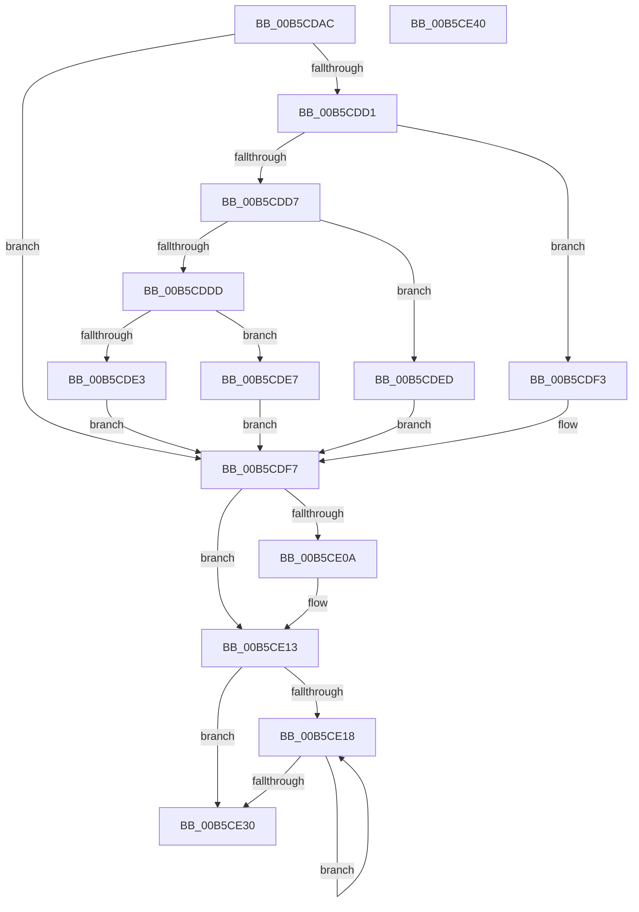

# InitCounterGroupBspOriginal

- RVA: `0x00B5CDAC`–`0x00B5CE41` (길이 `149` bytes)
- VA: `0x0000000140B5CDAC`
- 실행 섹션: `PAGELK`
- PDB 이름 있음: `예`; PDB Function 태그: `아니요`
- unwind 정보 RVA: `0x00060BC4`
- 디코드: `49`개 명령, `149/149` bytes 표시
- 미해석 바이트: `0` (있으면 어셈블리에 `.byte`로 보존)

> 이 문서는 커널 이미지의 기계어와 PDB 기호를 분석해 생성했습니다. 4번과 5번은 함수 원형과 자료형을 바이너리 사용 방식에서 추정한 C 해석이며 원본 소스 복구 결과는 아닙니다.

## 1. Dependencies

- 직접 호출 지점: **1**; 고유 호출 대상: **1**
- 직접 호출자로 확인된 함수: **1**
- RIP 상대 이미지 참조: **1**

### Outgoing calls
- `0x00B5CE0A` → [HalpMmAllocateMemory](../../text/54/HalpMmAllocateMemory_function_00544974.md) (function, `0x00544974`)

### Direct callers
- [DefaultInitializeProfilingOriginal](DefaultInitializeProfilingOriginal_function_00B5CB30.md) at `0x00B5CB8F`
- [DefaultInitializeProfilingOriginal](DefaultInitializeProfilingOriginal_function_00B5CB30.md) at `0x00B5CB98`
- [DefaultInitializeProfilingOriginal](DefaultInitializeProfilingOriginal_function_00B5CB30.md) at `0x00B5CBA2`
- [DefaultInitializeProfilingOriginal](DefaultInitializeProfilingOriginal_function_00B5CB30.md) at `0x00B5CBAC`

### Static image references
- `0x00B5CDBB` → RVA `0x00FC8C40` (`ALMOSTRO`; read)

## 2. Other-region calls and transfers

- 다른 실행 섹션으로 향하는 call: **1**
  - `0x00B5CE0A` → [HalpMmAllocateMemory](../../text/54/HalpMmAllocateMemory_function_00544974.md) (`PAGELK` → `.text`)
- 별도 외부 분기/꼬리 이동을 확인하지 못했습니다.

## 3. Assembly (complete function range)

```asm
00B5CDAC  48 89 5C 24 08                  mov qword ptr [rsp + 8], rbx
00B5CDB1  48 89 74 24 10                  mov qword ptr [rsp + 0x10], rsi
00B5CDB6  57                              push rdi
00B5CDB7  48 83 EC 20                     sub rsp, 0x20
00B5CDBB  48 8B 05 7E BE 46 00            mov rax, qword ptr [rip + 0x46be7e]
00B5CDC2  33 FF                           xor edi, edi
00B5CDC4  8B F1                           mov esi, ecx
00B5CDC6  44 8B C1                        mov r8d, ecx
00B5CDC9  48 8B 58 58                     mov rbx, qword ptr [rax + 0x58]
00B5CDCD  85 C9                           test ecx, ecx
00B5CDCF  74 26                           je 0x140b5cdf7
00B5CDD1  41 83 E8 01                     sub r8d, 1
00B5CDD5  74 1C                           je 0x140b5cdf3
00B5CDD7  41 83 E8 63                     sub r8d, 0x63
00B5CDDB  74 10                           je 0x140b5cded
00B5CDDD  41 83 F8 01                     cmp r8d, 1
00B5CDE1  74 04                           je 0x140b5cde7
00B5CDE3  8B DF                           mov ebx, edi
00B5CDE5  EB 10                           jmp 0x140b5cdf7
00B5CDE7  48 83 C3 48                     add rbx, 0x48
00B5CDEB  EB 0A                           jmp 0x140b5cdf7
00B5CDED  48 83 C3 30                     add rbx, 0x30
00B5CDF1  EB 04                           jmp 0x140b5cdf7
00B5CDF3  48 83 C3 18                     add rbx, 0x18
00B5CDF7  8D 0C 52                        lea ecx, [rdx + rdx*2]
00B5CDFA  89 33                           mov dword ptr [rbx], esi
00B5CDFC  C1 E1 04                        shl ecx, 4
00B5CDFF  89 53 04                        mov dword ptr [rbx + 4], edx
00B5CE02  48 89 7B 10                     mov qword ptr [rbx + 0x10], rdi
00B5CE06  85 C9                           test ecx, ecx
00B5CE08  74 09                           je 0x140b5ce13
00B5CE0A  E8 65 7B 9E FF                  call 0x140544974
00B5CE0F  48 89 43 10                     mov qword ptr [rbx + 0x10], rax
00B5CE13  39 7B 04                        cmp dword ptr [rbx + 4], edi
00B5CE16  76 18                           jbe 0x140b5ce30
00B5CE18  8B C7                           mov eax, edi
00B5CE1A  FF C7                           inc edi
00B5CE1C  48 8D 0C 40                     lea rcx, [rax + rax*2]
00B5CE20  48 8B 43 10                     mov rax, qword ptr [rbx + 0x10]
00B5CE24  48 03 C9                        add rcx, rcx
00B5CE27  89 74 C8 1C                     mov dword ptr [rax + rcx*8 + 0x1c], esi
00B5CE2B  3B 7B 04                        cmp edi, dword ptr [rbx + 4]
00B5CE2E  72 E8                           jb 0x140b5ce18
00B5CE30  48 8B 5C 24 30                  mov rbx, qword ptr [rsp + 0x30]
00B5CE35  48 8B 74 24 38                  mov rsi, qword ptr [rsp + 0x38]
00B5CE3A  48 83 C4 20                     add rsp, 0x20
00B5CE3E  5F                              pop rdi
00B5CE3F  C3                              ret
00B5CE40  CC                              int3
```

## 4. C-style interpretation (structured pseudocode)

```c
__int64 __fastcall InitCounterGroupBspOriginal(int a1, __int64 a2)
{
    __int64 result;
    __int64 v_rbx;
    __int64 v_rdi;
    __int64 v_rsp;
    unsigned __int64 v_stack_p10;
    unsigned __int64 v_stack_p8;

    v_stack_p8 = v_rbx;
    v_stack_p10 = v_rsi;
    v_rsp = (v_rsp) - (32);
    v_rdi = 0;
    if (a1 == 0) goto loc_00B5CDF7;
    a3 = (unsigned int)(((unsigned int)(a1)) - (1));
    if (condition_is_equal) goto loc_00B5CDF3;
    a3 = (unsigned int)((a3) - (99));
    if (condition_is_equal) goto loc_00B5CDED;
    if (((unsigned int)(a3)) == 1) goto loc_00B5CDE7;
    goto loc_00B5CDF7;
loc_00B5CDE7:
    v_rbx = (0) + (72);
    goto loc_00B5CDF7;
loc_00B5CDED:
    v_rbx = (v_rbx) + (48);
    goto loc_00B5CDF7;
loc_00B5CDF3:
    v_rbx = (v_rbx) + (24);
loc_00B5CDF7:
    *(unsigned int *)(v_rbx) = (unsigned int)((unsigned int)(a1));
    a1 = (unsigned int)((a2 + a2 * 2) << (4));
    *(unsigned int *)(v_rbx + 4) = (unsigned int)(a2);
    *(unsigned __int64 *)(v_rbx + 16) = 0;
    result = *(unsigned __int64 *)(v_rip + 4636286);
    if (a1 != 0) {
        result = HalpMmAllocateMemory(a1, a2, a3, a4);
        *(unsigned __int64 *)(v_rbx + 16) = result;
    }
    if ((*(unsigned int *)(v_rbx + 4)) <= 0) goto loc_00B5CE30;
loc_00B5CE18:
    v_rdi = (unsigned int)((v_rdi) + 1);
    a1 = (0 + 0 * 2) + (0 + 0 * 2);
    *(unsigned int *)(*(unsigned __int64 *)(v_rbx + 16) + a1 * 8 + 28) = (unsigned int)((unsigned int)(a1));
    if (((unsigned int)(v_rdi)) < (*(unsigned int *)(v_rbx + 4))) goto loc_00B5CE18;
loc_00B5CE30:
    v_rsp = (v_rsp) + (32);
    return *(unsigned __int64 *)(v_rbx + 16);
}
```

## 5. (Beta) C Style

```c
int64_t InitCounterGroupBspOriginal(int32_t Arg1, void *Arg2)
{
    uint8_t *arg2 = (uint8_t *)Arg2;

    int64_t result;
    int64_t local_rbx;
    int64_t local_rdi;
    int64_t local_rsp;
    uint64_t v_stack_p10;
    uint64_t v_stack_p8;

    v_stack_p8 = local_rbx;
    v_stack_p10 = local_rsi;
    local_rsp = (local_rsp) - (32);
    local_rdi = 0;
    if (Arg1 == 0) goto loc_00B5CDF7;
    a3 = (uint32_t)(((uint32_t)(Arg1)) - (1));
    if (condition_is_equal) goto loc_00B5CDF3;
    a3 = (uint32_t)((a3) - (99));
    if (condition_is_equal) goto loc_00B5CDED;
    if (((uint32_t)(a3)) == 1) goto loc_00B5CDE7;
    goto loc_00B5CDF7;
loc_00B5CDE7:
    local_rbx = (0) + (72);
    goto loc_00B5CDF7;
loc_00B5CDED:
    local_rbx = (local_rbx) + (48);
    goto loc_00B5CDF7;
loc_00B5CDF3:
    local_rbx = (local_rbx) + (24);
loc_00B5CDF7:
    *(uint32_t *)(local_rbx) = (uint32_t)((uint32_t)(Arg1));
    Arg1 = (uint32_t)((Arg2 + Arg2 * 2) << (4));
    *(uint32_t *)(local_rbx + 0x4) = (uint32_t)(Arg2);
    *(uint64_t *)(local_rbx + 0x10) = 0;
    result = *(uint64_t *)(v_rip + 0x46BE7E);
    if (Arg1 != 0) {
        result = HalpMmAllocateMemory(Arg1, Arg2, a3, a4);
        *(uint64_t *)(local_rbx + 0x10) = result;
    }
    if ((*(uint32_t *)(local_rbx + 0x4)) <= 0) goto loc_00B5CE30;
loc_00B5CE18:
    local_rdi = (uint32_t)((local_rdi) + 1);
    Arg1 = (0 + 0 * 2) + (0 + 0 * 2);
    *(uint32_t *)(*(uint64_t *)(local_rbx + 0x10) + Arg1 * 8 + 0x1C) = (uint32_t)((uint32_t)(Arg1));
    if (((uint32_t)(local_rdi)) < (*(uint32_t *)(local_rbx + 0x4))) goto loc_00B5CE18;
loc_00B5CE30:
    local_rsp = (local_rsp) + (32);
    return *(uint64_t *)(local_rbx + 0x10);
}
```

### 관측된 메모리 오프셋

구조체 형식이 확인되지 않은 접근은 인자 기준의 오프셋으로만 기록했습니다.

| 기준 인자 | 오프셋 표현 | 폭 (bit) | 접근 |
|---|---:|---:|---|
| `Arg2` | `+ 0x0 + rdx*2` | `32` | `R` |

## 6. Execution-region graph

[열기: 2D/3D 그래프와 함수 탐색 컨트롤 패널](../../../control-panel.html?section=pagelk&rva=0x00B5CDAC&view=graph)

- 2D 그래프는 위에서 아래로 흐르고, 3D 그래프는 빈 공간을 드래그해 회전합니다. Shift+드래그는 이동, 휠은 확대·축소, 함수 노드 선택은 대상 보고서 이동입니다.

### Static fallback


