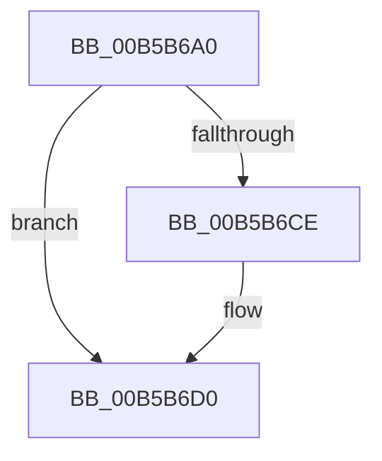

# KiDetectFpuLeakage

- RVA: `0x00B5B6A0`–`0x00B5B6D8` (길이 `56` bytes)
- VA: `0x0000000140B5B6A0`
- 실행 섹션: `PAGELK`
- PDB 이름 있음: `예`; PDB Function 태그: `아니요`
- unwind 정보 RVA: `0x000BFE84`
- 디코드: `17`개 명령, `56/56` bytes 표시
- 미해석 바이트: `0` (있으면 어셈블리에 `.byte`로 보존)

> 이 문서는 커널 이미지의 기계어와 PDB 기호를 분석해 생성했습니다. 4번과 5번은 함수 원형과 자료형을 바이너리 사용 방식에서 추정한 C 해석이며 원본 소스 복구 결과는 아닙니다.

## 1. Dependencies

- 직접 호출 지점: **0**; 고유 호출 대상: **0**
- 직접 호출자로 확인된 함수: **1**
- RIP 상대 이미지 참조: **0**

### Outgoing calls
- 직접 디코드된 call 명령이 없습니다.

### Direct callers
- [KiInitializeKernel](../B6/KiInitializeKernel_function_00B68D20.md) at `0x00B68E20`

### Static image references
- 디코드된 RIP-relative 메모리 참조가 없습니다.

## 2. Other-region calls and transfers

- 다른 실행 섹션으로 향하는 call: **0**
- 별도 외부 분기/꼬리 이동을 확인하지 못했습니다.

## 3. Assembly (complete function range)

```asm
00B5B6A0  48 81 EC 08 02 00 00            sub rsp, 0x208
00B5B6A7  48 0F AE 04 24                  fxsave64 ptr [rsp]
00B5B6AC  DB E2                           fnclex
00B5B6AE  DD C7                           ffree st(7)
00B5B6B0  DB 04 24                        fild dword ptr [rsp]
00B5B6B3  33 D2                           xor edx, edx
00B5B6B5  FF CA                           dec edx
00B5B6B7  48 89 54 24 08                  mov qword ptr [rsp + 8], rdx
00B5B6BC  48 0F AE 0C 24                  fxrstor64 ptr [rsp]
00B5B6C1  DD 34 24                        fnsave dword ptr [rsp]
00B5B6C4  8B 4C 24 0C                     mov ecx, dword ptr [rsp + 0xc]
00B5B6C8  33 C0                           xor eax, eax
00B5B6CA  3B D1                           cmp edx, ecx
00B5B6CC  74 02                           je 0x140b5b6d0
00B5B6CE  FF C0                           inc eax
00B5B6D0  48 81 C4 08 02 00 00            add rsp, 0x208
00B5B6D7  C3                              ret
```

## 4. C-style interpretation (structured pseudocode)

```c
__int64 __fastcall KiDetectFpuLeakage(__int64 a1, int a2)
{
    __int64 result;
    __int64 v_rsp;
    unsigned int v_stack_m1FC;
    unsigned __int64 v_stack_m200;
    unsigned __int64 v_stack_m208;

    v_rsp = (v_rsp) - (520);
    a2 = 0;
    a2 = (unsigned int)((a2) - 1);
    v_stack_m200 = a2;
    result = 0;
    if (a2 != ((unsigned int)((unsigned int)(v_stack_m1FC)))) {
        result = (unsigned int)((result) + 1);
    }
    v_rsp = (v_rsp) + (520);
    return result;
}
```

## 5. (Beta) C Style

```c
int64_t KiDetectFpuLeakage(int64_t Arg1, int32_t Arg2)
{
    int64_t result;
    int64_t local_rsp;
    uint32_t v_stack_m1FC;
    uint64_t v_stack_m200;
    uint64_t v_stack_m208;

    local_rsp = (local_rsp) - (520);
    Arg2 = 0;
    Arg2 = (uint32_t)((Arg2) - 1);
    v_stack_m200 = Arg2;
    result = 0;
    if (Arg2 != ((uint32_t)((uint32_t)(v_stack_m1FC)))) {
        result = (uint32_t)((result) + 1);
    }
    local_rsp = (local_rsp) + (520);
    return result;
}
```

## 6. Execution-region graph

[열기: 2D/3D 그래프와 함수 탐색 컨트롤 패널](../../../control-panel.html?section=pagelk&rva=0x00B5B6A0&view=graph)

- 2D 그래프는 위에서 아래로 흐르고, 3D 그래프는 빈 공간을 드래그해 회전합니다. Shift+드래그는 이동, 휠은 확대·축소, 함수 노드 선택은 대상 보고서 이동입니다.

### Static fallback


