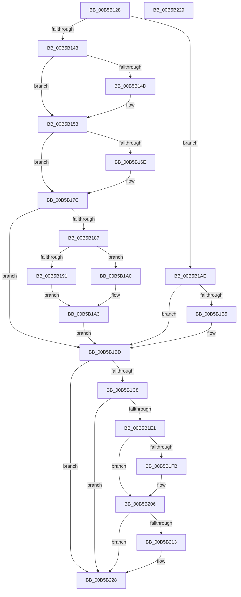

# KiEnableXSave

- RVA: `0x00B5B128`–`0x00B5B22A` (길이 `258` bytes)
- VA: `0x0000000140B5B128`
- 실행 섹션: `PAGELK`
- PDB 이름 있음: `예`; PDB Function 태그: `아니요`
- unwind 정보 RVA: `0x000DB714`
- 디코드: `61`개 명령, `258/258` bytes 표시
- 미해석 바이트: `0` (있으면 어셈블리에 `.byte`로 보존)

> 이 문서는 커널 이미지의 기계어와 PDB 기호를 분석해 생성했습니다. 4번과 5번은 함수 원형과 자료형을 바이너리 사용 방식에서 추정한 C 해석이며 원본 소스 복구 결과는 아닙니다.

## 1. Dependencies

- 직접 호출 지점: **0**; 고유 호출 대상: **0**
- 직접 호출자로 확인된 함수: **3**
- RIP 상대 이미지 참조: **3**

### Outgoing calls
- 직접 디코드된 call 명령이 없습니다.

### Direct callers
- [KiRestoreXSaveSupport](KiRestoreXSaveSupport_function_00B5B110.md) at `0x00B5B114`
- [KiConfigureDynamicProcessor](../B6/KiConfigureDynamicProcessor_function_00B684D8.md) at `0x00B684DE`
- [KiInitializeKernel](../B6/KiInitializeKernel_function_00B68D20.md) at `0x00B692A5`

### Static image references
- `0x00B5B12E` → RVA `0x00FC6B30` (`ALMOSTRO`; read)
- `0x00B5B162` → RVA `0x00FC6C60` (`ALMOSTRO`; read)
- `0x00B5B1F2` → RVA `0x01201841` (`CFGRO`; read)

## 2. Other-region calls and transfers

- 다른 실행 섹션으로 향하는 call: **0**
- 별도 외부 분기/꼬리 이동을 확인하지 못했습니다.

## 3. Assembly (complete function range)

```asm
00B5B128  4C 8B C1                        mov r8, rcx
00B5B12B  0F 20 E2                        mov rdx, cr4
00B5B12E  48 0F BA 25 F9 B9 46 00 17      bt qword ptr [rip + 0x46b9f9], 0x17
00B5B137  49 BA D8 03 00 00 80 F7 FF FF   movabs r10, 0xfffff780000003d8
00B5B141  73 6B                           jae 0x140b5b1ae
00B5B143  B8 00 00 04 00                  mov eax, 0x40000
00B5B148  48 85 D0                        test rax, rdx
00B5B14B  75 06                           jne 0x140b5b153
00B5B14D  48 0B D0                        or rdx, rax
00B5B150  0F 22 E2                        mov cr4, rdx
00B5B153  49 8B 12                        mov rdx, qword ptr [r10]
00B5B156  33 C9                           xor ecx, ecx
00B5B158  48 8B C2                        mov rax, rdx
00B5B15B  48 C1 EA 20                     shr rdx, 0x20
00B5B15F  0F 01 D1                        xsetbv
00B5B162  48 8B 15 F7 BA 46 00            mov rdx, qword ptr [rip + 0x46baf7]
00B5B169  48 85 D2                        test rdx, rdx
00B5B16C  74 0E                           je 0x140b5b17c
00B5B16E  48 8B C2                        mov rax, rdx
00B5B171  B9 A0 0D 00 00                  mov ecx, 0xda0
00B5B176  48 C1 EA 20                     shr rdx, 0x20
00B5B17A  0F 30                           wrmsr
00B5B17C  48 0F BA 25 AB B9 46 00 37      bt qword ptr [rip + 0x46b9ab], 0x37
00B5B185  73 36                           jae 0x140b5b1bd
00B5B187  B9 C4 01 00 00                  mov ecx, 0x1c4
00B5B18C  4D 85 C0                        test r8, r8
00B5B18F  75 0F                           jne 0x140b5b1a0
00B5B191  48 BA 10 07 00 00 80 F7 FF FF   movabs rdx, 0xfffff78000000710
00B5B19B  48 8B 12                        mov rdx, qword ptr [rdx]
00B5B19E  EB 03                           jmp 0x140b5b1a3
00B5B1A0  49 8B 10                        mov rdx, qword ptr [r8]
00B5B1A3  48 8B C2                        mov rax, rdx
00B5B1A6  48 C1 EA 20                     shr rdx, 0x20
00B5B1AA  0F 30                           wrmsr
00B5B1AC  EB 0F                           jmp 0x140b5b1bd
00B5B1AE  48 0F BA E2 12                  bt rdx, 0x12
00B5B1B3  73 08                           jae 0x140b5b1bd
00B5B1B5  48 0F BA F2 12                  btr rdx, 0x12
00B5B1BA  0F 22 E2                        mov cr4, rdx
00B5B1BD  48 0F BA 25 6A B9 46 00 17      bt qword ptr [rip + 0x46b96a], 0x17
00B5B1C6  73 60                           jae 0x140b5b228
00B5B1C8  65 48 8B 0C 25 20 00 00 00      mov rcx, qword ptr gs:[0x20]
00B5B1D1  48 8D 81 F0 01 00 00            lea rax, [rcx + 0x1f0]
00B5B1D8  48 39 81 C0 8F 00 00            cmp qword ptr [rcx + 0x8fc0], rax
00B5B1DF  74 47                           je 0x140b5b228
00B5B1E1  8B 81 C8 8F 00 00               mov eax, dword ptr [rcx + 0x8fc8]
00B5B1E7  0D 40 00 10 00                  or eax, 0x100040
00B5B1EC  89 81 C8 8F 00 00               mov dword ptr [rcx + 0x8fc8], eax
00B5B1F2  80 3D 48 66 6A 00 00            cmp byte ptr [rip + 0x6a6648], 0
00B5B1F9  74 0B                           je 0x140b5b206
00B5B1FB  0D 80 00 10 00                  or eax, 0x100080
00B5B200  89 81 C8 8F 00 00               mov dword ptr [rcx + 0x8fc8], eax
00B5B206  A1 EC 03 00 00 80 F7 FF FF      movabs eax, dword ptr [0xfffff780000003ec]
00B5B20F  A8 02                           test al, 2
00B5B211  74 15                           je 0x140b5b228
00B5B213  49 8B 02                        mov rax, qword ptr [r10]
00B5B216  48 0B 05 43 BA 46 00            or rax, qword ptr [rip + 0x46ba43]
00B5B21D  48 83 E0 FC                     and rax, 0xfffffffffffffffc
00B5B221  48 89 81 10 87 00 00            mov qword ptr [rcx + 0x8710], rax
00B5B228  C3                              ret
00B5B229  CC                              int3
```

## 4. C-style interpretation (structured pseudocode)

```c
__int64 __fastcall KiEnableXSave(__int64 a1)
{
    __int64 result;
    __int64 v_cr4;

    if (condition_is_above_or_equal) goto loc_00B5B1AE;
    if ((((unsigned int)(0x40000ULL)) & (v_cr4)) == 0) {
        a2 = (v_cr4) | ((unsigned int)(0x40000ULL));
        v_cr4 = a2;
    }
    a1 = 0;
    a2 = (*(unsigned __int64 *)(v_r10)) >> (32);
    result = *(unsigned __int64 *)(v_r10);
    if (*(unsigned __int64 *)(v_rip + 4635383) != 0) {
        result = *(unsigned __int64 *)(v_rip + 4635383);
        a1 = 0xDA0ULL;
        a2 = (*(unsigned __int64 *)(v_rip + 4635383)) >> (32);
    }
    if (condition_is_above_or_equal) goto loc_00B5B1BD;
    if (a1 != 0) goto loc_00B5B1A0;
    goto loc_00B5B1A3;
loc_00B5B1A0:
loc_00B5B1A3:
    a2 = (*(unsigned __int64 *)(a1)) >> (32);
    goto loc_00B5B1BD;
loc_00B5B1AE:
    if (!(condition_is_above_or_equal)) {
        v_cr4 = a2;
    }
    if (condition_is_above_or_equal) goto loc_00B5B228;
    if ((*(unsigned __int64 *)(*(unsigned __int64 *)(gs_base + (0 + 32)) + 36800)) == (*(unsigned __int64 *)(gs_base + (0 + 32)) + 496)) goto loc_00B5B228;
    result = (unsigned int)(((unsigned int)(*(unsigned int *)(*(unsigned __int64 *)(gs_base + (0 + 32)) + 36808))) | (0x100040ULL));
    *(unsigned int *)(*(unsigned __int64 *)(gs_base + (0 + 32)) + 36808) = (unsigned int)(result);
    if ((*(unsigned __int8 *)(v_rip + 6973000)) != 0) {
        result = (unsigned int)((result) | (0x100080ULL));
        *(unsigned int *)(*(unsigned __int64 *)(gs_base + (0 + 32)) + 36808) = (unsigned int)(result);
    }
    if ((((unsigned __int8)(result)) & (2)) != 0) {
        result = *(unsigned __int64 *)(v_r10);
        result = (result) | (*(unsigned __int64 *)(v_rip + 4635203));
        result = (result) & (-4);
        *(unsigned __int64 *)(*(unsigned __int64 *)(gs_base + (0 + 32)) + 34576) = result;
    }
    return result;
}
```

## 5. (Beta) C Style

```c
int64_t KiEnableXSave(int64_t Arg1)
{
    int64_t result;
    int64_t v_cr4;

    if (condition_is_above_or_equal) goto loc_00B5B1AE;
    if ((((uint32_t)(0x40000ULL)) & (v_cr4)) == 0) {
        a2 = (v_cr4) | ((uint32_t)(0x40000ULL));
        v_cr4 = a2;
    }
    Arg1 = 0;
    a2 = (*(uint64_t *)(local_r10)) >> (32);
    result = *(uint64_t *)(local_r10);
    if (*(uint64_t *)(v_rip + 0x46BAF7) != 0) {
        result = *(uint64_t *)(v_rip + 0x46BAF7);
        Arg1 = 0xDA0ULL;
        a2 = (*(uint64_t *)(v_rip + 0x46BAF7)) >> (32);
    }
    if (condition_is_above_or_equal) goto loc_00B5B1BD;
    if (Arg1 != 0) goto loc_00B5B1A0;
    goto loc_00B5B1A3;
loc_00B5B1A0:
loc_00B5B1A3:
    a2 = (*(uint64_t *)(Arg1)) >> (32);
    goto loc_00B5B1BD;
loc_00B5B1AE:
    if (!(condition_is_above_or_equal)) {
        v_cr4 = a2;
    }
    if (condition_is_above_or_equal) goto loc_00B5B228;
    if ((*(uint64_t *)(*(uint64_t *)(gs_base + (0 + 0x20)) + 0x8FC0)) == (*(uint64_t *)(gs_base + (0 + 0x20)) + 496)) goto loc_00B5B228;
    result = (uint32_t)(((uint32_t)(*(uint32_t *)(*(uint64_t *)(gs_base + (0 + 0x20)) + 0x8FC8))) | (0x100040ULL));
    *(uint32_t *)(*(uint64_t *)(gs_base + (0 + 0x20)) + 0x8FC8) = (uint32_t)(result);
    if ((*(uint8_t *)(v_rip + 0x6A6648)) != 0) {
        result = (uint32_t)((result) | (0x100080ULL));
        *(uint32_t *)(*(uint64_t *)(gs_base + (0 + 0x20)) + 0x8FC8) = (uint32_t)(result);
    }
    if ((((uint8_t)(result)) & (2)) != 0) {
        result = *(uint64_t *)(local_r10);
        result = (result) | (*(uint64_t *)(v_rip + 0x46BA43));
        result = (result) & (-4);
        *(uint64_t *)(*(uint64_t *)(gs_base + (0 + 0x20)) + 0x8710) = result;
    }
    return result;
}
```

## 6. Execution-region graph

[열기: 2D/3D 그래프와 함수 탐색 컨트롤 패널](../../../control-panel.html?section=pagelk&rva=0x00B5B128&view=graph)

- 2D 그래프는 위에서 아래로 흐르고, 3D 그래프는 빈 공간을 드래그해 회전합니다. Shift+드래그는 이동, 휠은 확대·축소, 함수 노드 선택은 대상 보고서 이동입니다.

### Static fallback


