# KiSystemStartup

- RVA: `0x00B5B3C0`–`0x00B5B693` (길이 `723` bytes)
- VA: `0x0000000140B5B3C0`
- 실행 섹션: `PAGELK`
- PDB 이름 있음: `예`; PDB Function 태그: `아니요`
- unwind 정보 RVA: `0x000BFE78`
- 디코드: `145`개 명령, `723/723` bytes 표시
- 미해석 바이트: `0` (있으면 어셈블리에 `.byte`로 보존)

> 이 문서는 커널 이미지의 기계어와 PDB 기호를 분석해 생성했습니다. 4번과 5번은 함수 원형과 자료형을 바이너리 사용 방식에서 추정한 C 해석이며 원본 소스 복구 결과는 아닙니다.

## 1. Dependencies

- 직접 호출 지점: **9**; 고유 호출 대상: **8**
- 직접 호출자로 확인된 함수: **0**
- RIP 상대 이미지 참조: **13**

### Outgoing calls
- `0x00B5B3E8` → [KasanInitSystem](../../init/C3/KasanInitSystem_function_00C368B0.md) (function, `0x00C368B0`)
- `0x00B5B407` → [KdInitSystem](../../pagekd/B8/KdInitSystem_function_00B85E30.md) (function, `0x00B85E30`)
- `0x00B5B525` → [KiInitializeKernelShadowStacks](../B6/KiInitializeKernelShadowStacks_function_00B69650.md) (function, `0x00B69650`)
- `0x00B5B575` → [KiInitializeBootStructures](../B6/KiInitializeBootStructures_function_00B68530.md) (function, `0x00B68530`)
- `0x00B5B591` → [KdInitSystem](../../pagekd/B8/KdInitSystem_function_00B85E30.md) (function, `0x00B85E30`)
- `0x00B5B5A8` → [KiInitializeXSaveConfiguration](../B6/KiInitializeXSaveConfiguration_function_00B66F10.md) (function, `0x00B66F10`)
- `0x00B5B5BB` → [KzSetIrqlUnsafe](../../text/5B/KzSetIrqlUnsafe_function_005B8AE0.md) (function, `0x005B8AE0`)
- `0x00B5B63E` → [KiInitializeKernel](../B6/KiInitializeKernel_function_00B68D20.md) (function, `0x00B68D20`)
- `0x00B5B68D` → [KiIdleLoop](../../text/6B/KiIdleLoop_function_006B2910.md) (function, `0x006B2910`)

### Direct callers
- 이 함수 시작 RVA로 연결되는 직접 call은 확인되지 않았습니다. 간접 호출은 완전히 역산할 수 없습니다.

### Static image references
- `0x00B5B3CC` → RVA `0x00FC6B20` (`ALMOSTRO`; write)
- `0x00B5B3F2` → RVA `0x00FC6B20` (`ALMOSTRO`; read)
- `0x00B5B4BB` → RVA `0x00FC6A84` (`ALMOSTRO`; read)
- `0x00B5B502` → RVA `0x00BD0030` (`guard_dispatch_icall$thunk$10345483385596137414`; read)
- `0x00B5B509` → RVA `0x00151758` (`.idata`; write)
- `0x00B5B510` → RVA `0x006BAA80` (`guard_check_icall`; read)
- `0x00B5B517` → RVA `0x00151750` (`.idata`; write)
- `0x00B5B54C` → RVA `0x01201843` (`CFGRO`; read)
- `0x00B5B5B2` → RVA `0x00FC6D20` (`ALMOSTRO`; read)
- `0x00B5B5C6` → RVA `0x00FC5110` (`ALMOSTRO`; read)
- `0x00B5B5EF` → RVA `0x01201840` (`CFGRO`; read)
- `0x00B5B64F` → RVA `0x00E0A740` (`.data`; read)
- `0x00B5B659` → RVA `0x00E0A750` (`.data`; write)

## 2. Other-region calls and transfers

- 다른 실행 섹션으로 향하는 call: **5**
  - `0x00B5B3E8` → [KasanInitSystem](../../init/C3/KasanInitSystem_function_00C368B0.md) (`PAGELK` → `INIT`)
  - `0x00B5B407` → [KdInitSystem](../../pagekd/B8/KdInitSystem_function_00B85E30.md) (`PAGELK` → `PAGEKD`)
  - `0x00B5B591` → [KdInitSystem](../../pagekd/B8/KdInitSystem_function_00B85E30.md) (`PAGELK` → `PAGEKD`)
  - `0x00B5B5BB` → [KzSetIrqlUnsafe](../../text/5B/KzSetIrqlUnsafe_function_005B8AE0.md) (`PAGELK` → `.text`)
  - `0x00B5B68D` → [KiIdleLoop](../../text/6B/KiIdleLoop_function_006B2910.md) (`PAGELK` → `.text`)
- 별도 외부 분기/꼬리 이동을 확인하지 못했습니다.

## 3. Assembly (complete function range)

```asm
00B5B3C0  48 83 EC 38                     sub rsp, 0x38
00B5B3C4  4C 89 7C 24 30                  mov qword ptr [rsp + 0x30], r15
00B5B3C9  4C 8B FC                        mov r15, rsp
00B5B3CC  48 89 0D 4D B7 46 00            mov qword ptr [rip + 0x46b74d], rcx
00B5B3D3  4C 8B 91 88 00 00 00            mov r10, qword ptr [rcx + 0x88]
00B5B3DA  41 83 7A 24 00                  cmp dword ptr [r10 + 0x24], 0
00B5B3DF  75 0C                           jne 0x140b5b3ed
00B5B3E1  48 C7 C2 00 00 00 00            mov rdx, 0
00B5B3E8  E8 C3 B4 0D 00                  call 0x140c368b0
00B5B3ED  B9 FF FF FF FF                  mov ecx, 0xffffffff
00B5B3F2  48 8B 15 27 B7 46 00            mov rdx, qword ptr [rip + 0x46b727]
00B5B3F9  4C 8B 92 88 00 00 00            mov r10, qword ptr [rdx + 0x88]
00B5B400  41 83 7A 24 00                  cmp dword ptr [r10 + 0x24], 0
00B5B405  75 05                           jne 0x140b5b40c
00B5B407  E8 24 AA 02 00                  call 0x140b85e30
00B5B40C  48 8B 0D 0D B7 46 00            mov rcx, qword ptr [rip + 0x46b70d]
00B5B413  48 8B 91 88 00 00 00            mov rdx, qword ptr [rcx + 0x88]
00B5B41A  4C 8B D2                        mov r10, rdx
00B5B41D  48 81 EA 80 01 00 00            sub rdx, 0x180
00B5B424  48 89 52 18                     mov qword ptr [rdx + 0x18], rdx
00B5B428  4C 89 52 20                     mov qword ptr [rdx + 0x20], r10
00B5B42C  41 0F 20 C0                     mov r8, cr0
00B5B430  4C 89 82 80 02 00 00            mov qword ptr [rdx + 0x280], r8
00B5B437  41 0F 20 D0                     mov r8, cr2
00B5B43B  4C 89 82 88 02 00 00            mov qword ptr [rdx + 0x288], r8
00B5B442  41 0F 20 D8                     mov r8, cr3
00B5B446  4C 89 82 90 02 00 00            mov qword ptr [rdx + 0x290], r8
00B5B44D  41 0F 20 E0                     mov r8, cr4
00B5B451  4C 89 82 98 02 00 00            mov qword ptr [rdx + 0x298], r8
00B5B458  0F 01 82 D6 02 00 00            sgdt [rdx + 0x2d6]
00B5B45F  4C 8B 82 D8 02 00 00            mov r8, qword ptr [rdx + 0x2d8]
00B5B466  4C 89 02                        mov qword ptr [rdx], r8
00B5B469  0F 01 8A E6 02 00 00            sidt [rdx + 0x2e6]
00B5B470  4C 8B 8A E8 02 00 00            mov r9, qword ptr [rdx + 0x2e8]
00B5B477  4C 89 4A 38                     mov qword ptr [rdx + 0x38], r9
00B5B47B  0F 00 8A F0 02 00 00            str word ptr [rdx + 0x2f0]
00B5B482  0F 00 82 F2 02 00 00            sldt word ptr [rdx + 0x2f2]
00B5B489  C7 82 80 01 00 00 80 1F 00 00   mov dword ptr [rdx + 0x180], 0x1f80
00B5B493  0F AE 92 80 01 00 00            ldmxcsr dword ptr [rdx + 0x180]
00B5B49A  41 83 7A 24 00                  cmp dword ptr [r10 + 0x24], 0
00B5B49F  75 09                           jne 0x140b5b4aa
00B5B4A1  66 B8 00 3C                     mov ax, 0x3c00
00B5B4A5  66 41 89 40 50                  mov word ptr [r8 + 0x50], ax
00B5B4AA  66 B8 2B 00                     mov ax, 0x2b
00B5B4AE  66 8E D8                        mov ds, ax
00B5B4B1  66 8E C0                        mov es, ax
00B5B4B4  66 B8 53 00                     mov ax, 0x53
00B5B4B8  66 8E E0                        mov fs, ax
00B5B4BB  F6 05 C2 B5 46 00 FF            test byte ptr [rip + 0x46b5c2], 0xff
00B5B4C2  75 05                           jne 0x140b5b4c9
00B5B4C4  33 C0                           xor eax, eax
00B5B4C6  0F 00 D0                        lldt ax
00B5B4C9  66 41 8B 40 42                  mov ax, word ptr [r8 + 0x42]
00B5B4CE  66 89 42 08                     mov word ptr [rdx + 8], ax
00B5B4D2  41 8A 40 44                     mov al, byte ptr [r8 + 0x44]
00B5B4D6  88 42 0A                        mov byte ptr [rdx + 0xa], al
00B5B4D9  41 8A 40 47                     mov al, byte ptr [r8 + 0x47]
00B5B4DD  88 42 0B                        mov byte ptr [rdx + 0xb], al
00B5B4E0  41 8B 40 48                     mov eax, dword ptr [r8 + 0x48]
00B5B4E4  89 42 0C                        mov dword ptr [rdx + 0xc], eax
00B5B4E7  8B C2                           mov eax, edx
00B5B4E9  48 C1 EA 20                     shr rdx, 0x20
00B5B4ED  B9 01 01 00 C0                  mov ecx, 0xc0000101
00B5B4F2  0F 30                           wrmsr
00B5B4F4  B9 02 01 00 C0                  mov ecx, 0xc0000102
00B5B4F9  0F 30                           wrmsr
00B5B4FB  41 83 7A 24 00                  cmp dword ptr [r10 + 0x24], 0
00B5B500  75 1C                           jne 0x140b5b51e
00B5B502  48 8D 0D 27 4B 07 00            lea rcx, [rip + 0x74b27]
00B5B509  48 89 0D 48 62 5F FF            mov qword ptr [rip - 0xa09db8], rcx
00B5B510  48 8D 0D 69 F5 B5 FF            lea rcx, [rip - 0x4a0a97]
00B5B517  48 89 0D 32 62 5F FF            mov qword ptr [rip - 0xa09dce], rcx
00B5B51E  48 8B 0D FB B5 46 00            mov rcx, qword ptr [rip + 0x46b5fb]
00B5B525  E8 26 E1 00 00                  call 0x140b69650
00B5B52A  48 85 C0                        test rax, rax
00B5B52D  74 3F                           je 0x140b5b56e
00B5B52F  4C 8B C0                        mov r8, rax
00B5B532  48 8B 15 E7 B5 46 00            mov rdx, qword ptr [rip + 0x46b5e7]
00B5B539  4C 8B 92 88 00 00 00            mov r10, qword ptr [rdx + 0x88]
00B5B540  41 83 7A 24 00                  cmp dword ptr [r10 + 0x24], 0
00B5B545  75 1E                           jne 0x140b5b565
00B5B547  B8 01 00 00 00                  mov eax, 1
00B5B54C  F6 05 F0 62 6A 00 01            test byte ptr [rip + 0x6a62f0], 1
00B5B553  74 03                           je 0x140b5b558
00B5B555  83 C8 02                        or eax, 2
00B5B558  33 D2                           xor edx, edx
00B5B55A  B9 A2 06 00 00                  mov ecx, 0x6a2
00B5B55F  0F 30                           wrmsr
00B5B561  F3 0F 01 E8                     setssbsy
00B5B565  F3 41 0F 01 28                  rstorssp dword ptr [r8]
00B5B56A  F3 0F 01 EA                     saveprevssp
00B5B56E  48 8B 0D AB B5 46 00            mov rcx, qword ptr [rip + 0x46b5ab]
00B5B575  E8 B6 CF 00 00                  call 0x140b68530
00B5B57A  33 C9                           xor ecx, ecx
00B5B57C  48 8B 15 9D B5 46 00            mov rdx, qword ptr [rip + 0x46b59d]
00B5B583  4C 8B 92 88 00 00 00            mov r10, qword ptr [rdx + 0x88]
00B5B58A  41 83 7A 24 00                  cmp dword ptr [r10 + 0x24], 0
00B5B58F  75 05                           jne 0x140b5b596
00B5B591  E8 9A A8 02 00                  call 0x140b85e30
00B5B596  48 8B 0D 83 B5 46 00            mov rcx, qword ptr [rip + 0x46b583]
00B5B59D  4C 8B 91 88 00 00 00            mov r10, qword ptr [rcx + 0x88]
00B5B5A4  41 8B 52 24                     mov edx, dword ptr [r10 + 0x24]
00B5B5A8  E8 63 B9 00 00                  call 0x140b66f10
00B5B5AD  B9 0F 00 00 00                  mov ecx, 0xf
00B5B5B2  83 3D 67 B7 46 00 00            cmp dword ptr [rip + 0x46b767], 0
00B5B5B9  74 07                           je 0x140b5b5c2
00B5B5BB  E8 20 D5 A5 FF                  call 0x1405b8ae0
00B5B5C0  EB 04                           jmp 0x140b5b5c6
00B5B5C2  44 0F 22 C1                     mov cr8, rcx
00B5B5C6  8B 0D 44 9B 46 00               mov ecx, dword ptr [rip + 0x469b44]
00B5B5CC  48 2B E1                        sub rsp, rcx
00B5B5CF  48 83 E4 C0                     and rsp, 0xffffffffffffffc0
00B5B5D3  48 81 EC D0 01 00 00            sub rsp, 0x1d0
00B5B5DA  48 8B 05 3F B5 46 00            mov rax, qword ptr [rip + 0x46b53f]
00B5B5E1  48 8B 88 90 00 00 00            mov rcx, qword ptr [rax + 0x90]
00B5B5E8  48 8B 90 98 00 00 00            mov rdx, qword ptr [rax + 0x98]
00B5B5EF  F6 05 4A 62 6A 00 01            test byte ptr [rip + 0x6a624a], 1
00B5B5F6  74 1B                           je 0x140b5b613
00B5B5F8  65 4C 8B 04 25 38 00 00 00      mov r8, qword ptr gs:[0x38]
00B5B601  4D 8B 80 78 10 00 00            mov r8, qword ptr [r8 + 0x1078]
00B5B608  65 4C 89 04 25 08 B0 00 00      mov qword ptr gs:[0xb008], r8
00B5B611  EB 0D                           jmp 0x140b5b620
00B5B613  65 4C 8B 04 25 08 00 00 00      mov r8, qword ptr gs:[8]
00B5B61C  4D 8B 40 04                     mov r8, qword ptr [r8 + 4]
00B5B620  65 4C 89 04 25 A8 01 00 00      mov qword ptr gs:[0x1a8], r8
00B5B629  4C 8B 88 88 00 00 00            mov r9, qword ptr [rax + 0x88]
00B5B630  45 8B 51 24                     mov r10d, dword ptr [r9 + 0x24]
00B5B634  4C 89 54 24 20                  mov qword ptr [rsp + 0x20], r10
00B5B639  48 89 44 24 28                  mov qword ptr [rsp + 0x28], rax
00B5B63E  E8 DD D6 00 00                  call 0x140b68d20
00B5B643  66 65 83 3C 25 A4 01 00 00 00   cmp word ptr gs:[0x1a4], 0
00B5B64D  75 11                           jne 0x140b5b660
00B5B64F  48 8B 05 EA F0 2A 00            mov rax, qword ptr [rip + 0x2af0ea]
00B5B656  48 F7 D0                        not rax
00B5B659  48 89 05 F0 F0 2A 00            mov qword ptr [rip + 0x2af0f0], rax
00B5B660  65 48 8B 04 25 A8 01 00 00      mov rax, qword ptr gs:[0x1a8]
00B5B669  8B 0D A1 9A 46 00               mov ecx, dword ptr [rip + 0x469aa1]
00B5B66F  48 2B C1                        sub rax, rcx
00B5B672  48 83 E0 C0                     and rax, 0xffffffffffffffc0
00B5B676  48 83 E8 50                     sub rax, 0x50
00B5B67A  48 8B E0                        mov rsp, rax
00B5B67D  65 48 8B 0C 25 88 01 00 00      mov rcx, qword ptr gs:[0x188]
00B5B686  C6 81 86 01 00 00 02            mov byte ptr [rcx + 0x186], 2
00B5B68D  E8 7E 72 B5 FF                  call 0x1406b2910
00B5B692  C3                              ret
```

## 4. C-style interpretation (structured pseudocode)

```c
__int64 __fastcall KiSystemStartup(__int64 a1)
{
    __int64 result;
    __int64 v_rsp;
    unsigned __int64 v_stack_m1E0;
    unsigned __int64 v_stack_m1E8;
    unsigned __int64 v_stack_m8;

    v_rsp = (v_rsp) - (56);
    v_stack_m8 = v_r15;
    *(unsigned __int64 *)(v_rip + 4634445) = a1;
    if ((*(unsigned int *)(*(unsigned __int64 *)(a1 + 136) + 36)) == 0) {
        a2 = 0;
        result = KasanInitSystem(a1, a2, a3, a4);
    }
    if ((*(unsigned int *)(*(unsigned __int64 *)(*(unsigned __int64 *)(v_rip + 4634407) + 136) + 36)) == 0) {
        result = KdInitSystem((unsigned int)(0xFFFFFFFFULL), *(unsigned __int64 *)(v_rip + 4634407), a3, a4);
    }
    a2 = (*(unsigned __int64 *)(*(unsigned __int64 *)(v_rip + 4634381) + 136)) - (384);
    *(unsigned __int64 *)(a2 + 24) = a2;
    *(unsigned __int64 *)(a2 + 32) = *(unsigned __int64 *)(*(unsigned __int64 *)(v_rip + 4634381) + 136);
    *(unsigned __int64 *)(a2 + 640) = v_cr0;
    *(unsigned __int64 *)(a2 + 648) = v_cr2;
    *(unsigned __int64 *)(a2 + 656) = v_cr3;
    *(unsigned __int64 *)(a2 + 664) = v_cr4;
    *(unsigned __int64 *)(a2) = *(unsigned __int64 *)(a2 + 728);
    *(unsigned __int64 *)(a2 + 56) = *(unsigned __int64 *)(a2 + 744);
    *(unsigned int *)(a2 + 384) = 0x1F80ULL;
    if ((*(unsigned int *)(*(unsigned __int64 *)(*(unsigned __int64 *)(v_rip + 4634381) + 136) + 36)) == 0) {
        result = 0x3C00ULL;
        *(unsigned __int16 *)(*(unsigned __int64 *)(a2 + 728) + 80) = (unsigned __int16)(result);
    }
    result = 83;
    if (((*(unsigned __int8 *)(v_rip + 4634050)) & (255)) == 0) {
        result = 0;
    }
    *(unsigned __int16 *)(a2 + 8) = (unsigned __int16)(*(unsigned __int16 *)(*(unsigned __int64 *)(a2 + 728) + 66));
    *(unsigned __int8 *)(a2 + 10) = (unsigned __int8)(*(unsigned __int8 *)(*(unsigned __int64 *)(a2 + 728) + 68));
    *(unsigned __int8 *)(a2 + 11) = (unsigned __int8)(*(unsigned __int8 *)(*(unsigned __int64 *)(a2 + 728) + 71));
    *(unsigned int *)(a2 + 12) = (unsigned int)((unsigned int)(*(unsigned int *)(*(unsigned __int64 *)(a2 + 728) + 72)));
    a2 = (a2) >> (32);
    if ((*(unsigned int *)(*(unsigned __int64 *)(*(unsigned __int64 *)(v_rip + 4634381) + 136) + 36)) == 0) {
        a1 = v_rip + 477991;
        *(unsigned __int64 *)(v_rip - 10526136) = a1;
        a1 = v_rip - 4852375;
        *(unsigned __int64 *)(v_rip - 10526158) = a1;
    }
    result = KiInitializeKernelShadowStacks(*(unsigned __int64 *)(v_rip + 4634107), a2, *(unsigned __int64 *)(a2 + 728), *(unsigned __int64 *)(a2 + 744));
    if (result == 0) goto loc_00B5B56E;
    if ((*(unsigned int *)(*(unsigned __int64 *)(*(unsigned __int64 *)(v_rip + 4634087) + 136) + 36)) != 0) goto loc_00B5B565;
    result = 1;
    if (((*(unsigned __int8 *)(v_rip + 6972144)) & (1)) != 0) {
        result = (unsigned int)((1) | (2));
    }
    a2 = 0;
loc_00B5B565:
loc_00B5B56E:
    result = KiInitializeBootStructures(*(unsigned __int64 *)(v_rip + 4634027), a2, result, *(unsigned __int64 *)(a2 + 744));
    a1 = 0;
    if ((*(unsigned int *)(*(unsigned __int64 *)(*(unsigned __int64 *)(v_rip + 4634013) + 136) + 36)) == 0) {
        result = KdInitSystem(a1, *(unsigned __int64 *)(v_rip + 4634013), result, *(unsigned __int64 *)(a2 + 744));
    }
    result = KiInitializeXSaveConfiguration(*(unsigned __int64 *)(v_rip + 4633987), (unsigned int)(*(unsigned int *)(*(unsigned __int64 *)(*(unsigned __int64 *)(v_rip + 4633987) + 136) + 36)), result, *(unsigned __int64 *)(a2 + 744));
    if ((*(unsigned int *)(v_rip + 4634471)) == 0) goto loc_00B5B5C2;
    result = KzSetIrqlUnsafe(15, (unsigned int)(*(unsigned int *)(*(unsigned __int64 *)(*(unsigned __int64 *)(v_rip + 4633987) + 136) + 36)), result, *(unsigned __int64 *)(a2 + 744));
    goto loc_00B5B5C6;
loc_00B5B5C2:
loc_00B5B5C6:
    v_rsp = (v_rsp) - ((unsigned int)(*(unsigned int *)(v_rip + 4627268)));
    v_rsp = (v_rsp) & (-64);
    v_rsp = (v_rsp) - (464);
    if (((*(unsigned __int8 *)(v_rip + 6971978)) & (1)) == 0) goto loc_00B5B613;
    *(unsigned __int64 *)(gs_base + (0 + 45064)) = *(unsigned __int64 *)(*(unsigned __int64 *)(gs_base + (0 + 56)) + 4216);
    goto loc_00B5B620;
loc_00B5B613:
loc_00B5B620:
    *(unsigned __int64 *)(gs_base + (0 + 424)) = *(unsigned __int64 *)(*(unsigned __int64 *)(gs_base + (0 + 8)) + 4);
    v_stack_m1E8 = (unsigned int)(*(unsigned int *)(*(unsigned __int64 *)(*(unsigned __int64 *)(v_rip + 4633919) + 136) + 36));
    v_stack_m1E0 = *(unsigned __int64 *)(v_rip + 4633919);
    result = KiInitializeKernel(*(unsigned __int64 *)(*(unsigned __int64 *)(v_rip + 4633919) + 144), *(unsigned __int64 *)(*(unsigned __int64 *)(v_rip + 4633919) + 152), *(unsigned __int64 *)(*(unsigned __int64 *)(gs_base + (0 + 8)) + 4), *(unsigned __int64 *)(*(unsigned __int64 *)(v_rip + 4633919) + 136));
    if ((*(unsigned __int16 *)(gs_base + (0 + 420))) == 0) {
        result = *(unsigned __int64 *)(v_rip + 2814186);
        result = ~(result);
        *(unsigned __int64 *)(v_rip + 2814192) = result;
    }
    result = (*(unsigned __int64 *)(gs_base + (0 + 424))) - ((unsigned int)(*(unsigned int *)(v_rip + 4627105)));
    result = (result) & (-64);
    result = (result) - (80);
    *(unsigned __int8 *)(*(unsigned __int64 *)(gs_base + (0 + 392)) + 390) = 2;
    result = KiIdleLoop(*(unsigned __int64 *)(gs_base + (0 + 392)), *(unsigned __int64 *)(*(unsigned __int64 *)(v_rip + 4633919) + 152), *(unsigned __int64 *)(*(unsigned __int64 *)(gs_base + (0 + 8)) + 4), *(unsigned __int64 *)(*(unsigned __int64 *)(v_rip + 4633919) + 136));
    return result;
}
```

## 5. (Beta) C Style

```c
int64_t KiSystemStartup(void *Arg1)
{
    uint8_t *arg1 = (uint8_t *)Arg1;

    int64_t result;
    int64_t local_rsp;
    uint64_t v_stack_m1E0;
    uint64_t v_stack_m1E8;
    uint64_t v_stack_m8;

    local_rsp = (local_rsp) - (56);
    v_stack_m8 = local_r15;
    *(void **)(v_rip + 0x46B74D) = Arg1;
    if ((*(uint32_t *)(*(uint64_t *)(arg1 + 0x88) + 0x24)) == 0) {
        a2 = 0;
        result = KasanInitSystem(Arg1, a2, a3, a4);
    }
    if ((*(uint32_t *)(*(uint64_t *)(*(uint64_t *)(v_rip + 0x46B727) + 0x88) + 0x24)) == 0) {
        result = KdInitSystem((uint32_t)(0xFFFFFFFFULL), *(uint64_t *)(v_rip + 0x46B727), a3, a4);
    }
    a2 = (*(uint64_t *)(*(uint64_t *)(v_rip + 0x46B70D) + 0x88)) - (384);
    *(uint64_t *)(a2 + 0x18) = a2;
    *(uint64_t *)(a2 + 0x20) = *(uint64_t *)(*(uint64_t *)(v_rip + 0x46B70D) + 0x88);
    *(uint64_t *)(a2 + 0x280) = v_cr0;
    *(uint64_t *)(a2 + 0x288) = v_cr2;
    *(uint64_t *)(a2 + 0x290) = v_cr3;
    *(uint64_t *)(a2 + 0x298) = v_cr4;
    *(uint64_t *)(a2) = *(uint64_t *)(a2 + 0x2D8);
    *(uint64_t *)(a2 + 0x38) = *(uint64_t *)(a2 + 0x2E8);
    *(uint32_t *)(a2 + 0x180) = 0x1F80ULL;
    if ((*(uint32_t *)(*(uint64_t *)(*(uint64_t *)(v_rip + 0x46B70D) + 0x88) + 0x24)) == 0) {
        result = 0x3C00ULL;
        *(uint16_t *)(*(uint64_t *)(a2 + 0x2D8) + 0x50) = (uint16_t)(result);
    }
    result = 83;
    if (((*(uint8_t *)(v_rip + 0x46B5C2)) & (255)) == 0) {
        result = 0;
    }
    *(uint16_t *)(a2 + 0x8) = (uint16_t)(*(uint16_t *)(*(uint64_t *)(a2 + 0x2D8) + 0x42));
    *(uint8_t *)(a2 + 0xA) = (uint8_t)(*(uint8_t *)(*(uint64_t *)(a2 + 0x2D8) + 0x44));
    *(uint8_t *)(a2 + 0xB) = (uint8_t)(*(uint8_t *)(*(uint64_t *)(a2 + 0x2D8) + 0x47));
    *(uint32_t *)(a2 + 0xC) = (uint32_t)((uint32_t)(*(uint32_t *)(*(uint64_t *)(a2 + 0x2D8) + 0x48)));
    a2 = (a2) >> (32);
    if ((*(uint32_t *)(*(uint64_t *)(*(uint64_t *)(v_rip + 0x46B70D) + 0x88) + 0x24)) == 0) {
        Arg1 = v_rip + 477991;
        *(void **)(v_rip - 0xA09DB8) = Arg1;
        Arg1 = v_rip - 4852375;
        *(void **)(v_rip - 0xA09DCE) = Arg1;
    }
    result = KiInitializeKernelShadowStacks(*(uint64_t *)(v_rip + 0x46B5FB), a2, *(uint64_t *)(a2 + 0x2D8), *(uint64_t *)(a2 + 0x2E8));
    if (result == 0) goto loc_00B5B56E;
    if ((*(uint32_t *)(*(uint64_t *)(*(uint64_t *)(v_rip + 0x46B5E7) + 0x88) + 0x24)) != 0) goto loc_00B5B565;
    result = 1;
    if (((*(uint8_t *)(v_rip + 0x6A62F0)) & (1)) != 0) {
        result = (uint32_t)((1) | (2));
    }
    a2 = 0;
loc_00B5B565:
loc_00B5B56E:
    result = KiInitializeBootStructures(*(uint64_t *)(v_rip + 0x46B5AB), a2, result, *(uint64_t *)(a2 + 0x2E8));
    Arg1 = 0;
    if ((*(uint32_t *)(*(uint64_t *)(*(uint64_t *)(v_rip + 0x46B59D) + 0x88) + 0x24)) == 0) {
        result = KdInitSystem(Arg1, *(uint64_t *)(v_rip + 0x46B59D), result, *(uint64_t *)(a2 + 0x2E8));
    }
    result = KiInitializeXSaveConfiguration(*(uint64_t *)(v_rip + 0x46B583), (uint32_t)(*(uint32_t *)(*(uint64_t *)(*(uint64_t *)(v_rip + 0x46B583) + 0x88) + 0x24)), result, *(uint64_t *)(a2 + 0x2E8));
    if ((*(uint32_t *)(v_rip + 0x46B767)) == 0) goto loc_00B5B5C2;
    result = KzSetIrqlUnsafe(15, (uint32_t)(*(uint32_t *)(*(uint64_t *)(*(uint64_t *)(v_rip + 0x46B583) + 0x88) + 0x24)), result, *(uint64_t *)(a2 + 0x2E8));
    goto loc_00B5B5C6;
loc_00B5B5C2:
loc_00B5B5C6:
    local_rsp = (local_rsp) - ((uint32_t)(*(uint32_t *)(v_rip + 0x469B44)));
    local_rsp = (local_rsp) & (-64);
    local_rsp = (local_rsp) - (464);
    if (((*(uint8_t *)(v_rip + 0x6A624A)) & (1)) == 0) goto loc_00B5B613;
    *(uint64_t *)(gs_base + (0 + 0xB008)) = *(uint64_t *)(*(uint64_t *)(gs_base + (0 + 0x38)) + 0x1078);
    goto loc_00B5B620;
loc_00B5B613:
loc_00B5B620:
    *(uint64_t *)(gs_base + (0 + 0x1A8)) = *(uint64_t *)(*(uint64_t *)(gs_base + (0 + 0x8)) + 0x4);
    v_stack_m1E8 = (uint32_t)(*(uint32_t *)(*(uint64_t *)(*(uint64_t *)(v_rip + 0x46B53F) + 0x88) + 0x24));
    v_stack_m1E0 = *(uint64_t *)(v_rip + 0x46B53F);
    result = KiInitializeKernel(*(uint64_t *)(*(uint64_t *)(v_rip + 0x46B53F) + 0x90), *(uint64_t *)(*(uint64_t *)(v_rip + 0x46B53F) + 0x98), *(uint64_t *)(*(uint64_t *)(gs_base + (0 + 0x8)) + 0x4), *(uint64_t *)(*(uint64_t *)(v_rip + 0x46B53F) + 0x88));
    if ((*(uint16_t *)(gs_base + (0 + 0x1A4))) == 0) {
        result = *(uint64_t *)(v_rip + 0x2AF0EA);
        result = ~(result);
        *(uint64_t *)(v_rip + 0x2AF0F0) = result;
    }
    result = (*(uint64_t *)(gs_base + (0 + 0x1A8))) - ((uint32_t)(*(uint32_t *)(v_rip + 0x469AA1)));
    result = (result) & (-64);
    result = (result) - (80);
    *(uint8_t *)(*(uint64_t *)(gs_base + (0 + 0x188)) + 0x186) = 2;
    result = KiIdleLoop(*(uint64_t *)(gs_base + (0 + 0x188)), *(uint64_t *)(*(uint64_t *)(v_rip + 0x46B53F) + 0x98), *(uint64_t *)(*(uint64_t *)(gs_base + (0 + 0x8)) + 0x4), *(uint64_t *)(*(uint64_t *)(v_rip + 0x46B53F) + 0x88));
    return result;
}
```

### 관측된 메모리 오프셋

구조체 형식이 확인되지 않은 접근은 인자 기준의 오프셋으로만 기록했습니다.

| 기준 인자 | 오프셋 표현 | 폭 (bit) | 접근 |
|---|---:|---:|---|
| `Arg1` | `+ 0x88` | `64` | `R` |

## 6. Execution-region graph

[열기: 2D/3D 그래프와 함수 탐색 컨트롤 패널](../../../control-panel.html?section=pagelk&rva=0x00B5B3C0&view=graph)

- 2D 그래프는 위에서 아래로 흐르고, 3D 그래프는 빈 공간을 드래그해 회전합니다. Shift+드래그는 이동, 휠은 확대·축소, 함수 노드 선택은 대상 보고서 이동입니다.

### Static fallback

```mermaid
flowchart TD
  bb_00B5B3C0[BB_00B5B3C0]
  bb_00B5B3E1[BB_00B5B3E1]
  bb_00B5B3ED[BB_00B5B3ED]
  bb_00B5B407[BB_00B5B407]
  bb_00B5B40C[BB_00B5B40C]
  bb_00B5B4A1[BB_00B5B4A1]
  bb_00B5B4AA[BB_00B5B4AA]
  bb_00B5B4C4[BB_00B5B4C4]
  bb_00B5B4C9[BB_00B5B4C9]
  bb_00B5B502[BB_00B5B502]
  bb_00B5B51E[BB_00B5B51E]
  bb_00B5B52F[BB_00B5B52F]
  bb_00B5B547[BB_00B5B547]
  bb_00B5B555[BB_00B5B555]
  bb_00B5B558[BB_00B5B558]
  bb_00B5B565[BB_00B5B565]
  bb_00B5B56E[BB_00B5B56E]
  bb_00B5B591[BB_00B5B591]
  bb_00B5B596[BB_00B5B596]
  bb_00B5B5BB[BB_00B5B5BB]
  bb_00B5B5C2[BB_00B5B5C2]
  bb_00B5B5C6[BB_00B5B5C6]
  bb_00B5B5F8[BB_00B5B5F8]
  bb_00B5B613[BB_00B5B613]
  bb_00B5B620[BB_00B5B620]
  bb_00B5B64F[BB_00B5B64F]
  bb_00B5B660[BB_00B5B660]
  bb_00B5B3C0 -->|branch| bb_00B5B3ED
  bb_00B5B3C0 -->|fallthrough| bb_00B5B3E1
  bb_00B5B3E1 -->|flow| bb_00B5B3ED
  bb_00B5B3ED -->|branch| bb_00B5B40C
  bb_00B5B3ED -->|fallthrough| bb_00B5B407
  bb_00B5B407 -->|flow| bb_00B5B40C
  bb_00B5B40C -->|branch| bb_00B5B4AA
  bb_00B5B40C -->|fallthrough| bb_00B5B4A1
  bb_00B5B4A1 -->|flow| bb_00B5B4AA
  bb_00B5B4AA -->|branch| bb_00B5B4C9
  bb_00B5B4AA -->|fallthrough| bb_00B5B4C4
  bb_00B5B4C4 -->|flow| bb_00B5B4C9
  bb_00B5B4C9 -->|branch| bb_00B5B51E
  bb_00B5B4C9 -->|fallthrough| bb_00B5B502
  bb_00B5B502 -->|flow| bb_00B5B51E
  bb_00B5B51E -->|branch| bb_00B5B56E
  bb_00B5B51E -->|fallthrough| bb_00B5B52F
  bb_00B5B52F -->|branch| bb_00B5B565
  bb_00B5B52F -->|fallthrough| bb_00B5B547
  bb_00B5B547 -->|branch| bb_00B5B558
  bb_00B5B547 -->|fallthrough| bb_00B5B555
  bb_00B5B555 -->|flow| bb_00B5B558
  bb_00B5B558 -->|flow| bb_00B5B565
  bb_00B5B565 -->|flow| bb_00B5B56E
  bb_00B5B56E -->|branch| bb_00B5B596
  bb_00B5B56E -->|fallthrough| bb_00B5B591
  bb_00B5B591 -->|flow| bb_00B5B596
  bb_00B5B596 -->|branch| bb_00B5B5C2
  bb_00B5B596 -->|fallthrough| bb_00B5B5BB
  bb_00B5B5BB -->|branch| bb_00B5B5C6
  bb_00B5B5C2 -->|flow| bb_00B5B5C6
  bb_00B5B5C6 -->|branch| bb_00B5B613
  bb_00B5B5C6 -->|fallthrough| bb_00B5B5F8
  bb_00B5B5F8 -->|branch| bb_00B5B620
  bb_00B5B613 -->|flow| bb_00B5B620
  bb_00B5B620 -->|branch| bb_00B5B660
  bb_00B5B620 -->|fallthrough| bb_00B5B64F
  bb_00B5B64F -->|flow| bb_00B5B660
```


