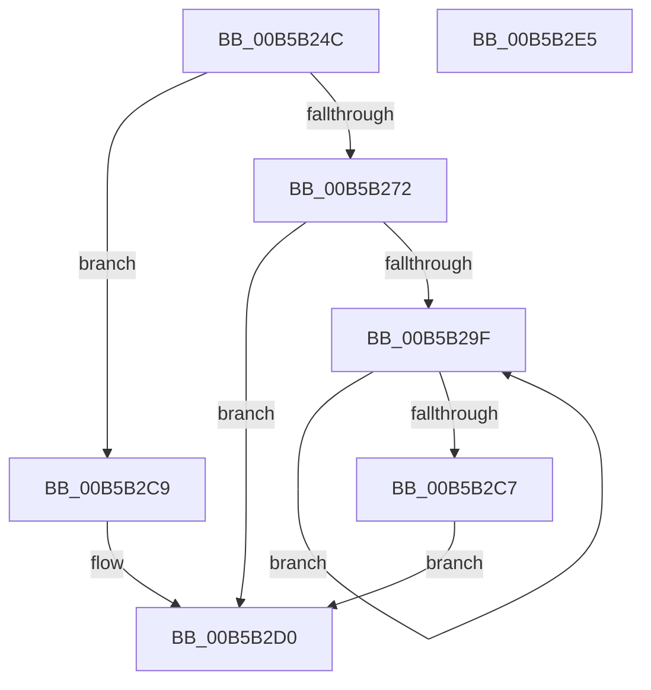

# PopBootLoaderTraceCopyPfnList

- RVA: `0x00B5B24C`–`0x00B5B2E6` (길이 `154` bytes)
- VA: `0x0000000140B5B24C`
- 실행 섹션: `PAGELK`
- PDB 이름 있음: `예`; PDB Function 태그: `아니요`
- unwind 정보 RVA: `0x00066400`
- 디코드: `38`개 명령, `154/154` bytes 표시
- 미해석 바이트: `0` (있으면 어셈블리에 `.byte`로 보존)

> 이 문서는 커널 이미지의 기계어와 PDB 기호를 분석해 생성했습니다. 4번과 5번은 함수 원형과 자료형을 바이너리 사용 방식에서 추정한 C 해석이며 원본 소스 복구 결과는 아닙니다.

## 1. Dependencies

- 직접 호출 지점: **2**; 고유 호출 대상: **2**
- 직접 호출자로 확인된 함수: **1**
- RIP 상대 이미지 참조: **0**

### Outgoing calls
- `0x00B5B28F` → [memcpy](../../text/6C/memcpy_function_006C6840.md) (function, `0x006C6840`)
- `0x00B5B2B8` → [PoSetHiberRange](../../text/47/PoSetHiberRange_function_0047C580.md) (function, `0x0047C580`)

### Direct callers
- [PopBuildMemoryImageHeader](../B6/PopBuildMemoryImageHeader_function_00B6CA20.md) at `0x00B6CBEF`

### Static image references
- 디코드된 RIP-relative 메모리 참조가 없습니다.

## 2. Other-region calls and transfers

- 다른 실행 섹션으로 향하는 call: **2**
  - `0x00B5B28F` → [memcpy](../../text/6C/memcpy_function_006C6840.md) (`PAGELK` → `.text`)
  - `0x00B5B2B8` → [PoSetHiberRange](../../text/47/PoSetHiberRange_function_0047C580.md) (`PAGELK` → `.text`)
- 별도 외부 분기/꼬리 이동을 확인하지 못했습니다.

## 3. Assembly (complete function range)

```asm
00B5B24C  48 89 5C 24 08                  mov qword ptr [rsp + 8], rbx
00B5B251  48 89 6C 24 10                  mov qword ptr [rsp + 0x10], rbp
00B5B256  48 89 74 24 18                  mov qword ptr [rsp + 0x18], rsi
00B5B25B  57                              push rdi
00B5B25C  48 83 EC 30                     sub rsp, 0x30
00B5B260  48 8B B1 E8 00 00 00            mov rsi, qword ptr [rcx + 0xe8]
00B5B267  48 8B FA                        mov rdi, rdx
00B5B26A  48 8B E9                        mov rbp, rcx
00B5B26D  48 85 F6                        test rsi, rsi
00B5B270  74 57                           je 0x140b5b2c9
00B5B272  8B 5E 28                        mov ebx, dword ptr [rsi + 0x28]
00B5B275  48 8D 8A B0 03 00 00            lea rcx, [rdx + 0x3b0]
00B5B27C  48 C1 EB 0C                     shr rbx, 0xc
00B5B280  48 83 C6 30                     add rsi, 0x30
00B5B284  48 8B D6                        mov rdx, rsi
00B5B287  4C 8D 04 DD 00 00 00 00         lea r8, [rbx*8]
00B5B28F  E8 AC B5 B6 FF                  call 0x1406c6840
00B5B294  89 9F AC 03 00 00               mov dword ptr [rdi + 0x3ac], ebx
00B5B29A  48 85 DB                        test rbx, rbx
00B5B29D  74 31                           je 0x140b5b2d0
00B5B29F  4C 8B 06                        mov r8, qword ptr [rsi]
00B5B2A2  41 B9 01 00 00 00               mov r9d, 1
00B5B2A8  BA 00 C0 00 00                  mov edx, 0xc000
00B5B2AD  C7 44 24 20 46 69 4D 64         mov dword ptr [rsp + 0x20], 0x644d6946
00B5B2B5  48 8B CD                        mov rcx, rbp
00B5B2B8  E8 C3 12 92 FF                  call 0x14047c580
00B5B2BD  48 8D 76 08                     lea rsi, [rsi + 8]
00B5B2C1  48 83 EB 01                     sub rbx, 1
00B5B2C5  75 D8                           jne 0x140b5b29f
00B5B2C7  EB 07                           jmp 0x140b5b2d0
00B5B2C9  83 A2 AC 03 00 00 00            and dword ptr [rdx + 0x3ac], 0
00B5B2D0  48 8B 5C 24 40                  mov rbx, qword ptr [rsp + 0x40]
00B5B2D5  48 8B 6C 24 48                  mov rbp, qword ptr [rsp + 0x48]
00B5B2DA  48 8B 74 24 50                  mov rsi, qword ptr [rsp + 0x50]
00B5B2DF  48 83 C4 30                     add rsp, 0x30
00B5B2E3  5F                              pop rdi
00B5B2E4  C3                              ret
00B5B2E5  CC                              int3
```

## 4. C-style interpretation (structured pseudocode)

```c
__int64 __fastcall PopBootLoaderTraceCopyPfnList(__int64 a1, __int64 a2)
{
    __int64 result;
    __int64 v_rbx;
    __int64 v_rsi;
    __int64 v_rsp;
    unsigned int v_stack_m18;
    unsigned __int64 v_stack_p10;
    unsigned __int64 v_stack_p18;
    unsigned __int64 v_stack_p8;

    v_stack_p8 = v_rbx;
    v_stack_p10 = v_rbp;
    v_stack_p18 = v_rsi;
    v_rsp = (v_rsp) - (48);
    if (*(unsigned __int64 *)(a1 + 232) == 0) goto loc_00B5B2C9;
    v_rbx = ((unsigned int)(*(unsigned int *)(*(unsigned __int64 *)(a1 + 232) + 40))) >> (12);
    v_rsi = (*(unsigned __int64 *)(a1 + 232)) + (48);
    result = memcpy(a2 + 944, v_rsi, v_rbx * 8, a4);
    *(unsigned int *)(a2 + 940) = (unsigned int)(v_rbx);
    if (v_rbx == 0) goto loc_00B5B2D0;
loc_00B5B29F:
    v_stack_m18 = 0x644D6946ULL;
    result = PoSetHiberRange(a1, (unsigned int)(0xC000ULL), *(unsigned __int64 *)(v_rsi), 1);
    v_rbx = (v_rbx) - (1);
    if (condition_is_not_equal) goto loc_00B5B29F;
    goto loc_00B5B2D0;
loc_00B5B2C9:
loc_00B5B2D0:
    v_rsp = (v_rsp) + (48);
    return result;
}
```

## 5. (Beta) C Style

```c
int64_t PopBootLoaderTraceCopyPfnList(void *Arg1, void *Arg2)
{
    uint8_t *arg1 = (uint8_t *)Arg1;
    uint8_t *arg2 = (uint8_t *)Arg2;

    int64_t result;
    int64_t local_rbx;
    int64_t local_rsi;
    int64_t local_rsp;
    uint32_t v_stack_m18;
    uint64_t v_stack_p10;
    uint64_t v_stack_p18;
    uint64_t v_stack_p8;

    v_stack_p8 = local_rbx;
    v_stack_p10 = local_rbp;
    v_stack_p18 = local_rsi;
    local_rsp = (local_rsp) - (48);
    if (*(uint64_t *)(arg1 + 0xE8) == 0) goto loc_00B5B2C9;
    local_rbx = ((uint32_t)(*(uint32_t *)(*(uint64_t *)(arg1 + 0xE8) + 0x28))) >> (12);
    local_rsi = (*(uint64_t *)(arg1 + 0xE8)) + (48);
    result = memcpy(Arg2 + 944, local_rsi, local_rbx * 8, a4);
    *(uint32_t *)(arg2 + 0x3AC) = (uint32_t)(local_rbx);
    if (local_rbx == 0) goto loc_00B5B2D0;
loc_00B5B29F:
    v_stack_m18 = 0x644D6946ULL;
    result = PoSetHiberRange(Arg1, (uint32_t)(0xC000ULL), *(uint64_t *)(local_rsi), 1);
    local_rbx = (local_rbx) - (1);
    if (condition_is_not_equal) goto loc_00B5B29F;
    goto loc_00B5B2D0;
loc_00B5B2C9:
loc_00B5B2D0:
    local_rsp = (local_rsp) + (48);
    return result;
}
```

### 관측된 메모리 오프셋

구조체 형식이 확인되지 않은 접근은 인자 기준의 오프셋으로만 기록했습니다.

| 기준 인자 | 오프셋 표현 | 폭 (bit) | 접근 |
|---|---:|---:|---|
| `Arg1` | `+ 0xE8` | `64` | `R` |
| `Arg2` | `+ 0x3AC` | `32` | `R/W` |
| `Arg2` | `+ 0x3AC` | `32` | `W` |
| `Arg2` | `+ 0x3B0` | `64` | `R` |

## 6. Execution-region graph

[열기: 2D/3D 그래프와 함수 탐색 컨트롤 패널](../../../control-panel.html?section=pagelk&rva=0x00B5B24C&view=graph)

- 2D 그래프는 위에서 아래로 흐르고, 3D 그래프는 빈 공간을 드래그해 회전합니다. Shift+드래그는 이동, 휠은 확대·축소, 함수 노드 선택은 대상 보고서 이동입니다.

### Static fallback


