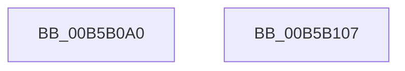

# PopTransitionSystemPowerState

- RVA: `0x00B5B0A0`–`0x00B5B108` (길이 `104` bytes)
- VA: `0x0000000140B5B0A0`
- 실행 섹션: `PAGELK`
- PDB 이름 있음: `예`; PDB Function 태그: `아니요`
- unwind 정보 RVA: `0x000BF878`
- 디코드: `28`개 명령, `104/104` bytes 표시
- 미해석 바이트: `0` (있으면 어셈블리에 `.byte`로 보존)

> 이 문서는 커널 이미지의 기계어와 PDB 기호를 분석해 생성했습니다. 4번과 5번은 함수 원형과 자료형을 바이너리 사용 방식에서 추정한 C 해석이며 원본 소스 복구 결과는 아닙니다.

## 1. Dependencies

- 직접 호출 지점: **3**; 고유 호출 대상: **3**
- 직접 호출자로 확인된 함수: **1**
- RIP 상대 이미지 참조: **1**

### Outgoing calls
- `0x00B5B0D1` → [memset](../../text/6C/memset_function_006C6C40.md) (function, `0x006C6C40`)
- `0x00B5B0E7` → [PopTransitionSystemPowerStateEx](../B7/PopTransitionSystemPowerStateEx_function_00B7E8C0.md) (function, `0x00B7E8C0`)
- `0x00B5B0F7` → [_security_check_cookie](../../text/6A/_security_check_cookie_function_006AC640.md) (function, `0x006AC640`)

### Direct callers
- [PopIssueActionRequest](../../page/A9/PopIssueActionRequest_function_00A9CE54.md) at `0x00A9D0B9`
- [PopIssueActionRequest](../../page/A9/PopIssueActionRequest_function_00A9CE54.md) at `0x00A9D18E`

### Static image references
- `0x00B5B0AB` → RVA `0x00E0A740` (`.data`; read)

## 2. Other-region calls and transfers

- 다른 실행 섹션으로 향하는 call: **2**
  - `0x00B5B0D1` → [memset](../../text/6C/memset_function_006C6C40.md) (`PAGELK` → `.text`)
  - `0x00B5B0F7` → [_security_check_cookie](../../text/6A/_security_check_cookie_function_006AC640.md) (`PAGELK` → `.text`)
- 별도 외부 분기/꼬리 이동을 확인하지 못했습니다.

## 3. Assembly (complete function range)

```asm
00B5B0A0  40 53                           push rbx
00B5B0A2  56                              push rsi
00B5B0A3  57                              push rdi
00B5B0A4  48 81 EC 90 01 00 00            sub rsp, 0x190
00B5B0AB  48 8B 05 8E F6 2A 00            mov rax, qword ptr [rip + 0x2af68e]
00B5B0B2  48 33 C4                        xor rax, rsp
00B5B0B5  48 89 84 24 80 01 00 00         mov qword ptr [rsp + 0x180], rax
00B5B0BD  41 8B F0                        mov esi, r8d
00B5B0C0  8B FA                           mov edi, edx
00B5B0C2  8B D9                           mov ebx, ecx
00B5B0C4  33 D2                           xor edx, edx
00B5B0C6  41 B8 4C 01 00 00               mov r8d, 0x14c
00B5B0CC  48 8D 4C 24 2C                  lea rcx, [rsp + 0x2c]
00B5B0D1  E8 6A BB B6 FF                  call 0x1406c6c40
00B5B0D6  48 8D 4C 24 20                  lea rcx, [rsp + 0x20]
00B5B0DB  89 5C 24 20                     mov dword ptr [rsp + 0x20], ebx
00B5B0DF  89 7C 24 24                     mov dword ptr [rsp + 0x24], edi
00B5B0E3  89 74 24 28                     mov dword ptr [rsp + 0x28], esi
00B5B0E7  E8 D4 37 02 00                  call 0x140b7e8c0
00B5B0EC  48 8B 8C 24 80 01 00 00         mov rcx, qword ptr [rsp + 0x180]
00B5B0F4  48 33 CC                        xor rcx, rsp
00B5B0F7  E8 44 15 B5 FF                  call 0x1406ac640
00B5B0FC  48 81 C4 90 01 00 00            add rsp, 0x190
00B5B103  5F                              pop rdi
00B5B104  5E                              pop rsi
00B5B105  5B                              pop rbx
00B5B106  C3                              ret
00B5B107  CC                              int3
```

## 4. C-style interpretation (structured pseudocode)

```c
__int64 __fastcall PopTransitionSystemPowerState(int a1, int a2, int a3)
{
    __int64 result;
    __int64 v_rsp;
    unsigned __int64 v_stack_m17C;
    unsigned int v_stack_m180;
    unsigned int v_stack_m184;
    unsigned __int64 v_stack_m188;
    unsigned __int64 v_stack_m28;

    v_rsp = (v_rsp) - (400);
    result = (*(unsigned __int64 *)(v_rip + 2815630)) ^ (v_rsp);
    v_stack_m28 = result;
    a2 = 0;
    result = memset(v_stack_m17C, a2, 332, a4);
    v_stack_m188 = (unsigned int)((unsigned int)(a1));
    v_stack_m184 = (unsigned int)((unsigned int)(a2));
    v_stack_m180 = (unsigned int)((unsigned int)(a3));
    result = PopTransitionSystemPowerStateEx(v_stack_m188, a2, 332, a4);
    a1 = (v_stack_m28) ^ (v_rsp);
    result = _security_check_cookie(a1, a2, 332, a4);
    v_rsp = (v_rsp) + (400);
    return result;
}
```

## 5. (Beta) C Style

```c
int64_t PopTransitionSystemPowerState(int32_t Arg1, int32_t Arg2, int32_t Arg3)
{
    int64_t result;
    int64_t local_rsp;
    uint64_t v_stack_m17C;
    uint32_t v_stack_m180;
    uint32_t v_stack_m184;
    uint64_t v_stack_m188;
    uint64_t v_stack_m28;

    local_rsp = (local_rsp) - (400);
    result = (*(uint64_t *)(v_rip + 0x2AF68E)) ^ (local_rsp);
    v_stack_m28 = result;
    Arg2 = 0;
    result = memset(v_stack_m17C, Arg2, 332, a4);
    v_stack_m188 = (uint32_t)((uint32_t)(Arg1));
    v_stack_m184 = (uint32_t)((uint32_t)(Arg2));
    v_stack_m180 = (uint32_t)((uint32_t)(Arg3));
    result = PopTransitionSystemPowerStateEx(v_stack_m188, Arg2, 332, a4);
    Arg1 = (v_stack_m28) ^ (local_rsp);
    result = _security_check_cookie(Arg1, Arg2, 332, a4);
    local_rsp = (local_rsp) + (400);
    return result;
}
```

## 6. Execution-region graph

[열기: 2D/3D 그래프와 함수 탐색 컨트롤 패널](../../../control-panel.html?section=pagelk&rva=0x00B5B0A0&view=graph)

- 2D 그래프는 위에서 아래로 흐르고, 3D 그래프는 빈 공간을 드래그해 회전합니다. Shift+드래그는 이동, 휠은 확대·축소, 함수 노드 선택은 대상 보고서 이동입니다.

### Static fallback


