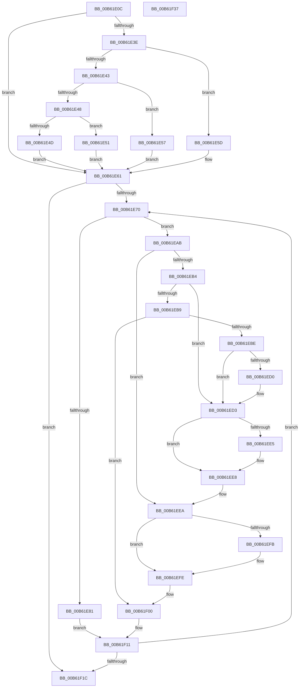

# Amd64RestartProfilingInternal

- RVA: `0x00B61E0C`–`0x00B61F38` (길이 `300` bytes)
- VA: `0x0000000140B61E0C`
- 실행 섹션: `PAGELK`
- PDB 이름 있음: `예`; PDB Function 태그: `아니요`
- unwind 정보 RVA: `0x0005D7BC`
- 디코드: `88`개 명령, `300/300` bytes 표시
- 미해석 바이트: `0` (있으면 어셈블리에 `.byte`로 보존)

> 이 문서는 커널 이미지의 기계어와 PDB 기호를 분석해 생성했습니다. 4번과 5번은 함수 원형과 자료형을 바이너리 사용 방식에서 추정한 C 해석이며 원본 소스 복구 결과는 아닙니다.

## 1. Dependencies

- 직접 호출 지점: **1**; 고유 호출 대상: **1**
- 직접 호출자로 확인된 함수: **1**
- RIP 상대 이미지 참조: **1**

### Outgoing calls
- `0x00B61EA4` → [Amd64ConfigureCounter](../../text/56/Amd64ConfigureCounter_function_0056BE58.md) (function, `0x0056BE58`)

### Direct callers
- [Amd64RestartProfiling](Amd64RestartProfiling_function_00B61DD0.md) at `0x00B61DE2`
- [Amd64RestartProfiling](Amd64RestartProfiling_function_00B61DD0.md) at `0x00B61DEE`
- [Amd64RestartProfiling](Amd64RestartProfiling_function_00B61DD0.md) at `0x00B61DFA`

### Static image references
- `0x00B61E27` → RVA `0x00000000` (`image boundary/outside`; read)

## 2. Other-region calls and transfers

- 다른 실행 섹션으로 향하는 call: **1**
  - `0x00B61EA4` → [Amd64ConfigureCounter](../../text/56/Amd64ConfigureCounter_function_0056BE58.md) (`PAGELK` → `.text`)
- 별도 외부 분기/꼬리 이동을 확인하지 못했습니다.

## 3. Assembly (complete function range)

```asm
00B61E0C  48 8B C4                        mov rax, rsp
00B61E0F  48 89 58 08                     mov qword ptr [rax + 8], rbx
00B61E13  48 89 68 10                     mov qword ptr [rax + 0x10], rbp
00B61E17  48 89 70 18                     mov qword ptr [rax + 0x18], rsi
00B61E1B  48 89 78 20                     mov qword ptr [rax + 0x20], rdi
00B61E1F  41 56                           push r14
00B61E21  48 83 EC 30                     sub rsp, 0x30
00B61E25  8B F2                           mov esi, edx
00B61E27  4C 8D 35 D2 E1 49 FF            lea r14, [rip - 0xb61e2e]
00B61E2E  49 8B 84 F6 40 8C FC 00         mov rax, qword ptr [r14 + rsi*8 + 0xfc8c40]
00B61E36  48 8B 58 58                     mov rbx, qword ptr [rax + 0x58]
00B61E3A  85 C9                           test ecx, ecx
00B61E3C  74 23                           je 0x140b61e61
00B61E3E  83 E9 01                        sub ecx, 1
00B61E41  74 1A                           je 0x140b61e5d
00B61E43  83 E9 63                        sub ecx, 0x63
00B61E46  74 0F                           je 0x140b61e57
00B61E48  83 F9 01                        cmp ecx, 1
00B61E4B  74 04                           je 0x140b61e51
00B61E4D  33 DB                           xor ebx, ebx
00B61E4F  EB 10                           jmp 0x140b61e61
00B61E51  48 83 C3 48                     add rbx, 0x48
00B61E55  EB 0A                           jmp 0x140b61e61
00B61E57  48 83 C3 30                     add rbx, 0x30
00B61E5B  EB 04                           jmp 0x140b61e61
00B61E5D  48 83 C3 18                     add rbx, 0x18
00B61E61  48 8B 6B 10                     mov rbp, qword ptr [rbx + 0x10]
00B61E65  33 FF                           xor edi, edi
00B61E67  39 7B 04                        cmp dword ptr [rbx + 4], edi
00B61E6A  0F 86 AC 00 00 00               jbe 0x140b61f1c
00B61E70  4C 8D 0C 7F                     lea r9, [rdi + rdi*2]
00B61E74  4D 03 C9                        add r9, r9
00B61E77  42 8B 44 CD 18                  mov eax, dword ptr [rbp + r9*8 + 0x18]
00B61E7C  83 F8 02                        cmp eax, 2
00B61E7F  7D 2A                           jge 0x140b61eab
00B61E81  4A 8B 4C CD 10                  mov rcx, qword ptr [rbp + r9*8 + 0x10]
00B61E86  83 F8 01                        cmp eax, 1
00B61E89  4E 8B 4C CD 00                  mov r9, qword ptr [rbp + r9*8]
00B61E8E  41 B0 01                        mov r8b, 1
00B61E91  8B 13                           mov edx, dword ptr [rbx]
00B61E93  0F 95 C0                        setne al
00B61E96  88 44 24 28                     mov byte ptr [rsp + 0x28], al
00B61E9A  48 8B 01                        mov rax, qword ptr [rcx]
00B61E9D  8B CF                           mov ecx, edi
00B61E9F  48 89 44 24 20                  mov qword ptr [rsp + 0x20], rax
00B61EA4  E8 AF 9F A0 FF                  call 0x14056be58
00B61EA9  EB 66                           jmp 0x140b61f11
00B61EAB  8B 0B                           mov ecx, dword ptr [rbx]
00B61EAD  33 D2                           xor edx, edx
00B61EAF  83 E9 01                        sub ecx, 1
00B61EB2  74 36                           je 0x140b61eea
00B61EB4  83 E9 63                        sub ecx, 0x63
00B61EB7  74 1A                           je 0x140b61ed3
00B61EB9  83 F9 01                        cmp ecx, 1
00B61EBC  75 42                           jne 0x140b61f00
00B61EBE  49 8B 84 F6 40 8C FC 00         mov rax, qword ptr [r14 + rsi*8 + 0xfc8c40]
00B61EC6  48 8B 50 58                     mov rdx, qword ptr [rax + 0x58]
00B61ECA  48 83 C2 30                     add rdx, 0x30
00B61ECE  74 03                           je 0x140b61ed3
00B61ED0  8B 52 04                        mov edx, dword ptr [rdx + 4]
00B61ED3  49 8B 84 F6 40 8C FC 00         mov rax, qword ptr [r14 + rsi*8 + 0xfc8c40]
00B61EDB  48 8B 40 58                     mov rax, qword ptr [rax + 0x58]
00B61EDF  48 83 C0 18                     add rax, 0x18
00B61EE3  74 03                           je 0x140b61ee8
00B61EE5  8B 40 04                        mov eax, dword ptr [rax + 4]
00B61EE8  03 D0                           add edx, eax
00B61EEA  49 8B 84 F6 40 8C FC 00         mov rax, qword ptr [r14 + rsi*8 + 0xfc8c40]
00B61EF2  48 8B 40 58                     mov rax, qword ptr [rax + 0x58]
00B61EF6  48 85 C0                        test rax, rax
00B61EF9  74 03                           je 0x140b61efe
00B61EFB  8B 40 04                        mov eax, dword ptr [rax + 4]
00B61EFE  03 D0                           add edx, eax
00B61F00  8D 0C 3A                        lea ecx, [rdx + rdi]
00B61F03  33 C0                           xor eax, eax
00B61F05  41 8B 8C 8E 40 F9 F8 00         mov ecx, dword ptr [r14 + rcx*4 + 0xf8f940]
00B61F0D  33 D2                           xor edx, edx
00B61F0F  0F 30                           wrmsr
00B61F11  FF C7                           inc edi
00B61F13  3B 7B 04                        cmp edi, dword ptr [rbx + 4]
00B61F16  0F 82 54 FF FF FF               jb 0x140b61e70
00B61F1C  48 8B 5C 24 40                  mov rbx, qword ptr [rsp + 0x40]
00B61F21  48 8B 6C 24 48                  mov rbp, qword ptr [rsp + 0x48]
00B61F26  48 8B 74 24 50                  mov rsi, qword ptr [rsp + 0x50]
00B61F2B  48 8B 7C 24 58                  mov rdi, qword ptr [rsp + 0x58]
00B61F30  48 83 C4 30                     add rsp, 0x30
00B61F34  41 5E                           pop r14
00B61F36  C3                              ret
00B61F37  CC                              int3
```

## 4. C-style interpretation (structured pseudocode)

```c
__int64 __fastcall Amd64RestartProfilingInternal(int a1, int a2)
{
    __int64 result;
    __int64 v_rbx;
    __int64 v_rdi;
    __int64 v_rsp;
    unsigned __int8 v_stack_m10;
    unsigned __int64 v_stack_m18;
    unsigned __int64 v_stack_p10;
    unsigned __int64 v_stack_p18;
    unsigned __int64 v_stack_p20;
    unsigned __int64 v_stack_p8;

    *(unsigned __int64 *)(v_rsp + 8) = v_rbx;
    *(unsigned __int64 *)(v_rsp + 16) = v_rbp;
    *(unsigned __int64 *)(v_rsp + 24) = v_rsi;
    *(unsigned __int64 *)(v_rsp + 32) = v_rdi;
    v_rsp = (v_rsp) - (48);
    if (a1 == 0) goto loc_00B61E61;
    a1 = (unsigned int)((a1) - (1));
    if (condition_is_equal) goto loc_00B61E5D;
    a1 = (unsigned int)((a1) - (99));
    if (condition_is_equal) goto loc_00B61E57;
    if (a1 == 1) goto loc_00B61E51;
    v_rbx = 0;
    goto loc_00B61E61;
loc_00B61E51:
    v_rbx = (v_rbx) + (72);
    goto loc_00B61E61;
loc_00B61E57:
    v_rbx = (v_rbx) + (48);
    goto loc_00B61E61;
loc_00B61E5D:
    v_rbx = (v_rbx) + (24);
loc_00B61E61:
    v_rdi = 0;
    if ((*(unsigned int *)(v_rbx + 4)) <= 0) goto loc_00B61F1C;
loc_00B61E70:
    a4 = (v_rdi + v_rdi * 2) + (v_rdi + v_rdi * 2);
    if (((unsigned int)((unsigned int)(*(unsigned int *)(*(unsigned __int64 *)(v_rbx + 16) + a4 * 8 + 24)))) >= 2) goto loc_00B61EAB;
    result = (((unsigned int)((unsigned int)(*(unsigned int *)(*(unsigned __int64 *)(v_rbx + 16) + a4 * 8 + 24)))) != 1) ? 1 : 0;
    v_stack_m10 = (unsigned __int8)(result);
    v_stack_m18 = *(unsigned __int64 *)(*(unsigned __int64 *)(*(unsigned __int64 *)(v_rbx + 16) + a4 * 8 + 16));
    result = Amd64ConfigureCounter(0, (unsigned int)(*(unsigned int *)(v_rbx)), 1, *(unsigned __int64 *)(*(unsigned __int64 *)(v_rbx + 16) + a4 * 8));
    goto loc_00B61F11;
loc_00B61EAB:
    a2 = 0;
    a1 = (unsigned int)(((unsigned int)(*(unsigned int *)(v_rbx))) - (1));
    if (condition_is_equal) goto loc_00B61EEA;
    a1 = (unsigned int)((a1) - (99));
    if (condition_is_equal) goto loc_00B61ED3;
    if (a1 != 1) goto loc_00B61F00;
    a2 = (*(unsigned __int64 *)(*(unsigned __int64 *)(v_rip - 11935278 + (unsigned int)(a2) * 8 + 16550976) + 88)) + (48);
    if (!(condition_is_equal)) {
        a2 = *(unsigned int *)(a2 + 4);
    }
    result = (*(unsigned __int64 *)(*(unsigned __int64 *)(v_rip - 11935278 + (unsigned int)(a2) * 8 + 16550976) + 88)) + (24);
    if (!(condition_is_equal)) {
        result = *(unsigned int *)(result + 4);
    }
    a2 = (unsigned int)((a2) + ((unsigned int)(result)));
loc_00B61EEA:
    result = *(unsigned __int64 *)(*(unsigned __int64 *)(v_rip - 11935278 + (unsigned int)(a2) * 8 + 16550976) + 88);
    if (*(unsigned __int64 *)(*(unsigned __int64 *)(v_rip - 11935278 + (unsigned int)(a2) * 8 + 16550976) + 88) != 0) {
        result = *(unsigned int *)(*(unsigned __int64 *)(*(unsigned __int64 *)(v_rip - 11935278 + (unsigned int)(a2) * 8 + 16550976) + 88) + 4);
    }
    a2 = (unsigned int)((a2) + ((unsigned int)(result)));
loc_00B61F00:
    result = 0;
    a2 = 0;
loc_00B61F11:
    v_rdi = (unsigned int)((v_rdi) + 1);
    if (((unsigned int)(v_rdi)) < (*(unsigned int *)(v_rbx + 4))) goto loc_00B61E70;
loc_00B61F1C:
    v_rsp = (v_rsp) + (48);
    return result;
}
```

## 5. (Beta) C Style

```c
int64_t Amd64RestartProfilingInternal(int32_t Arg1, int32_t Arg2)
{
    int64_t result;
    int64_t local_rbx;
    int64_t local_rdi;
    int64_t local_rsp;
    uint8_t v_stack_m10;
    uint64_t v_stack_m18;
    uint64_t v_stack_p10;
    uint64_t v_stack_p18;
    uint64_t v_stack_p20;
    uint64_t v_stack_p8;

    *(uint64_t *)(local_rsp + 0x8) = local_rbx;
    *(uint64_t *)(local_rsp + 0x10) = local_rbp;
    *(uint64_t *)(local_rsp + 0x18) = local_rsi;
    *(uint64_t *)(local_rsp + 0x20) = local_rdi;
    local_rsp = (local_rsp) - (48);
    if (Arg1 == 0) goto loc_00B61E61;
    Arg1 = (uint32_t)((Arg1) - (1));
    if (condition_is_equal) goto loc_00B61E5D;
    Arg1 = (uint32_t)((Arg1) - (99));
    if (condition_is_equal) goto loc_00B61E57;
    if (Arg1 == 1) goto loc_00B61E51;
    local_rbx = 0;
    goto loc_00B61E61;
loc_00B61E51:
    local_rbx = (local_rbx) + (72);
    goto loc_00B61E61;
loc_00B61E57:
    local_rbx = (local_rbx) + (48);
    goto loc_00B61E61;
loc_00B61E5D:
    local_rbx = (local_rbx) + (24);
loc_00B61E61:
    local_rdi = 0;
    if ((*(uint32_t *)(local_rbx + 0x4)) <= 0) goto loc_00B61F1C;
loc_00B61E70:
    a4 = (local_rdi + local_rdi * 2) + (local_rdi + local_rdi * 2);
    if (((uint32_t)((uint32_t)(*(uint32_t *)(*(uint64_t *)(local_rbx + 0x10) + a4 * 8 + 0x18)))) >= 2) goto loc_00B61EAB;
    result = (((uint32_t)((uint32_t)(*(uint32_t *)(*(uint64_t *)(local_rbx + 0x10) + a4 * 8 + 0x18)))) != 1) ? 1 : 0;
    v_stack_m10 = (uint8_t)(result);
    v_stack_m18 = *(uint64_t *)(*(uint64_t *)(*(uint64_t *)(local_rbx + 0x10) + a4 * 8 + 0x10));
    result = Amd64ConfigureCounter(0, (uint32_t)(*(uint32_t *)(local_rbx)), 1, *(uint64_t *)(*(uint64_t *)(local_rbx + 0x10) + a4 * 8));
    goto loc_00B61F11;
loc_00B61EAB:
    Arg2 = 0;
    Arg1 = (uint32_t)(((uint32_t)(*(uint32_t *)(local_rbx))) - (1));
    if (condition_is_equal) goto loc_00B61EEA;
    Arg1 = (uint32_t)((Arg1) - (99));
    if (condition_is_equal) goto loc_00B61ED3;
    if (Arg1 != 1) goto loc_00B61F00;
    Arg2 = (*(uint64_t *)(*(uint64_t *)(v_rip - 0xB61E2E + (uint32_t)(Arg2) * 8 + 0xFC8C40) + 0x58)) + (48);
    if (!(condition_is_equal)) {
        Arg2 = *(uint32_t *)(Arg2 + 0x4);
    }
    result = (*(uint64_t *)(*(uint64_t *)(v_rip - 0xB61E2E + (uint32_t)(Arg2) * 8 + 0xFC8C40) + 0x58)) + (24);
    if (!(condition_is_equal)) {
        result = *(uint32_t *)(result + 0x4);
    }
    Arg2 = (uint32_t)((Arg2) + ((uint32_t)(result)));
loc_00B61EEA:
    result = *(uint64_t *)(*(uint64_t *)(v_rip - 0xB61E2E + (uint32_t)(Arg2) * 8 + 0xFC8C40) + 0x58);
    if (*(uint64_t *)(*(uint64_t *)(v_rip - 0xB61E2E + (uint32_t)(Arg2) * 8 + 0xFC8C40) + 0x58) != 0) {
        result = *(uint32_t *)(*(uint64_t *)(*(uint64_t *)(v_rip - 0xB61E2E + (uint32_t)(Arg2) * 8 + 0xFC8C40) + 0x58) + 0x4);
    }
    Arg2 = (uint32_t)((Arg2) + ((uint32_t)(result)));
loc_00B61F00:
    result = 0;
    Arg2 = 0;
loc_00B61F11:
    local_rdi = (uint32_t)((local_rdi) + 1);
    if (((uint32_t)(local_rdi)) < (*(uint32_t *)(local_rbx + 0x4))) goto loc_00B61E70;
loc_00B61F1C:
    local_rsp = (local_rsp) + (48);
    return result;
}
```

## 6. Execution-region graph

[열기: 2D/3D 그래프와 함수 탐색 컨트롤 패널](../../../control-panel.html?section=pagelk&rva=0x00B61E0C&view=graph)

- 2D 그래프는 위에서 아래로 흐르고, 3D 그래프는 빈 공간을 드래그해 회전합니다. Shift+드래그는 이동, 휠은 확대·축소, 함수 노드 선택은 대상 보고서 이동입니다.

### Static fallback


