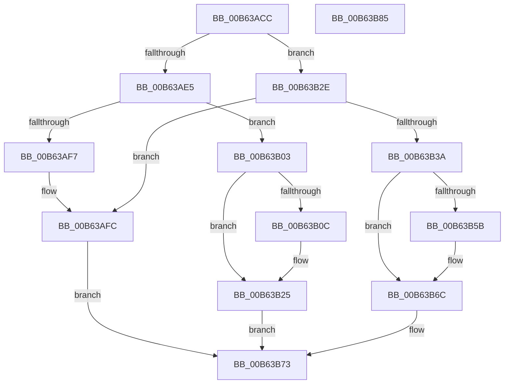

# BgkResumePrepare

- RVA: `0x00B63ACC`–`0x00B63B86` (길이 `186` bytes)
- VA: `0x0000000140B63ACC`
- 실행 섹션: `PAGELK`
- PDB 이름 있음: `예`; PDB Function 태그: `아니요`
- unwind 정보 RVA: `0x000794E0`
- 디코드: `53`개 명령, `186/186` bytes 표시
- 미해석 바이트: `0` (있으면 어셈블리에 `.byte`로 보존)

> 이 문서는 커널 이미지의 기계어와 PDB 기호를 분석해 생성했습니다. 4번과 5번은 함수 원형과 자료형을 바이너리 사용 방식에서 추정한 C 해석이며 원본 소스 복구 결과는 아닙니다.

## 1. Dependencies

- 직접 호출 지점: **7**; 고유 호출 대상: **5**
- 직접 호출자로 확인된 함수: **2**
- RIP 상대 이미지 참조: **2**

### Outgoing calls
- `0x00B63AE5` → [BgkpLockBgfxCodeSection](../../pagebgfx/BC/BgkpLockBgfxCodeSection_function_00BC04F0.md) (function, `0x00BC04F0`)
- `0x00B63AEA` → [BgGetContext](../../pagebgfx/BC/BgGetContext_function_00BC06A8.md) (function, `0x00BC06A8`)
- `0x00B63AF7` → [BgkpUnlockBgfxCodeSection](../../pagebgfx/BC/BgkpUnlockBgfxCodeSection_function_00BC4910.md) (function, `0x00BC4910`)
- `0x00B63B20` → [PoSetHiberRange](../../text/47/PoSetHiberRange_function_0047C580.md) (function, `0x0047C580`)
- `0x00B63B4D` → [PoSetHiberRange](../../text/47/PoSetHiberRange_function_0047C580.md) (function, `0x0047C580`)
- `0x00B63B67` → [PoSetHiberRange](../../text/47/PoSetHiberRange_function_0047C580.md) (function, `0x0047C580`)
- `0x00B63B6C` → [BgMarkHiberPhase](../../pagebgfx/BC/BgMarkHiberPhase_function_00BC078C.md) (function, `0x00BC078C`)

### Direct callers
- [PopAllocateHiberContext](../../page/AD/PopAllocateHiberContext_function_00ADC05C.md) at `0x00ADC68E`
- [PopMarkComponentsBootPhase](PopMarkComponentsBootPhase_function_00B6E0E4.md) at `0x00B6E272`

### Static image references
- `0x00B63B25` → RVA `0x00E65E90` (`.data`; write)
- `0x00B63B2E` → RVA `0x00E65E90` (`.data`; read)

## 2. Other-region calls and transfers

- 다른 실행 섹션으로 향하는 call: **7**
  - `0x00B63AE5` → [BgkpLockBgfxCodeSection](../../pagebgfx/BC/BgkpLockBgfxCodeSection_function_00BC04F0.md) (`PAGELK` → `PAGEBGFX`)
  - `0x00B63AEA` → [BgGetContext](../../pagebgfx/BC/BgGetContext_function_00BC06A8.md) (`PAGELK` → `PAGEBGFX`)
  - `0x00B63AF7` → [BgkpUnlockBgfxCodeSection](../../pagebgfx/BC/BgkpUnlockBgfxCodeSection_function_00BC4910.md) (`PAGELK` → `PAGEBGFX`)
  - `0x00B63B20` → [PoSetHiberRange](../../text/47/PoSetHiberRange_function_0047C580.md) (`PAGELK` → `.text`)
  - `0x00B63B4D` → [PoSetHiberRange](../../text/47/PoSetHiberRange_function_0047C580.md) (`PAGELK` → `.text`)
  - `0x00B63B67` → [PoSetHiberRange](../../text/47/PoSetHiberRange_function_0047C580.md) (`PAGELK` → `.text`)
  - `0x00B63B6C` → [BgMarkHiberPhase](../../pagebgfx/BC/BgMarkHiberPhase_function_00BC078C.md) (`PAGELK` → `PAGEBGFX`)
- 별도 외부 분기/꼬리 이동을 확인하지 못했습니다.

## 3. Assembly (complete function range)

```asm
00B63ACC  48 89 5C 24 08                  mov qword ptr [rsp + 8], rbx
00B63AD1  48 89 74 24 10                  mov qword ptr [rsp + 0x10], rsi
00B63AD6  57                              push rdi
00B63AD7  48 83 EC 30                     sub rsp, 0x30
00B63ADB  33 DB                           xor ebx, ebx
00B63ADD  48 8B F1                        mov rsi, rcx
00B63AE0  48 85 C9                        test rcx, rcx
00B63AE3  74 49                           je 0x140b63b2e
00B63AE5  E8 06 CA 05 00                  call 0x140bc04f0
00B63AEA  E8 B9 CB 05 00                  call 0x140bc06a8
00B63AEF  48 8B F8                        mov rdi, rax
00B63AF2  48 85 C0                        test rax, rax
00B63AF5  75 0C                           jne 0x140b63b03
00B63AF7  E8 14 0E 06 00                  call 0x140bc4910
00B63AFC  BB 9A 00 00 C0                  mov ebx, 0xc000009a
00B63B01  EB 70                           jmp 0x140b63b73
00B63B03  4C 8B 40 10                     mov r8, qword ptr [rax + 0x10]
00B63B07  4D 85 C0                        test r8, r8
00B63B0A  74 19                           je 0x140b63b25
00B63B0C  44 8B 48 18                     mov r9d, dword ptr [rax + 0x18]
00B63B10  BA 00 80 00 00                  mov edx, 0x8000
00B63B15  48 8B CE                        mov rcx, rsi
00B63B18  C7 44 24 20 42 47 49 4B         mov dword ptr [rsp + 0x20], 0x4b494742
00B63B20  E8 5B 8A 91 FF                  call 0x14047c580
00B63B25  48 89 3D 64 23 30 00            mov qword ptr [rip + 0x302364], rdi
00B63B2C  EB 45                           jmp 0x140b63b73
00B63B2E  48 8B 3D 5B 23 30 00            mov rdi, qword ptr [rip + 0x30235b]
00B63B35  48 85 FF                        test rdi, rdi
00B63B38  74 C2                           je 0x140b63afc
00B63B3A  44 8B 0F                        mov r9d, dword ptr [rdi]
00B63B3D  BE 00 00 01 00                  mov esi, 0x10000
00B63B42  8B D6                           mov edx, esi
00B63B44  89 5C 24 20                     mov dword ptr [rsp + 0x20], ebx
00B63B48  4C 8B C7                        mov r8, rdi
00B63B4B  33 C9                           xor ecx, ecx
00B63B4D  E8 2E 8A 91 FF                  call 0x14047c580
00B63B52  4C 8B 47 10                     mov r8, qword ptr [rdi + 0x10]
00B63B56  4D 85 C0                        test r8, r8
00B63B59  74 11                           je 0x140b63b6c
00B63B5B  44 8B 4F 18                     mov r9d, dword ptr [rdi + 0x18]
00B63B5F  8B D6                           mov edx, esi
00B63B61  33 C9                           xor ecx, ecx
00B63B63  89 5C 24 20                     mov dword ptr [rsp + 0x20], ebx
00B63B67  E8 14 8A 91 FF                  call 0x14047c580
00B63B6C  E8 1B CC 05 00                  call 0x140bc078c
00B63B71  8B D8                           mov ebx, eax
00B63B73  48 8B 74 24 48                  mov rsi, qword ptr [rsp + 0x48]
00B63B78  8B C3                           mov eax, ebx
00B63B7A  48 8B 5C 24 40                  mov rbx, qword ptr [rsp + 0x40]
00B63B7F  48 83 C4 30                     add rsp, 0x30
00B63B83  5F                              pop rdi
00B63B84  C3                              ret
00B63B85  CC                              int3
```

## 4. C-style interpretation (structured pseudocode)

```c
__int64 __fastcall BgkResumePrepare(__int64 a1)
{
    __int64 result;
    __int64 v_rbx;
    __int64 v_rsp;
    unsigned int v_stack_m18;
    unsigned __int64 v_stack_p10;
    unsigned __int64 v_stack_p8;

    v_stack_p8 = v_rbx;
    v_stack_p10 = v_rsi;
    v_rsp = (v_rsp) - (48);
    v_rbx = 0;
    if (a1 == 0) goto loc_00B63B2E;
    result = BgkpLockBgfxCodeSection(a1, a2, a3, a4);
    result = BgGetContext(a1, a2, a3, a4);
    if (result != 0) goto loc_00B63B03;
    result = BgkpUnlockBgfxCodeSection(a1, a2, a3, a4);
loc_00B63AFC:
    goto loc_00B63B73;
loc_00B63B03:
    if (*(unsigned __int64 *)(result + 16) != 0) {
        a4 = *(unsigned int *)(result + 24);
        a2 = 0x8000ULL;
        a1 = a1;
        v_stack_m18 = 0x4B494742ULL;
        result = PoSetHiberRange(a1, a2, *(unsigned __int64 *)(result + 16), a4);
    }
    *(unsigned __int64 *)(v_rip + 3154788) = result;
    goto loc_00B63B73;
loc_00B63B2E:
    if (*(unsigned __int64 *)(v_rip + 3154779) == 0) goto loc_00B63AFC;
    v_stack_m18 = (unsigned int)((unsigned int)(0xC000009AULL));
    a1 = 0;
    result = PoSetHiberRange(a1, (unsigned int)((unsigned int)((unsigned int)(0x10000ULL))), *(unsigned __int64 *)(v_rip + 3154779), (unsigned int)(*(unsigned int *)(*(unsigned __int64 *)(v_rip + 3154779))));
    if (*(unsigned __int64 *)(*(unsigned __int64 *)(v_rip + 3154779) + 16) != 0) {
        a4 = *(unsigned int *)(*(unsigned __int64 *)(v_rip + 3154779) + 24);
        a2 = (unsigned int)((unsigned int)(0x10000ULL));
        a1 = 0;
        v_stack_m18 = (unsigned int)((unsigned int)(0xC000009AULL));
        result = PoSetHiberRange(a1, a2, *(unsigned __int64 *)(*(unsigned __int64 *)(v_rip + 3154779) + 16), a4);
    }
    result = BgMarkHiberPhase(a1, a2, *(unsigned __int64 *)(*(unsigned __int64 *)(v_rip + 3154779) + 16), a4);
loc_00B63B73:
    v_rsp = (v_rsp) + (48);
    return (unsigned int)((unsigned int)((unsigned int)((unsigned int)(result))));
}
```

## 5. (Beta) C Style

```c
int64_t BgkResumePrepare(int64_t Arg1)
{
    int64_t result;
    int64_t local_rbx;
    int64_t local_rsp;
    uint32_t v_stack_m18;
    uint64_t v_stack_p10;
    uint64_t v_stack_p8;

    v_stack_p8 = local_rbx;
    v_stack_p10 = local_rsi;
    local_rsp = (local_rsp) - (48);
    local_rbx = 0;
    if (Arg1 == 0) goto loc_00B63B2E;
    result = BgkpLockBgfxCodeSection(Arg1, a2, a3, a4);
    result = BgGetContext(Arg1, a2, a3, a4);
    if (result != 0) goto loc_00B63B03;
    result = BgkpUnlockBgfxCodeSection(Arg1, a2, a3, a4);
loc_00B63AFC:
    goto loc_00B63B73;
loc_00B63B03:
    if (*(uint64_t *)(result + 0x10) != 0) {
        a4 = *(uint32_t *)(result + 0x18);
        a2 = 0x8000ULL;
        Arg1 = Arg1;
        v_stack_m18 = 0x4B494742ULL;
        result = PoSetHiberRange(Arg1, a2, *(uint64_t *)(result + 0x10), a4);
    }
    *(uint64_t *)(v_rip + 0x302364) = result;
    goto loc_00B63B73;
loc_00B63B2E:
    if (*(uint64_t *)(v_rip + 0x30235B) == 0) goto loc_00B63AFC;
    v_stack_m18 = (uint32_t)((uint32_t)(0xC000009AULL));
    Arg1 = 0;
    result = PoSetHiberRange(Arg1, (uint32_t)((uint32_t)((uint32_t)(0x10000ULL))), *(uint64_t *)(v_rip + 0x30235B), (uint32_t)(*(uint32_t *)(*(uint64_t *)(v_rip + 0x30235B))));
    if (*(uint64_t *)(*(uint64_t *)(v_rip + 0x30235B) + 0x10) != 0) {
        a4 = *(uint32_t *)(*(uint64_t *)(v_rip + 0x30235B) + 0x18);
        a2 = (uint32_t)((uint32_t)(0x10000ULL));
        Arg1 = 0;
        v_stack_m18 = (uint32_t)((uint32_t)(0xC000009AULL));
        result = PoSetHiberRange(Arg1, a2, *(uint64_t *)(*(uint64_t *)(v_rip + 0x30235B) + 0x10), a4);
    }
    result = BgMarkHiberPhase(Arg1, a2, *(uint64_t *)(*(uint64_t *)(v_rip + 0x30235B) + 0x10), a4);
loc_00B63B73:
    local_rsp = (local_rsp) + (48);
    return (uint32_t)((uint32_t)((uint32_t)((uint32_t)(result))));
}
```

## 6. Execution-region graph

[열기: 2D/3D 그래프와 함수 탐색 컨트롤 패널](../../../control-panel.html?section=pagelk&rva=0x00B63ACC&view=graph)

- 2D 그래프는 위에서 아래로 흐르고, 3D 그래프는 빈 공간을 드래그해 회전합니다. Shift+드래그는 이동, 휠은 확대·축소, 함수 노드 선택은 대상 보고서 이동입니다.

### Static fallback


