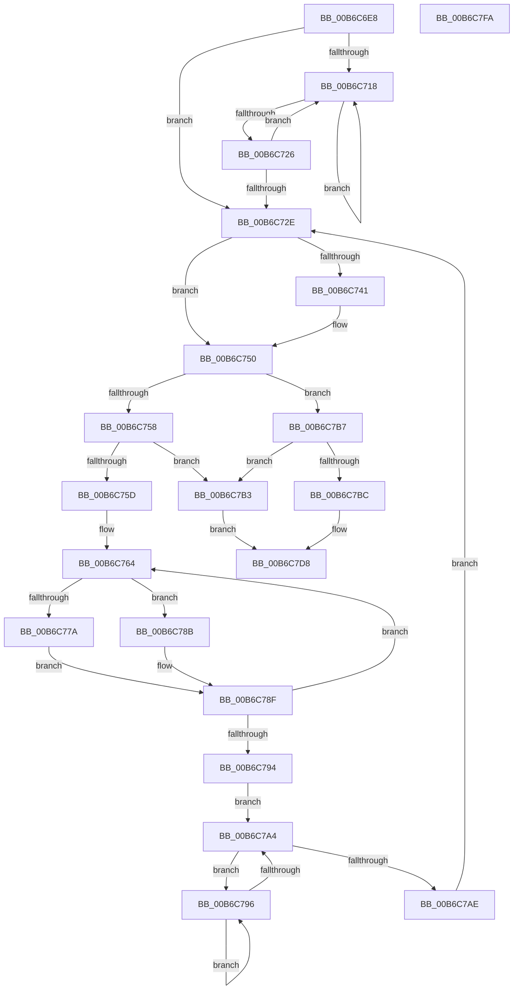

# ConsumerGetBuffer

- RVA: `0x00B6C6E8`–`0x00B6C7FB` (길이 `275` bytes)
- VA: `0x0000000140B6C6E8`
- 실행 섹션: `PAGELK`
- PDB 이름 있음: `예`; PDB Function 태그: `아니요`
- unwind 정보 RVA: `0x0007F3F8`
- 디코드: `88`개 명령, `275/275` bytes 표시
- 미해석 바이트: `0` (있으면 어셈블리에 `.byte`로 보존)

> 이 문서는 커널 이미지의 기계어와 PDB 기호를 분석해 생성했습니다. 4번과 5번은 함수 원형과 자료형을 바이너리 사용 방식에서 추정한 C 해석이며 원본 소스 복구 결과는 아닙니다.

## 1. Dependencies

- 직접 호출 지점: **3**; 고유 호출 대상: **1**
- 직접 호출자로 확인된 함수: **1**
- RIP 상대 이미지 참조: **0**

### Outgoing calls
- `0x00B6C71A` → [PopHiberCheckForDebugBreak](../B7/PopHiberCheckForDebugBreak_function_00B78258.md) (function, `0x00B78258`)
- `0x00B6C766` → [PopHiberCheckForDebugBreak](../B7/PopHiberCheckForDebugBreak_function_00B78258.md) (function, `0x00B78258`)
- `0x00B6C798` → [PopHiberCheckForDebugBreak](../B7/PopHiberCheckForDebugBreak_function_00B78258.md) (function, `0x00B78258`)

### Direct callers
- [PopRequestWrite](PopRequestWrite_function_00B6EB14.md) at `0x00B6ECDD`

### Static image references
- 디코드된 RIP-relative 메모리 참조가 없습니다.

## 2. Other-region calls and transfers

- 다른 실행 섹션으로 향하는 call: **0**
- 별도 외부 분기/꼬리 이동을 확인하지 못했습니다.

## 3. Assembly (complete function range)

```asm
00B6C6E8  48 8B C4                        mov rax, rsp
00B6C6EB  48 89 58 08                     mov qword ptr [rax + 8], rbx
00B6C6EF  48 89 70 10                     mov qword ptr [rax + 0x10], rsi
00B6C6F3  48 89 78 18                     mov qword ptr [rax + 0x18], rdi
00B6C6F7  4C 89 70 20                     mov qword ptr [rax + 0x20], r14
00B6C6FB  41 57                           push r15
00B6C6FD  48 83 EC 20                     sub rsp, 0x20
00B6C701  33 C0                           xor eax, eax
00B6C703  41 8B D8                        mov ebx, r8d
00B6C706  4C 8B F2                        mov r14, rdx
00B6C709  48 8B F9                        mov rdi, rcx
00B6C70C  44 8D 78 01                     lea r15d, [rax + 1]
00B6C710  F0 44 0F B1 79 18               lock cmpxchg dword ptr [rcx + 0x18], r15d
00B6C716  74 16                           je 0x140b6c72e
00B6C718  F3 90                           pause
00B6C71A  E8 39 BB 00 00                  call 0x140b78258
00B6C71F  8B 47 18                        mov eax, dword ptr [rdi + 0x18]
00B6C722  85 C0                           test eax, eax
00B6C724  75 F2                           jne 0x140b6c718
00B6C726  F0 44 0F B1 7F 18               lock cmpxchg dword ptr [rdi + 0x18], r15d
00B6C72C  75 EA                           jne 0x140b6c718
00B6C72E  8B 57 28                        mov edx, dword ptr [rdi + 0x28]
00B6C731  48 8D 77 20                     lea rsi, [rdi + 0x20]
00B6C735  8B 47 30                        mov eax, dword ptr [rdi + 0x30]
00B6C738  2B D0                           sub edx, eax
00B6C73A  48 83 7F 10 00                  cmp qword ptr [rdi + 0x10], 0
00B6C73F  75 0F                           jne 0x140b6c750
00B6C741  8B 0E                           mov ecx, dword ptr [rsi]
00B6C743  2B C8                           sub ecx, eax
00B6C745  41 8B 06                        mov eax, dword ptr [r14]
00B6C748  3B C1                           cmp eax, ecx
00B6C74A  0F 43 C1                        cmovae eax, ecx
00B6C74D  41 89 06                        mov dword ptr [r14], eax
00B6C750  45 8B 0E                        mov r9d, dword ptr [r14]
00B6C753  44 3B CA                        cmp r9d, edx
00B6C756  76 5F                           jbe 0x140b6c7b7
00B6C758  41 84 DF                        test r15b, bl
00B6C75B  75 56                           jne 0x140b6c7b3
00B6C75D  C7 47 18 00 00 00 00            mov dword ptr [rdi + 0x18], 0
00B6C764  F3 90                           pause
00B6C766  E8 ED BA 00 00                  call 0x140b78258
00B6C76B  8B 57 28                        mov edx, dword ptr [rdi + 0x28]
00B6C76E  8B 47 30                        mov eax, dword ptr [rdi + 0x30]
00B6C771  2B D0                           sub edx, eax
00B6C773  48 83 7F 10 00                  cmp qword ptr [rdi + 0x10], 0
00B6C778  75 11                           jne 0x140b6c78b
00B6C77A  8B 0E                           mov ecx, dword ptr [rsi]
00B6C77C  2B C8                           sub ecx, eax
00B6C77E  41 8B 06                        mov eax, dword ptr [r14]
00B6C781  3B C1                           cmp eax, ecx
00B6C783  0F 43 C1                        cmovae eax, ecx
00B6C786  41 89 06                        mov dword ptr [r14], eax
00B6C789  EB 04                           jmp 0x140b6c78f
00B6C78B  48 8D 77 20                     lea rsi, [rdi + 0x20]
00B6C78F  41 39 16                        cmp dword ptr [r14], edx
00B6C792  77 D0                           ja 0x140b6c764
00B6C794  EB 0E                           jmp 0x140b6c7a4
00B6C796  F3 90                           pause
00B6C798  E8 BB BA 00 00                  call 0x140b78258
00B6C79D  8B 47 18                        mov eax, dword ptr [rdi + 0x18]
00B6C7A0  85 C0                           test eax, eax
00B6C7A2  75 F2                           jne 0x140b6c796
00B6C7A4  33 C0                           xor eax, eax
00B6C7A6  F0 44 0F B1 7F 18               lock cmpxchg dword ptr [rdi + 0x18], r15d
00B6C7AC  75 E8                           jne 0x140b6c796
00B6C7AE  E9 7B FF FF FF                  jmp 0x140b6c72e
00B6C7B3  33 C0                           xor eax, eax
00B6C7B5  EB 21                           jmp 0x140b6c7d8
00B6C7B7  45 85 C9                        test r9d, r9d
00B6C7BA  74 F7                           je 0x140b6c7b3
00B6C7BC  4C 8B 47 30                     mov r8, qword ptr [rdi + 0x30]
00B6C7C0  33 D2                           xor edx, edx
00B6C7C2  8B 4F 08                        mov ecx, dword ptr [rdi + 8]
00B6C7C5  49 8B C0                        mov rax, r8
00B6C7C8  48 F7 F1                        div rcx
00B6C7CB  4B 8D 0C 08                     lea rcx, [r8 + r9]
00B6C7CF  8B C2                           mov eax, edx
00B6C7D1  48 03 07                        add rax, qword ptr [rdi]
00B6C7D4  48 89 4F 30                     mov qword ptr [rdi + 0x30], rcx
00B6C7D8  48 8B 5C 24 30                  mov rbx, qword ptr [rsp + 0x30]
00B6C7DD  48 8B 74 24 38                  mov rsi, qword ptr [rsp + 0x38]
00B6C7E2  4C 8B 74 24 48                  mov r14, qword ptr [rsp + 0x48]
00B6C7E7  C7 47 18 00 00 00 00            mov dword ptr [rdi + 0x18], 0
00B6C7EE  48 8B 7C 24 40                  mov rdi, qword ptr [rsp + 0x40]
00B6C7F3  48 83 C4 20                     add rsp, 0x20
00B6C7F7  41 5F                           pop r15
00B6C7F9  C3                              ret
00B6C7FA  CC                              int3
```

## 4. C-style interpretation (structured pseudocode)

```c
__int64 __fastcall ConsumerGetBuffer(__int64 a1, __int64 a2, int a3)
{
    __int64 result;
    __int64 v_rsp;
    unsigned __int64 v_stack_p10;
    unsigned __int64 v_stack_p18;
    unsigned __int64 v_stack_p20;
    unsigned __int64 v_stack_p8;

    *(unsigned __int64 *)(v_rsp + 8) = v_rbx;
    *(unsigned __int64 *)(v_rsp + 16) = v_rsi;
    *(unsigned __int64 *)(v_rsp + 24) = v_rdi;
    *(unsigned __int64 *)(v_rsp + 32) = v_r14;
    v_rsp = (v_rsp) - (32);
    result = 0;
    if (condition_is_equal) goto loc_00B6C72E;
loc_00B6C718:
    result = PopHiberCheckForDebugBreak(a1, a2, a3, a4);
    if ((unsigned int)((unsigned int)(*(unsigned int *)(a1 + 24))) != 0) goto loc_00B6C718;
    if ((unsigned int)((unsigned int)(*(unsigned int *)(a1 + 24))) != 0) goto loc_00B6C718;
loc_00B6C72E:
    a2 = (unsigned int)(((unsigned int)(*(unsigned int *)(a1 + 40))) - ((unsigned int)((unsigned int)(*(unsigned int *)(a1 + 48)))));
    result = (unsigned int)(*(unsigned int *)(a1 + 48));
    if ((*(unsigned __int64 *)(a1 + 16)) == 0) {
        a1 = *(unsigned int *)(a1 + 32);
        a1 = (unsigned int)((a1) - ((unsigned int)((unsigned int)(*(unsigned int *)(a1 + 48)))));
        result = *(unsigned int *)(a2);
        if (((unsigned int)(result)) >= ((unsigned int)(a1))) { result = (unsigned int)(a1); }
        *(unsigned int *)(a2) = (unsigned int)(result);
    }
    if (((unsigned int)((unsigned int)(*(unsigned int *)(a2)))) <= ((unsigned int)(a2))) goto loc_00B6C7B7;
    if ((((unsigned __int8)(result + 1)) & ((unsigned __int8)((unsigned int)(a3)))) != 0) goto loc_00B6C7B3;
    *(unsigned int *)(a1 + 24) = 0;
loc_00B6C764:
    result = PopHiberCheckForDebugBreak(a1, a2, a3, (unsigned int)(*(unsigned int *)(a2)));
    a2 = (unsigned int)(((unsigned int)(*(unsigned int *)(a1 + 40))) - ((unsigned int)((unsigned int)(*(unsigned int *)(a1 + 48)))));
    if ((*(unsigned __int64 *)(a1 + 16)) != 0) goto loc_00B6C78B;
    a1 = (unsigned int)(((unsigned int)(*(unsigned int *)(a1 + 32))) - ((unsigned int)((unsigned int)(*(unsigned int *)(a1 + 48)))));
    result = (unsigned int)(*(unsigned int *)(a2));
    if (((unsigned int)((unsigned int)(*(unsigned int *)(a2)))) >= ((unsigned int)(a1))) { result = (unsigned int)(a1); }
    *(unsigned int *)(a2) = (unsigned int)(result);
    goto loc_00B6C78F;
loc_00B6C78B:
loc_00B6C78F:
    if ((*(unsigned int *)(a2)) > ((unsigned int)(a2))) goto loc_00B6C764;
    goto loc_00B6C7A4;
loc_00B6C796:
    result = PopHiberCheckForDebugBreak(a1, a2, a3, (unsigned int)(*(unsigned int *)(a2)));
    if ((unsigned int)((unsigned int)(*(unsigned int *)(a1 + 24))) != 0) goto loc_00B6C796;
loc_00B6C7A4:
    result = 0;
    if (condition_is_not_equal) goto loc_00B6C796;
    goto loc_00B6C72E;
loc_00B6C7B3:
    result = 0;
    goto loc_00B6C7D8;
loc_00B6C7B7:
    if ((unsigned int)((unsigned int)(*(unsigned int *)(a2))) == 0) goto loc_00B6C7B3;
    a2 = 0;
    result = (0) + (*(unsigned __int64 *)(a1));
    *(unsigned __int64 *)(a1 + 48) = *(unsigned __int64 *)(a1 + 48) + (unsigned int)(*(unsigned int *)(a2)) * 1;
loc_00B6C7D8:
    *(unsigned int *)(a1 + 24) = 0;
    v_rsp = (v_rsp) + (32);
    return result;
}
```

## 5. (Beta) C Style

```c
int64_t ConsumerGetBuffer(void *Arg1, void *Arg2, int32_t Arg3)
{
    uint8_t *arg1 = (uint8_t *)Arg1;
    uint8_t *arg2 = (uint8_t *)Arg2;

    int64_t result;
    int64_t local_rsp;
    uint64_t v_stack_p10;
    uint64_t v_stack_p18;
    uint64_t v_stack_p20;
    uint64_t v_stack_p8;

    *(uint64_t *)(local_rsp + 0x8) = local_rbx;
    *(uint64_t *)(local_rsp + 0x10) = local_rsi;
    *(uint64_t *)(local_rsp + 0x18) = local_rdi;
    *(uint64_t *)(local_rsp + 0x20) = local_r14;
    local_rsp = (local_rsp) - (32);
    result = 0;
    if (condition_is_equal) goto loc_00B6C72E;
loc_00B6C718:
    result = PopHiberCheckForDebugBreak(Arg1, Arg2, Arg3, a4);
    if ((uint32_t)((uint32_t)(*(uint32_t *)(arg1 + 0x18))) != 0) goto loc_00B6C718;
    if ((uint32_t)((uint32_t)(*(uint32_t *)(arg1 + 0x18))) != 0) goto loc_00B6C718;
loc_00B6C72E:
    Arg2 = (uint32_t)(((uint32_t)(*(uint32_t *)(arg1 + 0x28))) - ((uint32_t)((uint32_t)(*(uint32_t *)(arg1 + 0x30)))));
    result = (uint32_t)(*(uint32_t *)(arg1 + 0x30));
    if ((*(uint64_t *)(arg1 + 0x10)) == 0) {
        Arg1 = *(uint32_t *)(arg1 + 0x20);
        Arg1 = (uint32_t)((Arg1) - ((uint32_t)((uint32_t)(*(uint32_t *)(arg1 + 0x30)))));
        result = *(uint32_t *)(arg2);
        if (((uint32_t)(result)) >= ((uint32_t)(Arg1))) { result = (uint32_t)(Arg1); }
        *(uint32_t *)(arg2) = (uint32_t)(result);
    }
    if (((uint32_t)((uint32_t)(*(uint32_t *)(arg2)))) <= ((uint32_t)(Arg2))) goto loc_00B6C7B7;
    if ((((uint8_t)(result + 1)) & ((uint8_t)((uint32_t)(Arg3)))) != 0) goto loc_00B6C7B3;
    *(uint32_t *)(arg1 + 0x18) = 0;
loc_00B6C764:
    result = PopHiberCheckForDebugBreak(Arg1, Arg2, Arg3, (uint32_t)(*(uint32_t *)(arg2)));
    Arg2 = (uint32_t)(((uint32_t)(*(uint32_t *)(arg1 + 0x28))) - ((uint32_t)((uint32_t)(*(uint32_t *)(arg1 + 0x30)))));
    if ((*(uint64_t *)(arg1 + 0x10)) != 0) goto loc_00B6C78B;
    Arg1 = (uint32_t)(((uint32_t)(*(uint32_t *)(arg1 + 0x20))) - ((uint32_t)((uint32_t)(*(uint32_t *)(arg1 + 0x30)))));
    result = (uint32_t)(*(uint32_t *)(arg2));
    if (((uint32_t)((uint32_t)(*(uint32_t *)(arg2)))) >= ((uint32_t)(Arg1))) { result = (uint32_t)(Arg1); }
    *(uint32_t *)(arg2) = (uint32_t)(result);
    goto loc_00B6C78F;
loc_00B6C78B:
loc_00B6C78F:
    if ((*(uint32_t *)(arg2)) > ((uint32_t)(Arg2))) goto loc_00B6C764;
    goto loc_00B6C7A4;
loc_00B6C796:
    result = PopHiberCheckForDebugBreak(Arg1, Arg2, Arg3, (uint32_t)(*(uint32_t *)(arg2)));
    if ((uint32_t)((uint32_t)(*(uint32_t *)(arg1 + 0x18))) != 0) goto loc_00B6C796;
loc_00B6C7A4:
    result = 0;
    if (condition_is_not_equal) goto loc_00B6C796;
    goto loc_00B6C72E;
loc_00B6C7B3:
    result = 0;
    goto loc_00B6C7D8;
loc_00B6C7B7:
    if ((uint32_t)((uint32_t)(*(uint32_t *)(arg2))) == 0) goto loc_00B6C7B3;
    Arg2 = 0;
    result = (0) + (*(uint64_t *)(arg1));
    *(uint64_t *)(arg1 + 0x30) = *(uint64_t *)(arg1 + 0x30) + (uint32_t)(*(uint32_t *)(arg2)) * 1;
loc_00B6C7D8:
    *(uint32_t *)(arg1 + 0x18) = 0;
    local_rsp = (local_rsp) + (32);
    return result;
}
```

### 관측된 메모리 오프셋

구조체 형식이 확인되지 않은 접근은 인자 기준의 오프셋으로만 기록했습니다.

| 기준 인자 | 오프셋 표현 | 폭 (bit) | 접근 |
|---|---:|---:|---|
| `Arg1` | `+ 0x0` | `32` | `R` |
| `Arg1` | `+ 0x0` | `64` | `R` |
| `Arg1` | `+ 0x8` | `32` | `R` |
| `Arg1` | `+ 0x10` | `64` | `R` |
| `Arg1` | `+ 0x18` | `32` | `R` |
| `Arg1` | `+ 0x18` | `32` | `W` |
| `Arg1` | `+ 0x20` | `64` | `R` |
| `Arg1` | `+ 0x28` | `32` | `R` |
| `Arg1` | `+ 0x30` | `32` | `R` |
| `Arg1` | `+ 0x30` | `64` | `R` |
| `Arg1` | `+ 0x30` | `64` | `W` |
| `Arg2` | `+ 0x0` | `32` | `R` |
| `Arg2` | `+ 0x0` | `32` | `W` |

## 6. Execution-region graph

[열기: 2D/3D 그래프와 함수 탐색 컨트롤 패널](../../../control-panel.html?section=pagelk&rva=0x00B6C6E8&view=graph)

- 2D 그래프는 위에서 아래로 흐르고, 3D 그래프는 빈 공간을 드래그해 회전합니다. Shift+드래그는 이동, 휠은 확대·축소, 함수 노드 선택은 대상 보고서 이동입니다.

### Static fallback


