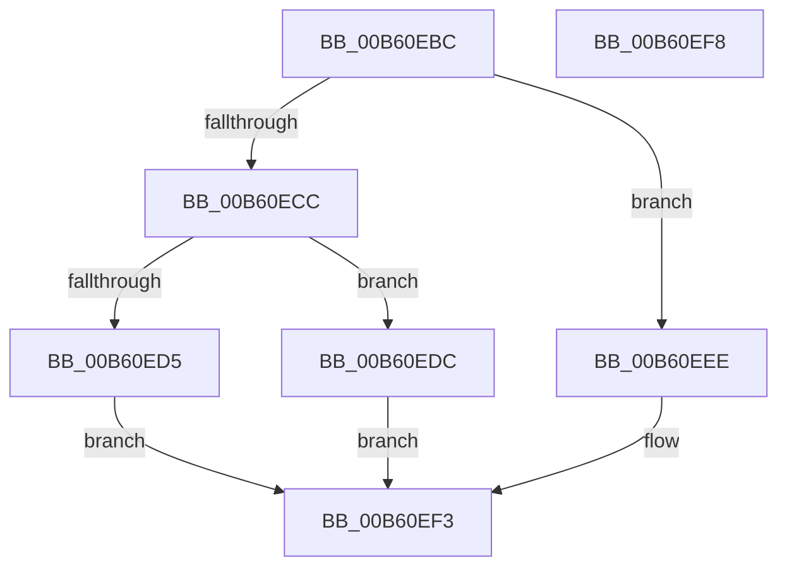

# HalReadBootRegister

- RVA: `0x00B60EBC`–`0x00B60EF9` (길이 `61` bytes)
- VA: `0x0000000140B60EBC`
- 실행 섹션: `PAGELK`
- PDB 이름 있음: `예`; PDB Function 태그: `아니요`
- unwind 정보 RVA: `0x0005C788`
- 디코드: `18`개 명령, `61/61` bytes 표시
- 미해석 바이트: `0` (있으면 어셈블리에 `.byte`로 보존)

> 이 문서는 커널 이미지의 기계어와 PDB 기호를 분석해 생성했습니다. 4번과 5번은 함수 원형과 자료형을 바이너리 사용 방식에서 추정한 C 해석이며 원본 소스 복구 결과는 아닙니다.

## 1. Dependencies

- 직접 호출 지점: **1**; 고유 호출 대상: **1**
- 직접 호출자로 확인된 함수: **2**
- RIP 상대 이미지 참조: **1**

### Outgoing calls
- `0x00B60EE5` → [HalpGetCmosData](../../text/55/HalpGetCmosData_function_00553C4C.md) (function, `0x00553C4C`)

### Direct callers
- [HalpResetSBF](../B5/HalpResetSBF_function_00B5B064.md) at `0x00B5B07C`
- [HalpSetupAcpiPhase0](../../init/C2/HalpSetupAcpiPhase0_function_00C23EDC.md) at `0x00C24181`

### Static image references
- `0x00B60EC0` → RVA `0x00E117F8` (`.data`; read)

## 2. Other-region calls and transfers

- 다른 실행 섹션으로 향하는 call: **1**
  - `0x00B60EE5` → [HalpGetCmosData](../../text/55/HalpGetCmosData_function_00553C4C.md) (`PAGELK` → `.text`)
- 별도 외부 분기/꼬리 이동을 확인하지 못했습니다.

## 3. Assembly (complete function range)

```asm
00B60EBC  48 83 EC 28                     sub rsp, 0x28
00B60EC0  48 8B 05 31 09 2B 00            mov rax, qword ptr [rip + 0x2b0931]
00B60EC7  48 85 C0                        test rax, rax
00B60ECA  74 22                           je 0x140b60eee
00B60ECC  0F B6 50 24                     movzx edx, byte ptr [rax + 0x24]
00B60ED0  48 85 C9                        test rcx, rcx
00B60ED3  75 07                           jne 0x140b60edc
00B60ED5  B8 0D 00 00 C0                  mov eax, 0xc000000d
00B60EDA  EB 17                           jmp 0x140b60ef3
00B60EDC  41 B9 01 00 00 00               mov r9d, 1
00B60EE2  4C 8B C1                        mov r8, rcx
00B60EE5  E8 62 2D 9F FF                  call 0x140553c4c
00B60EEA  33 C0                           xor eax, eax
00B60EEC  EB 05                           jmp 0x140b60ef3
00B60EEE  B8 0E 00 00 C0                  mov eax, 0xc000000e
00B60EF3  48 83 C4 28                     add rsp, 0x28
00B60EF7  C3                              ret
00B60EF8  CC                              int3
```

## 4. C-style interpretation (structured pseudocode)

```c
__int64 __fastcall HalReadBootRegister(__int64 a1)
{
    __int64 result;
    __int64 v_rsp;

    v_rsp = (v_rsp) - (40);
    if (*(unsigned __int64 *)(v_rip + 2820401) == 0) goto loc_00B60EEE;
    if (a1 != 0) goto loc_00B60EDC;
    goto loc_00B60EF3;
loc_00B60EDC:
    result = HalpGetCmosData(a1, *(unsigned __int8 *)(*(unsigned __int64 *)(v_rip + 2820401) + 36), a1, 1);
    result = 0;
    goto loc_00B60EF3;
loc_00B60EEE:
loc_00B60EF3:
    v_rsp = (v_rsp) + (40);
    return (unsigned int)(0xC000000EULL);
}
```

## 5. (Beta) C Style

```c
int64_t HalReadBootRegister(int64_t Arg1)
{
    int64_t result;
    int64_t local_rsp;

    local_rsp = (local_rsp) - (40);
    if (*(uint64_t *)(v_rip + 0x2B0931) == 0) goto loc_00B60EEE;
    if (Arg1 != 0) goto loc_00B60EDC;
    goto loc_00B60EF3;
loc_00B60EDC:
    result = HalpGetCmosData(Arg1, *(uint8_t *)(*(uint64_t *)(v_rip + 0x2B0931) + 0x24), Arg1, 1);
    result = 0;
    goto loc_00B60EF3;
loc_00B60EEE:
loc_00B60EF3:
    local_rsp = (local_rsp) + (40);
    return (uint32_t)(0xC000000EULL);
}
```

## 6. Execution-region graph

[열기: 2D/3D 그래프와 함수 탐색 컨트롤 패널](../../../control-panel.html?section=pagelk&rva=0x00B60EBC&view=graph)

- 2D 그래프는 위에서 아래로 흐르고, 3D 그래프는 빈 공간을 드래그해 회전합니다. Shift+드래그는 이동, 휠은 확대·축소, 함수 노드 선택은 대상 보고서 이동입니다.

### Static fallback


