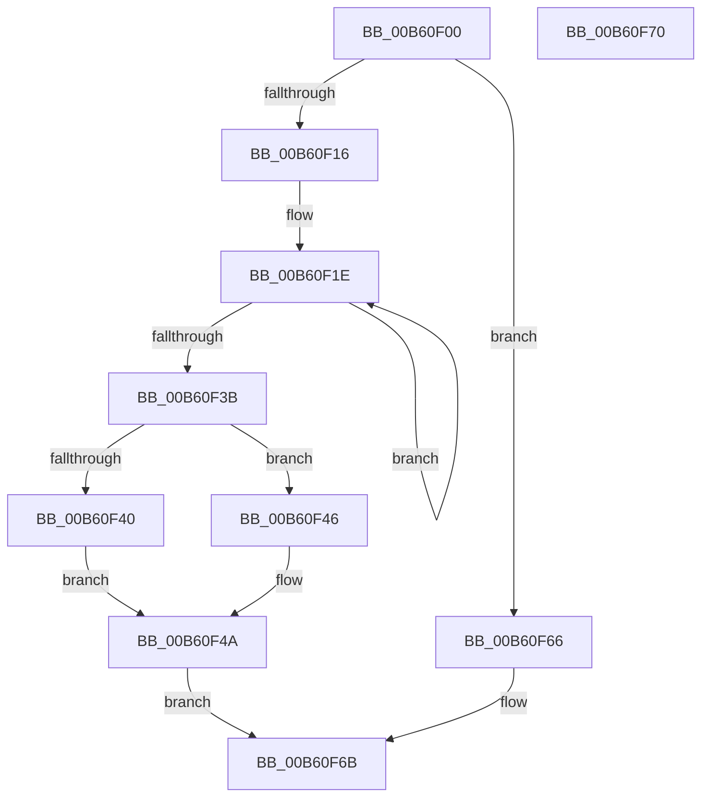

# HalWriteBootRegister

- RVA: `0x00B60F00`–`0x00B60F71` (길이 `113` bytes)
- VA: `0x0000000140B60F00`
- 실행 섹션: `PAGELK`
- PDB 이름 있음: `예`; PDB Function 태그: `아니요`
- unwind 정보 RVA: `0x0005C788`
- 디코드: `33`개 명령, `113/113` bytes 표시
- 미해석 바이트: `0` (있으면 어셈블리에 `.byte`로 보존)

> 이 문서는 커널 이미지의 기계어와 PDB 기호를 분석해 생성했습니다. 4번과 5번은 함수 원형과 자료형을 바이너리 사용 방식에서 추정한 C 해석이며 원본 소스 복구 결과는 아닙니다.

## 1. Dependencies

- 직접 호출 지점: **1**; 고유 호출 대상: **1**
- 직접 호출자로 확인된 함수: **2**
- RIP 상대 이미지 참조: **1**

### Outgoing calls
- `0x00B60F5D` → [HalpSetCmosData](../../text/42/HalpSetCmosData_function_0042D294.md) (function, `0x0042D294`)

### Direct callers
- [HalpResetSBF](../B5/HalpResetSBF_function_00B5B064.md) at `0x00B5B08C`
- [HalpSetupAcpiPhase0](../../init/C2/HalpSetupAcpiPhase0_function_00C23EDC.md) at `0x00C24196`

### Static image references
- `0x00B60F04` → RVA `0x00E117F8` (`.data`; read)

## 2. Other-region calls and transfers

- 다른 실행 섹션으로 향하는 call: **1**
  - `0x00B60F5D` → [HalpSetCmosData](../../text/42/HalpSetCmosData_function_0042D294.md) (`PAGELK` → `.text`)
- 별도 외부 분기/꼬리 이동을 확인하지 못했습니다.

## 3. Assembly (complete function range)

```asm
00B60F00  48 83 EC 28                     sub rsp, 0x28
00B60F04  48 8B 05 ED 08 2B 00            mov rax, qword ptr [rip + 0x2b08ed]
00B60F0B  45 32 C9                        xor r9b, r9b
00B60F0E  44 8A C1                        mov r8b, cl
00B60F11  48 85 C0                        test rax, rax
00B60F14  74 50                           je 0x140b60f66
00B60F16  44 0F B6 58 24                  movzx r11d, byte ptr [rax + 0x24]
00B60F1B  41 B2 01                        mov r10b, 1
00B60F1E  41 8D 41 01                     lea eax, [r9 + 1]
00B60F22  45 84 D0                        test r8b, r10b
00B60F25  0F B6 C8                        movzx ecx, al
00B60F28  41 0F B6 C1                     movzx eax, r9b
00B60F2C  0F 44 C8                        cmove ecx, eax
00B60F2F  45 02 D2                        add r10b, r10b
00B60F32  44 8A C9                        mov r9b, cl
00B60F35  41 80 FA 80                     cmp r10b, 0x80
00B60F39  72 E3                           jb 0x140b60f1e
00B60F3B  F6 C1 01                        test cl, 1
00B60F3E  75 06                           jne 0x140b60f46
00B60F40  41 80 C8 80                     or r8b, 0x80
00B60F44  EB 04                           jmp 0x140b60f4a
00B60F46  41 80 E0 7F                     and r8b, 0x7f
00B60F4A  44 88 44 24 30                  mov byte ptr [rsp + 0x30], r8b
00B60F4F  41 B9 01 00 00 00               mov r9d, 1
00B60F55  4C 8D 44 24 30                  lea r8, [rsp + 0x30]
00B60F5A  41 8B D3                        mov edx, r11d
00B60F5D  E8 32 C3 8C FF                  call 0x14042d294
00B60F62  33 C0                           xor eax, eax
00B60F64  EB 05                           jmp 0x140b60f6b
00B60F66  B8 0E 00 00 C0                  mov eax, 0xc000000e
00B60F6B  48 83 C4 28                     add rsp, 0x28
00B60F6F  C3                              ret
00B60F70  CC                              int3
```

## 4. C-style interpretation (structured pseudocode)

```c
__int64 __fastcall HalWriteBootRegister(unsigned __int8 a1, __int64 a2, __int64 a3, unsigned __int8 a4)
{
    __int64 result;
    __int64 v_r10;
    __int64 v_rsp;
    unsigned __int8 v_stack_p8;

    v_rsp = (v_rsp) - (40);
    a4 = 0;
    if (*(unsigned __int64 *)(v_rip + 2820333) == 0) goto loc_00B60F66;
loc_00B60F1E:
    a1 = (unsigned __int8)(a4 + 1);
    if (((a1) & (1)) == 0) { a1 = 0; }
    v_r10 = (unsigned __int8)((1) + (1));
    if (((unsigned __int8)(v_r10)) < 128) goto loc_00B60F1E;
    if (((a1) & (1)) != 0) goto loc_00B60F46;
    a3 = (unsigned __int8)((a1) | (128));
    goto loc_00B60F4A;
loc_00B60F46:
    a3 = (unsigned __int8)((a3) & (127));
loc_00B60F4A:
    v_stack_p8 = (unsigned __int8)(a3);
    result = HalpSetCmosData(a1, (unsigned int)((unsigned int)(*(unsigned __int8 *)(*(unsigned __int64 *)(v_rip + 2820333) + 36))), v_stack_p8, 1);
    result = 0;
    goto loc_00B60F6B;
loc_00B60F66:
loc_00B60F6B:
    v_rsp = (v_rsp) + (40);
    return (unsigned int)(0xC000000EULL);
}
```

## 5. (Beta) C Style

```c
int64_t HalWriteBootRegister(uint8_t Arg1, int64_t Arg2, int64_t Arg3, uint8_t Arg4)
{
    int64_t result;
    int64_t local_r10;
    int64_t local_rsp;
    uint8_t v_stack_p8;

    local_rsp = (local_rsp) - (40);
    Arg4 = 0;
    if (*(uint64_t *)(v_rip + 0x2B08ED) == 0) goto loc_00B60F66;
loc_00B60F1E:
    Arg1 = (uint8_t)(Arg4 + 1);
    if (((Arg1) & (1)) == 0) { Arg1 = 0; }
    local_r10 = (uint8_t)((1) + (1));
    if (((uint8_t)(local_r10)) < 128) goto loc_00B60F1E;
    if (((Arg1) & (1)) != 0) goto loc_00B60F46;
    Arg3 = (uint8_t)((Arg1) | (128));
    goto loc_00B60F4A;
loc_00B60F46:
    Arg3 = (uint8_t)((Arg3) & (127));
loc_00B60F4A:
    v_stack_p8 = (uint8_t)(Arg3);
    result = HalpSetCmosData(Arg1, (uint32_t)((uint32_t)(*(uint8_t *)(*(uint64_t *)(v_rip + 0x2B08ED) + 0x24))), v_stack_p8, 1);
    result = 0;
    goto loc_00B60F6B;
loc_00B60F66:
loc_00B60F6B:
    local_rsp = (local_rsp) + (40);
    return (uint32_t)(0xC000000EULL);
}
```

## 6. Execution-region graph

[열기: 2D/3D 그래프와 함수 탐색 컨트롤 패널](../../../control-panel.html?section=pagelk&rva=0x00B60F00&view=graph)

- 2D 그래프는 위에서 아래로 흐르고, 3D 그래프는 빈 공간을 드래그해 회전합니다. Shift+드래그는 이동, 휠은 확대·축소, 함수 노드 선택은 대상 보고서 이동입니다.

### Static fallback


