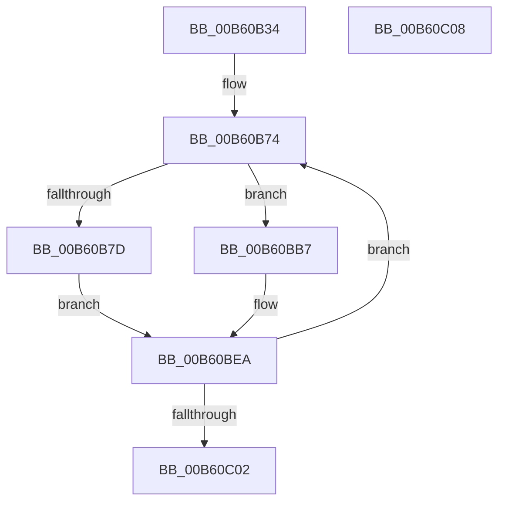

# HalpBlkInitializeIdt

- RVA: `0x00B60B34`–`0x00B60C09` (길이 `213` bytes)
- VA: `0x0000000140B60B34`
- 실행 섹션: `PAGELK`
- PDB 이름 있음: `예`; PDB Function 태그: `아니요`
- unwind 정보 RVA: `0x0005CF00`
- 디코드: `57`개 명령, `213/213` bytes 표시
- 미해석 바이트: `0` (있으면 어셈블리에 `.byte`로 보존)

> 이 문서는 커널 이미지의 기계어와 PDB 기호를 분석해 생성했습니다. 4번과 5번은 함수 원형과 자료형을 바이너리 사용 방식에서 추정한 C 해석이며 원본 소스 복구 결과는 아닙니다.

## 1. Dependencies

- 직접 호출 지점: **1**; 고유 호출 대상: **1**
- 직접 호출자로 확인된 함수: **1**
- RIP 상대 이미지 참조: **2**

### Outgoing calls
- `0x00B60B52` → [memset](../../text/6C/memset_function_006C6C40.md) (function, `0x006C6C40`)

### Direct callers
- [HalpBlkInitializeProcessorState](HalpBlkInitializeProcessorState_function_00B60C10.md) at `0x00B60CFF`

### Static image references
- `0x00B60B59` → RVA `0x00E05318` (`.data`; read)
- `0x00B60BB7` → RVA `0x00BECE00` (`HalpBlkUnexpectedInterrupt`; read)

## 2. Other-region calls and transfers

- 다른 실행 섹션으로 향하는 call: **1**
  - `0x00B60B52` → [memset](../../text/6C/memset_function_006C6C40.md) (`PAGELK` → `.text`)
- 별도 외부 분기/꼬리 이동을 확인하지 못했습니다.

## 3. Assembly (complete function range)

```asm
00B60B34  40 53                           push rbx
00B60B36  48 83 EC 20                     sub rsp, 0x20
00B60B3A  48 8B DA                        mov rbx, rdx
00B60B3D  48 89 51 08                     mov qword ptr [rcx + 8], rdx
00B60B41  66 C7 41 06 FF 0F               mov word ptr [rcx + 6], 0xfff
00B60B47  33 D2                           xor edx, edx
00B60B49  48 8B CB                        mov rcx, rbx
00B60B4C  41 B8 00 10 00 00               mov r8d, 0x1000
00B60B52  E8 E9 60 B6 FF                  call 0x1406c6c40
00B60B57  33 D2                           xor edx, edx
00B60B59  4C 8D 05 B8 47 2A 00            lea r8, [rip + 0x2a47b8]
00B60B60  48 83 C3 04                     add rbx, 4
00B60B64  41 BA F8 00 00 00               mov r10d, 0xf8
00B60B6A  41 BB 00 8E 00 00               mov r11d, 0x8e00
00B60B70  44 8D 4A 10                     lea r9d, [rdx + 0x10]
00B60B74  41 0F B6 40 F8                  movzx eax, byte ptr [r8 - 8]
00B60B79  3B D0                           cmp edx, eax
00B60B7B  75 3A                           jne 0x140b60bb7
00B60B7D  41 0F B7 00                     movzx eax, word ptr [r8]
00B60B81  66 89 43 FC                     mov word ptr [rbx - 4], ax
00B60B85  66 44 89 4B FE                  mov word ptr [rbx - 2], r9w
00B60B8A  41 8A 40 F9                     mov al, byte ptr [r8 - 7]
00B60B8E  24 07                           and al, 7
00B60B90  0F B6 C8                        movzx ecx, al
00B60B93  0F B7 03                        movzx eax, word ptr [rbx]
00B60B96  66 41 23 C2                     and ax, r10w
00B60B9A  66 0B C8                        or cx, ax
00B60B9D  66 41 0B CB                     or cx, r11w
00B60BA1  66 89 0B                        mov word ptr [rbx], cx
00B60BA4  41 8B 00                        mov eax, dword ptr [r8]
00B60BA7  48 C1 E8 10                     shr rax, 0x10
00B60BAB  66 89 43 02                     mov word ptr [rbx + 2], ax
00B60BAF  49 8B 08                        mov rcx, qword ptr [r8]
00B60BB2  4D 03 C1                        add r8, r9
00B60BB5  EB 33                           jmp 0x140b60bea
00B60BB7  48 8D 05 42 C2 08 00            lea rax, [rip + 0x8c242]
00B60BBE  66 44 89 4B FE                  mov word ptr [rbx - 2], r9w
00B60BC3  8D 0C D5 00 00 00 00            lea ecx, [rdx*8]
00B60BCA  48 03 C8                        add rcx, rax
00B60BCD  0F B7 03                        movzx eax, word ptr [rbx]
00B60BD0  66 41 23 C2                     and ax, r10w
00B60BD4  66 89 4B FC                     mov word ptr [rbx - 4], cx
00B60BD8  66 41 0B C3                     or ax, r11w
00B60BDC  66 89 03                        mov word ptr [rbx], ax
00B60BDF  48 8B C1                        mov rax, rcx
00B60BE2  48 C1 E8 10                     shr rax, 0x10
00B60BE6  66 89 43 02                     mov word ptr [rbx + 2], ax
00B60BEA  48 C1 E9 20                     shr rcx, 0x20
00B60BEE  FF C2                           inc edx
00B60BF0  89 4B 04                        mov dword ptr [rbx + 4], ecx
00B60BF3  49 03 D9                        add rbx, r9
00B60BF6  81 FA 00 01 00 00               cmp edx, 0x100
00B60BFC  0F 82 72 FF FF FF               jb 0x140b60b74
00B60C02  48 83 C4 20                     add rsp, 0x20
00B60C06  5B                              pop rbx
00B60C07  C3                              ret
00B60C08  CC                              int3
```

## 4. C-style interpretation (structured pseudocode)

```c
__int64 __fastcall HalpBlkInitializeIdt(__int64 a1, __int64 a2)
{
    __int64 result;
    __int64 v_rbx;
    __int64 v_rsp;

    v_rsp = (v_rsp) - (32);
    *(unsigned __int64 *)(a1 + 8) = a2;
    *(unsigned __int16 *)(a1 + 6) = 0xFFFULL;
    a2 = 0;
    result = memset(0, a2, (unsigned int)(0x1000ULL), a4);
    a2 = 0;
    v_rbx = (a2) + (4);
loc_00B60B74:
    if (0 != ((unsigned int)(*(unsigned __int8 *)(v_rip + 2770872 - 8)))) goto loc_00B60BB7;
    *(unsigned __int16 *)(v_rbx - 4) = (unsigned __int16)(*(unsigned __int16 *)(v_rip + 2770872));
    *(unsigned __int16 *)(v_rbx - 2) = (unsigned __int16)(a2 + 16);
    result = (unsigned __int8)((*(unsigned __int8 *)(v_rip + 2770872 - 7)) & (7));
    result = (unsigned __int16)((*(unsigned __int16 *)(v_rbx)) & (248));
    a1 = (unsigned __int16)(((unsigned __int8)(result)) | ((unsigned __int16)(result)));
    a1 = (unsigned __int16)((a1) | ((unsigned __int16)((unsigned int)(0x8E00ULL))));
    *(unsigned __int16 *)(v_rbx) = (unsigned __int16)(a1);
    result = ((unsigned int)(*(unsigned int *)(v_rip + 2770872))) >> (16);
    *(unsigned __int16 *)(v_rbx + 2) = (unsigned __int16)(result);
    a3 = (v_rip + 2770872) + (a2 + 16);
    goto loc_00B60BEA;
loc_00B60BB7:
    *(unsigned __int16 *)(v_rbx - 2) = (unsigned __int16)(a2 + 16);
    a1 = (a2 * 8) + (v_rip + 574018);
    result = (unsigned __int16)((*(unsigned __int16 *)(v_rbx)) & (248));
    *(unsigned __int16 *)(v_rbx - 4) = (unsigned __int16)(a1);
    result = (unsigned __int16)((result) | ((unsigned __int16)((unsigned int)(0x8E00ULL))));
    *(unsigned __int16 *)(v_rbx) = (unsigned __int16)(result);
    result = (a1) >> (16);
    *(unsigned __int16 *)(v_rbx + 2) = (unsigned __int16)(result);
loc_00B60BEA:
    a1 = (a1) >> (32);
    a2 = (unsigned int)((a2) + 1);
    *(unsigned int *)(v_rbx + 4) = (unsigned int)(a1);
    v_rbx = (v_rbx) + (a2 + 16);
    if (((unsigned int)(a2)) < 256) goto loc_00B60B74;
    v_rsp = (v_rsp) + (32);
    return result;
}
```

## 5. (Beta) C Style

```c
int64_t HalpBlkInitializeIdt(void *Arg1, void *Arg2)
{
    uint8_t *arg1 = (uint8_t *)Arg1;
    uint8_t *arg2 = (uint8_t *)Arg2;

    int64_t result;
    int64_t local_rbx;
    int64_t local_rsp;

    local_rsp = (local_rsp) - (32);
    *(void **)(arg1 + 0x8) = Arg2;
    *(uint16_t *)(arg1 + 0x6) = 0xFFFULL;
    Arg2 = 0;
    result = memset(0, Arg2, (uint32_t)(0x1000ULL), a4);
    Arg2 = 0;
    local_rbx = (Arg2) + (4);
loc_00B60B74:
    if (0 != ((uint32_t)(*(uint8_t *)(v_rip + 0x2A47B8 - 0x8)))) goto loc_00B60BB7;
    *(uint16_t *)(local_rbx - 0x4) = (uint16_t)(*(uint16_t *)(v_rip + 0x2A47B8));
    *(uint16_t *)(local_rbx - 0x2) = (uint16_t)(Arg2 + 16);
    result = (uint8_t)((*(uint8_t *)(v_rip + 0x2A47B8 - 0x7)) & (7));
    result = (uint16_t)((*(uint16_t *)(local_rbx)) & (248));
    Arg1 = (uint16_t)(((uint8_t)(result)) | ((uint16_t)(result)));
    Arg1 = (uint16_t)((Arg1) | ((uint16_t)((uint32_t)(0x8E00ULL))));
    *(uint16_t *)(local_rbx) = (uint16_t)(Arg1);
    result = ((uint32_t)(*(uint32_t *)(v_rip + 0x2A47B8))) >> (16);
    *(uint16_t *)(local_rbx + 0x2) = (uint16_t)(result);
    a3 = (v_rip + 2770872) + (Arg2 + 16);
    goto loc_00B60BEA;
loc_00B60BB7:
    *(uint16_t *)(local_rbx - 0x2) = (uint16_t)(Arg2 + 16);
    Arg1 = (Arg2 * 8) + (v_rip + 574018);
    result = (uint16_t)((*(uint16_t *)(local_rbx)) & (248));
    *(uint16_t *)(local_rbx - 0x4) = (uint16_t)(Arg1);
    result = (uint16_t)((result) | ((uint16_t)((uint32_t)(0x8E00ULL))));
    *(uint16_t *)(local_rbx) = (uint16_t)(result);
    result = (Arg1) >> (16);
    *(uint16_t *)(local_rbx + 0x2) = (uint16_t)(result);
loc_00B60BEA:
    Arg1 = (Arg1) >> (32);
    Arg2 = (uint32_t)((Arg2) + 1);
    *(uint32_t *)(local_rbx + 0x4) = (uint32_t)(Arg1);
    local_rbx = (local_rbx) + (Arg2 + 16);
    if (((uint32_t)(Arg2)) < 256) goto loc_00B60B74;
    local_rsp = (local_rsp) + (32);
    return result;
}
```

### 관측된 메모리 오프셋

구조체 형식이 확인되지 않은 접근은 인자 기준의 오프셋으로만 기록했습니다.

| 기준 인자 | 오프셋 표현 | 폭 (bit) | 접근 |
|---|---:|---:|---|
| `Arg1` | `+ 0x6` | `16` | `W` |
| `Arg1` | `+ 0x8` | `64` | `W` |
| `Arg2` | `- 0x4` | `16` | `W` |
| `Arg2` | `- 0x2` | `16` | `W` |
| `Arg2` | `+ 0x0` | `16` | `R` |
| `Arg2` | `+ 0x0` | `16` | `W` |
| `Arg2` | `+ 0x2` | `16` | `W` |
| `Arg2` | `+ 0x4` | `32` | `W` |

## 6. Execution-region graph

[열기: 2D/3D 그래프와 함수 탐색 컨트롤 패널](../../../control-panel.html?section=pagelk&rva=0x00B60B34&view=graph)

- 2D 그래프는 위에서 아래로 흐르고, 3D 그래프는 빈 공간을 드래그해 회전합니다. Shift+드래그는 이동, 휠은 확대·축소, 함수 노드 선택은 대상 보고서 이동입니다.

### Static fallback


