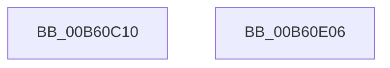

# HalpBlkInitializeProcessorState

- RVA: `0x00B60C10`–`0x00B60E07` (길이 `503` bytes)
- VA: `0x0000000140B60C10`
- 실행 섹션: `PAGELK`
- PDB 이름 있음: `예`; PDB Function 태그: `아니요`
- unwind 정보 RVA: `0x0007F3F8`
- 디코드: `105`개 명령, `503/503` bytes 표시
- 미해석 바이트: `0` (있으면 어셈블리에 `.byte`로 보존)

> 이 문서는 커널 이미지의 기계어와 PDB 기호를 분석해 생성했습니다. 4번과 5번은 함수 원형과 자료형을 바이너리 사용 방식에서 추정한 C 해석이며 원본 소스 복구 결과는 아닙니다.

## 1. Dependencies

- 직접 호출 지점: **4**; 고유 호출 대상: **3**
- 직접 호출자로 확인된 함수: **1**
- RIP 상대 이미지 참조: **7**

### Outgoing calls
- `0x00B60C40` → [memset](../../text/6C/memset_function_006C6C40.md) (function, `0x006C6C40`)
- `0x00B60C50` → [memset](../../text/6C/memset_function_006C6C40.md) (function, `0x006C6C40`)
- `0x00B60CF3` → [memcpy](../../text/6C/memcpy_function_006C6840.md) (function, `0x006C6840`)
- `0x00B60CFF` → [HalpBlkInitializeIdt](HalpBlkInitializeIdt_function_00B60B34.md) (function, `0x00B60B34`)

### Direct callers
- [HalpBlkStartBlockedProcessor](HalpBlkStartBlockedProcessor_function_00B60E10.md) at `0x00B60E5C`

### Static image references
- `0x00B60C29` → RVA `0x00F8FA90` (`.data`; read)
- `0x00B60C9C` → RVA `0x00E10440` (`.data`; read)
- `0x00B60CA7` → RVA `0x00E10451` (`.data`; read)
- `0x00B60CB1` → RVA `0x00E10452` (`.data`; read)
- `0x00B60CBB` → RVA `0x00E117F0` (`.data`; read)
- `0x00B60D56` → RVA `0x00BEB860` (`HalpBlkProcessorStartup`; read)
- `0x00B60DC1` → RVA `0x00F90558` (`.data`; read)

## 2. Other-region calls and transfers

- 다른 실행 섹션으로 향하는 call: **3**
  - `0x00B60C40` → [memset](../../text/6C/memset_function_006C6C40.md) (`PAGELK` → `.text`)
  - `0x00B60C50` → [memset](../../text/6C/memset_function_006C6C40.md) (`PAGELK` → `.text`)
  - `0x00B60CF3` → [memcpy](../../text/6C/memcpy_function_006C6840.md) (`PAGELK` → `.text`)
- 별도 외부 분기/꼬리 이동을 확인하지 못했습니다.

## 3. Assembly (complete function range)

```asm
00B60C10  48 8B C4                        mov rax, rsp
00B60C13  48 89 58 08                     mov qword ptr [rax + 8], rbx
00B60C17  48 89 70 10                     mov qword ptr [rax + 0x10], rsi
00B60C1B  48 89 78 18                     mov qword ptr [rax + 0x18], rdi
00B60C1F  4C 89 70 20                     mov qword ptr [rax + 0x20], r14
00B60C23  41 57                           push r15
00B60C25  48 83 EC 20                     sub rsp, 0x20
00B60C29  8B 1D 61 EE 42 00               mov ebx, dword ptr [rip + 0x42ee61]
00B60C2F  4C 8B FA                        mov r15, rdx
00B60C32  4C 8B F1                        mov r14, rcx
00B60C35  33 D2                           xor edx, edx
00B60C37  49 8B CF                        mov rcx, r15
00B60C3A  41 B8 00 E0 00 00               mov r8d, 0xe000
00B60C40  E8 FB 5F B6 FF                  call 0x1406c6c40
00B60C45  33 D2                           xor edx, edx
00B60C47  41 B8 C0 05 00 00               mov r8d, 0x5c0
00B60C4D  49 8B CE                        mov rcx, r14
00B60C50  E8 EB 5F B6 FF                  call 0x1406c6c40
00B60C55  65 4C 8B 0C 25 20 00 00 00      mov r9, qword ptr gs:[0x20]
00B60C5E  49 8D BF 00 90 00 00            lea rdi, [r15 + 0x9000]
00B60C65  8B 44 24 50                     mov eax, dword ptr [rsp + 0x50]
00B60C69  48 8D B7 B0 2F 00 00            lea rsi, [rdi + 0x2fb0]
00B60C70  48 8B CE                        mov rcx, rsi
00B60C73  41 8B 91 A4 00 00 00            mov edx, dword ptr [r9 + 0xa4]
00B60C7A  41 0F AF 91 A0 00 00 00         imul edx, dword ptr [r9 + 0xa0]
00B60C82  41 89 47 0C                     mov dword ptr [r15 + 0xc], eax
00B60C86  41 89 5F 08                     mov dword ptr [r15 + 8], ebx
00B60C8A  48 8D 9F 00 10 00 00            lea rbx, [rdi + 0x1000]
00B60C91  4D 89 3F                        mov qword ptr [r15], r15
00B60C94  F7 DA                           neg edx
00B60C96  23 D0                           and edx, eax
00B60C98  41 89 57 18                     mov dword ptr [r15 + 0x18], edx
00B60C9C  48 8B 05 9D F7 2A 00            mov rax, qword ptr [rip + 0x2af79d]
00B60CA3  49 89 47 20                     mov qword ptr [r15 + 0x20], rax
00B60CA7  8A 05 A4 F7 2A 00               mov al, byte ptr [rip + 0x2af7a4]
00B60CAD  41 88 47 28                     mov byte ptr [r15 + 0x28], al
00B60CB1  8A 05 9B F7 2A 00               mov al, byte ptr [rip + 0x2af79b]
00B60CB7  41 88 47 29                     mov byte ptr [r15 + 0x29], al
00B60CBB  8A 05 2F 0B 2B 00               mov al, byte ptr [rip + 0x2b0b2f]
00B60CC1  41 88 47 2A                     mov byte ptr [r15 + 0x2a], al
00B60CC5  41 8A 81 8D 00 00 00            mov al, byte ptr [r9 + 0x8d]
00B60CCC  41 88 47 2B                     mov byte ptr [r15 + 0x2b], al
00B60CD0  41 0F B7 81 56 01 00 00         movzx eax, word ptr [r9 + 0x156]
00B60CD8  66 41 89 46 56                  mov word ptr [r14 + 0x56], ax
00B60CDD  49 89 76 58                     mov qword ptr [r14 + 0x58], rsi
00B60CE1  45 0F B7 81 56 01 00 00         movzx r8d, word ptr [r9 + 0x156]
00B60CE9  49 8B 91 58 01 00 00            mov rdx, qword ptr [r9 + 0x158]
00B60CF0  49 FF C0                        inc r8
00B60CF3  E8 48 5B B6 FF                  call 0x1406c6840
00B60CF8  49 8D 4E 60                     lea rcx, [r14 + 0x60]
00B60CFC  48 8B D7                        mov rdx, rdi
00B60CFF  E8 30 FE FF FF                  call 0x140b60b34
00B60D04  4C 89 BF 70 10 00 00            mov qword ptr [rdi + 0x1070], r15
00B60D0B  49 8D 97 00 30 00 00            lea rdx, [r15 + 0x3000]
00B60D12  66 89 5E 42                     mov word ptr [rsi + 0x42], bx
00B60D16  49 8D 8F 00 50 00 00            lea rcx, [r15 + 0x5000]
00B60D1D  48 8B C3                        mov rax, rbx
00B60D20  48 C1 E8 10                     shr rax, 0x10
00B60D24  88 46 44                        mov byte ptr [rsi + 0x44], al
00B60D27  48 8B C3                        mov rax, rbx
00B60D2A  48 C1 E8 18                     shr rax, 0x18
00B60D2E  88 46 47                        mov byte ptr [rsi + 0x47], al
00B60D31  48 8B C3                        mov rax, rbx
00B60D34  48 C1 E8 20                     shr rax, 0x20
00B60D38  89 46 48                        mov dword ptr [rsi + 0x48], eax
00B60D3B  49 8D 87 00 70 00 00            lea rax, [r15 + 0x7000]
00B60D42  48 89 43 2C                     mov qword ptr [rbx + 0x2c], rax
00B60D46  48 89 4B 24                     mov qword ptr [rbx + 0x24], rcx
00B60D4A  48 89 7B 34                     mov qword ptr [rbx + 0x34], rdi
00B60D4E  48 89 53 04                     mov qword ptr [rbx + 4], rdx
00B60D52  49 89 47 60                     mov qword ptr [r15 + 0x60], rax
00B60D56  48 8D 05 03 AB 08 00            lea rax, [rip + 0x8ab03]
00B60D5D  49 89 57 50                     mov qword ptr [r15 + 0x50], rdx
00B60D61  49 89 4F 58                     mov qword ptr [r15 + 0x58], rcx
00B60D65  49 89 7F 68                     mov qword ptr [r15 + 0x68], rdi
00B60D69  49 89 7F 30                     mov qword ptr [r15 + 0x30], rdi
00B60D6D  49 89 7F 38                     mov qword ptr [r15 + 0x38], rdi
00B60D71  49 89 77 48                     mov qword ptr [r15 + 0x48], rsi
00B60D75  49 89 5F 40                     mov qword ptr [r15 + 0x40], rbx
00B60D79  41 83 A6 34 01 00 00 00         and dword ptr [r14 + 0x134], 0
00B60D81  49 89 86 E8 01 00 00            mov qword ptr [r14 + 0x1e8], rax
00B60D88  48 8D 42 F8                     lea rax, [rdx - 8]
00B60D8C  49 89 86 88 01 00 00            mov qword ptr [r14 + 0x188], rax
00B60D93  4D 89 BE 70 01 00 00            mov qword ptr [r14 + 0x170], r15
00B60D9A  41 C7 86 28 01 00 00 10 00 2B 00  mov dword ptr [r14 + 0x128], 0x2b0010
00B60DA5  41 C7 86 2C 01 00 00 2B 00 53 00  mov dword ptr [r14 + 0x12c], 0x53002b
00B60DB0  41 C7 86 30 01 00 00 2B 00 18 00  mov dword ptr [r14 + 0x130], 0x18002b
00B60DBB  0F 20 C0                        mov rax, cr0
00B60DBE  49 89 06                        mov qword ptr [r14], rax
00B60DC1  48 8B 05 90 F7 42 00            mov rax, qword ptr [rip + 0x42f790]
00B60DC8  49 89 46 10                     mov qword ptr [r14 + 0x10], rax
00B60DCC  66 41 C7 46 70 40 00            mov word ptr [r14 + 0x70], 0x40
00B60DD3  C6 46 45 89                     mov byte ptr [rsi + 0x45], 0x89
00B60DD7  0F 20 E0                        mov rax, cr4
00B60DDA  48 8B 5C 24 30                  mov rbx, qword ptr [rsp + 0x30]
00B60DDF  48 0F BA F0 17                  btr rax, 0x17
00B60DE4  48 8B 74 24 38                  mov rsi, qword ptr [rsp + 0x38]
00B60DE9  48 8B 7C 24 40                  mov rdi, qword ptr [rsp + 0x40]
00B60DEE  49 89 46 18                     mov qword ptr [r14 + 0x18], rax
00B60DF2  49 83 A7 A8 08 00 00 00         and qword ptr [r15 + 0x8a8], 0
00B60DFA  4C 8B 74 24 48                  mov r14, qword ptr [rsp + 0x48]
00B60DFF  48 83 C4 20                     add rsp, 0x20
00B60E03  41 5F                           pop r15
00B60E05  C3                              ret
00B60E06  CC                              int3
```

## 4. C-style interpretation (structured pseudocode)

```c
__int64 __fastcall HalpBlkInitializeProcessorState(__int64 a1, __int64 a2, __int64 a3, __int64 a4, unsigned int a5)
{
    __int64 result;
    __int64 v_rsp;
    unsigned __int64 v_stack_p10;
    unsigned __int64 v_stack_p18;
    unsigned __int64 v_stack_p20;
    unsigned __int64 v_stack_p8;

    *(unsigned __int64 *)(v_rsp + 8) = v_rbx;
    *(unsigned __int64 *)(v_rsp + 16) = v_rsi;
    *(unsigned __int64 *)(v_rsp + 24) = v_rdi;
    *(unsigned __int64 *)(v_rsp + 32) = v_r14;
    v_rsp = (v_rsp) - (32);
    a2 = 0;
    result = memset(0, a2, (unsigned int)(0xE000ULL), a4);
    a2 = 0;
    result = memset(a1, a2, (unsigned int)(0x5C0ULL), a4);
    a2 = (unsigned int)(((unsigned int)(*(unsigned int *)(*(unsigned __int64 *)(gs_base + (0 + 32)) + 164))) * (*(unsigned int *)(*(unsigned __int64 *)(gs_base + (0 + 32)) + 160)));
    *(unsigned int *)(a2 + 12) = (unsigned int)((unsigned int)(a5));
    *(unsigned int *)(a2 + 8) = (unsigned int)((unsigned int)(*(unsigned int *)(v_rip + 4386401)));
    *(unsigned __int64 *)(a2) = a2;
    a2 = (unsigned int)(-(a2));
    a2 = (unsigned int)((a2) & ((unsigned int)((unsigned int)(a5))));
    *(unsigned int *)(a2 + 24) = (unsigned int)(a2);
    *(unsigned __int64 *)(a2 + 32) = *(unsigned __int64 *)(v_rip + 2815901);
    *(unsigned __int8 *)(a2 + 40) = (unsigned __int8)(*(unsigned __int8 *)(v_rip + 2815908));
    *(unsigned __int8 *)(a2 + 41) = (unsigned __int8)(*(unsigned __int8 *)(v_rip + 2815899));
    *(unsigned __int8 *)(a2 + 42) = (unsigned __int8)(*(unsigned __int8 *)(v_rip + 2820911));
    *(unsigned __int8 *)(a2 + 43) = (unsigned __int8)(*(unsigned __int8 *)(*(unsigned __int64 *)(gs_base + (0 + 32)) + 141));
    *(unsigned __int16 *)(a1 + 86) = (unsigned __int16)(*(unsigned __int16 *)(*(unsigned __int64 *)(gs_base + (0 + 32)) + 342));
    *(unsigned __int64 *)(a1 + 88) = a2 + 36864 + 12208;
    a3 = (*(unsigned __int16 *)(*(unsigned __int64 *)(gs_base + (0 + 32)) + 342)) + 1;
    result = memcpy(a2 + 36864 + 12208, *(unsigned __int64 *)(*(unsigned __int64 *)(gs_base + (0 + 32)) + 344), a3, *(unsigned __int64 *)(gs_base + (0 + 32)));
    result = HalpBlkInitializeIdt(a1 + 96, a2 + 36864, a3, *(unsigned __int64 *)(gs_base + (0 + 32)));
    *(unsigned __int64 *)(a2 + 36864 + 4208) = a2;
    *(unsigned __int16 *)(a2 + 36864 + 12208 + 66) = (unsigned __int16)(a2 + 36864 + 4096);
    result = (a2 + 36864 + 4096) >> (16);
    *(unsigned __int8 *)(a2 + 36864 + 12208 + 68) = (unsigned __int8)(result);
    result = (a2 + 36864 + 4096) >> (24);
    *(unsigned __int8 *)(a2 + 36864 + 12208 + 71) = (unsigned __int8)(result);
    result = (a2 + 36864 + 4096) >> (32);
    *(unsigned int *)(a2 + 36864 + 12208 + 72) = (unsigned int)(result);
    *(unsigned __int64 *)(a2 + 36864 + 4096 + 44) = a2 + 28672;
    *(unsigned __int64 *)(a2 + 36864 + 4096 + 36) = a2 + 20480;
    *(unsigned __int64 *)(a2 + 36864 + 4096 + 52) = a2 + 36864;
    *(unsigned __int64 *)(a2 + 36864 + 4096 + 4) = a2 + 12288;
    *(unsigned __int64 *)(a2 + 96) = a2 + 28672;
    *(unsigned __int64 *)(a2 + 80) = a2 + 12288;
    *(unsigned __int64 *)(a2 + 88) = a2 + 20480;
    *(unsigned __int64 *)(a2 + 104) = a2 + 36864;
    *(unsigned __int64 *)(a2 + 48) = a2 + 36864;
    *(unsigned __int64 *)(a2 + 56) = a2 + 36864;
    *(unsigned __int64 *)(a2 + 72) = a2 + 36864 + 12208;
    *(unsigned __int64 *)(a2 + 64) = a2 + 36864 + 4096;
    *(unsigned __int64 *)(a1 + 488) = v_rip + 568067;
    *(unsigned __int64 *)(a1 + 392) = a2 + 12288 - 8;
    *(unsigned __int64 *)(a1 + 368) = a2;
    *(unsigned int *)(a1 + 296) = 0x2B0010ULL;
    *(unsigned int *)(a1 + 300) = 0x53002BULL;
    *(unsigned int *)(a1 + 304) = 0x18002BULL;
    *(unsigned __int64 *)(a1) = v_cr0;
    *(unsigned __int64 *)(a1 + 16) = *(unsigned __int64 *)(v_rip + 4388752);
    *(unsigned __int16 *)(a1 + 112) = 64;
    *(unsigned __int8 *)(a2 + 36864 + 12208 + 69) = 137;
    *(unsigned __int64 *)(a1 + 24) = v_cr4;
    v_rsp = (v_rsp) + (32);
    return v_cr4;
}
```

## 5. (Beta) C Style

```c
int64_t HalpBlkInitializeProcessorState(void *Arg1, void *Arg2, int64_t Arg3, int64_t Arg4, uint32_t Arg5)
{
    uint8_t *arg1 = (uint8_t *)Arg1;
    uint8_t *arg2 = (uint8_t *)Arg2;

    int64_t result;
    int64_t local_rsp;
    uint64_t v_stack_p10;
    uint64_t v_stack_p18;
    uint64_t v_stack_p20;
    uint64_t v_stack_p8;

    *(uint64_t *)(local_rsp + 0x8) = local_rbx;
    *(uint64_t *)(local_rsp + 0x10) = local_rsi;
    *(uint64_t *)(local_rsp + 0x18) = local_rdi;
    *(uint64_t *)(local_rsp + 0x20) = local_r14;
    local_rsp = (local_rsp) - (32);
    Arg2 = 0;
    result = memset(0, Arg2, (uint32_t)(0xE000ULL), Arg4);
    Arg2 = 0;
    result = memset(Arg1, Arg2, (uint32_t)(0x5C0ULL), Arg4);
    Arg2 = (uint32_t)(((uint32_t)(*(uint32_t *)(*(uint64_t *)(gs_base + (0 + 0x20)) + 0xA4))) * (*(uint32_t *)(*(uint64_t *)(gs_base + (0 + 0x20)) + 0xA0)));
    *(uint32_t *)(arg2 + 0xC) = (uint32_t)((uint32_t)(Arg5));
    *(uint32_t *)(arg2 + 0x8) = (uint32_t)((uint32_t)(*(uint32_t *)(v_rip + 0x42EE61)));
    *(void **)(arg2) = Arg2;
    Arg2 = (uint32_t)(-(Arg2));
    Arg2 = (uint32_t)((Arg2) & ((uint32_t)((uint32_t)(Arg5))));
    *(uint32_t *)(arg2 + 0x18) = (uint32_t)(Arg2);
    *(uint64_t *)(arg2 + 0x20) = *(uint64_t *)(v_rip + 0x2AF79D);
    *(uint8_t *)(arg2 + 0x28) = (uint8_t)(*(uint8_t *)(v_rip + 0x2AF7A4));
    *(uint8_t *)(arg2 + 0x29) = (uint8_t)(*(uint8_t *)(v_rip + 0x2AF79B));
    *(uint8_t *)(arg2 + 0x2A) = (uint8_t)(*(uint8_t *)(v_rip + 0x2B0B2F));
    *(uint8_t *)(arg2 + 0x2B) = (uint8_t)(*(uint8_t *)(*(uint64_t *)(gs_base + (0 + 0x20)) + 0x8D));
    *(uint16_t *)(arg1 + 0x56) = (uint16_t)(*(uint16_t *)(*(uint64_t *)(gs_base + (0 + 0x20)) + 0x156));
    *(void **)(arg1 + 0x58) = Arg2 + 36864 + 12208;
    Arg3 = (*(uint16_t *)(*(uint64_t *)(gs_base + (0 + 0x20)) + 0x156)) + 1;
    result = memcpy(Arg2 + 36864 + 12208, *(uint64_t *)(*(uint64_t *)(gs_base + (0 + 0x20)) + 0x158), Arg3, *(uint64_t *)(gs_base + (0 + 0x20)));
    result = HalpBlkInitializeIdt(Arg1 + 96, Arg2 + 36864, Arg3, *(uint64_t *)(gs_base + (0 + 0x20)));
    *(void **)(arg2 + 0x9000 + 0x1070) = Arg2;
    *(uint16_t *)(arg2 + 0x9000 + 0x2FB0 + 0x42) = (uint16_t)(Arg2 + 36864 + 4096);
    result = (Arg2 + 36864 + 4096) >> (16);
    *(uint8_t *)(arg2 + 0x9000 + 0x2FB0 + 0x44) = (uint8_t)(result);
    result = (Arg2 + 36864 + 4096) >> (24);
    *(uint8_t *)(arg2 + 0x9000 + 0x2FB0 + 0x47) = (uint8_t)(result);
    result = (Arg2 + 36864 + 4096) >> (32);
    *(uint32_t *)(arg2 + 0x9000 + 0x2FB0 + 0x48) = (uint32_t)(result);
    *(void **)(arg2 + 0x9000 + 0x1000 + 0x2C) = Arg2 + 28672;
    *(void **)(arg2 + 0x9000 + 0x1000 + 0x24) = Arg2 + 20480;
    *(void **)(arg2 + 0x9000 + 0x1000 + 0x34) = Arg2 + 36864;
    *(void **)(arg2 + 0x9000 + 0x1000 + 0x4) = Arg2 + 12288;
    *(void **)(arg2 + 0x60) = Arg2 + 28672;
    *(void **)(arg2 + 0x50) = Arg2 + 12288;
    *(void **)(arg2 + 0x58) = Arg2 + 20480;
    *(void **)(arg2 + 0x68) = Arg2 + 36864;
    *(void **)(arg2 + 0x30) = Arg2 + 36864;
    *(void **)(arg2 + 0x38) = Arg2 + 36864;
    *(void **)(arg2 + 0x48) = Arg2 + 36864 + 12208;
    *(void **)(arg2 + 0x40) = Arg2 + 36864 + 4096;
    *(uint64_t *)(arg1 + 0x1E8) = v_rip + 568067;
    *(void **)(arg1 + 0x188) = Arg2 + 12288 - 8;
    *(void **)(arg1 + 0x170) = Arg2;
    *(uint32_t *)(arg1 + 0x128) = 0x2B0010ULL;
    *(uint32_t *)(arg1 + 0x12C) = 0x53002BULL;
    *(uint32_t *)(arg1 + 0x130) = 0x18002BULL;
    *(uint64_t *)(arg1) = v_cr0;
    *(uint64_t *)(arg1 + 0x10) = *(uint64_t *)(v_rip + 0x42F790);
    *(uint16_t *)(arg1 + 0x70) = 64;
    *(uint8_t *)(arg2 + 0x9000 + 0x2FB0 + 0x45) = 137;
    *(uint64_t *)(arg1 + 0x18) = v_cr4;
    local_rsp = (local_rsp) + (32);
    return v_cr4;
}
```

### 관측된 메모리 오프셋

구조체 형식이 확인되지 않은 접근은 인자 기준의 오프셋으로만 기록했습니다.

| 기준 인자 | 오프셋 표현 | 폭 (bit) | 접근 |
|---|---:|---:|---|
| `Arg1` | `+ 0x0` | `64` | `W` |
| `Arg1` | `+ 0x10` | `64` | `W` |
| `Arg1` | `+ 0x18` | `64` | `W` |
| `Arg1` | `+ 0x56` | `16` | `W` |
| `Arg1` | `+ 0x58` | `64` | `W` |
| `Arg1` | `+ 0x60` | `64` | `R` |
| `Arg1` | `+ 0x70` | `16` | `W` |
| `Arg1` | `+ 0x128` | `32` | `W` |
| `Arg1` | `+ 0x12C` | `32` | `W` |
| `Arg1` | `+ 0x130` | `32` | `W` |
| `Arg1` | `+ 0x134` | `32` | `R/W` |
| `Arg1` | `+ 0x170` | `64` | `W` |
| `Arg1` | `+ 0x188` | `64` | `W` |
| `Arg1` | `+ 0x1E8` | `64` | `W` |
| `Arg2` | `- 0x8` | `64` | `R` |
| `Arg2` | `+ 0x0` | `64` | `W` |
| `Arg2` | `+ 0x4` | `64` | `W` |
| `Arg2` | `+ 0x8` | `32` | `W` |
| `Arg2` | `+ 0xC` | `32` | `W` |
| `Arg2` | `+ 0x18` | `32` | `W` |
| `Arg2` | `+ 0x20` | `64` | `W` |
| `Arg2` | `+ 0x24` | `64` | `W` |
| `Arg2` | `+ 0x28` | `8` | `W` |
| `Arg2` | `+ 0x29` | `8` | `W` |
| `Arg2` | `+ 0x2A` | `8` | `W` |
| `Arg2` | `+ 0x2B` | `8` | `W` |
| `Arg2` | `+ 0x2C` | `64` | `W` |
| `Arg2` | `+ 0x30` | `64` | `W` |
| `Arg2` | `+ 0x34` | `64` | `W` |
| `Arg2` | `+ 0x38` | `64` | `W` |
| `Arg2` | `+ 0x40` | `64` | `W` |
| `Arg2` | `+ 0x42` | `16` | `W` |

추가 오프셋 17개는 표에서 생략했습니다.

## 6. Execution-region graph

[열기: 2D/3D 그래프와 함수 탐색 컨트롤 패널](../../../control-panel.html?section=pagelk&rva=0x00B60C10&view=graph)

- 2D 그래프는 위에서 아래로 흐르고, 3D 그래프는 빈 공간을 드래그해 회전합니다. Shift+드래그는 이동, 휠은 확대·축소, 함수 노드 선택은 대상 보고서 이동입니다.

### Static fallback


