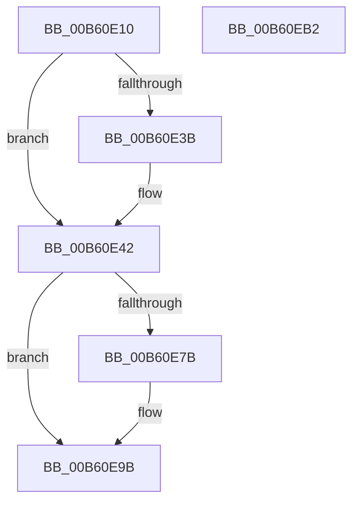

# HalpBlkStartBlockedProcessor

- RVA: `0x00B60E10`–`0x00B60EB3` (길이 `163` bytes)
- VA: `0x0000000140B60E10`
- 실행 섹션: `PAGELK`
- PDB 이름 있음: `예`; PDB Function 태그: `아니요`
- unwind 정보 RVA: `0x000C4F58`
- 디코드: `38`개 명령, `163/163` bytes 표시
- 미해석 바이트: `0` (있으면 어셈블리에 `.byte`로 보존)

> 이 문서는 커널 이미지의 기계어와 PDB 기호를 분석해 생성했습니다. 4번과 5번은 함수 원형과 자료형을 바이너리 사용 방식에서 추정한 C 해석이며 원본 소스 복구 결과는 아닙니다.

## 1. Dependencies

- 직접 호출 지점: **4**; 고유 호출 대상: **4**
- 직접 호출자로 확인된 함수: **1**
- RIP 상대 이미지 참조: **4**

### Outgoing calls
- `0x00B60E2E` → [memset](../../text/6C/memset_function_006C6C40.md) (function, `0x006C6C40`)
- `0x00B60E5C` → [HalpBlkInitializeProcessorState](HalpBlkInitializeProcessorState_function_00B60C10.md) (function, `0x00B60C10`)
- `0x00B60E71` → [HalpInterruptStartProcessor](../B5/HalpInterruptStartProcessor_function_00B5BEF0.md) (function, `0x00B5BEF0`)
- `0x00B60E95` → [KeBugCheckEx](../../text/4F/KeBugCheckEx_function_004FD660.md) (function, `0x004FD660`)

### Direct callers
- [HalpInterruptStartBlockedProcessors](../../text/55/HalpInterruptStartBlockedProcessors_function_00558914.md) at `0x0055895B`

### Static image references
- `0x00B60E33` → RVA `0x00F9069C` (`.data`; read)
- `0x00B60E3B` → RVA `0x00F8FA90` (`.data`; read/write)
- `0x00B60E42` → RVA `0x00F8FA90` (`.data`; read)
- `0x00B60E4D` → RVA `0x00F90550` (`.data`; read)

## 2. Other-region calls and transfers

- 다른 실행 섹션으로 향하는 call: **2**
  - `0x00B60E2E` → [memset](../../text/6C/memset_function_006C6C40.md) (`PAGELK` → `.text`)
  - `0x00B60E95` → [KeBugCheckEx](../../text/4F/KeBugCheckEx_function_004FD660.md) (`PAGELK` → `.text`)
- 별도 외부 분기/꼬리 이동을 확인하지 못했습니다.

## 3. Assembly (complete function range)

```asm
00B60E10  48 89 5C 24 08                  mov qword ptr [rsp + 8], rbx
00B60E15  57                              push rdi
00B60E16  48 81 EC F0 05 00 00            sub rsp, 0x5f0
00B60E1D  8B FA                           mov edi, edx
00B60E1F  8B D9                           mov ebx, ecx
00B60E21  33 D2                           xor edx, edx
00B60E23  48 8D 4C 24 30                  lea rcx, [rsp + 0x30]
00B60E28  41 B8 C0 05 00 00               mov r8d, 0x5c0
00B60E2E  E8 0D 5E B6 FF                  call 0x1406c6c40
00B60E33  3B 1D 63 F8 42 00               cmp ebx, dword ptr [rip + 0x42f863]
00B60E39  75 07                           jne 0x140b60e42
00B60E3B  83 25 4E EC 42 00 00            and dword ptr [rip + 0x42ec4e], 0
00B60E42  8B 05 48 EC 42 00               mov eax, dword ptr [rip + 0x42ec48]
00B60E48  48 8D 4C 24 30                  lea rcx, [rsp + 0x30]
00B60E4D  48 8B 15 FC F6 42 00            mov rdx, qword ptr [rip + 0x42f6fc]
00B60E54  89 7C 24 20                     mov dword ptr [rsp + 0x20], edi
00B60E58  48 8B 14 C2                     mov rdx, qword ptr [rdx + rax*8]
00B60E5C  E8 AF FD FF FF                  call 0x140b60c10
00B60E61  4C 8D 4C 24 30                  lea r9, [rsp + 0x30]
00B60E66  41 B8 04 00 00 00               mov r8d, 4
00B60E6C  8B D7                           mov edx, edi
00B60E6E  83 C9 FF                        or ecx, 0xffffffff
00B60E71  E8 7A B0 FF FF                  call 0x140b5bef0
00B60E76  83 F8 04                        cmp eax, 4
00B60E79  74 20                           je 0x140b60e9b
00B60E7B  44 8B 05 0E EC 42 00            mov r8d, dword ptr [rip + 0x42ec0e]
00B60E82  4C 8B CF                        mov r9, rdi
00B60E85  48 83 64 24 20 00               and qword ptr [rsp + 0x20], 0
00B60E8B  BA 02 00 00 00                  mov edx, 2
00B60E90  B9 DA 01 00 00                  mov ecx, 0x1da
00B60E95  E8 C6 C7 99 FF                  call 0x1404fd660
00B60E9A  CC                              int3
00B60E9B  FF 05 EF EB 42 00               inc dword ptr [rip + 0x42ebef]
00B60EA1  48 8B 9C 24 00 06 00 00         mov rbx, qword ptr [rsp + 0x600]
00B60EA9  48 81 C4 F0 05 00 00            add rsp, 0x5f0
00B60EB0  5F                              pop rdi
00B60EB1  C3                              ret
00B60EB2  CC                              int3
```

## 4. C-style interpretation (structured pseudocode)

```c
__int64 __fastcall HalpBlkStartBlockedProcessor(int a1, int a2)
{
    __int64 result;
    __int64 v_rsp;
    unsigned __int64 v_stack_m5C8;
    unsigned int v_stack_m5D8;
    unsigned __int64 v_stack_p8;

    v_stack_p8 = v_rbx;
    v_rsp = (v_rsp) - (0x5F0ULL);
    a2 = 0;
    result = memset(v_stack_m5C8, a2, (unsigned int)(0x5C0ULL), a4);
    if (((unsigned int)((unsigned int)(a1))) == (*(unsigned int *)(v_rip + 4388963))) {
    }
    v_stack_m5D8 = (unsigned int)((unsigned int)(a2));
    result = HalpBlkInitializeProcessorState(v_stack_m5C8, *(unsigned __int64 *)(*(unsigned __int64 *)(v_rip + 4388604) + (unsigned int)(*(unsigned int *)(v_rip + 4385864)) * 8), (unsigned int)(0x5C0ULL), a4);
    a1 = (unsigned int)((v_stack_m5C8) | (0xFFFFFFFFULL));
    result = HalpInterruptStartProcessor(a1, (unsigned int)((unsigned int)((unsigned int)(a2))), 4, v_stack_m5C8);
    if (((unsigned int)(result)) != 4) {
        a3 = *(unsigned int *)(v_rip + 4385806);
        a4 = (unsigned int)(a2);
        a2 = 2;
        a1 = 474;
        result = KeBugCheckEx(a1, a2, a3, a4);
    }
    v_rsp = (v_rsp) + (0x5F0ULL);
    return result;
}
```

## 5. (Beta) C Style

```c
int64_t HalpBlkStartBlockedProcessor(int32_t Arg1, int32_t Arg2)
{
    int64_t result;
    int64_t local_rsp;
    uint64_t v_stack_m5C8;
    uint32_t v_stack_m5D8;
    uint64_t v_stack_p8;

    v_stack_p8 = local_rbx;
    local_rsp = (local_rsp) - (0x5F0ULL);
    Arg2 = 0;
    result = memset(v_stack_m5C8, Arg2, (uint32_t)(0x5C0ULL), a4);
    if (((uint32_t)((uint32_t)(Arg1))) == (*(uint32_t *)(v_rip + 0x42F863))) {
    }
    v_stack_m5D8 = (uint32_t)((uint32_t)(Arg2));
    result = HalpBlkInitializeProcessorState(v_stack_m5C8, *(uint64_t *)(*(uint64_t *)(v_rip + 0x42F6FC) + (uint32_t)(*(uint32_t *)(v_rip + 0x42EC48)) * 8), (uint32_t)(0x5C0ULL), a4);
    Arg1 = (uint32_t)((v_stack_m5C8) | (0xFFFFFFFFULL));
    result = HalpInterruptStartProcessor(Arg1, (uint32_t)((uint32_t)((uint32_t)(Arg2))), 4, v_stack_m5C8);
    if (((uint32_t)(result)) != 4) {
        a3 = *(uint32_t *)(v_rip + 0x42EC0E);
        a4 = (uint32_t)(Arg2);
        Arg2 = 2;
        Arg1 = 474;
        result = KeBugCheckEx(Arg1, Arg2, a3, a4);
    }
    local_rsp = (local_rsp) + (0x5F0ULL);
    return result;
}
```

## 6. Execution-region graph

[열기: 2D/3D 그래프와 함수 탐색 컨트롤 패널](../../../control-panel.html?section=pagelk&rva=0x00B60E10&view=graph)

- 2D 그래프는 위에서 아래로 흐르고, 3D 그래프는 빈 공간을 드래그해 회전합니다. Shift+드래그는 이동, 휠은 확대·축소, 함수 노드 선택은 대상 보고서 이동입니다.

### Static fallback


