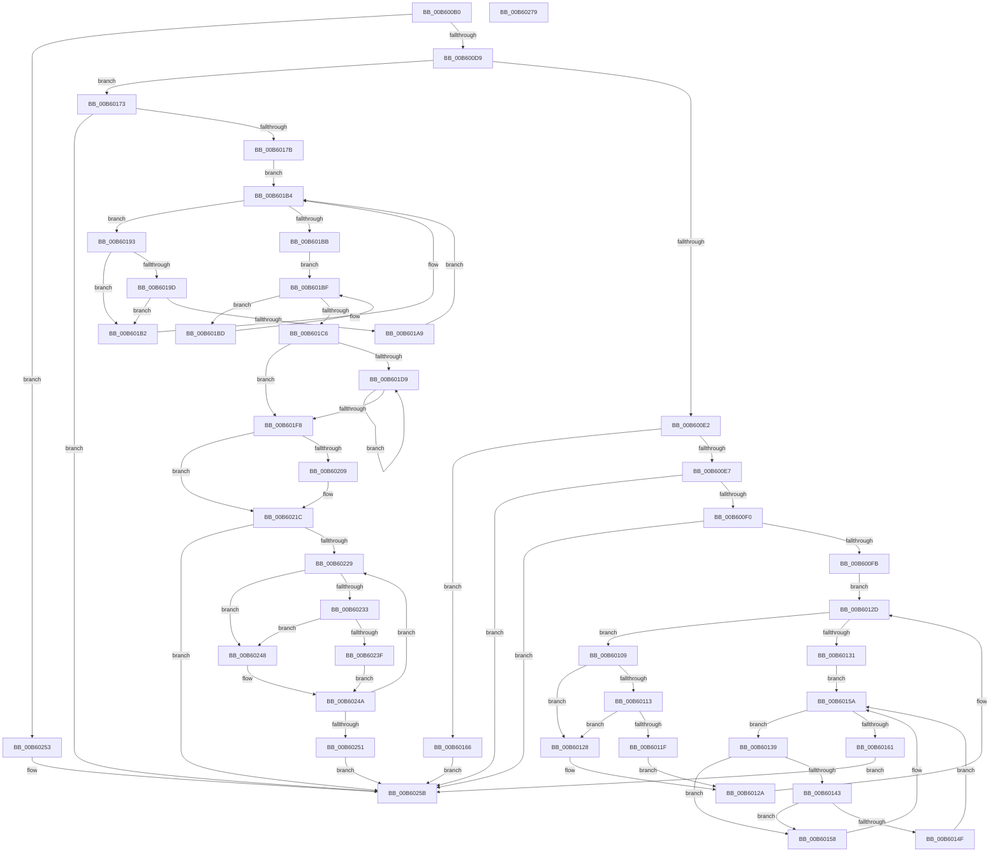

# HalpDpReplaceControl

- RVA: `0x00B600B0`–`0x00B6027A` (길이 `458` bytes)
- VA: `0x0000000140B600B0`
- 실행 섹션: `PAGELK`
- PDB 이름 있음: `예`; PDB Function 태그: `아니요`
- unwind 정보 RVA: `0x0005E6B4`
- 디코드: `143`개 명령, `458/458` bytes 표시
- 미해석 바이트: `0` (있으면 어셈블리에 `.byte`로 보존)

> 이 문서는 커널 이미지의 기계어와 PDB 기호를 분석해 생성했습니다. 4번과 5번은 함수 원형과 자료형을 바이너리 사용 방식에서 추정한 C 해석이며 원본 소스 복구 결과는 아닙니다.

## 1. Dependencies

- 직접 호출 지점: **11**; 고유 호출 대상: **6**
- 직접 호출자로 확인된 함수: **0**
- RIP 상대 이미지 참조: **2**

### Outgoing calls
- `0x00B60121` → [guard_dispatch_icall](../../text/6B/guard_dispatch_icall_function_006BAAD0.md) (function, `0x006BAAD0`)
- `0x00B60151` → [guard_dispatch_icall](../../text/6B/guard_dispatch_icall_function_006BAAD0.md) (function, `0x006BAAD0`)
- `0x00B60169` → [HalpDpPostReplace](../B5/HalpDpPostReplace_function_00B5FCD0.md) (function, `0x00B5FCD0`)
- `0x00B6017F` → [KeQueryPerformanceCounter](../../text/37/KeQueryPerformanceCounter_function_0037E7E0.md) (function, `0x0037E7E0`)
- `0x00B601AB` → [guard_dispatch_icall](../../text/6B/guard_dispatch_icall_function_006BAAD0.md) (function, `0x006BAAD0`)
- `0x00B601C8` → [KeQueryPerformanceCounter](../../text/37/KeQueryPerformanceCounter_function_0037E7E0.md) (function, `0x0037E7E0`)
- `0x00B601EB` → [HalpDpStartProcessor](HalpDpStartProcessor_function_00B60384.md) (function, `0x00B60384`)
- `0x00B601FA` → [KeQueryPerformanceCounter](../../text/37/KeQueryPerformanceCounter_function_0037E7E0.md) (function, `0x0037E7E0`)
- `0x00B60214` → [HalpInterruptSwapProcessorIdentifiers](HalpInterruptSwapProcessorIdentifiers_function_00B60510.md) (function, `0x00B60510`)
- `0x00B60241` → [guard_dispatch_icall](../../text/6B/guard_dispatch_icall_function_006BAAD0.md) (function, `0x006BAAD0`)
- `0x00B60256` → [HalpDpPreReplace](../B5/HalpDpPreReplace_function_00B5FF8C.md) (function, `0x00B5FF8C`)

### Direct callers
- 이 함수 시작 RVA로 연결되는 직접 call은 확인되지 않았습니다. 간접 호출은 완전히 역산할 수 없습니다.

### Static image references
- `0x00B6010B` → RVA `0x00FC1C7C` (`.data`; reference)
- `0x00B60113` → RVA `0x00FC1C80` (`.data`; read)

## 2. Other-region calls and transfers

- 다른 실행 섹션으로 향하는 call: **7**
  - `0x00B60121` → [guard_dispatch_icall](../../text/6B/guard_dispatch_icall_function_006BAAD0.md) (`PAGELK` → `.text`)
  - `0x00B60151` → [guard_dispatch_icall](../../text/6B/guard_dispatch_icall_function_006BAAD0.md) (`PAGELK` → `.text`)
  - `0x00B6017F` → [KeQueryPerformanceCounter](../../text/37/KeQueryPerformanceCounter_function_0037E7E0.md) (`PAGELK` → `.text`)
  - `0x00B601AB` → [guard_dispatch_icall](../../text/6B/guard_dispatch_icall_function_006BAAD0.md) (`PAGELK` → `.text`)
  - `0x00B601C8` → [KeQueryPerformanceCounter](../../text/37/KeQueryPerformanceCounter_function_0037E7E0.md) (`PAGELK` → `.text`)
  - `0x00B601FA` → [KeQueryPerformanceCounter](../../text/37/KeQueryPerformanceCounter_function_0037E7E0.md) (`PAGELK` → `.text`)
  - `0x00B60241` → [guard_dispatch_icall](../../text/6B/guard_dispatch_icall_function_006BAAD0.md) (`PAGELK` → `.text`)
- 별도 외부 분기/꼬리 이동을 확인하지 못했습니다.

## 3. Assembly (complete function range)

```asm
00B600B0  48 8B C4                        mov rax, rsp
00B600B3  48 89 58 08                     mov qword ptr [rax + 8], rbx
00B600B7  48 89 68 10                     mov qword ptr [rax + 0x10], rbp
00B600BB  48 89 70 18                     mov qword ptr [rax + 0x18], rsi
00B600BF  48 89 78 20                     mov qword ptr [rax + 0x20], rdi
00B600C3  41 56                           push r14
00B600C5  48 83 EC 20                     sub rsp, 0x20
00B600C9  8B 3A                           mov edi, dword ptr [rdx]
00B600CB  45 33 F6                        xor r14d, r14d
00B600CE  48 8B DA                        mov rbx, rdx
00B600D1  85 C9                           test ecx, ecx
00B600D3  0F 84 7A 01 00 00               je 0x140b60253
00B600D9  83 E9 01                        sub ecx, 1
00B600DC  0F 84 91 00 00 00               je 0x140b60173
00B600E2  83 E9 01                        sub ecx, 1
00B600E5  74 7F                           je 0x140b60166
00B600E7  83 F9 01                        cmp ecx, 1
00B600EA  0F 85 6B 01 00 00               jne 0x140b6025b
00B600F0  88 4A 44                        mov byte ptr [rdx + 0x44], cl
00B600F3  85 FF                           test edi, edi
00B600F5  0F 84 60 01 00 00               je 0x140b6025b
00B600FB  33 F6                           xor esi, esi
00B600FD  F0 FF 42 30                     lock inc dword ptr [rdx + 0x30]
00B60101  8B 42 30                        mov eax, dword ptr [rdx + 0x30]
00B60104  8D 6F 01                        lea ebp, [rdi + 1]
00B60107  EB 24                           jmp 0x140b6012d
00B60109  FF C6                           inc esi
00B6010B  85 35 6B 1B 46 00               test dword ptr [rip + 0x461b6b], esi
00B60111  75 15                           jne 0x140b60128
00B60113  48 8B 05 66 1B 46 00            mov rax, qword ptr [rip + 0x461b66]
00B6011A  48 85 C0                        test rax, rax
00B6011D  74 09                           je 0x140b60128
00B6011F  8B CE                           mov ecx, esi
00B60121  E8 AA A9 B5 FF                  call 0x1406baad0
00B60126  EB 02                           jmp 0x140b6012a
00B60128  F3 90                           pause
00B6012A  8B 43 30                        mov eax, dword ptr [rbx + 0x30]
00B6012D  3B C5                           cmp eax, ebp
00B6012F  7C D8                           jl 0x140b60109
00B60131  33 FF                           xor edi, edi
00B60133  F0 FF 43 34                     lock inc dword ptr [rbx + 0x34]
00B60137  EB 21                           jmp 0x140b6015a
00B60139  FF C7                           inc edi
00B6013B  85 3D 3B 1B 46 00               test dword ptr [rip + 0x461b3b], edi
00B60141  75 15                           jne 0x140b60158
00B60143  48 8B 05 36 1B 46 00            mov rax, qword ptr [rip + 0x461b36]
00B6014A  48 85 C0                        test rax, rax
00B6014D  74 09                           je 0x140b60158
00B6014F  8B CF                           mov ecx, edi
00B60151  E8 7A A9 B5 FF                  call 0x1406baad0
00B60156  EB 02                           jmp 0x140b6015a
00B60158  F3 90                           pause
00B6015A  8B 43 34                        mov eax, dword ptr [rbx + 0x34]
00B6015D  3B C5                           cmp eax, ebp
00B6015F  7C D8                           jl 0x140b60139
00B60161  E9 F5 00 00 00                  jmp 0x140b6025b
00B60166  48 8B CB                        mov rcx, rbx
00B60169  E8 62 FB FF FF                  call 0x140b5fcd0
00B6016E  E9 E8 00 00 00                  jmp 0x140b6025b
00B60173  85 FF                           test edi, edi
00B60175  0F 84 E0 00 00 00               je 0x140b6025b
00B6017B  48 8D 4A 48                     lea rcx, [rdx + 0x48]
00B6017F  E8 5C E6 81 FF                  call 0x14037e7e0
00B60184  48 89 43 50                     mov qword ptr [rbx + 0x50], rax
00B60188  33 F6                           xor esi, esi
00B6018A  F0 FF 43 30                     lock inc dword ptr [rbx + 0x30]
00B6018E  8D 6F 01                        lea ebp, [rdi + 1]
00B60191  EB 21                           jmp 0x140b601b4
00B60193  FF C6                           inc esi
00B60195  85 35 E1 1A 46 00               test dword ptr [rip + 0x461ae1], esi
00B6019B  75 15                           jne 0x140b601b2
00B6019D  48 8B 05 DC 1A 46 00            mov rax, qword ptr [rip + 0x461adc]
00B601A4  48 85 C0                        test rax, rax
00B601A7  74 09                           je 0x140b601b2
00B601A9  8B CE                           mov ecx, esi
00B601AB  E8 20 A9 B5 FF                  call 0x1406baad0
00B601B0  EB 02                           jmp 0x140b601b4
00B601B2  F3 90                           pause
00B601B4  8B 43 30                        mov eax, dword ptr [rbx + 0x30]
00B601B7  3B C5                           cmp eax, ebp
00B601B9  7C D8                           jl 0x140b60193
00B601BB  EB 02                           jmp 0x140b601bf
00B601BD  F3 90                           pause
00B601BF  8B 43 38                        mov eax, dword ptr [rbx + 0x38]
00B601C2  3B C7                           cmp eax, edi
00B601C4  7C F7                           jl 0x140b601bd
00B601C6  33 C9                           xor ecx, ecx
00B601C8  E8 13 E6 81 FF                  call 0x14037e7e0
00B601CD  8B 13                           mov edx, dword ptr [rbx]
00B601CF  33 FF                           xor edi, edi
00B601D1  48 89 43 60                     mov qword ptr [rbx + 0x60], rax
00B601D5  85 D2                           test edx, edx
00B601D7  74 1F                           je 0x140b601f8
00B601D9  48 8B 4B 18                     mov rcx, qword ptr [rbx + 0x18]
00B601DD  44 8B CA                        mov r9d, edx
00B601E0  4C 8B 43 10                     mov r8, qword ptr [rbx + 0x10]
00B601E4  48 8B 53 08                     mov rdx, qword ptr [rbx + 8]
00B601E8  8B 0C B9                        mov ecx, dword ptr [rcx + rdi*4]
00B601EB  E8 94 01 00 00                  call 0x140b60384
00B601F0  8B 13                           mov edx, dword ptr [rbx]
00B601F2  FF C7                           inc edi
00B601F4  3B FA                           cmp edi, edx
00B601F6  72 E1                           jb 0x140b601d9
00B601F8  33 C9                           xor ecx, ecx
00B601FA  E8 E1 E5 81 FF                  call 0x14037e7e0
00B601FF  48 89 43 70                     mov qword ptr [rbx + 0x70], rax
00B60203  44 38 73 2C                     cmp byte ptr [rbx + 0x2c], r14b
00B60207  75 13                           jne 0x140b6021c
00B60209  44 8B 03                        mov r8d, dword ptr [rbx]
00B6020C  48 8B 53 10                     mov rdx, qword ptr [rbx + 0x10]
00B60210  48 8B 4B 08                     mov rcx, qword ptr [rbx + 8]
00B60214  E8 F7 02 00 00                  call 0x140b60510
00B60219  44 8B F0                        mov r14d, eax
00B6021C  33 FF                           xor edi, edi
00B6021E  F0 FF 43 34                     lock inc dword ptr [rbx + 0x34]
00B60222  8B 4B 34                        mov ecx, dword ptr [rbx + 0x34]
00B60225  3B CD                           cmp ecx, ebp
00B60227  7D 32                           jge 0x140b6025b
00B60229  FF C7                           inc edi
00B6022B  85 3D 4B 1A 46 00               test dword ptr [rip + 0x461a4b], edi
00B60231  75 15                           jne 0x140b60248
00B60233  48 8B 05 46 1A 46 00            mov rax, qword ptr [rip + 0x461a46]
00B6023A  48 85 C0                        test rax, rax
00B6023D  74 09                           je 0x140b60248
00B6023F  8B CF                           mov ecx, edi
00B60241  E8 8A A8 B5 FF                  call 0x1406baad0
00B60246  EB 02                           jmp 0x140b6024a
00B60248  F3 90                           pause
00B6024A  8B 43 34                        mov eax, dword ptr [rbx + 0x34]
00B6024D  3B C5                           cmp eax, ebp
00B6024F  7C D8                           jl 0x140b60229
00B60251  EB 08                           jmp 0x140b6025b
00B60253  48 8B CB                        mov rcx, rbx
00B60256  E8 31 FD FF FF                  call 0x140b5ff8c
00B6025B  48 8B 5C 24 30                  mov rbx, qword ptr [rsp + 0x30]
00B60260  41 8B C6                        mov eax, r14d
00B60263  48 8B 6C 24 38                  mov rbp, qword ptr [rsp + 0x38]
00B60268  48 8B 74 24 40                  mov rsi, qword ptr [rsp + 0x40]
00B6026D  48 8B 7C 24 48                  mov rdi, qword ptr [rsp + 0x48]
00B60272  48 83 C4 20                     add rsp, 0x20
00B60276  41 5E                           pop r14
00B60278  C3                              ret
00B60279  CC                              int3
```

## 4. C-style interpretation (structured pseudocode)

```c
__int64 __fastcall HalpDpReplaceControl(int a1, __int64 a2)
{
    __int64 result;
    __int64 v_r14;
    __int64 v_rdi;
    __int64 v_rsi;
    __int64 v_rsp;
    unsigned __int64 v_stack_p10;
    unsigned __int64 v_stack_p18;
    unsigned __int64 v_stack_p20;
    unsigned __int64 v_stack_p8;

    *(unsigned __int64 *)(v_rsp + 8) = v_rbx;
    *(unsigned __int64 *)(v_rsp + 16) = v_rbp;
    *(unsigned __int64 *)(v_rsp + 24) = v_rsi;
    *(unsigned __int64 *)(v_rsp + 32) = v_rdi;
    v_rsp = (v_rsp) - (32);
    v_r14 = 0;
    if (a1 == 0) goto loc_00B60253;
    a1 = (unsigned int)((a1) - (1));
    if (condition_is_equal) goto loc_00B60173;
    a1 = (unsigned int)((a1) - (1));
    if (condition_is_equal) goto loc_00B60166;
    if (a1 != 1) goto loc_00B6025B;
    *(unsigned __int8 *)(a2 + 68) = (unsigned __int8)(a1);
    if ((unsigned int)((unsigned int)(*(unsigned int *)(a2))) == 0) goto loc_00B6025B;
    v_rsi = 0;
    goto loc_00B6012D;
loc_00B60109:
    v_rsi = (unsigned int)((v_rsi) + 1);
    if (((*(unsigned int *)(v_rip + 4594539)) & ((unsigned int)(v_rsi))) != 0) goto loc_00B60128;
    if (*(unsigned __int64 *)(v_rip + 4594534) == 0) goto loc_00B60128;
    result = guard_dispatch_icall((unsigned int)((unsigned int)(v_rsi)), a2, a3, a4);
    goto loc_00B6012A;
loc_00B60128:
loc_00B6012A:
loc_00B6012D:
    if (((unsigned int)((unsigned int)(*(unsigned int *)(a2 + 48)))) < ((unsigned int)((unsigned int)(*(unsigned int *)(a2)) + 1))) goto loc_00B60109;
    v_rdi = 0;
    goto loc_00B6015A;
loc_00B60139:
    v_rdi = (unsigned int)((v_rdi) + 1);
    if (((*(unsigned int *)(v_rip + 4594491)) & ((unsigned int)(v_rdi))) != 0) goto loc_00B60158;
    if (*(unsigned __int64 *)(v_rip + 4594486) == 0) goto loc_00B60158;
    result = guard_dispatch_icall((unsigned int)((unsigned int)(v_rdi)), a2, a3, a4);
    goto loc_00B6015A;
loc_00B60158:
loc_00B6015A:
    if (((unsigned int)((unsigned int)(*(unsigned int *)(a2 + 52)))) < ((unsigned int)((unsigned int)(*(unsigned int *)(a2)) + 1))) goto loc_00B60139;
    goto loc_00B6025B;
loc_00B60166:
    result = HalpDpPostReplace(a2, a2, a3, a4);
    goto loc_00B6025B;
loc_00B60173:
    if ((unsigned int)(v_rdi) == 0) goto loc_00B6025B;
    result = KeQueryPerformanceCounter(a2 + 72, a2, a3, a4);
    *(unsigned __int64 *)(a2 + 80) = result;
    v_rsi = 0;
    goto loc_00B601B4;
loc_00B60193:
    v_rsi = (unsigned int)((v_rsi) + 1);
    if (((*(unsigned int *)(v_rip + 4594401)) & ((unsigned int)(v_rsi))) != 0) goto loc_00B601B2;
    if (*(unsigned __int64 *)(v_rip + 4594396) == 0) goto loc_00B601B2;
    result = guard_dispatch_icall((unsigned int)((unsigned int)(v_rsi)), a2, a3, a4);
    goto loc_00B601B4;
loc_00B601B2:
loc_00B601B4:
    if (((unsigned int)((unsigned int)(*(unsigned int *)(a2 + 48)))) < ((unsigned int)(v_rdi + 1))) goto loc_00B60193;
    goto loc_00B601BF;
loc_00B601BD:
loc_00B601BF:
    if (((unsigned int)((unsigned int)(*(unsigned int *)(a2 + 56)))) < ((unsigned int)(v_rdi))) goto loc_00B601BD;
    a1 = 0;
    result = KeQueryPerformanceCounter(a1, a2, a3, a4);
    v_rdi = 0;
    *(unsigned __int64 *)(a2 + 96) = result;
    if ((unsigned int)((unsigned int)(*(unsigned int *)(a2))) == 0) goto loc_00B601F8;
loc_00B601D9:
    result = HalpDpStartProcessor((unsigned int)(*(unsigned int *)(*(unsigned __int64 *)(a2 + 24) + v_rdi * 4)), *(unsigned __int64 *)(a2 + 8), *(unsigned __int64 *)(a2 + 16), (unsigned int)((unsigned int)((unsigned int)(*(unsigned int *)(a2)))));
    v_rdi = (unsigned int)((v_rdi) + 1);
    if (((unsigned int)(v_rdi)) < ((unsigned int)((unsigned int)(*(unsigned int *)(a2))))) goto loc_00B601D9;
loc_00B601F8:
    a1 = 0;
    result = KeQueryPerformanceCounter(a1, (unsigned int)(*(unsigned int *)(a2)), *(unsigned __int64 *)(a2 + 16), (unsigned int)((unsigned int)((unsigned int)(*(unsigned int *)(a2)))));
    *(unsigned __int64 *)(a2 + 112) = result;
    if ((*(unsigned __int8 *)(a2 + 44)) == 0) {
        a3 = *(unsigned int *)(a2);
        a2 = *(unsigned __int64 *)(a2 + 16);
        a1 = *(unsigned __int64 *)(a2 + 8);
        result = HalpInterruptSwapProcessorIdentifiers(a1, a2, a3, (unsigned int)((unsigned int)((unsigned int)(*(unsigned int *)(a2)))));
        v_r14 = (unsigned int)(result);
    }
    v_rdi = 0;
    if (((unsigned int)((unsigned int)(*(unsigned int *)(a2 + 52)))) >= ((unsigned int)(v_rdi + 1))) goto loc_00B6025B;
loc_00B60229:
    v_rdi = (unsigned int)((v_rdi) + 1);
    if (((*(unsigned int *)(v_rip + 4594251)) & ((unsigned int)(v_rdi))) != 0) goto loc_00B60248;
    if (*(unsigned __int64 *)(v_rip + 4594246) == 0) goto loc_00B60248;
    result = guard_dispatch_icall((unsigned int)((unsigned int)(v_rdi)), a2, a3, (unsigned int)((unsigned int)((unsigned int)(*(unsigned int *)(a2)))));
    goto loc_00B6024A;
loc_00B60248:
loc_00B6024A:
    if (((unsigned int)((unsigned int)(*(unsigned int *)(a2 + 52)))) < ((unsigned int)(v_rdi + 1))) goto loc_00B60229;
    goto loc_00B6025B;
loc_00B60253:
    result = HalpDpPreReplace(a2, a2, a3, (unsigned int)((unsigned int)((unsigned int)(*(unsigned int *)(a2)))));
loc_00B6025B:
    v_rsp = (v_rsp) + (32);
    return (unsigned int)((unsigned int)(v_r14));
}
```

## 5. (Beta) C Style

```c
int64_t HalpDpReplaceControl(int32_t Arg1, void *Arg2)
{
    uint8_t *arg2 = (uint8_t *)Arg2;

    int64_t result;
    int64_t local_r14;
    int64_t local_rdi;
    int64_t local_rsi;
    int64_t local_rsp;
    uint64_t v_stack_p10;
    uint64_t v_stack_p18;
    uint64_t v_stack_p20;
    uint64_t v_stack_p8;

    *(uint64_t *)(local_rsp + 0x8) = local_rbx;
    *(uint64_t *)(local_rsp + 0x10) = local_rbp;
    *(uint64_t *)(local_rsp + 0x18) = local_rsi;
    *(uint64_t *)(local_rsp + 0x20) = local_rdi;
    local_rsp = (local_rsp) - (32);
    local_r14 = 0;
    if (Arg1 == 0) goto loc_00B60253;
    Arg1 = (uint32_t)((Arg1) - (1));
    if (condition_is_equal) goto loc_00B60173;
    Arg1 = (uint32_t)((Arg1) - (1));
    if (condition_is_equal) goto loc_00B60166;
    if (Arg1 != 1) goto loc_00B6025B;
    *(uint8_t *)(arg2 + 0x44) = (uint8_t)(Arg1);
    if ((uint32_t)((uint32_t)(*(uint32_t *)(arg2))) == 0) goto loc_00B6025B;
    local_rsi = 0;
    goto loc_00B6012D;
loc_00B60109:
    local_rsi = (uint32_t)((local_rsi) + 1);
    if (((*(uint32_t *)(v_rip + 0x461B6B)) & ((uint32_t)(local_rsi))) != 0) goto loc_00B60128;
    if (*(uint64_t *)(v_rip + 0x461B66) == 0) goto loc_00B60128;
    result = guard_dispatch_icall((uint32_t)((uint32_t)(local_rsi)), Arg2, a3, a4);
    goto loc_00B6012A;
loc_00B60128:
loc_00B6012A:
loc_00B6012D:
    if (((uint32_t)((uint32_t)(*(uint32_t *)(arg2 + 0x30)))) < ((uint32_t)((uint32_t)(*(uint32_t *)(arg2)) + 1))) goto loc_00B60109;
    local_rdi = 0;
    goto loc_00B6015A;
loc_00B60139:
    local_rdi = (uint32_t)((local_rdi) + 1);
    if (((*(uint32_t *)(v_rip + 0x461B3B)) & ((uint32_t)(local_rdi))) != 0) goto loc_00B60158;
    if (*(uint64_t *)(v_rip + 0x461B36) == 0) goto loc_00B60158;
    result = guard_dispatch_icall((uint32_t)((uint32_t)(local_rdi)), Arg2, a3, a4);
    goto loc_00B6015A;
loc_00B60158:
loc_00B6015A:
    if (((uint32_t)((uint32_t)(*(uint32_t *)(arg2 + 0x34)))) < ((uint32_t)((uint32_t)(*(uint32_t *)(arg2)) + 1))) goto loc_00B60139;
    goto loc_00B6025B;
loc_00B60166:
    result = HalpDpPostReplace(Arg2, Arg2, a3, a4);
    goto loc_00B6025B;
loc_00B60173:
    if ((uint32_t)(local_rdi) == 0) goto loc_00B6025B;
    result = KeQueryPerformanceCounter(Arg2 + 72, Arg2, a3, a4);
    *(uint64_t *)(arg2 + 0x50) = result;
    local_rsi = 0;
    goto loc_00B601B4;
loc_00B60193:
    local_rsi = (uint32_t)((local_rsi) + 1);
    if (((*(uint32_t *)(v_rip + 0x461AE1)) & ((uint32_t)(local_rsi))) != 0) goto loc_00B601B2;
    if (*(uint64_t *)(v_rip + 0x461ADC) == 0) goto loc_00B601B2;
    result = guard_dispatch_icall((uint32_t)((uint32_t)(local_rsi)), Arg2, a3, a4);
    goto loc_00B601B4;
loc_00B601B2:
loc_00B601B4:
    if (((uint32_t)((uint32_t)(*(uint32_t *)(arg2 + 0x30)))) < ((uint32_t)(local_rdi + 1))) goto loc_00B60193;
    goto loc_00B601BF;
loc_00B601BD:
loc_00B601BF:
    if (((uint32_t)((uint32_t)(*(uint32_t *)(arg2 + 0x38)))) < ((uint32_t)(local_rdi))) goto loc_00B601BD;
    Arg1 = 0;
    result = KeQueryPerformanceCounter(Arg1, Arg2, a3, a4);
    local_rdi = 0;
    *(uint64_t *)(arg2 + 0x60) = result;
    if ((uint32_t)((uint32_t)(*(uint32_t *)(arg2))) == 0) goto loc_00B601F8;
loc_00B601D9:
    result = HalpDpStartProcessor((uint32_t)(*(uint32_t *)(*(uint64_t *)(arg2 + 0x18) + local_rdi * 4)), *(uint64_t *)(arg2 + 0x8), *(uint64_t *)(arg2 + 0x10), (uint32_t)((uint32_t)((uint32_t)(*(uint32_t *)(arg2)))));
    local_rdi = (uint32_t)((local_rdi) + 1);
    if (((uint32_t)(local_rdi)) < ((uint32_t)((uint32_t)(*(uint32_t *)(arg2))))) goto loc_00B601D9;
loc_00B601F8:
    Arg1 = 0;
    result = KeQueryPerformanceCounter(Arg1, (uint32_t)(*(uint32_t *)(arg2)), *(uint64_t *)(arg2 + 0x10), (uint32_t)((uint32_t)((uint32_t)(*(uint32_t *)(arg2)))));
    *(uint64_t *)(arg2 + 0x70) = result;
    if ((*(uint8_t *)(arg2 + 0x2C)) == 0) {
        a3 = *(uint32_t *)(arg2);
        Arg2 = *(uint64_t *)(arg2 + 0x10);
        Arg1 = *(uint64_t *)(arg2 + 0x8);
        result = HalpInterruptSwapProcessorIdentifiers(Arg1, Arg2, a3, (uint32_t)((uint32_t)((uint32_t)(*(uint32_t *)(arg2)))));
        local_r14 = (uint32_t)(result);
    }
    local_rdi = 0;
    if (((uint32_t)((uint32_t)(*(uint32_t *)(arg2 + 0x34)))) >= ((uint32_t)(local_rdi + 1))) goto loc_00B6025B;
loc_00B60229:
    local_rdi = (uint32_t)((local_rdi) + 1);
    if (((*(uint32_t *)(v_rip + 0x461A4B)) & ((uint32_t)(local_rdi))) != 0) goto loc_00B60248;
    if (*(uint64_t *)(v_rip + 0x461A46) == 0) goto loc_00B60248;
    result = guard_dispatch_icall((uint32_t)((uint32_t)(local_rdi)), Arg2, a3, (uint32_t)((uint32_t)((uint32_t)(*(uint32_t *)(arg2)))));
    goto loc_00B6024A;
loc_00B60248:
loc_00B6024A:
    if (((uint32_t)((uint32_t)(*(uint32_t *)(arg2 + 0x34)))) < ((uint32_t)(local_rdi + 1))) goto loc_00B60229;
    goto loc_00B6025B;
loc_00B60253:
    result = HalpDpPreReplace(Arg2, Arg2, a3, (uint32_t)((uint32_t)((uint32_t)(*(uint32_t *)(arg2)))));
loc_00B6025B:
    local_rsp = (local_rsp) + (32);
    return (uint32_t)((uint32_t)(local_r14));
}
```

### 관측된 메모리 오프셋

구조체 형식이 확인되지 않은 접근은 인자 기준의 오프셋으로만 기록했습니다.

| 기준 인자 | 오프셋 표현 | 폭 (bit) | 접근 |
|---|---:|---:|---|
| `Arg2` | `+ 0x0` | `32` | `R` |
| `Arg2` | `+ 0x8` | `64` | `R` |
| `Arg2` | `+ 0x10` | `64` | `R` |
| `Arg2` | `+ 0x18` | `64` | `R` |
| `Arg2` | `+ 0x2C` | `8` | `R` |
| `Arg2` | `+ 0x30` | `32` | `R` |
| `Arg2` | `+ 0x30` | `32` | `R/W` |
| `Arg2` | `+ 0x34` | `32` | `R` |
| `Arg2` | `+ 0x34` | `32` | `R/W` |
| `Arg2` | `+ 0x38` | `32` | `R` |
| `Arg2` | `+ 0x44` | `8` | `W` |
| `Arg2` | `+ 0x48` | `64` | `R` |
| `Arg2` | `+ 0x50` | `64` | `W` |
| `Arg2` | `+ 0x60` | `64` | `W` |
| `Arg2` | `+ 0x70` | `64` | `W` |

## 6. Execution-region graph

[열기: 2D/3D 그래프와 함수 탐색 컨트롤 패널](../../../control-panel.html?section=pagelk&rva=0x00B600B0&view=graph)

- 2D 그래프는 위에서 아래로 흐르고, 3D 그래프는 빈 공간을 드래그해 회전합니다. Shift+드래그는 이동, 휠은 확대·축소, 함수 노드 선택은 대상 보고서 이동입니다.

### Static fallback


